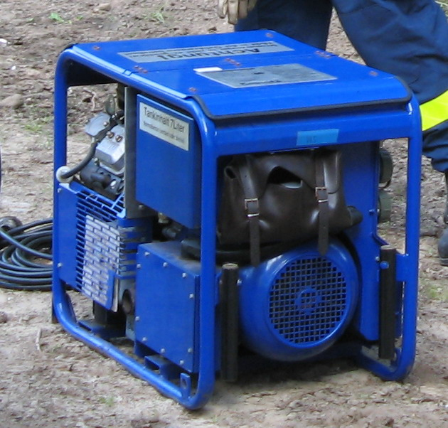

# 25.05 — Dlaczego nie zasila się domu przez gniazdo

> **Moduł:** [25 — Transformatory, zasilacze, UPS i agregaty](README.md) · **Oznaczenia:** 🏠📋 · **Zakres SEP:** (a) (c) (e) · **Status:** ✅ pełny
>
> **Czytaj:**
>
> - [TAURON Dystrybucja — Agregaty prądotwórcze w domu jednorodzinnym (PDF)](https://www.tauron-dystrybucja.pl/-/media/offer-documents/dystrybucja/inne-dokumenty/td-agregaty-pradotworcze-dom-jednorodzinny.ashx)
> - Przełącznik zasilania: [25.04](25.04-agregat-pradotworczy-i-przelacznik-zasilania.md)

[← poprzedni temat](25.04-agregat-pradotworczy-i-przelacznik-zasilania.md) · [spis modułu](README.md) · (koniec modułu) →

## Po co to jest

W internecie co zimę wraca „patent”: przewód z **dwiema wtyczkami** — jedną do agregatu, drugą do dowolnego gniazdka w domu — i cały dom ma prąd. Ten temat wyjaśnia, dlaczego to jedno z najgroźniejszych rozwiązań w domowej elektryce, groźne **dla kogoś, kogo nawet nie widzisz**.

## Po ludzku

**1. Bolce wtyczki są pod napięciem.** Gdy jedna wtyczka jest w agregacie, a drugiej jeszcze nie wpiąłeś (albo wypadła z gniazda), trzymasz w ręce **odsłonięte metalowe bolce z 230 V**. Normalnie wtyczka nigdy nie jest źródłem — dlatego bolce nie mają osłon.

**2. Prąd idzie do sieci.** Gniazdko jest połączone z rozdzielnicą, ta z licznikiem, przyłączem i linią. Jeśli nie odłączyłeś domu od sieci, agregat zasila **całą ulicę** — próbuje, przeciąża się, ale napięcie na linii się pojawia.

**3. Transformator działa w obie strony.** Stacja obniża 15 kV do 400 V. Napięcie wepchnięte od strony 400 V transformator **podnosi** do ok. 15 kV. Monter, który wyłączył linię, sprawdził brak napięcia i założył uziemiacze, może zostać porażony, jeśli napięcie pojawi się po zdjęciu uziemień albo w miejscu bez nich. Dlatego energetycy traktują każdy agregat jak potencjalnego zabójcę.

**4. Powrót sieci.** Gdy napięcie wróci, sieć i agregat spotkają się w twojej instalacji — z przypadkowym przesunięciem faz. Efekt: zniszczony agregat, przepalone przewody, pożar.

**5. Gniazdo i przewód nie są na to przewidziane.** Obwód gniazdowy ma 2,5 mm² i B16 — przy mocnym agregacie przewód zasilający cały dom przez jedno gniazdo się przegrzewa. Jeśli w ogóle wyłącznik zadziała, to dopiero przy przeciążeniu, a nie przy groźnej sytuacji.

**6. Ochrona przeciwporażeniowa przestaje działać.** RCD i wyłączniki w domu dobrano do zasilania z sieci w układzie TN. Agregat przez gniazdo daje układ, w którym przy uszkodzeniu wyłączenie może nie nastąpić.

**Jedyne poprawne rozwiązania:**

- **przełącznik I-0-II** za licznikiem i gniazdo do agregatu ([25.04](25.04-agregat-pradotworczy-i-przelacznik-zasilania.md)),
- albo zasilanie **pojedynczych odbiorników bezpośrednio z gniazd agregatu** przedłużaczem (np. lodówka), bez łączenia z instalacją domu.

**A „balkonowa fotowoltaika” do gniazdka?** Mikroinwerter ma wbudowaną ochronę anti-islanding — przy zaniku sieci przestaje oddawać energię w ciągu ułamka sekundy, więc nie zasila linii jak agregat. Mimo to jest **źródłem przyłączonym do sieci**, a w Polsce co do zasady takie źródło to mikroinstalacja, która wymaga **zgłoszenia do OSD** ([26.03](../26-fotowoltaika-pompy-wallboxy/26.03-falownik-i-przylaczenie-mikroinstalacji.md)). Agregat żadnej takiej ochrony nie ma.

## Jak to wygląda

*Na co patrzeć: gniazda w agregacie są do zasilania odbiorników przedłużaczem — nie do „wstecznego” zasilania instalacji domu przez gniazdko w ścianie.*

## Schemat

## Pojęcia

| Pojęcie | Po ludzku | Termin normowy / symbol |
|---------|-----------|-------------------------|
| Zasilanie zwrotne | Napięcie wpychane do sieci od strony odbiorcy | backfeed |
| „Kabel samobójca” | Przewód z wtyczkami na obu końcach | — |
| Anti-islanding | Wyłączenie źródła przy zaniku sieci | ochrona przed pracą wyspową |
| Praca wyspowa | Źródło zasila odcięty fragment sieci | — |

## Liczby do zapamiętania

| Wielkość | Wartość | Kiedy obowiązuje | Źródło |
|----------|---------|------------------|--------|
| Przekładnia stacji SN/nn | ok. **15 000 / 400 V** | typowa sieć rozdzielcza | 14.01 |
| Napięcie po stronie SN przy 230 V „wepchniętym” od dołu | **tysiące V** (do ok. 15 kV) | zasilanie zwrotne | prawo transformacji |
| Obwód gniazdowy | **B16, 2,5 mm²** — nie do zasilania domu | typowa instalacja | 16.01 |

## W praktyce

- Masz agregat, a nie masz przełącznika — zasilaj **odbiorniki bezpośrednio z agregatu** przedłużaczami o odpowiednim przekroju.
- Chcesz zasilać piec CO z agregatu — zrób **osobne gniazdo** dla pieca (wtyczka pieca przekładana z gniazda sieciowego do przedłużacza z agregatu) albo zamontuj przełącznik.
- Widzisz u sąsiada „kabel samobójca” — to dobry moment na rozmowę; jest groźny także dla ekip, które przyjadą naprawiać linię.

## Błędy i zagrożenia

- ⚠️ **Przewód z dwiema wtyczkami** — porażenie osoby trzymającej wtyczkę, porażenie monterów sieci, pożar.
- ⚠️ **„Wyłączyłem główny wyłącznik, więc mogę przez gniazdo”** — wystarczy, że ktoś go włączy (albo pomylisz wyłącznik), i zasilanie zwrotne wraca. Brak też pozycji 0 i blokady.
- **Agregat przez gniazdo w układzie trójfazowym** — zasila tylko jedną fazę, część domu „działa dziwnie”, a odbiorniki trójfazowe (np. pompa) pracują na jednej fazie.

## Przykład

**Zadanie.** Sąsiad mówi: „Wyłączam główny w RG, potem wtykam agregat do gniazdka w garażu, więc nic do sieci nie idzie”. Co jest źle?

**Rozwiązanie.** Bezpieczeństwo zależy wyłącznie od pamięci i uwagi jednej osoby — nie ma blokady wykluczającej jednoczesne podłączenie. Wtyczka na końcu przewodu ma odsłonięte bolce pod napięciem przy wpinaniu i wypinaniu. Gniazdo w garażu i jego obwód nie są przewidziane do zasilania całej instalacji (przekrój, zabezpieczenie), a ochrona przeciwporażeniowa nie jest sprawdzona dla takiego zasilania. Poprawnie: przełącznik I-0-II za licznikiem montowany przez elektryka z uprawnieniami.

## Pytania SEP

1. **Dlaczego nie wolno zasilać instalacji domu z agregatu przez gniazdo wtykowe?**

Odpowiedź

Bo wtyczka przewodu podłączonego do agregatu ma odsłonięte styki pod napięciem; nie ma blokady wykluczającej jednoczesne połączenie instalacji z siecią i agregatem, więc energia może popłynąć do sieci, gdzie transformator podniesie napięcie i zagrozi osobom pracującym przy „wyłączonej” linii; po powrocie napięcia sieci nastąpi zwarcie niezsynchronizowanych źródeł i uszkodzenie agregatu lub pożar; obwód gniazdowy nie jest dobrany do zasilania całej instalacji, a ochrona przeciwporażeniowa nie jest zapewniona. Agregat podłącza się przez przełącznik zasilania za licznikiem.

## Sprawdź się

1. Dlaczego mikroinwerter wpięty do gniazdka nie jest tak groźny dla monterów jak agregat, a mimo to nie wolno go podłączać „po cichu”?

Odpowiedź

Mikroinwerter ma ochronę przed pracą wyspową — przy zaniku napięcia sieci w ułamku sekundy przestaje oddawać energię, więc nie zasila wyłączonej linii. Jest jednak źródłem przyłączonym do sieci: wpływa na napięcie, bilans energii i licznik, dlatego co do zasady trzeba go zgłosić do operatora jak mikroinstalację.

## Źródła

- [TAURON Dystrybucja — Agregaty prądotwórcze w domu jednorodzinnym (PDF)](https://www.tauron-dystrybucja.pl/-/media/offer-documents/dystrybucja/inne-dokumenty/td-agregaty-pradotworcze-dom-jednorodzinny.ashx).
- [03.02 — Indukcja i transformator](../03-elektromagnetyzm-w-praktyce/03.02-indukcja-elektromagnetyczna-i-transformator.md).
- [14.01 — Przyłącze napowietrzne i kablowe](../14-od-slupa-do-gniazdka/14.01-przylacze-napowietrzne-i-kablowe.md).

---

[← poprzedni temat](25.04-agregat-pradotworczy-i-przelacznik-zasilania.md) · [spis modułu](README.md) · (koniec modułu) →
