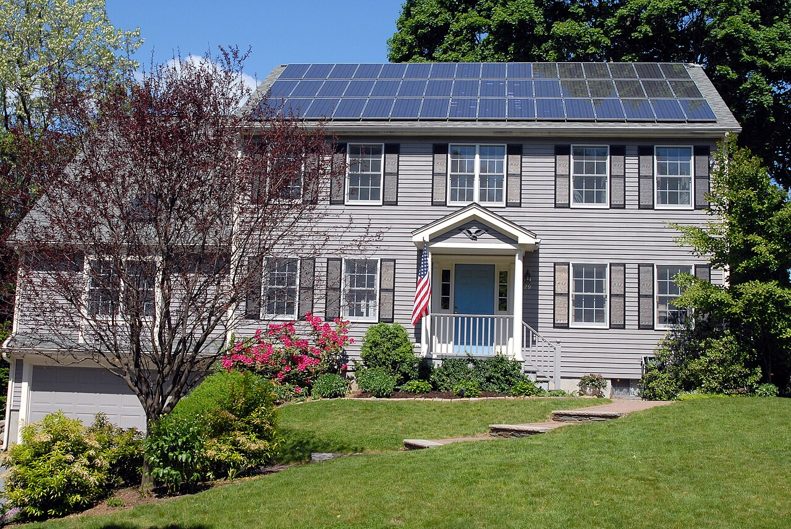
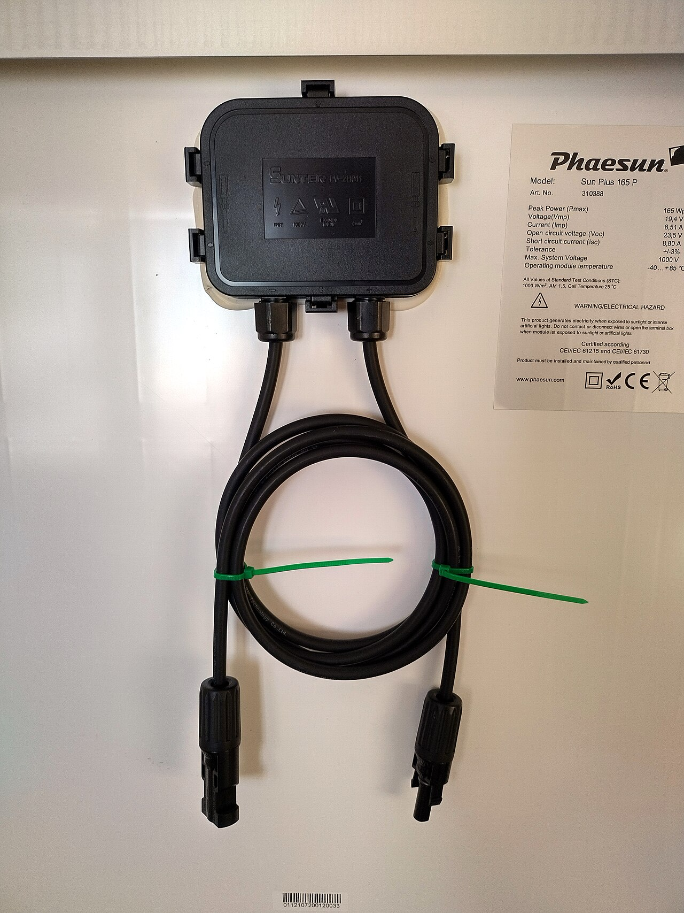
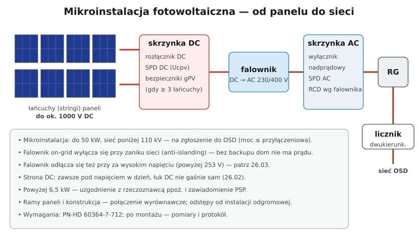

# 26.01 — Fotowoltaika — budowa instalacji

> **Moduł:** [26 — Fotowoltaika, pompy ciepła, wallboxy i magazyny energii](README.md) · **Oznaczenia:** 🏠📋 · **Zakres SEP:** (a) (b) (c) (e) · **Status:** ✅ pełny
>
> **Czytaj:**
>
> - Ustawa z 20 lutego 2015 r. o odnawialnych źródłach energii (definicja mikroinstalacji, art. 2 pkt 19)
> - [KM PSP Katowice — zawiadomienie organu PSP dotyczące instalacji fotowoltaicznej](https://www.gov.pl/web/kmpsp-katowice/zawiadomienie-organu-psp-dotyczacego-instalacji-fotowoltaicznej)

← (początek modułu) · [spis modułu](README.md) · [następny temat →](26.02-strona-dc-zagrozenia-i-zabezpieczenia.md)

## Po co to jest

Fotowoltaika (PV) stoi na co trzecim nowym dachu. Elektryk spotyka ją przy przeglądach, przy rozbudowie rozdzielnicy i przy awariach — a strażak przy pożarze. Ten temat to mapa: z czego składa się instalacja, gdzie jest prąd stały, a gdzie przemienny, i jakie formalności trzeba spełnić. Szczegóły strony DC — w [26.02](26.02-strona-dc-zagrozenia-i-zabezpieczenia.md), falownika i przyłączenia — w [26.03](26.03-falownik-i-przylaczenie-mikroinstalacji.md).

## Po ludzku

**Panel (moduł) PV** to kilkadziesiąt ogniw krzemowych połączonych szeregowo. Światło wytwarza w nich napięcie stałe — ok. **35–50 V** na panel bez obciążenia — i prąd zależny od nasłonecznienia, ok. **10–14 A** w pełnym słońcu. Typowy panel ma dziś **400–500 W**.

**Łańcuch (string)** — panele łączy się **szeregowo**, żeby uzyskać wysokie napięcie (setki woltów, do ok. **1000 V DC**) przy małym prądzie. Dzięki temu przewody mogą być cienkie (4–6 mm²).

**Falownik (inwerter)** zamienia prąd stały na przemienny 230/400 V, dopasowany do sieci, i szuka punktu największej mocy paneli (**MPPT**).

**Strona AC** — z falownika przewód idzie do rozdzielnicy (zabezpieczenie nadprądowe, SPD, RCD według wymagań falownika), dalej przez licznik do sieci. Licznik operator wymienia na **dwukierunkowy** — liczy energię pobraną i oddaną.

**Ile produkuje?** W Polsce ok. **900–1100 kWh rocznie z 1 kWp** (kilowata mocy szczytowej paneli) — najwięcej w maju–sierpniu, w grudniu kilkanaście razy mniej.

**Formalności (w skrócie):**

- **mikroinstalacja** — do **50 kW**, przyłączona do sieci o napięciu poniżej 110 kV; przyłącza się ją na podstawie **zgłoszenia do OSD** (moc nie większa niż moc przyłączeniowa obiektu),
- **powyżej 6,5 kW** — projekt **uzgodniony z rzeczoznawcą ds. zabezpieczeń przeciwpożarowych** i **zawiadomienie Państwowej Straży Pożarnej** o zakończeniu budowy (Prawo budowlane),
- montaż i przyłączenie — osoba z **odpowiednimi kwalifikacjami** (świadectwo kwalifikacyjne SEP),
- po montażu — **pomiary i protokół** (także strony DC: napięcia i prądy łańcuchów, rezystancja izolacji).

## Jak to wygląda

*Na co patrzeć: panele w jednym polu na dachu skierowanym na słońce. Każdy rząd to zwykle jeden lub dwa łańcuchy połączone szeregowo — razem kilkaset woltów prądu stałego.*

*Na co patrzeć: puszka przyłączeniowa z diodami bocznikującymi, dwa przewody (+ i −) ze złączami MC4 i tabliczka znamionowa z Voc, Isc, Pmax. Napięcie Voc z tabliczki jest potrzebne do doboru falownika i SPD.*

## Schemat

## Pojęcia

| Pojęcie | Po ludzku | Termin normowy / symbol |
|---------|-----------|-------------------------|
| Moduł PV | Panel słoneczny | moduł fotowoltaiczny |
| Łańcuch | Panele połączone szeregowo | string |
| kWp | Moc paneli w warunkach testowych | kilowat szczytowy |
| Voc / Isc | Napięcie bez obciążenia / prąd zwarcia panelu | $U_{OC}$, $I_{SC}$ (STC) |
| MPPT | Szukanie punktu największej mocy | Maximum Power Point Tracking |
| Mikroinstalacja | Mała instalacja OZE do 50 kW | ustawa o OZE |
| Prosument | Odbiorca, który też wytwarza energię | — |

## Liczby do zapamiętania

| Wielkość | Wartość | Kiedy obowiązuje | Źródło |
|----------|---------|------------------|--------|
| Mikroinstalacja | **≤ 50 kW**, sieć **< 110 kV** | definicja | ustawa o OZE |
| Uzgodnienie ppoż. + zawiadomienie PSP | **> 6,5 kW** | instalacje PV | Prawo budowlane; KM PSP |
| Napięcie łańcucha | do ok. **1000 V DC** (typowo 1000 V, czasem 1500 V w farmach) | domy, firmy | katalogi falowników |
| Uzysk roczny | ok. **900–1100 kWh/kWp** | Polska | dane branżowe |
| Panel | ok. **400–500 W**, Voc ok. **35–50 V** | typowe moduły | katalogi |
| Norma instalacji PV | **PN-HD 60364-7-712** | zasilanie PV | — |

## W praktyce

- **Przed rozbudową rozdzielnicy** sprawdź, czy dom ma PV: obwód falownika to **źródło**, a nie odbiornik. Oznacz rozdzielnicę i złącze naklejką ostrzegawczą o instalacji PV.
- **Wyłączenie instalacji** do prac: wyłącznik AC falownika → rozłącznik DC → dopiero wtedy prace. Pamiętaj, że **panele i przewody DC do rozłącznika dalej są pod napięciem**.
- **Połączenia wyrównawcze** ram paneli i konstrukcji — według projektu; utrzymanie odstępów od instalacji odgromowej ([09.05](../09-ochrona-przeciwprzepieciowa/09.05-ochrona-odgromowa-budynku-podstawy.md)).
- **Przegląd** — oględziny złączy, przewodów (UV, gryzonie), pomiar rezystancji izolacji DC, kontrola falownika (komunikaty o błędach izolacji).

## Błędy i zagrożenia

- ⚠️ **Przekonanie, że wyłączenie w rozdzielnicy wyłącza PV** — strona DC na dachu i do falownika jest pod napięciem przy każdym świetle dziennym.
- ⚠️ **Montaż bez uzgodnienia ppoż. powyżej 6,5 kW** — naruszenie Prawa budowlanego i realne ryzyko dla strażaków.
- **Instalacja większa niż moc przyłączeniowa** — OSD nie przyłączy jej na zgłoszenie.
- **Brak pomiarów i protokołu** — nie wiadomo, czy instalacja jest bezpieczna; często też problem z gwarancją.

## Przykład

**Zadanie.** Dom ma moc przyłączeniową 14 kW. Właściciel chce 10 kWp paneli. Jakie formalności?

**Rozwiązanie.** 10 kW ≤ 50 kW i ≤ 14 kW mocy przyłączeniowej → to **mikroinstalacja** przyłączana na **zgłoszenie do OSD**. Ponieważ 10 kW > 6,5 kW, potrzebne jest **uzgodnienie projektu z rzeczoznawcą ds. zabezpieczeń przeciwpożarowych** i **zawiadomienie PSP** po zakończeniu montażu. Szacunkowa produkcja: ok. 10 · 1000 = **10 000 kWh rocznie**.

## Pytania SEP

1. **Z jakich podstawowych elementów składa się instalacja fotowoltaiczna przyłączona do sieci?**

Odpowiedź

Z modułów fotowoltaicznych połączonych w łańcuchy (strona prądu stałego), okablowania DC ze złączami, zabezpieczeń strony DC (rozłącznik DC, ograniczniki przepięć, w razie potrzeby bezpieczniki łańcuchowe gPV), falownika przekształcającego prąd stały na przemienny zsynchronizowany z siecią, zabezpieczeń strony AC (wyłącznik nadprądowy, ograniczniki przepięć, wyłącznik różnicowoprądowy według wymagań falownika), konstrukcji wsporczej z połączeniami wyrównawczymi oraz układu pomiarowego (licznik dwukierunkowy) operatora.

2. **Co to jest mikroinstalacja i na jakiej podstawie przyłącza się ją do sieci?**

Odpowiedź

Według ustawy o odnawialnych źródłach energii to instalacja OZE o łącznej mocy zainstalowanej nie większej niż 50 kW, przyłączona do sieci o napięciu znamionowym niższym niż 110 kV. Jeśli moc mikroinstalacji nie przekracza mocy przyłączeniowej obiektu, przyłącza się ją na podstawie zgłoszenia do operatora systemu dystrybucyjnego, który instaluje odpowiedni układ pomiarowy. Instalacje PV powyżej 6,5 kW wymagają dodatkowo uzgodnienia z rzeczoznawcą ds. zabezpieczeń przeciwpożarowych i zawiadomienia PSP.

## Sprawdź się

1. Dlaczego panele łączy się szeregowo w łańcuchy o napięciu kilkuset woltów, a nie równolegle przy 40 V?

Odpowiedź

Przy tej samej mocy wyższe napięcie oznacza mniejszy prąd. Mniejszy prąd to cieńsze przewody i mniejsze straty (straty rosną z kwadratem prądu). Przy 40 V i mocy 8 kW prąd wynosiłby 200 A — przewody byłyby bardzo grube.

## Źródła

- PN-HD 60364-7-712 — Wymagania dotyczące specjalnych instalacji lub lokalizacji. Fotowoltaiczne (PV) układy zasilania.
- Ustawa z 20 lutego 2015 r. o odnawialnych źródłach energii (definicja mikroinstalacji, zasady przyłączania).
- [KM PSP Katowice — zawiadomienie organu PSP dotyczące instalacji fotowoltaicznej](https://www.gov.pl/web/kmpsp-katowice/zawiadomienie-organu-psp-dotyczacego-instalacji-fotowoltaicznej).

---

← (początek modułu) · [spis modułu](README.md) · [następny temat →](26.02-strona-dc-zagrozenia-i-zabezpieczenia.md)
