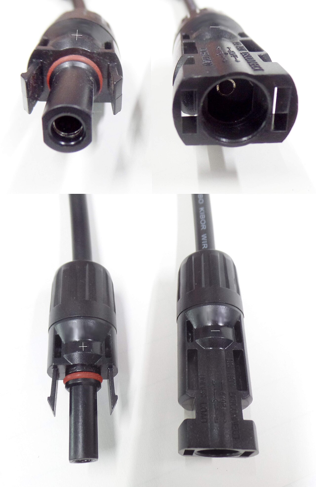
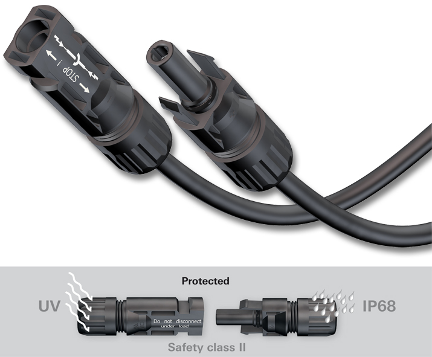
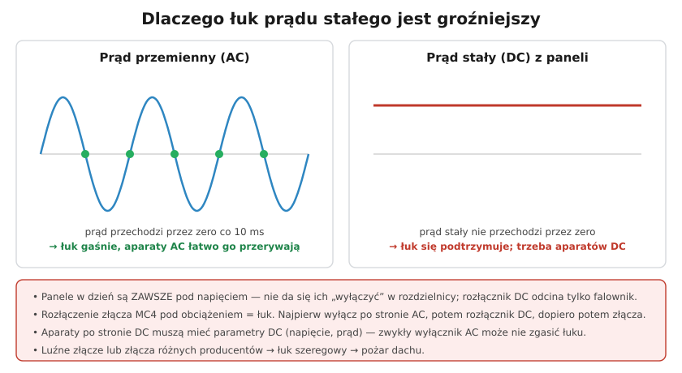

# 26.02 — Strona DC — zagrożenia i zabezpieczenia

> **Moduł:** [26 — Fotowoltaika, pompy ciepła, wallboxy i magazyny energii](README.md) · **Oznaczenia:** 🏠📋 · **Zakres SEP:** (a) (b) (c) (e) · **Status:** ✅ pełny
>
> **Czytaj:**
>
> - [ETI Polam — Fotowoltaika: ochrona przeciwprzepięciowa (PDF)](https://www.etipolam.com.pl/images/userfiles/pl-PL/ETI%20POLAM/Wsparcie%20Techniczne/Artykuly/Artykuly3/9_Fotowoltaika_PV_ETIpdf.pdf)
> - Ograniczniki przepięć: [09.03](../09-ochrona-przeciwprzepieciowa/09.03-ograniczniki-przepiec-typu-1-2-i-3.md)

[← poprzedni temat](26.01-fotowoltaika-budowa-instalacji.md) · [spis modułu](README.md) · [następny temat →](26.03-falownik-i-przylaczenie-mikroinstalacji.md)

## Po co to jest

Strona prądu stałego to najbardziej niedoceniana część instalacji PV. **Nie da się jej wyłączyć**, dopóki świeci słońce, a łuk prądu stałego potrafi palić się bez końca. Większość pożarów instalacji PV zaczyna się od złego złącza po stronie DC. Elektryk musi wiedzieć, jak dobrać napięcie łańcucha, ogranicznik przepięć, aparaty DC i jak bezpiecznie rozłączyć łańcuch.

## Po ludzku

**Zawsze pod napięciem.** Panel wytwarza napięcie, gdy pada na niego światło — nawet w pochmurny dzień napięcie łańcucha jest bliskie pełnemu. Rozłącznik DC przy falowniku odcina tylko falownik; przewody od paneli do rozłącznika **dalej mają kilkaset woltów**.

**Łuk DC nie gaśnie sam.** Prąd przemienny co 10 ms przechodzi przez zero — łuk przy rozłączaniu sam gaśnie. Prąd stały płynie cały czas w jedną stronę, więc łuk raz zapalony **podtrzymuje się**. Dlatego:

- aparaty po stronie DC (rozłączniki, bezpieczniki, wyłączniki) muszą mieć **parametry DC** — napięcie i prąd prądu stałego,
- **złącza MC4 nie rozłącza się pod obciążeniem** — najpierw wyłącz falownik (AC), potem rozłącznik DC, dopiero potem złącza,
- **luźne złącze** albo połączenie złączy **różnych producentów** to opór, grzanie i łuk szeregowy — klasyczny początek pożaru dachu.

**Napięcie rośnie na mrozie.** Napięcie Voc panelu podaje się dla 25 °C. W mroźny słoneczny poranek jest wyższe — nawet o ok. **15–20 %**. Dlatego łańcuch dobiera się tak, by **Voc łańcucha × ok. 1,2** nie przekroczyło napięcia maksymalnego falownika i przewodów (zwykle 1000 V). Z tego samego powodu ogranicznik przepięć DC ma **Ucpv ≥ 1,2 × Uoc łańcucha** (STC).

**Ochrona przed przepięciami.** Długie przewody DC na dachu to antena dla przepięć od wyładowań. Stosuje się SPD po stronie DC (przy falowniku, a przy długich trasach — powyżej ok. 10 m — także przy panelach) i po stronie AC. Typ (T1 czy T2) zależy od tego, czy budynek ma instalację odgromową i czy zachowano odstęp separacyjny ([09](../09-ochrona-przeciwprzepieciowa/README.md)).

**Bezpieczniki łańcuchowe gPV** — gdy kilka łańcuchów pracuje równolegle, przy zwarciu w jednym pozostałe wpychają w niego prąd wsteczny. Przy trzech i więcej łańcuchach równoległych zwykle potrzebne są bezpieczniki **gPV** w obu biegunach (dobór według danych panelu).

**Prowadzenie przewodów** — przewody + i − tego samego łańcucha prowadzi się **razem**, żeby nie tworzyć dużej pętli, w której wyładowanie indukuje przepięcia.

## Jak to wygląda

*Na co patrzeć: zatrzask i uszczelka. Złącze ma się zatrzasnąć z wyraźnym kliknięciem; rozłącza się je specjalnym kluczykiem — nie szarpaniem i nigdy pod obciążeniem.*

*Na co patrzeć: złącza zaciska się na przewodzie solarnym (np. H1Z2Z2-K) dedykowaną zaciskarką. Wtyk i gniazdo muszą być tego samego producenta i typu.*

## Schemat

## Pojęcia

| Pojęcie | Po ludzku | Termin normowy / symbol |
|---------|-----------|-------------------------|
| Rozłącznik DC | Odcina łańcuchy od falownika | rozłącznik izolacyjny DC |
| Łuk szeregowy | Łuk na luźnym połączeniu w przewodzie | — |
| Ucpv | Najwyższe trwałe napięcie DC ogranicznika | $U_{CPV}$ |
| Bezpiecznik gPV | Wkładka do ochrony łańcuchów PV | charakterystyka gPV |
| MC4 | Popularny typ złącza PV | — |
| Przewód solarny | Odporny na UV, podwójnie izolowany, Cu ocynowana | np. H1Z2Z2-K |

## Liczby do zapamiętania

| Wielkość | Wartość | Kiedy obowiązuje | Źródło |
|----------|---------|------------------|--------|
| Wzrost Voc na mrozie | do ok. **15–20 %** | niska temperatura, słońce | ETI Polam |
| Dobór Ucpv ogranicznika DC | **≥ 1,2 × Uoc łańcucha** (STC) | SPD po stronie DC | ETI Polam |
| SPD przy panelach | gdy trasa DC **> 10 m** | ochrona falownika i modułów | jw. |
| Bezpieczniki gPV | zwykle przy **≥ 3** łańcuchach równoległych | ochrona przed prądem wstecznym | dane producentów |
| Przekroje przewodów DC | typowo **4–6 mm²** | domowe łańcuchy | katalogi |

## W praktyce

- **Kolejność wyłączenia:** wyłącznik AC falownika → falownik przestaje pobierać prąd → rozłącznik DC → (jeśli trzeba) rozłączenie złączy MC4 kluczykiem. Uruchomienie — w odwrotnej kolejności.
- **Pomiary odbiorcze strony DC** (PN-EN 62446-1): napięcie Voc i prąd Isc każdego łańcucha, polaryzacja, rezystancja izolacji. Różnice między łańcuchami zdradzają błędy montażu.
- **Błąd izolacji zgłoszony przez falownik** — szukaj uszkodzonego przewodu, zalanej puszki lub złącza; nie kasuj błędu „na ślepo”.
- **Pożar** — strażacy muszą wiedzieć o PV: oznaczenia przy złączu i RG, plan dachu z trasami DC. Systemy z optymalizatorami lub szybkim wyłączaniem obniżają napięcie na dachu po odcięciu falownika ([30](../30-pozar-i-awaria/README.md)).

## Błędy i zagrożenia

- ⚠️ **Rozłączanie MC4 pod obciążeniem** — łuk, poparzenie, uszkodzenie złącza.
- ⚠️ **Krzyżowanie złączy różnych producentów** — różne tolerancje, grzanie, pożar.
- ⚠️ **Zwykły wyłącznik AC w obwodzie DC** — może nie przerwać łuku.
- **Zbyt długi łańcuch** — w mroźny dzień Voc przekracza dopuszczalne napięcie falownika i go niszczy.
- **Przewody DC luzem na dachu, bez ochrony przed UV i ostrymi krawędziami** — uszkodzenie izolacji, doziemienie, łuk.

## Przykład

**Zadanie.** Panel ma Voc = 45 V (STC). Falownik przyjmuje maks. 1000 V DC. Ile paneli w łańcuchu i jaki ogranicznik DC?

**Rozwiązanie.** Z zapasem na mróz: $n \le 1000 / (1{,}2 \cdot 45) = 1000 / 54 \approx 18{,}5$ → **maks. 18 paneli**. Voc łańcucha (STC): 18 · 45 = 810 V. Ogranicznik: Ucpv ≥ 1,2 · 810 = **972 V** → dobierz **SPD DC o Ucpv = 1000 V** (lub wyższym, np. 1100 V). Dla 20 paneli wyszłoby 20 · 54 = 1080 V > 1000 V — za dużo.

## Pytania SEP

1. **Dlaczego strona DC instalacji fotowoltaicznej jest szczególnie niebezpieczna podczas prac i pożaru?**

Odpowiedź

Bo moduły wytwarzają napięcie zawsze, gdy pada na nie światło — nie da się ich wyłączyć aparatem w rozdzielnicy, a napięcie łańcucha sięga kilkuset woltów (do ok. 1000 V DC). Rozłącznik DC odcina tylko falownik; przewody od modułów do rozłącznika pozostają pod napięciem. Łuk prądu stałego nie gaśnie samoczynnie, bo prąd nie przechodzi przez zero, więc rozłączenie złącza pod obciążeniem lub luźne połączenie mogą wywołać trwały łuk i pożar. Podczas gaszenia strażacy mają kontakt z elementami pod napięciem — stąd oznakowanie instalacji i wymagania przeciwpożarowe.

2. **Jak dobiera się ogranicznik przepięć po stronie DC instalacji PV?**

Odpowiedź

Najwyższe trwałe napięcie pracy ogranicznika Ucpv musi być nie mniejsze niż maksymalne napięcie łańcucha, które przy niskiej temperaturze jest wyższe od Uoc w warunkach STC — praktycznie przyjmuje się Ucpv ≥ 1,2 · Uoc łańcucha. Typ ogranicznika (1 lub 2) zależy od tego, czy budynek ma instalację odgromową i czy zachowano odstęp separacyjny. Ograniczniki montuje się przy falowniku, a przy długich trasach DC (powyżej ok. 10 m) również przy modułach; przewody łączeniowe muszą być krótkie.

## Sprawdź się

1. Dlaczego przy rozłączaniu łańcucha najpierw wyłącza się falownik po stronie AC?

Odpowiedź

Bo bez sieci falownik przestaje przetwarzać energię i prąd w łańcuchu spada praktycznie do zera. Wtedy rozłącznik DC (a później złącza) rozłącza obwód bez prądu, więc łuk się nie zapali. Rozłączanie pod pełnym prądem łańcucha grozi trwałym łukiem DC.

## Źródła

- PN-HD 60364-7-712 — Fotowoltaiczne (PV) układy zasilania.
- PN-EN 62446-1 — Systemy fotowoltaiczne. Wymagania dotyczące badań, dokumentacji i utrzymania.
- [ETI Polam — Fotowoltaika: ochrona przeciwprzepięciowa (PDF)](https://www.etipolam.com.pl/images/userfiles/pl-PL/ETI%20POLAM/Wsparcie%20Techniczne/Artykuly/Artykuly3/9_Fotowoltaika_PV_ETIpdf.pdf).
- [09.03 — Ograniczniki przepięć typu 1, 2 i 3](../09-ochrona-przeciwprzepieciowa/09.03-ograniczniki-przepiec-typu-1-2-i-3.md).

---

[← poprzedni temat](26.01-fotowoltaika-budowa-instalacji.md) · [spis modułu](README.md) · [następny temat →](26.03-falownik-i-przylaczenie-mikroinstalacji.md)
