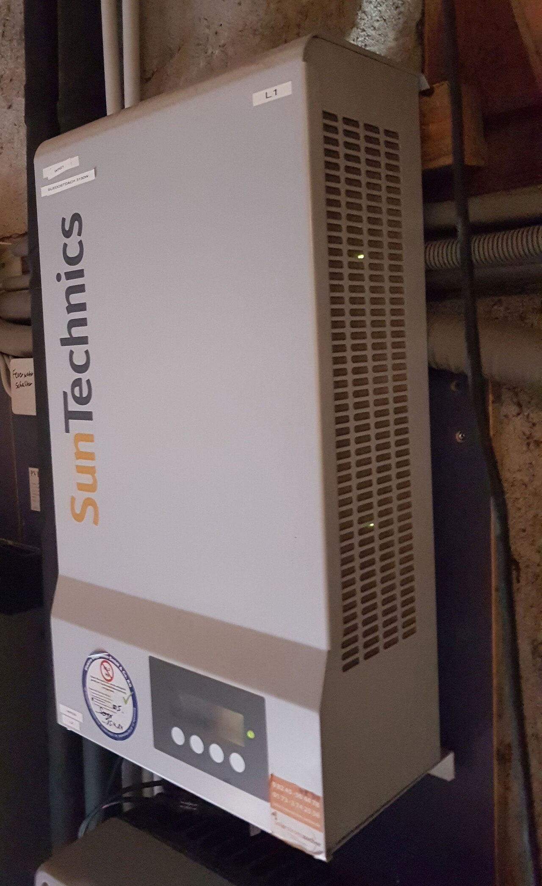
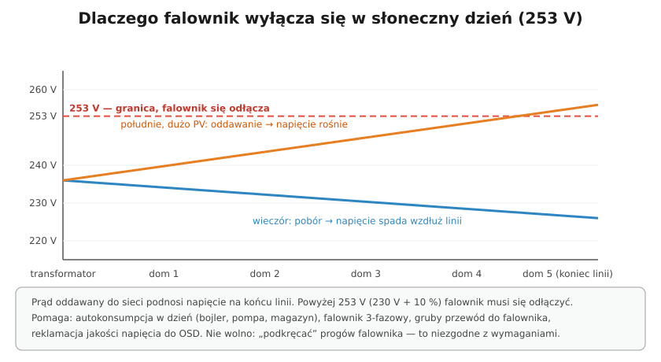

# 26.03 — Falownik i przyłączenie mikroinstalacji

> **Moduł:** [26 — Fotowoltaika, pompy ciepła, wallboxy i magazyny energii](README.md) · **Oznaczenia:** 🏠📋 · **Zakres SEP:** (a) (b) (c) (e) · **Status:** ✅ pełny
>
> **Czytaj:**
>
> - [Globenergia — za wysokie napięcie wyłącza fotowoltaikę](https://globenergia.pl/zmora-prosumentow-za-wysokie-napiecie-wylacza-fotowoltaike-jak-nie-tracic-energii-i-pieniedzy/)
> - Licznik i moc przyłączeniowa: [14.03](../14-od-slupa-do-gniazdka/14.03-licznik-i-zabezpieczenie-przedlicznikowe.md), [14.05](../14-od-slupa-do-gniazdka/14.05-moc-przylaczeniowa-i-taryfy.md)

[← poprzedni temat](26.02-strona-dc-zagrozenia-i-zabezpieczenia.md) · [spis modułu](README.md) · [następny temat →](26.04-pompa-ciepla-zasilanie-i-zabezpieczenia.md)

## Po co to jest

Falownik to serce instalacji PV i jej najczęstsze źródło pytań: „dlaczego w słoneczny dzień się wyłącza?”, „dlaczego przy awarii sieci nie mam prądu, skoro mam panele?”, „jaki RCD?”. Ten temat odpowiada na nie i pokazuje, jak przebiega przyłączenie mikroinstalacji.

## Po ludzku

**Co robi falownik on-grid:**

- zamienia prąd stały z paneli na przemienny i **synchronizuje się z siecią** (częstotliwość, faza),
- prowadzi **MPPT** — dobiera obciążenie paneli tak, żeby dawały najwięcej mocy,
- **pilnuje sieci** — gdy napięcie albo częstotliwość wyjdą poza dopuszczalne granice, **odłącza się**,
- **anti-islanding** — przy zaniku sieci **wyłącza się w ułamku sekundy**. Nie może zasilać „wyspy”, bo zagrażałby monterom ([25.05](../25-transformatory-ups-agregaty/25.05-dlaczego-nie-zasila-sie-domu-przez-gniazdo.md)). Dlatego **bez magazynu z funkcją backup** dom z PV przy awarii sieci nie ma prądu.

**Dlaczego wyłącza się w słoneczny dzień?** Prąd płynie od miejsca o wyższym napięciu do niższego. Żeby oddać energię do sieci, falownik musi podnieść napięcie w swoim punkcie przyłączenia. Gdy na jednej ulicy wiele instalacji naraz oddaje energię, napięcie na końcu linii rośnie. Gdy przekroczy **253 V** (230 V + 10 %), falownik musi się odłączyć — i produkcja przepada.

Co pomaga:

- **autokonsumpcja w dzień** — bojler, pompa ciepła, pralka, ładowanie auta, magazyn energii,
- falownik **trójfazowy** (oddaje energię na trzy fazy równo) zamiast jednofazowego,
- **przewód od falownika do RG o małym spadku napięcia** — każdy wolt spadku na przewodzie to wolt mniej zapasu,
- **reklamacja jakości napięcia** do OSD — operator ma obowiązek dotrzymać parametrów napięcia.

Co **nie wolno**: „podkręcać” progów zabezpieczeń falownika — nastawy wymaga operator.

**RCD dla falownika** — według instrukcji. Wiele falowników ma wbudowany układ kontroli prądu upływu (RCMU) i deklarację, że nie wprowadza do instalacji prądów stałych — wtedy wystarcza RCD **typu A**; w przeciwnym razie wymagany jest **typ B** ([08.03](../08-wylaczniki-roznicowopradowe/08.03-typy-ac-a-f-i-b-ktory-do-czego.md)).

**Przyłączenie mikroinstalacji — kolejno:**

1. sprawdzenie mocy przyłączeniowej (moc instalacji ≤ moc przyłączeniowa),
2. montaż, pomiary, protokół; dla > 6,5 kW — uzgodnienie ppoż. ([26.01](26.01-fotowoltaika-budowa-instalacji.md)),
3. **zgłoszenie do OSD** (zwykle przez instalatora, z dokumentami falownika i protokołem),
4. OSD montuje **licznik dwukierunkowy** — od tej chwili instalacja może pracować,
5. rozliczenia — dla nowych prosumentów od kwietnia 2022 r. **net-billing** (rozliczenie wartościowe energii oddanej i pobranej). Szczegóły rozliczeń się zmieniają — sprawdzaj aktualne zasady u sprzedawcy.

## Jak to wygląda

*Na co patrzeć: przewody wchodzą od dołu — po jednej stronie DC z paneli, po drugiej AC do rozdzielnicy. Wyświetlacz pokazuje moc, napięcie sieci i komunikaty błędów (np. „Grid overvoltage” — za wysokie napięcie sieci).*

## Schemat

## Pojęcia

| Pojęcie | Po ludzku | Termin normowy / symbol |
|---------|-----------|-------------------------|
| Falownik on-grid | Pracuje tylko z siecią | inwerter sieciowy |
| Falownik hybrydowy | On-grid + magazyn + backup | — |
| Anti-islanding | Odłączenie przy zaniku sieci | ochrona przed pracą wyspową, LoM |
| RCMU | Wbudowana kontrola prądu upływu | — |
| Net-billing | Rozliczenie wartości energii oddanej i pobranej | — |
| Autokonsumpcja | Zużycie energii z PV na miejscu | — |

## Liczby do zapamiętania

| Wielkość | Wartość | Kiedy obowiązuje | Źródło |
|----------|---------|------------------|--------|
| Górna granica napięcia | **253 V** (230 V + 10 %) — falownik się odłącza | sieć nn | Globenergia; PN-EN 50160 |
| Napięcie znamionowe | **230 V ± 10 %** | sieć nn | PN-EN 50160 |
| Rozliczenie nowych prosumentów | **net-billing** od **1.04.2022** | mikroinstalacje | ustawa o OZE |
| RCD falownika | **typ A** gdy producent dopuszcza (RCMU), inaczej **typ B** | strona AC | instrukcja falownika; PN-HD 60364-7-712 |
| Moc instalacji | **≤ moc przyłączeniowa** | przyłączenie na zgłoszenie | ustawa o OZE |

## W praktyce

- **Wyłączenia przez napięcie** — sprawdź w historii falownika napięcia fazowe w chwili wyłączenia; zmierz spadek na przewodzie falownik–RG przy pełnej mocy. Jeśli spadek jest duży — grubszy przewód. Jeśli napięcie w RG przekracza 253 V — reklamacja do OSD z danymi.
- **Falownik jednofazowy na jednej fazie domu** — wszystko, co oddaje, idzie na tę jedną fazę; licznik i tak bilansuje trzy fazy, ale napięcie tej fazy rośnie najmocniej.
- **Obwód falownika** — osobny, bez innych odbiorników, z opisem w rozdzielnicy.
- **Aktualizacja oprogramowania i nastawy** — wykonuje serwis według kodu sieci/wymagań OSD.

## Błędy i zagrożenia

- ⚠️ **Praca przy obwodzie „wyłączonego” falownika bez sprawdzenia** — strona DC jest pod napięciem, a kondensatory falownika potrzebują czasu na rozładowanie (podany w instrukcji).
- **Zmiana progów napięciowych falownika** — niezgodne z wymaganiami operatora; zagraża jakości napięcia u sąsiadów.
- **Zbyt cienki przewód do falownika** — straty i częste wyłączenia przy wysokim napięciu.
- **RCD typu AC** w obwodzie falownika — nie zadziała prawidłowo przy prądach z elektroniki.

## Przykład

**Zadanie.** Napięcie w RG w południe: 249 V. Falownik 10 kW trójfazowy jest podłączony przewodem 5 × 2,5 mm² o długości 30 m. Prąd na fazę ok. 14,5 A. Czy przewód przyczynia się do wyłączeń?

**Rozwiązanie.** Spadek napięcia na fazie (Cu, ρ ≈ 0,0175): $\Delta U \approx I \cdot \rho \cdot l / S = 14{,}5 \cdot 0{,}0175 \cdot 30 / 2{,}5 \approx 3{,}0$ V. Falownik „widzi” ok. 249 + 3 = **252 V** — tuż pod granicą. Przewód 5 × 6 mm² zmniejszy spadek do ok. 1,3 V. Pomoże też autokonsumpcja; jeśli napięcie w RG stale przekracza 250 V, warto zgłosić to do OSD.

## Pytania SEP

1. **Dlaczego falownik instalacji fotowoltaicznej wyłącza się przy zaniku napięcia sieci?**

Odpowiedź

Ze względu na ochronę przed pracą wyspową (anti-islanding). Gdyby falownik pracował dalej, zasilałby odłączony fragment sieci — przez transformator napięcie pojawiłoby się po stronie SN, zagrażając osobom pracującym przy sieci, a po przywróceniu zasilania mogłoby dojść do niezsynchronizowanego połączenia źródeł. Falownik musi wykryć zanik sieci i odłączyć się w krótkim czasie; zasilanie domu przy awarii jest możliwe tylko z falownikiem lub magazynem z funkcją zasilania rezerwowego, który odłącza instalację od sieci.

2. **Dlaczego w słoneczne dni mikroinstalacje często wyłączają się samoczynnie i jak temu przeciwdziałać?**

Odpowiedź

Oddawanie energii do sieci podnosi napięcie w punkcie przyłączenia, szczególnie na końcu długich linii, przy wielu instalacjach PV. Po przekroczeniu dopuszczalnej wartości (253 V, tj. 230 V + 10 %) zabezpieczenie falownika musi go odłączyć. Przeciwdziała się przez zwiększenie autokonsumpcji (w tym magazyn energii), stosowanie falowników trójfazowych, zmniejszenie spadku napięcia na przewodzie od falownika do rozdzielnicy oraz zgłoszenie do operatora reklamacji jakości napięcia. Nie wolno samodzielnie zmieniać nastaw zabezpieczeń falownika.

## Sprawdź się

1. Dlaczego zwiększenie przekroju przewodu od falownika do RG może zmniejszyć liczbę wyłączeń, skoro napięcie sieci się nie zmienia?

Odpowiedź

Falownik mierzy napięcie na swoich zaciskach, które jest wyższe od napięcia w RG o spadek na przewodzie (prąd płynie od falownika do sieci). Grubszy przewód to mniejszy spadek, więc falownik „widzi” napięcie bliższe napięciu w RG i rzadziej przekracza próg 253 V.

## Źródła

- [Globenergia — Zmora prosumentów: za wysokie napięcie wyłącza fotowoltaikę](https://globenergia.pl/zmora-prosumentow-za-wysokie-napiecie-wylacza-fotowoltaike-jak-nie-tracic-energii-i-pieniedzy/).
- PN-EN 50160 — Parametry napięcia zasilającego w publicznych sieciach elektroenergetycznych.
- PN-EN 50549-1 — Wymagania dotyczące instalacji wytwórczych przyłączanych równolegle do sieci dystrybucyjnych nn.
- Ustawa z 20 lutego 2015 r. o odnawialnych źródłach energii.

---

[← poprzedni temat](26.02-strona-dc-zagrozenia-i-zabezpieczenia.md) · [spis modułu](README.md) · [następny temat →](26.04-pompa-ciepla-zasilanie-i-zabezpieczenia.md)
