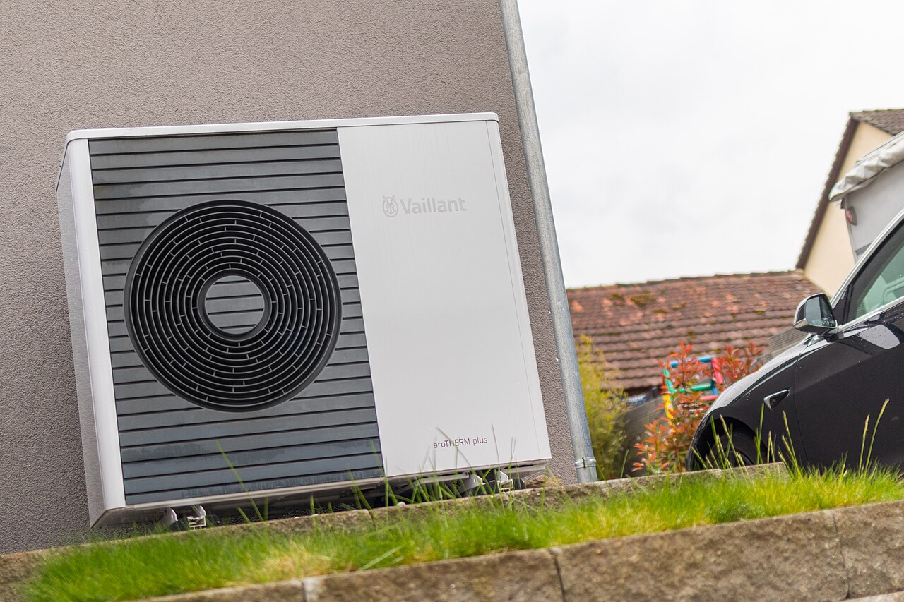
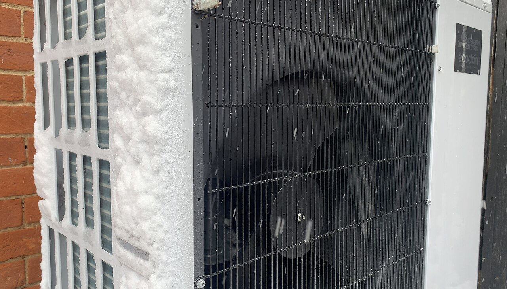
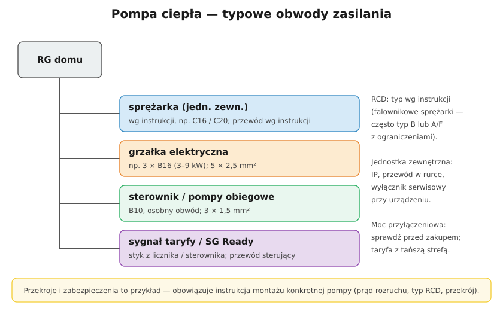

# 26.04 — Pompa ciepła — zasilanie i zabezpieczenia

> **Moduł:** [26 — Fotowoltaika, pompy ciepła, wallboxy i magazyny energii](README.md) · **Oznaczenia:** 🏠📋 · **Zakres SEP:** (a) (b) (c) (e) · **Status:** ✅ pełny
>
> **Czytaj:**
>
> - Obwody wydzielone: [16.06](../16-planowanie-obwodow/16.06-obwody-wydzielone-plyta-piekarnik-pralka.md)
> - Moc przyłączeniowa i taryfy: [14.05](../14-od-slupa-do-gniazdka/14.05-moc-przylaczeniowa-i-taryfy.md)

[← poprzedni temat](26.03-falownik-i-przylaczenie-mikroinstalacji.md) · [spis modułu](README.md) · [następny temat →](26.05-wallbox-i-ladowanie-samochodu.md)

## Po co to jest

Pompa ciepła to dziś najpopularniejsze źródło ogrzewania w nowych domach — i najmocniejszy odbiornik w instalacji obok płyty indukcyjnej i wallboxa. Elektryk musi zaprojektować dla niej obwody, dobrać zabezpieczenia według instrukcji, sprawdzić moc przyłączeniową i poprowadzić przewód do jednostki zewnętrznej.

## Po ludzku

Pompa ciepła działa jak lodówka „na odwrót”: sprężarka przepompowuje ciepło z powietrza (lub gruntu) do wody grzewczej. Z **1 kWh prądu** daje **3–4 kWh ciepła** (średnio w sezonie — współczynnik **SCOP**). W mrozy sprawność spada, a gdy pompa nie nadąża, włącza się **grzałka elektryczna**.

**Co trzeba zasilić** (typowy dom, pompa powietrze–woda):

- **sprężarka** w jednostce zewnętrznej — kilka kW mocy elektrycznej przy maksimum, 1- lub 3-fazowo; zabezpieczenie i przekrój **według instrukcji** (często charakterystyka C),
- **grzałka** (w jednostce wewnętrznej lub w buforze) — 3–9 kW, zwykle 3-fazowo, osobny obwód,
- **sterownik i pompy obiegowe** — mały osobny obwód,
- **sygnały sterujące** — taryfa (tańsza strefa), SG Ready (sterowanie od PV), czujniki.

**Falownikowe sprężarki** (inwerterowe) startują łagodnie — bez dużego prądu rozruchu. Ich elektronika może jednak wprowadzać do PE prądy upływu z składową wysokiej częstotliwości lub stałą — dlatego **typ RCD** (A, F lub B) podaje producent. Czasem instrukcja dopuszcza pracę sprężarki bez RCD w obwodzie stałym (bez gniazd) — o ile spełnione są inne warunki ochrony; to decyzja projektowa, nie skrót „bo wybija”.

**Moc przyłączeniowa** — pompa z grzałką, płyta indukcyjna i wallbox w jednym domu łatwo przekraczają typowe 11–14 kW. Trzeba to sprawdzić **przed zakupem** ([14.05](../14-od-slupa-do-gniazdka/14.05-moc-przylaczeniowa-i-taryfy.md)).

**Pompa typu split** ma przewody chłodnicze między jednostkami — prace przy czynniku chłodniczym wymagają **certyfikatu F-gazowego**. **Monoblok** łączy się z domem tylko rurami wodnymi i przewodem elektrycznym.

## Jak to wygląda

*Na co patrzeć: jednostka zewnętrzna stoi na podstawie nad ziemią (odpływ skroplin i śnieg). Przewód zasilający dochodzi zwykle od tyłu w rurce osłonowej. Obok samochód elektryczny — dwa największe odbiorniki w domu.*

*Na co patrzeć: szron na wymienniku — pompa okresowo go rozmraża (defrost). W tym czasie pobiera prąd, a nie grzeje. W mrozy ruszają też grzałki — instalacja musi być na to przygotowana.*

## Schemat

## Pojęcia

| Pojęcie | Po ludzku | Termin normowy / symbol |
|---------|-----------|-------------------------|
| COP / SCOP | Ile razy więcej ciepła niż prądu (chwilowo / w sezonie) | — |
| Sprężarka inwerterowa | Z regulacją obrotów, łagodny start | — |
| Grzałka wspomagająca | Dogrzewa w mrozy | grzałka szczytowa |
| SG Ready | Wejście sterujące — „teraz jest tani prąd” | — |
| Monoblok / split | Czynnik tylko w jednostce zewn. / w rurach do domu | — |
| Defrost | Rozmrażanie wymiennika | odszranianie |

## Liczby do zapamiętania

| Wielkość | Wartość | Kiedy obowiązuje | Źródło |
|----------|---------|------------------|--------|
| SCOP | ok. **3–4** (zależnie od pompy i domu) | pompy powietrze–woda | katalogi |
| Grzałka wspomagająca | ok. **3–9 kW** | typowe pompy domowe | katalogi |
| Moc elektryczna sprężarki | ok. **2–5 kW** przy maksimum | domy jednorodzinne | katalogi |
| Typ RCD | **wg instrukcji** (A, F lub B) | obwody pompy | instrukcja producenta |
| Typowa moc przyłączeniowa domu | **11–14 kW** — sprawdź bilans | przed zakupem | 14.05 |

## W praktyce

- **Zanim zaczniesz** — instrukcja montażu konkretnej pompy: zabezpieczenia, przekroje, typ RCD, przewody sterujące, wymagania na długość.
- **Przewód do jednostki zewnętrznej** — odporny na warunki zewnętrzne (np. YKY) lub w rurce osłonowej odpornej na UV; uszczelnione przejście przez ścianę.
- **Wyłącznik serwisowy** przy jednostce zewnętrznej (jeśli wymaga go instrukcja lub projekt) — serwisant odcina zasilanie w zasięgu wzroku.
- **Taryfa** — dwustrefowa (np. G12, G12w) pozwala grzać taniej; sterownik pompy dostaje sygnał strefy.
- **Z PV** — wejście SG Ready lub sterowanie z falownika podnosi autokonsumpcję ([26.03](26.03-falownik-i-przylaczenie-mikroinstalacji.md)).
- **Pomiary** po montażu — jak dla każdego obwodu ([23](../23-pomiary-odbiorcze-i-okresowe/README.md)).

## Błędy i zagrożenia

- ⚠️ **Pompa na wspólnym obwodzie z gniazdami** — przeciążenia i wybijanie przy rozruchu grzałki.
- ⚠️ **RCD typu AC lub niezgodny z instrukcją** — może nie zadziałać przy uszkodzeniu albo wybijać bez powodu.
- **Brak sprawdzenia mocy przyłączeniowej** — wybija zabezpieczenie przedlicznikowe w mroźny wieczór.
- **Przewód w ziemi bez osłony i oznaczenia** — uszkodzenie przy pracach w ogrodzie ([17.04](../17-pomieszczenia-szczegolne/17.04-instalacje-zewnetrzne-i-ogrod.md)).
- **Prace przy czynniku chłodniczym bez certyfikatu** — niezgodne z przepisami o F-gazach.

## Przykład

**Zadanie.** Dom: moc przyłączeniowa 14 kW. Pompa ciepła: sprężarka maks. 3,5 kW + grzałka 6 kW. Płyta indukcyjna 7,4 kW, wallbox 11 kW. Co z mocą?

**Rozwiązanie.** Najgorszy zimowy wieczór: 3,5 + 6 + 7,4 + 11 = **27,9 kW** (plus reszta domu) — dwukrotnie ponad moc przyłączeniową. Rozwiązania: **dynamiczne zarządzanie mocą** wallboxa ([26.05](26.05-wallbox-i-ladowanie-samochodu.md)), blokada grzałki przy ładowaniu, ładowanie nocą, a jeśli to nie wystarczy — **wniosek o zwiększenie mocy przyłączeniowej**.

## Pytania SEP

1. **Jakie wymagania należy uwzględnić przy zasilaniu pompy ciepła w domu jednorodzinnym?**

Odpowiedź

Osobne obwody dla sprężarki, grzałki i sterowania, z zabezpieczeniami i przekrojami według instrukcji producenta (z uwzględnieniem prądu rozruchu i długości trasy); dobór typu wyłącznika różnicowoprądowego zgodny z instrukcją (urządzenia z przekształtnikami mogą wymagać typu F lub B); przewód do jednostki zewnętrznej odporny na warunki zewnętrzne, chroniony mechanicznie; połączenie ochronne obudowy; sprawdzenie bilansu mocy względem mocy przyłączeniowej; po montażu — pomiary ochronne i protokół.

## Sprawdź się

1. Dlaczego pompa ciepła w mróz zużywa dużo więcej prądu niż jesienią przy tym samym zapotrzebowaniu na ciepło w ciągu godziny?

Odpowiedź

Bo jej sprawność (COP) spada wraz z temperaturą powietrza — z każdej kWh prądu daje mniej ciepła. Do tego dochodzi energia na rozmrażanie wymiennika, a gdy moc sprężarki nie wystarcza, włącza się grzałka o COP = 1.

## Źródła

- Instrukcje montażu pomp ciepła (producent konkretnego urządzenia) — zabezpieczenia, przekroje, typ RCD.
- PN-HD 60364-5-53 — dobór wyłączników różnicowoprądowych do odbiorników z przekształtnikami.
- [16.06 — Obwody wydzielone](../16-planowanie-obwodow/16.06-obwody-wydzielone-plyta-piekarnik-pralka.md); [14.05 — Moc przyłączeniowa i taryfy](../14-od-slupa-do-gniazdka/14.05-moc-przylaczeniowa-i-taryfy.md).

---

[← poprzedni temat](26.03-falownik-i-przylaczenie-mikroinstalacji.md) · [spis modułu](README.md) · [następny temat →](26.05-wallbox-i-ladowanie-samochodu.md)
