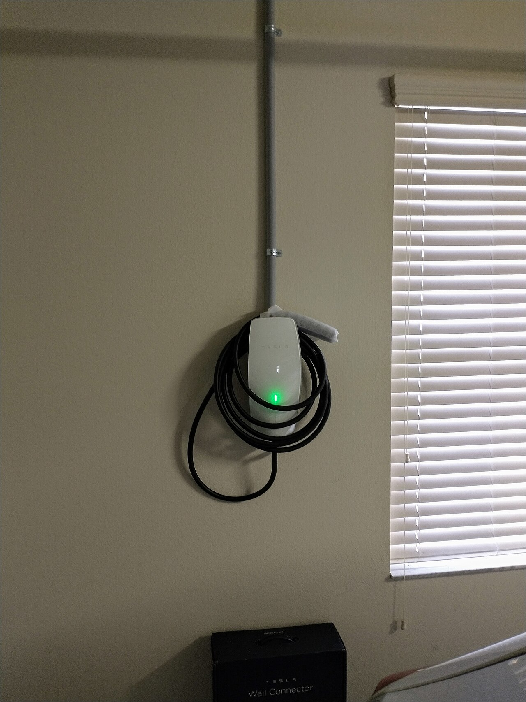
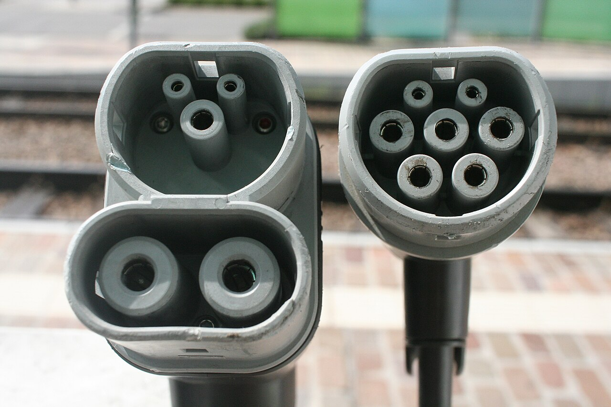
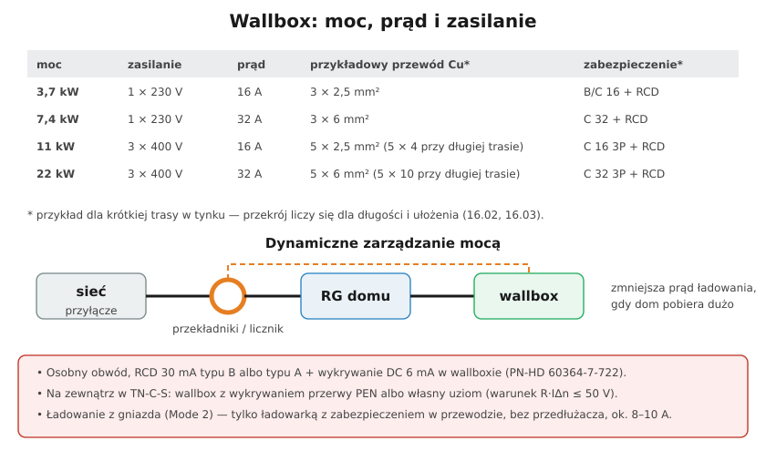

# 26.05 — Wallbox i ładowanie samochodu

> **Moduł:** [26 — Fotowoltaika, pompy ciepła, wallboxy i magazyny energii](README.md) · **Oznaczenia:** 🏠📋 · **Zakres SEP:** (a) (b) (c) (e) · **Status:** ✅ pełny
>
> **Czytaj:**
>
> - Garaż i wallbox — podstawy: [17.03](../17-pomieszczenia-szczegolne/17.03-garaz-i-warsztat.md)
> - 🇬🇧 [NEN 1010 guide — 722 EV charging](https://nen.sulerr.com/en/guides/nen-1010/722-ev-charging)

[← poprzedni temat](26.04-pompa-ciepla-zasilanie-i-zabezpieczenia.md) · [spis modułu](README.md) · [następny temat →](26.06-magazyn-energii.md)

## Po co to jest

Samochód elektryczny to odbiornik, który przez wiele godzin pobiera 11 kW — więcej niż cała reszta domu. Wymagania dla punktu ładowania opisuje osobny arkusz normy (**PN-HD 60364-7-722**). Podstawy (osobny obwód, RCD) są w [17.03](../17-pomieszczenia-szczegolne/17.03-garaz-i-warsztat.md); tu — dobór mocy, przewodu, zabezpieczeń, problem przerwanego PEN i zarządzanie mocą.

## Po ludzku

**Tryby ładowania (IEC 61851):**

- **Mode 1** — zwykłe gniazdo bez żadnej elektroniki (rowery, hulajnogi) — dla samochodów praktycznie nieużywany,
- **Mode 2** — przenośna ładowarka z **zabezpieczeniem w przewodzie** (puszka z RCD i komunikacją z autem) z gniazda domowego lub siłowego. Prąd zwykle ograniczony do **ok. 8–10 A** z gniazda 230 V — gniazdo i obwód przez wiele godzin pracują na granicy możliwości,
- **Mode 3** — **wallbox** (stacja AC na stałe), komunikacja z autem, typowo 11 kW,
- **Mode 4** — szybkie ładowanie DC (stacje publiczne; prostownik jest w stacji, nie w aucie).

**Wtyczki** — w Europie standard AC to **Typ 2** (7 styków). Szybkie ładowanie DC — **CCS2** (Typ 2 + dwa grube styki DC).

**Moc ładowania AC** ogranicza **ładowarka pokładowa** samochodu. Najczęściej:

- **11 kW** = 3 × 16 A (3 fazy) — standard dla domu,
- **7,4 kW** = 1 × 32 A (1 faza) — niektóre auta, domy 1-fazowe,
- **22 kW** = 3 × 32 A — rzadko w domu, wymaga dużej mocy przyłączeniowej.

**Wymagania PN-HD 60364-7-722 (najważniejsze):**

- każdy punkt ładowania na **osobnym obwodzie**,
- RCD **30 mA typu B** albo **typu A + wykrywanie prądu stałego 6 mA** (RDC-DD) w wallboxie — typ A sam lub typ F **nie wystarczą** (auto może wprowadzić prąd stały, który „oślepia” RCD typu A),
- zabezpieczenie nadprądowe dla każdego punktu (zwykle **C16** dla 11 kW),
- przy zasilaniu w **TN-C-S** punktu ładowania na zewnątrz: **przerwa PEN** w sieci podnosi potencjał PE (i karoserii auta stojącego na ziemi) nawet do 230 V. Ochrona: **wykrywanie przerwy PEN** w wallboxie (odłączenie w ciągu ok. 5 s) albo **osobny uziom** (lokalny układ TT),
- ochrona przeciwprzepięciowa — zalecana szczególnie przy dłuższych trasach na zewnątrz,
- gniazdo / złącze na wysokości ok. **0,5–1,5 m**, IP odpowiednie do miejsca (na zewnątrz co najmniej IP44, często IP54+).

**Dynamiczne zarządzanie mocą** — przekładniki lub licznik na zasilaniu domu mierzą bieżący pobór, a wallbox zmniejsza prąd ładowania, gdy dom potrzebuje więcej (np. płyta indukcyjna). Dzięki temu wallbox 11 kW zmieści się w mocy przyłączeniowej. Może też ładować auto z nadwyżek PV.

## Jak to wygląda

*Na co patrzeć: przewód zasilający w rurce, wallbox z przewodem na stałe (z wtyczką Typ 2). Po zakończeniu ładowania przewód nawija się na uchwyt — leżący na ziemi szybko się niszczy.*

*Na co patrzeć: Typ 2 (po prawej) — styki L1, L2, L3, N, PE i dwa małe sygnałowe (CP, PP). CCS2 (po lewej) — ta sama górna część plus dwa grube styki prądu stałego do szybkiego ładowania.*

## Schemat

## Pojęcia

| Pojęcie | Po ludzku | Termin normowy / symbol |
|---------|-----------|-------------------------|
| Wallbox | Domowa stacja ładowania AC | punkt ładowania, Mode 3 |
| Ładowarka pokładowa | Prostownik w samochodzie, ogranicza moc AC | OBC |
| RDC-DD | Wykrywanie prądu stałego 6 mA w wallboxie | IEC 62955 |
| Wykrywanie przerwy PEN | Odłącza wallbox, gdy PE „pływa” | — |
| Dynamiczne zarządzanie mocą | Wallbox dostosowuje prąd do poboru domu | load balancing |
| Typ 2 / CCS2 | Złącze AC / złącze AC+DC | PN-EN 62196 |

## Liczby do zapamiętania

| Wielkość | Wartość | Kiedy obowiązuje | Źródło |
|----------|---------|------------------|--------|
| Typowa moc domowa | **11 kW = 3 × 16 A** | ładowanie AC | 🇬🇧 NEN guide |
| RCD | **30 mA typ B** lub **typ A + 6 mA DC** w wallboxie | każdy punkt ładowania | PN-HD 60364-7-722 |
| Wykrycie przerwy PEN | odłączenie w ciągu ok. **5 s** | TN-C-S, ładowanie na zewnątrz | jw. |
| Wysokość złącza | ok. **0,5–1,5 m** | montaż | 🇬🇧 NEN guide |
| Mode 2 z gniazda 230 V | ok. **8–10 A** | ładowanie awaryjne | instrukcje ładowarek |
| Zasięg z 1 h ładowania 11 kW | ok. **50–70 km** (przy 15–20 kWh/100 km) | szacunek | — |

## W praktyce

- **Przekrój przewodu** dobierz jak dla każdego obwodu: obciążalność (ładowanie to obciążenie **ciągłe** przez wiele godzin), sposób ułożenia, spadek napięcia ([16.02](../16-planowanie-obwodow/16.02-dobor-przekroju-i-zabezpieczenia-procedura-krok.md), [16.03](../16-planowanie-obwodow/16.03-sprawdzanie-spadku-napiecia.md)). Dla 11 kW zwykle 5 × 2,5 mm², przy długiej trasie 5 × 4 lub 5 × 6 mm².
- **RCD typu A + wallbox z RDC-DD** — sprawdź w karcie wallboxa, czy ma wbudowane wykrywanie 6 mA DC; jeśli nie — RCD typu B w rozdzielnicy.
- **Wallbox na zewnątrz w TN-C-S** — wybierz model z wykrywaniem przerwy PEN albo zrób uziom i zasil wallbox w układzie TT (z właściwym RCD i pomiarem uziemienia).
- **Ładowanie z gniazda (Mode 2)** — tylko z gniazda w dobrym stanie, **bez przedłużacza** i rozgałęźnika; sprawdź ciepłotę wtyczki po godzinie ładowania. Lepiej gniazdo siłowe 16 A i ładowarka 3-fazowa.
- **Pomiary odbiorcze** — z badaniem RCD i, jeśli jest, uziomu ([23](../23-pomiary-odbiorcze-i-okresowe/README.md)).

## Błędy i zagrożenia

- ⚠️ **Ładowanie z przedłużacza na bębnie** — przegrzanie nawiniętego przewodu, pożar.
- ⚠️ **RCD typu A bez wykrywania DC** — prąd stały z auta może „oślepić” RCD i cała ochrona w obwodzie przestaje działać.
- ⚠️ **Przerwa PEN** przy ładowaniu na podjeździe — karoseria auta pod napięciem względem ziemi.
- **Wallbox 11 kW bez zarządzania mocą przy małej mocy przyłączeniowej** — wybija zabezpieczenie przedlicznikowe.
- **Wallbox na tym samym obwodzie co gniazda garażu** — niezgodne z normą.

## Przykład

**Zadanie.** Wallbox 11 kW, trasa od RG do garażu 35 m, przewód ułożony w rurce w ścianie. Dobierz zabezpieczenie i sprawdź spadek napięcia dla 5 × 2,5 mm² i 5 × 4 mm² (Cu, ρ ≈ 0,0175 Ω·mm²/m).

**Rozwiązanie.** Prąd: 11 000 / (√3 · 400) ≈ **16 A** → **C16 3P** + RCD (B lub A + RDC-DD). Spadek trójfazowy: $\Delta U\% = \frac{\sqrt{3} \cdot I \cdot \rho \cdot l}{S \cdot 400} \cdot 100$.
Dla 2,5 mm²: $\sqrt{3} \cdot 16 \cdot 0{,}0175 \cdot 35 / 2{,}5 \approx 6{,}8$ V → **1,7 %**. Dla 4 mm²: ok. 4,2 V → **1,1 %**. Oba mieszczą się w typowych 3 %, ale przy długotrwałym obciążeniu i ułożeniu w ścianie z innymi przewodami **5 × 4 mm²** daje zapas obciążalności i mniejsze grzanie — dobry wybór.

## Pytania SEP

1. **Jakie wymagania dotyczące ochrony przeciwporażeniowej stawia norma dla punktów ładowania pojazdów elektrycznych?**

Odpowiedź

Każdy punkt ładowania zasila się z osobnego obwodu z własnym zabezpieczeniem nadprądowym. Każdy punkt chroni się wyłącznikiem różnicowoprądowym o IΔn ≤ 30 mA typu B albo typu A połączonym z urządzeniem wykrywającym prąd stały powyżej 6 mA i odłączającym zasilanie (RDC-DD). Przy zasilaniu w układzie TN-C-S punktu ładowania na zewnątrz trzeba zabezpieczyć się przed skutkami przerwy w przewodzie PEN — np. przez urządzenie wykrywające przerwę PEN i odłączające zasilanie albo przez zastosowanie lokalnego uziomu (układ TT). Zaleca się ochronę przeciwprzepięciową.

2. **Dlaczego w obwodzie ładowania samochodu nie wystarcza zwykły wyłącznik różnicowoprądowy typu A?**

Odpowiedź

Bo przy uszkodzeniu w układach elektronicznych samochodu i ładowarki prąd różnicowy może mieć składową stałą. Prąd stały powyżej kilku mA może namagnesować rdzeń wyłącznika typu A tak, że przestaje on reagować również na prądy przemienne — ochrona przestaje działać. Dlatego wymaga się typu B albo typu A z dodatkowym wykrywaniem prądu stałego 6 mA.

## Sprawdź się

1. Samochód ma ładowarkę pokładową 7,4 kW (1 faza). Wallbox w domu ma 11 kW (3 fazy). Z jaką mocą będzie się ładował?

Odpowiedź

Ładowarka pokładowa jednofazowa wykorzysta tylko jedną fazę wallboxa: 1 × 16 A × 230 V ≈ **3,7 kW**. Pełne 7,4 kW wymagałoby 32 A na jednej fazie, a ten wallbox daje 16 A na fazę.

## Źródła

- PN-HD 60364-7-722 — Wymagania dotyczące specjalnych instalacji lub lokalizacji. Zasilanie pojazdów elektrycznych.
- IEC 61851-1 — Systemy przewodowego ładowania pojazdów elektrycznych; PN-EN 62196 — wtyki i gniazda.
- 🇬🇧 [NEN 1010 guide — 722 EV charging](https://nen.sulerr.com/en/guides/nen-1010/722-ev-charging).
- [17.03 — Garaż i warsztat](../17-pomieszczenia-szczegolne/17.03-garaz-i-warsztat.md).

---

[← poprzedni temat](26.04-pompa-ciepla-zasilanie-i-zabezpieczenia.md) · [spis modułu](README.md) · [następny temat →](26.06-magazyn-energii.md)
