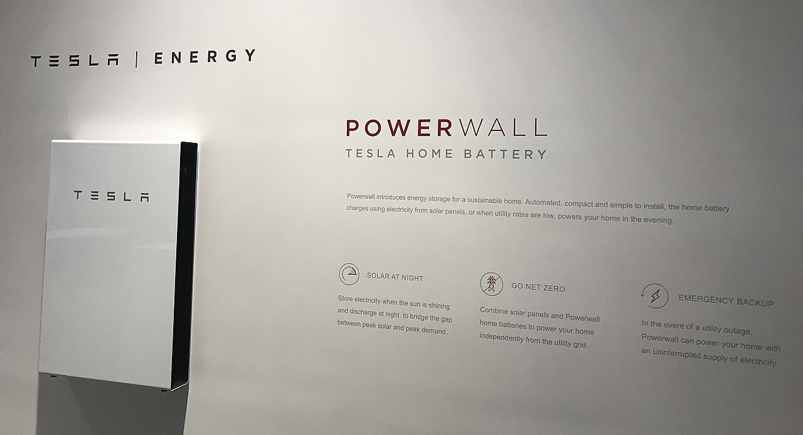

# 26.06 — Magazyn energii

> **Moduł:** [26 — Fotowoltaika, pompy ciepła, wallboxy i magazyny energii](README.md) · **Oznaczenia:** 🏠📋 · **Zakres SEP:** (a) (b) (c) (e) · **Status:** ✅ pełny
>
> **Czytaj:**
>
> - Falownik i backup: [26.03](26.03-falownik-i-przylaczenie-mikroinstalacji.md)
> - Przełączanie źródeł: [25.04](../25-transformatory-ups-agregaty/25.04-agregat-pradotworczy-i-przelacznik-zasilania.md)

[← poprzedni temat](26.05-wallbox-i-ladowanie-samochodu.md) · [spis modułu](README.md) · (koniec modułu) →

## Po co to jest

Domowy magazyn energii zbiera nadwyżki z PV w dzień i oddaje je wieczorem. Przy rozliczeniu net-billing to sposób na wyższą autokonsumpcję, a z funkcją **backup** — także zasilanie awaryjne. Dla elektryka to **trzecie źródło** w domu (obok sieci i PV) z bateriami prądu stałego o dużym prądzie zwarciowym.

## Po ludzku

**Bateria** — dziś prawie zawsze **litowo-żelazowo-fosforanowa (LFP)**: bezpieczniejsza termicznie od innych litowych, trwała (kilka tysięcy cykli). Typowa pojemność domowa **5–15 kWh**, modułowa. Ma własny układ **BMS**, który pilnuje napięć ogniw, temperatury i prądów.

**Dwa sposoby dołączenia:**

- **sprzężenie DC** — bateria i panele podłączone do jednego **falownika hybrydowego**. Mniej przemian energii (wyższa sprawność przy ładowaniu z PV), jeden falownik. Dobre przy nowej instalacji,
- **sprzężenie AC** — bateria ma **własny falownik bateryjny** podłączony po stronie AC. Łatwo dołożyć do istniejącej instalacji PV, ale energia z paneli przechodzi DC→AC→DC→AC.

**Backup (EPS)** — przy zaniku sieci falownik **odłącza dom od sieci** wbudowanym przełącznikiem (lub w skrzynce backup) i zasila wybrane obwody z baterii, a często też z paneli. To ta sama zasada co przy agregacie: **nigdy nie zasilaj sieci** ([25.05](../25-transformatory-ups-agregaty/25.05-dlaczego-nie-zasila-sie-domu-przez-gniazdo.md)). Rodzaje:

- **częściowy** — osobne wyjście z wybranymi obwodami (lodówka, piec, oświetlenie, router),
- **całego domu** — przełącznik na całą instalację, większa moc falownika,
- czas przełączenia — od milisekund (UPS-owy) do kilku sekund — zależy od modelu.

**Ochrona przeciwporażeniowa w trybie wyspowym** — po odłączeniu od sieci znika połączenie N–PE ze stacji. Falownik musi wtedy zapewnić właściwy układ (np. zestyk łączący N z PE w trybie backup), żeby RCD i samoczynne wyłączenie dalej działały. To wymaganie producenta i projektu — elektryk musi je **sprawdzić pomiarami w trybie backup**.

## Jak to wygląda

*Na co patrzeć: zamknięta obudowa naścienna — w środku moduły ogniw LFP/litowe, BMS i (w tym modelu) falownik. Montaż wymaga zachowania odstępów i warunków z instrukcji (temperatura, nasłonecznienie, wysokość, odległość od drzwi i okien).*

## Schemat

## Pojęcia

| Pojęcie | Po ludzku | Termin normowy / symbol |
|---------|-----------|-------------------------|
| LFP | Bateria litowo-żelazowo-fosforanowa | LiFePO₄ |
| BMS | Elektronika nadzorująca ogniwa | Battery Management System |
| Sprzężenie DC / AC | Bateria przy falowniku PV / z osobnym falownikiem | — |
| Backup / EPS | Zasilanie awaryjne z magazynu | Emergency Power Supply |
| Praca wyspowa | Dom odłączony od sieci, zasilany z magazynu | tryb off-grid |
| Pojemność użyteczna | Ile energii da się realnie wyjąć | kWh (usable) |
| Cykl | Pełne naładowanie i rozładowanie | — |

## Liczby do zapamiętania

| Wielkość | Wartość | Kiedy obowiązuje | Źródło |
|----------|---------|------------------|--------|
| Pojemność domowa | ok. **5–15 kWh** | typowe magazyny | katalogi |
| Chemia | najczęściej **LFP** | domowe magazyny | katalogi |
| Trwałość LFP | ok. **3000–6000 cykli** | według producenta | katalogi |
| Sprawność cyklu | ok. **85–95 %** | ładowanie + rozładowanie | katalogi |
| Czas przełączenia na backup | **ms – kilka s** | zależnie od modelu | instrukcje |

## W praktyce

- **Miejsce montażu** — według instrukcji: zakres temperatur (LFP nie lubi ładowania na mrozie), odstępy, podłoże, brak bezpośredniego słońca. Garaż lub pomieszczenie techniczne, z dala od dróg ewakuacji. Sprawdź aktualne wymagania przeciwpożarowe.
- **Przewody DC baterii** — duże prądy (dziesiątki–ponad sto A) przy niskim napięciu (baterie 48 V) albo średnie przy bateriach wysokonapięciowych (setki V). Zabezpieczenie (bezpiecznik/wyłącznik DC) przy baterii, odpowiedni przekrój, staranne dokręcenie.
- **Obwody backup** — w rozdzielnicy osobna sekcja z wyraźnym opisem „zasilane z magazynu”; przy pracach trzeba wyłączyć falownik i baterię, nie tylko wyłącznik główny.
- **Po montażu** — pomiary ochronne **w obu trybach**: z sieci i w trybie backup.
- **Dobór pojemności** — wieczorny i nocny pobór domu, a nie „im więcej, tym lepiej”; w zimie PV rzadko naładuje dużą baterię.

## Błędy i zagrożenia

- ⚠️ **Zwarcie zacisków baterii** — prąd zwarciowy DC rzędu tysięcy A, łuk, poparzenia. Narzędzia izolowane, zdjęta biżuteria, praca po rozłączeniu.
- ⚠️ **Praca w obwodzie backup po wyłączeniu wyłącznika głównego** — obwód zasila magazyn.
- ⚠️ **Brak działającej ochrony przeciwporażeniowej w trybie wyspy** — RCD nie zadziała, jeśli falownik nie odtworzy połączenia N–PE.
- **Bateria na mrozie lub w słońcu** — ograniczenie mocy, szybsza degradacja.
- **Domowe „magazyny” z używanych ogniw** — bez BMS i atestów to realne ryzyko pożaru.

## Przykład

**Zadanie.** Dom zużywa wieczorem i w nocy (18:00–7:00) ok. 6 kWh. Magazyn ma 10 kWh pojemności nominalnej i 90 % pojemności użytecznej. Czy wystarczy na noc i ile zostanie na awarię?

**Rozwiązanie.** Pojemność użyteczna: 10 · 0,9 = **9 kWh**. Po nocy zostaje ok. 9 − 6 = **3 kWh**, jeśli w dzień bateria się naładowała. Gdy rano wystąpi awaria, 3 kWh wystarczy na kilka godzin zasilania lodówki, pieca, routera i oświetlenia (razem ok. 300–400 W). Część pojemności można zarezerwować w ustawieniach na backup (np. 20 %).

## Pytania SEP

1. **O czym należy pamiętać, wykonując prace w instalacji z magazynem energii i funkcją zasilania rezerwowego?**

Odpowiedź

Że w instalacji są co najmniej trzy źródła: sieć, moduły PV i bateria. Wyłączenie wyłącznika głównego nie odłącza obwodów zasilanych z falownika hybrydowego w trybie rezerwowym. Przed pracą trzeba wyłączyć falownik według instrukcji, odłączyć baterię rozłącznikiem DC i stronę PV, sprawdzić brak napięcia i zabezpieczyć przed ponownym załączeniem. Bateria jest źródłem dużego prądu zwarciowego DC — praca przy jej zaciskach wymaga narzędzi izolowanych i szczególnej ostrożności.

2. **Jakie warunki musi spełniać zasilanie rezerwowe z magazynu energii, aby było bezpieczne?**

Odpowiedź

Musi samoczynnie odłączać zasilane obwody od sieci przed przejściem na pracę wyspową (nie może zasilać sieci), a po powrocie sieci — przełączać z powrotem z synchronizacją lub po przerwie. W trybie wyspowym musi być zapewniona skuteczna ochrona przeciwporażeniowa, np. przez odpowiednie połączenie przewodu N z PE w falowniku i działające wyłączniki różnicowoprądowe — co sprawdza się pomiarami w tym trybie.

## Sprawdź się

1. Dlaczego przy sprzężeniu AC energia z PV zmagazynowana w baterii „traci” więcej niż przy sprzężeniu DC?

Odpowiedź

Bo przechodzi więcej przemian: DC z paneli → AC w falowniku PV → DC w falowniku bateryjnym przy ładowaniu → AC przy rozładowaniu. Każda przemiana ma kilka procent strat. Przy sprzężeniu DC energia z paneli trafia do baterii bez zamiany na AC.

## Źródła

- PN-HD 60364-8-82 — Prosumenckie instalacje niskiego napięcia (zasilanie z wielu źródeł, praca wyspowa).
- PN-EN 62619 — Bezpieczeństwo akumulatorów litowych do zastosowań przemysłowych (w tym magazynów energii).
- [25.04 — Agregat i przełącznik zasilania](../25-transformatory-ups-agregaty/25.04-agregat-pradotworczy-i-przelacznik-zasilania.md); [26.03 — Falownik i przyłączenie](26.03-falownik-i-przylaczenie-mikroinstalacji.md).

---

[← poprzedni temat](26.05-wallbox-i-ladowanie-samochodu.md) · [spis modułu](README.md) · (koniec modułu) →
