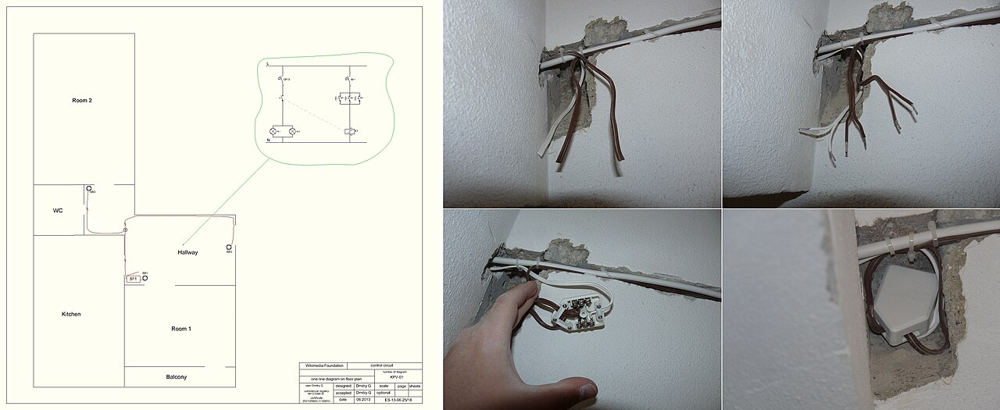
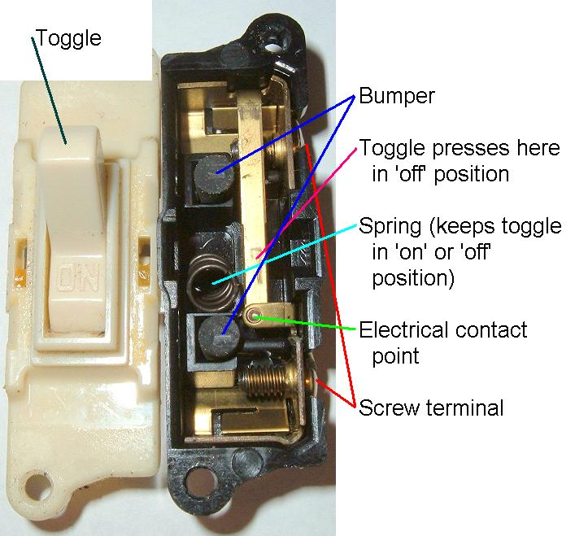
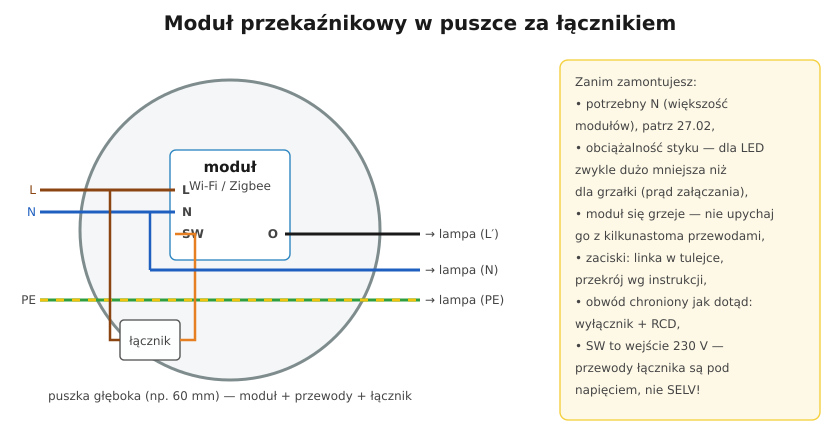

# 27.01 — Moduły bezprzewodowe w puszce — bezpieczny montaż

> **Moduł:** [27 — Inteligentny dom](README.md) · **Oznaczenia:** 🏠 · **Zakres SEP:** (c) · **Status:** ✅ pełny
>
> **Czytaj:**
>
> - Puszki i złączki: [06.03](../06-osprzet-instalacyjny/06.03-puszki-instalacyjne-i-rozgalezne.md), [06.04](../06-osprzet-instalacyjny/06.04-zlaczki-i-laczenie-przewodow-dlaczego-nie.md)
> - Przekaźnik impulsowy i sterowanie oświetleniem: [18.04](../18-oswietlenie/18.04-przekaznik-impulsowy-zamiast-lacznikow.md)

← (początek modułu) · [spis modułu](README.md) · [następny temat →](27.02-przewod-neutralny-w-puszce-lacznika.md)

## Po co to jest

Moduły „smart” montowane w puszce za łącznikiem to najpopularniejszy sposób, żeby zwykłe światło lub roletę sterować z telefonu. Wyglądają niewinnie — mała kostka z kilkoma zaciskami — ale to **urządzenie 230 V** wciśnięte do ciasnej puszki razem z przewodami. Ten temat mówi, jak je zamontować, żeby nie pogorszyć bezpieczeństwa instalacji.

## Po ludzku

**Co jest w środku modułu:** mały zasilacz (zwykle bez transformatora — elektronika ma potencjał sieci), mikrokontroler z radiem (Wi-Fi, Zigbee, Z-Wave, Thread/Matter) i **przekaźnik** albo triak, który załącza lampę. Wejście **SW** czyta stan zwykłego łącznika, więc łącznik dalej działa.

**Typowe zaciski:**

- **L** i **N** — zasilanie modułu,
- **SW** (S1, S2) — wejścia z łącznika (często na napięciu 230 V!),
- **O** (O1, O2, „L-out”) — wyjście do lampy,
- przy modułach rolet — dwa wyjścia (góra / dół) z wzajemną blokadą.

**Najważniejsze zasady montażu:**

1. **Puszka głęboka** (np. 60 mm) albo puszka z dodatkową przestrzenią. Moduł + kilka przewodów + łącznik w zwykłej płytkiej puszce to dociskanie izolacji, łamanie żył i ciepło bez ujścia.
2. **Obciążalność** — styk modułu ma podany prąd, ale dla LED i zasilaczy dopuszczalna moc jest dużo mniejsza (prąd załączania kondensatorów, [25.02](../25-transformatory-ups-agregaty/25.02-zasilacze-impulsowe.md)). Do dużych odbiorników (grzałka, bojler) moduł steruje **stycznikiem**, a nie odbiornikiem bezpośrednio.
3. **Zaciski** — przekrój i długość odizolowania wg instrukcji; linka w tulejce; nie więcej przewodów w zacisku, niż dopuszcza producent. Połączenia „w puszce” robi się **złączkami**, a do modułu idzie po jednym przewodzie na zacisk.
4. **Ochrona obwodu bez zmian** — moduł nie zastępuje wyłącznika nadprądowego ani RCD; zabezpieczenie obwodu musi chronić także cienkie przewody modułu (często dopuszczalne max. 10 lub 16 A — sprawdź instrukcję).
5. **To nie jest SELV** — przewody do łącznika podłączonego do wejścia SW mają **230 V**. Nie podłączaj do SW przycisków dzwonkowych 12 V ani przewodów sygnałowych.
6. **Opis** — w rozdzielnicy i w dokumentacji zaznacz, gdzie są moduły. Następny elektryk szukający „dlaczego lampa świeci” powinien to wiedzieć.

**Moduł czy przekaźnik w rozdzielnicy?** Moduł w puszce jest tani i szybki do dołożenia w istniejącej instalacji. W nowym domu lepiej przewidzieć przewody i **sterowanie z rozdzielnicy** (przekaźniki, aktory — [27.04](27.04-automatyka-w-rozdzielnicy.md)): ciepło, serwis i porządek są wtedy w jednym miejscu.

## Jak to wygląda

*Na co patrzeć: wiele przewodów w jednej puszce — moduł przekaźnikowy wymaga miejsca. Przy planowaniu warto dać puszkę głęboką albo osobną puszkę na połączenia obok łącznika.*

*Na co patrzeć: zwykły łącznik zostaje — moduł tylko „czyta” jego położenie przez wejście SW. Dlatego po montażu modułu łącznik nadal działa, nawet bez Wi-Fi.*

## Schemat

## Pojęcia

| Pojęcie | Po ludzku | Termin normowy / symbol |
|---------|-----------|-------------------------|
| Moduł przekaźnikowy | Mały sterownik z przekaźnikiem do puszki | — |
| Wejście SW | Zacisk, do którego podłącza się łącznik | S, S1, SW |
| Wyjście O | Zacisk sterowanej lampy | O, L-out |
| Przekaźnik / triak | Element załączający obciążenie | — |
| Zigbee / Z-Wave / Thread | Sieci radiowe automatyki domu | — |
| Puszka głęboka | Puszka o większej głębokości, np. 60 mm | — |

## Liczby do zapamiętania

| Wielkość | Wartość | Kiedy obowiązuje | Źródło |
|----------|---------|------------------|--------|
| Głębokość puszki pod moduł | zwykle **≥ 60 mm** | moduł + łącznik w jednej puszce | instrukcje producentów |
| Obciążalność styku | podana w A, dla **LED** zwykle **dużo mniejsza** | dobór do odbiornika | instrukcja modułu |
| Napięcie wejść SW | **230 V** (o ile instrukcja nie mówi inaczej) | moduły zasilane z sieci | instrukcja modułu |
| Zabezpieczenie obwodu | nie większe niż dopuszcza moduł (np. **10 / 16 A**) | wymagania producenta | instrukcja modułu |

## W praktyce

- **Przed montażem:** wyłącz obwód, sprawdź brak napięcia na wszystkich przewodach w puszce — w puszce łącznika bywa faza z innego obwodu (np. gniazda).
- **Rozpoznaj przewody:** który jest L zasilający, który idzie do lampy, czy jest N ([27.02](27.02-przewod-neutralny-w-puszce-lacznika.md)). Opisz je taśmą przed odłączeniem łącznika.
- **Po montażu:** sprawdź działanie łącznikiem i aplikacją; przy LED — czy nie migają po wyłączeniu.
- **Gorący moduł** albo zapach — przeciążenie lub luźny zacisk; wyłącz i sprawdź.
- **Rolety** — moduł roletowy ma blokadę jednoczesnego załączenia obu kierunków; nie łącz silnika rolety na dwóch zwykłych modułach przekaźnikowych.

## Błędy i zagrożenia

- ⚠️ **Moduł wciśnięty na siłę do płytkiej puszki** — uszkodzona izolacja, zwarcie, przegrzanie.
- ⚠️ **„N” z przewodu ochronnego** — prąd roboczy w PE, wybija RCD, a przy przerwie PE obudowy dostają napięcie.
- **Grzejnik lub bojler bezpośrednio na module** — przegrzany przekaźnik, sklejone styki.
- **Przyciski SELV podłączone do wejść 230 V** — 230 V w przewodach i przyciskach, które nie są do tego przystosowane.
- **Brak opisu** — kolejna osoba wyłącza „swój” obwód, a moduł zasilany z innego dalej ma napięcie.

## Przykład

**Zadanie.** Lampa LED 8 × 7 W w salonie, moduł o styku „16 A”, ale w instrukcji: „LED — maks. 200 W”. Czy wystarczy? Co, jeśli właściciel chce też podłączyć do modułu grzejnik konwektorowy 2000 W?

**Rozwiązanie.** Oświetlenie: 8 · 7 = **56 W** < 200 W — w porządku. Grzejnik 2000 W to ok. **8,7 A** — w granicy styku, ale długotrwałe obciążenie w ciasnej puszce grzeje moduł. Rozsądniej: moduł steruje **stycznikiem modułowym** w rozdzielnicy, a grzejnik jest na osobnym obwodzie ([10.02](../10-aparatura-modulowa/10.02-stycznik-modulowy-i-przekaznik-bistabilny.md)).

## Pytania SEP

1. **Na co należy zwrócić uwagę przy montażu modułów sterujących w puszkach instalacyjnych?**

Odpowiedź

Na wystarczającą przestrzeń w puszce (puszka głęboka), tak aby przewody i moduł nie były dociskane i mogły oddawać ciepło; na dopuszczalne obciążenie wyjścia, zwłaszcza dla źródeł LED i odbiorników o dużym prądzie załączania; na prawidłowe podłączenie przewodów L, N i przewodów sterujących zgodnie z instrukcją (przewody łącznika są zwykle pod napięciem 230 V); na dobór przekroju i sposób zakończenia przewodów; na zachowanie zabezpieczenia nadprądowego i różnicowoprądowego obwodu; oraz na opisanie zmian w dokumentacji instalacji. Przed pracą trzeba wyłączyć zasilanie i sprawdzić brak napięcia na wszystkich przewodach w puszce.

## Sprawdź się

1. Dlaczego po zamontowaniu modułu przekaźnikowego wymiana lampy wymaga takiej samej ostrożności jak wcześniej, mimo że lampa „jest wyłączona w aplikacji”?

Odpowiedź

Bo wyłączenie w aplikacji to tylko otwarty styk przekaźnika (albo zablokowany triak) — nie jest to odłączenie zapewniające bezpieczeństwo. Przy błędzie modułu, ponownym załączeniu z harmonogramu lub przez inną osobę lampa może dostać napięcie. Do prac wyłącza się obwód w rozdzielnicy i sprawdza brak napięcia.

## Źródła

- Instrukcje montażu modułów przekaźnikowych (producent konkretnego urządzenia) — obciążalność, przekroje, puszka.
- PN-HD 60364-5-52 — Dobór i montaż wyposażenia elektrycznego. Oprzewodowanie.
- [18.04 — Przekaźnik impulsowy](../18-oswietlenie/18.04-przekaznik-impulsowy-zamiast-lacznikow.md).

---

← (początek modułu) · [spis modułu](README.md) · [następny temat →](27.02-przewod-neutralny-w-puszce-lacznika.md)
