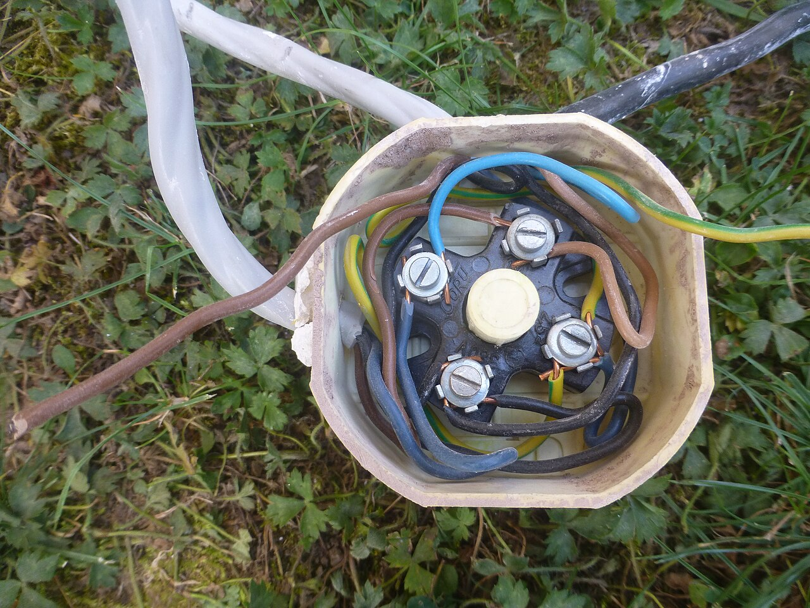
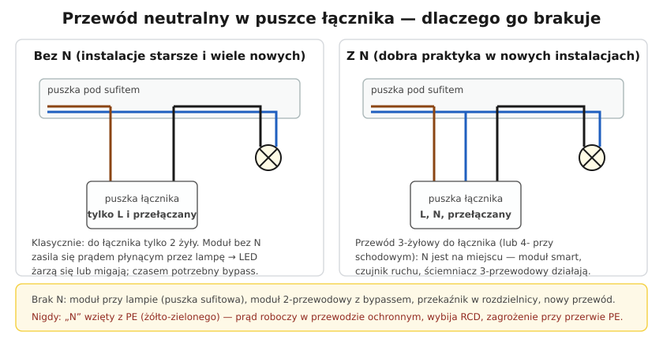

# 27.02 — Przewód neutralny w puszce łącznika

> **Moduł:** [27 — Inteligentny dom](README.md) · **Oznaczenia:** 🏠 · **Zakres SEP:** (c) · **Status:** ✅ pełny
>
> **Czytaj:**
>
> - Wymiana łącznika: [19.02](../19-prace-krok-po-kroku/19.02-wymiana-lacznika.md)
> - Schematy łączników: [18.02](../18-oswietlenie/18.02-lacznik-jednobiegunowy-i-swiecznikowy-schematy.md), [18.03](../18-oswietlenie/18.03-uklad-schodowy-i-krzyzowy-schematy.md)

[← poprzedni temat](27.01-moduly-bezprzewodowe-w-puszce-bezpieczny-montaz.md) · [spis modułu](README.md) · [następny temat →](27.03-systemy-przewodowe-knx-modbus-przeglad.md)

## Po co to jest

„Kupiłem łącznik dotykowy / moduł Wi-Fi, a w puszce nie ma niebieskiego przewodu” — to jedno z najczęstszych pytań przy automatyce domu. Ten temat wyjaśnia, skąd bierze się brak N w puszce łącznika, jak sobie z tym radzić i czego nigdy nie robić.

## Po ludzku

**Klasyczny obwód oświetlenia:** w puszce pod sufitem (albo w puszce rozgałęźnej) jest L, N i PE z rozdzielnicy. Do łącznika schodzi przewód **dwużyłowy** (albo trzyżyłowy z PE): **L** do łącznika i **powrót** (L przełączany) do lampy. **N idzie prosto do lampy** — łącznikowi nie był potrzebny, bo zwykły łącznik tylko przerywa fazę.

**Elektronika potrzebuje zasilania** — a zasilanie to zawsze obwód L–N. Jeśli w puszce łącznika nie ma N, elektronika może zasilać się tylko **przez lampę**: płynie przez nią mały prąd także wtedy, gdy jest „wyłączona”. Żarówka tradycyjna tego nie pokaże, ale LED (z zasilaczem) potrafi od tego prądu **migać** lub **żarzyć się** ([20.07](../20-diagnostyka-usterek/20.07-migajace-i-zarzace-sie-led.md)).

**Rozwiązania, gdy brak N:**

1. **Moduł przy lampie** — w puszce sufitowej lub w lampie (tam N jest). Łącznik dalej steruje modułem przez wejście SW.
2. **Moduł/łącznik dwuprzewodowy** (bez N) — przeznaczony do tego; przy małych obciążeniach LED producent dodaje **bypass** (kondensator lub rezystor równolegle do lampy), żeby prąd zasilający elektronikę płynął obok lampy.
3. **Przekaźnik w rozdzielnicy** — w puszce łącznika zostaje zwykły przycisk, a sterowanie jest w rozdzielnicy ([18.04](../18-oswietlenie/18.04-przekaznik-impulsowy-zamiast-lacznikow.md), [27.04](27.04-automatyka-w-rozdzielnicy.md)).
4. **Dołożenie przewodu** — wymiana przewodu w rurce lub nowa bruzda.

**Czego nie wolno:** wziąć „N” z przewodu ochronnego PE. Wtedy prąd roboczy płynie przewodem, który ma chronić ([02.02](../02-prad-przemienny-230-400/02.02-faza-przewod-neutralny-i-przewod-ochronny-l-n-pe.md)): RCD wykryje różnicę i wybije, a jeśli obwód jest bez RCD — przy przerwie PE wszystkie obudowy podłączone do tego PE dostaną napięcie przez moduł.

**W nowych instalacjach** doprowadzenie N do puszek łączników (przewód 3×1,5 + PE zamiast 2×1,5 + PE) kosztuje niewiele, a pozwala później zamontować dowolny łącznik elektroniczny, czujnik ruchu czy moduł. To dobra praktyka, warto ją zapisać w projekcie.

## Jak to wygląda

*Na co patrzeć: w puszce rozgałęźnej są wszystkie żyły — brązowe, niebieskie i żółto-zielone. Tu N jest zawsze dostępny, dlatego moduł można zamontować przy lampie, a nie w puszce łącznika.*

## Schemat

## Pojęcia

| Pojęcie | Po ludzku | Termin normowy / symbol |
|---------|-----------|-------------------------|
| Przewód przełączany | Żyła od łącznika do lampy | „powrót”, L′ |
| Moduł 2-przewodowy | Działa bez N, zasila się przez lampę | — |
| Bypass | Element równoległy do lampy przepuszczający mały prąd | — |
| Prąd upływu modułu | Prąd płynący przez „wyłączoną” lampę | — |
| Łącznik elektroniczny | Łącznik dotykowy, ściemniacz, czujnik ruchu | — |

## Liczby do zapamiętania

| Wielkość | Wartość | Kiedy obowiązuje | Źródło |
|----------|---------|------------------|--------|
| Żyły do łącznika (klasycznie) | **2 + PE** (L, L′) | obwód z łącznikiem 1-biegunowym | 18.02 |
| Żyły do łącznika z N | **3 + PE** (L, N, L′) | łączniki elektroniczne, moduły | dobra praktyka |
| Minimalne obciążenie modułu bez N | często **kilka W–kilkanaście W** (wg instrukcji) | moduły 2-przewodowe | instrukcje producentów |

## W praktyce

- **Sprawdź, co jest w puszce:** wyłącz obwód, rozłącz łącznik, zmierz po załączeniu (ostrożnie) napięcie między żyłami a PE; albo sprawdź ciągłość po wyłączeniu. Niebieska żyła w puszce łącznika **nie zawsze jest N** — bywa użyta jako przewód przełączany.
- **Schodowy (dwa łączniki)** — przewody między łącznikami to „korespondencyjne” żyły; N zwykle jest tylko w puszce rozgałęźnej ([18.03](../18-oswietlenie/18.03-uklad-schodowy-i-krzyzowy-schematy.md)).
- **Wymiana przewodu w rurce** — jeśli instalacja jest w rurkach, często da się przeciągnąć przewód z dodatkową żyłą.
- **Zapisz zmianę** — kto później otworzy puszkę, powinien wiedzieć, że jest tam moduł i N.

## Błędy i zagrożenia

- ⚠️ **N wzięty z PE** — niezgodne z zasadami, groźne przy przerwie PE, zwykle wybija RCD.
- ⚠️ **N wzięty z innego obwodu** (np. z gniazda obok) — RCD obu obwodów wybijają, a po wyłączeniu jednego obwodu w puszce dalej jest napięcie z drugiego.
- **Zakładanie, że niebieska żyła to N** — w starszych instalacjach bywa fazą przełączaną.
- **Moduł 2-przewodowy z bardzo małym obciążeniem LED** — miganie, niestabilna praca; potrzebny bypass albo moduł z N.

## Przykład

**Zadanie.** W puszce łącznika są dwie żyły: brązowa i czarna, plus żółto-zielona. Właściciel chce łącznik dotykowy wymagający N. Co proponujesz?

**Rozwiązanie.** Brązowa to zapewne L, czarna — przewód do lampy (sprawdź pomiarem). N w puszce nie ma, **PE nie może go zastąpić**. Możliwości: łącznik dotykowy w wersji **bez N** (z bypassem przy LED), **moduł przy lampie** z łącznikiem zwykłym/przyciskiem, albo — jeśli przewody są w rurce — **przeciągnięcie przewodu z dodatkową żyłą**.

## Pytania SEP

1. **Dlaczego nie wolno wykorzystywać przewodu ochronnego PE jako przewodu neutralnego do zasilania urządzeń?**

Odpowiedź

Przewód PE służy wyłącznie do ochrony przy uszkodzeniu i w normalnych warunkach nie powinien przewodzić prądu roboczego. Gdy płynie nim prąd roboczy, wyłącznik różnicowoprądowy wykrywa różnicę prądów i może wyzwalać, a jeśli obwód nie ma RCD — przy przerwie przewodu PE wszystkie dołączone do niego części przewodzące dostępne mogą znaleźć się pod napięciem przez odbiornik. Funkcji N i PE łączy się tylko w przewodzie PEN w układzie TN-C, w warunkach określonych przepisami (odpowiedni przekrój, instalacja stała) — nigdy w obwodach odbiorczych z przewodami o małym przekroju.

## Sprawdź się

1. Dlaczego żarówka tradycyjna nie świeci od prądu modułu bez N, a lampa LED potrafi się żarzyć?

Odpowiedź

Prąd zasilający elektronikę modułu jest bardzo mały (miliampery). Żarówce o mocy kilkudziesięciu watów to za mało, żeby żarnik się rozgrzał. Zasilacz lampy LED gromadzi ten prąd w kondensatorze, a gdy napięcie na nim wystarczy, zasilacz na chwilę startuje — lampa błyska lub żarzy się słabym światłem.

## Źródła

- PN-HD 60364-5-54 — Uziemienia i przewody ochronne (rola przewodu PE).
- [19.02 — Wymiana łącznika](../19-prace-krok-po-kroku/19.02-wymiana-lacznika.md); [20.07 — Migające i żarzące się LED](../20-diagnostyka-usterek/20.07-migajace-i-zarzace-sie-led.md).

---

[← poprzedni temat](27.01-moduly-bezprzewodowe-w-puszce-bezpieczny-montaz.md) · [spis modułu](README.md) · [następny temat →](27.03-systemy-przewodowe-knx-modbus-przeglad.md)
