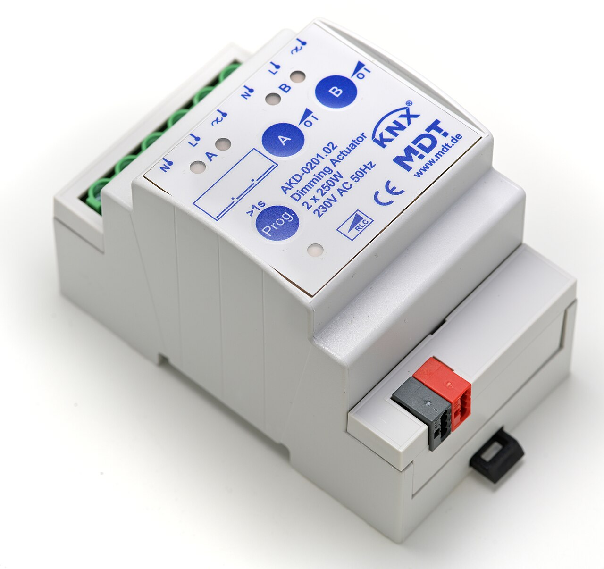
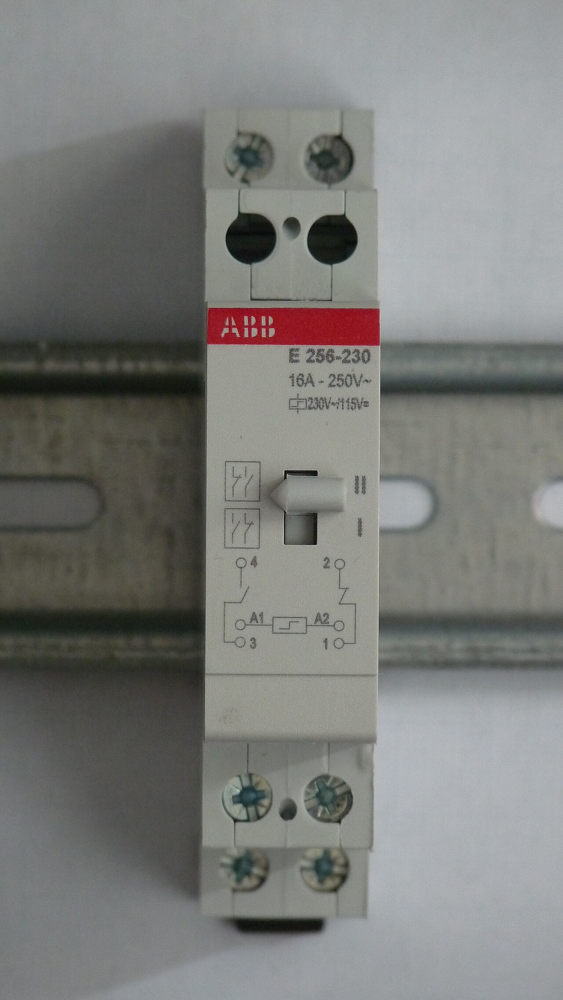
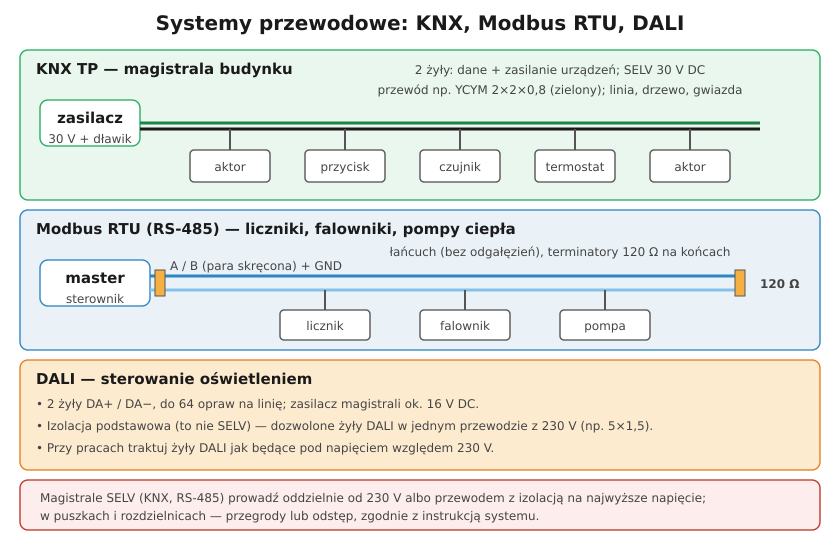

# 27.03 — Systemy przewodowe: KNX, Modbus — przegląd

> **Moduł:** [27 — Inteligentny dom](README.md) · **Oznaczenia:** 🏠 · **Zakres SEP:** (c) · **Status:** ✅ pełny
>
> **Czytaj:**
>
> - 🇬🇧 [ABB i-bus KNX — instalacja systemu](https://new.abb.com/low-voltage/products/building-automation/product-range/abb-i-bus-knx/system/installation)
> - SELV i separacja obwodów: [12.04](../12-ochrona-przeciwporazeniowa/12.04-izolacja-podwojna-separacja-elektryczna-selv-i.md)

[← poprzedni temat](27.02-przewod-neutralny-w-puszce-lacznika.md) · [spis modułu](README.md) · [następny temat →](27.04-automatyka-w-rozdzielnicy.md)

## Po co to jest

Gdy automatyki w domu jest dużo (oświetlenie, rolety, ogrzewanie, liczniki energii, PV), moduły radiowe przestają wystarczać. Wtedy pojawiają się **systemy przewodowe**: KNX, Modbus, DALI. Elektryk nie musi umieć ich programować, ale musi je **poprawnie ułożyć i podłączyć** — oddzielić od 230 V, dobrać przewód, nie pomylić magistrali z obwodem zasilającym.

## Po ludzku

**KNX (TP — skrętka)** — międzynarodowy standard automatyki budynków (EN 50090). Wszystkie urządzenia (przyciski, aktory, czujniki, termostaty) wiszą na **jednej parze przewodów**, która niesie i dane, i zasilanie urządzeń: **ok. 30 V DC, SELV**. Zasilacz KNX ma dławik, który oddziela napięcie stałe od sygnału. Aktory w rozdzielnicy załączają obwody 230 V. Program wgrywa się narzędziem ETS. Typowe zasady linii KNX: do **64 urządzeń** na segment, długość przewodu w segmencie do **1000 m**, od zasilacza do urządzenia **≤ 350 m**, między urządzeniami **≤ 700 m**; topologia liniowa, drzewiasta lub gwiazdowa (bez pętli). Przewód: np. **YCYM 2×2×0,8** (zielona powłoka) — druga para jest rezerwą.

**Modbus RTU (RS-485)** — prosty protokół, którym „rozmawiają” liczniki energii, falowniki PV, pompy ciepła, wallboxy. Jedno urządzenie nadrzędne (master) odpytuje pozostałe. Okablowanie: **para skręcona A/B** (+ masa), połączenie **łańcuchowe** (od urządzenia do urządzenia, bez długich odgałęzień), **terminatory 120 Ω** na obu końcach. Zasięg do ok. 1200 m przy małej prędkości.

**DALI** — magistrala do sterowania oprawami oświetleniowymi (ściemnianie, sceny). **Dwie żyły**, do **64 opraw** na linię, napięcie ok. 16 V DC z zasilacza magistrali. Ważne: DALI ma **izolację podstawową**, a **nie SELV** — dlatego żyły DALI mogą biec w jednym przewodzie z 230 V (np. 5×1,5 mm²: L, N, PE, DA+, DA−). Z tego samego powodu przy pracach traktuje się je jak przewody pod napięciem.

**Separacja SELV od 230 V** — obwody SELV (KNX, RS-485, 24 V) muszą być oddzielone od obwodów 230 V: osobnym przewodem i odstępem, przegrodą w puszce lub rozdzielnicy, albo izolacją każdego przewodu na najwyższe występujące napięcie ([12.04](../12-ochrona-przeciwporazeniowa/12.04-izolacja-podwojna-separacja-elektryczna-selv-i.md)). Szczegóły — wytyczne systemu i producenta przewodu.

## Jak to wygląda

*Na co patrzeć: czerwono-czarne złącze na dole to magistrala KNX (SELV 30 V); zaciski u góry to obwody 230 V. W jednym aparacie spotykają się dwa światy — dlatego przewody magistrali prowadzi się osobno i ostrożnie.*

*Na co patrzeć: prostsze sterowanie bez magistrali — przekaźnik bistabilny załączany przyciskami. Wiele „inteligentnych” funkcji da się zrobić tak tanio i niezawodnie.*

## Schemat

## Pojęcia

| Pojęcie | Po ludzku | Termin normowy / symbol |
|---------|-----------|-------------------------|
| KNX | Magistrala automatyki budynku | EN 50090, KNX TP |
| Aktor | Urządzenie wykonawcze (przekaźnik, ściemniacz) | — |
| Sensor | Urządzenie wejściowe (przycisk, czujnik) | — |
| Modbus RTU | Protokół komunikacji szeregowej | RS-485 |
| Terminator | Rezystor 120 Ω na końcu linii RS-485 | — |
| DALI | Magistrala sterowania oświetleniem | IEC 62386 |
| Magistrala | Wspólne przewody dla wielu urządzeń | bus |

## Liczby do zapamiętania

| Wielkość | Wartość | Kiedy obowiązuje | Źródło |
|----------|---------|------------------|--------|
| Napięcie KNX | ok. **30 V DC**, SELV | magistrala TP | ABB i-bus KNX |
| Przewód KNX | np. **YCYM 2×2×0,8** | instalacja TP | jw. |
| Linia KNX | do **64** urządzeń, **1000 m** | segment linii | wytyczne KNX |
| Odległości KNX | zasilacz–urządzenie **≤ 350 m**, urządzenie–urządzenie **≤ 700 m** | segment linii | wytyczne KNX |
| Terminator RS-485 | **120 Ω** na obu końcach | Modbus RTU | standard RS-485 |
| DALI | **64** oprawy na linię, ok. **16 V DC** | sterowanie oświetleniem | IEC 62386 |

## W praktyce

- **Przewód magistrali w rurce** razem z przewodami 230 V — tylko gdy pozwala na to izolacja przewodu i wytyczne systemu; najprościej: osobne rurki.
- **Oznacz przewody magistral** na obu końcach (KNX, MODBUS, DALI) — kolor powłoki to za mało.
- **Pomiary izolacji** — przed pomiarem 500 V odłącz urządzenia magistral i elektronikę; magistralę SELV mierzy się napięciem 250 V ([23.03](../23-pomiary-odbiorcze-i-okresowe/23.03-rezystancja-izolacji.md)).
- **Modbus nie działa** — sprawdź zamianę A/B (producenci różnie opisują zaciski), terminatory, wspólną masę, adresy i prędkość.
- **DALI w przewodzie 5-żyłowym** — przy pracach w puszce żyły DA+/DA− traktuj jak będące pod napięciem.

## Błędy i zagrożenia

- ⚠️ **Przewód SELV w puszce z 230 V bez przegrody** — uszkodzenie izolacji przenosi 230 V na przyciski i czujniki, których ktoś dotyka ręką.
- **Pierścień (pętla) na magistrali KNX** — błędy komunikacji; magistrala ma być drzewem.
- **Gwiazda z długimi odgałęzieniami na RS-485** — odbicia sygnału i błędy.
- **Pomiar izolacji 500 V z podłączonymi urządzeniami magistral** — uszkodzenie elektroniki.
- **Brak dokumentacji** (adresy, plan magistrali) — instalacji nie da się serwisować.

## Przykład

**Zadanie.** Do sterownika domowego (master Modbus) w rozdzielnicy podłączasz licznik energii (w rozdzielnicy), falownik PV (garaż, 25 m) i pompę ciepła (kotłownia, 15 m dalej). Jak ułożyć magistralę?

**Rozwiązanie.** Łańcuchowo: **sterownik → licznik → falownik → pompa**, jednym przewodem skrętkowym z parą A/B i żyłą masy (np. przewód do RS-485 lub skrętka). **Terminatory 120 Ω** na pierwszym (sterownik) i ostatnim (pompa) urządzeniu — wiele urządzeń ma je wbudowane do włączenia przełącznikiem. Przewód magistrali w osobnej rurce lub z odpowiednią izolacją, oddzielony od przewodów 230 V.

## Pytania SEP

1. **Jak należy prowadzić obwody bardzo niskiego napięcia (SELV) systemów automatyki względem obwodów 230 V?**

Odpowiedź

Obwody SELV muszą być oddzielone od obwodów o wyższym napięciu tak, aby uszkodzenie izolacji nie przeniosło napięcia na obwód SELV: przez prowadzenie w osobnych przewodach i rurkach z odstępem, przez przegrody izolacyjne lub uziemione w puszkach i rozdzielnicach, albo przez zastosowanie przewodów, których izolacja jest dobrana na najwyższe występujące napięcie. W puszkach z oboma rodzajami obwodów stosuje się przegrody. Części czynne SELV nie mogą być połączone z ziemią ani z przewodami ochronnymi innych obwodów.

## Sprawdź się

1. Dlaczego żyły DALI mogą być w jednym przewodzie z 230 V, a magistrala KNX — co do zasady nie?

Odpowiedź

Bo DALI ma tylko izolację podstawową i nie jest obwodem SELV — jest traktowana jak obwód sieciowy, więc może biec razem z 230 V. KNX TP to SELV: żeby pozostała bezpieczna w dotyku (przyciski), musi być oddzielona od 230 V odstępem, przegrodą lub izolacją na najwyższe napięcie.

## Źródła

- PN-EN 50090 (KNX), IEC 62386 (DALI), specyfikacja Modbus over Serial Line.
- 🇬🇧 [ABB i-bus KNX — instalacja systemu](https://new.abb.com/low-voltage/products/building-automation/product-range/abb-i-bus-knx/system/installation).
- PN-HD 60364-4-41 — rozdz. 414 (SELV i PELV, oddzielenie obwodów).

---

[← poprzedni temat](27.02-przewod-neutralny-w-puszce-lacznika.md) · [spis modułu](README.md) · [następny temat →](27.04-automatyka-w-rozdzielnicy.md)
