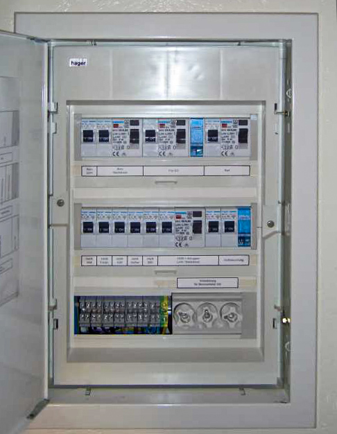
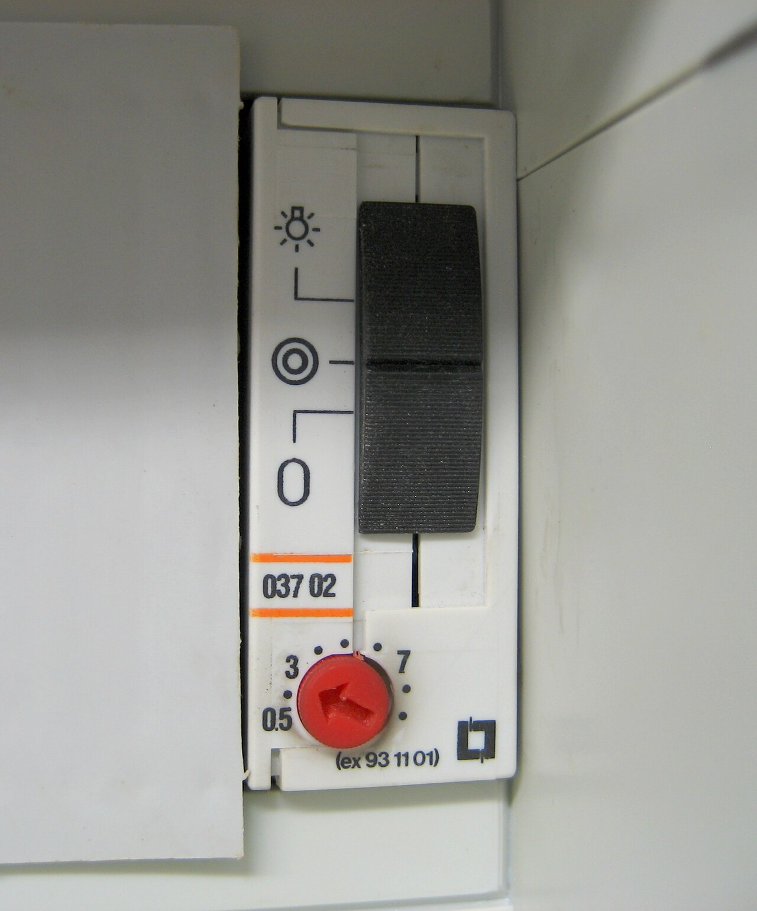
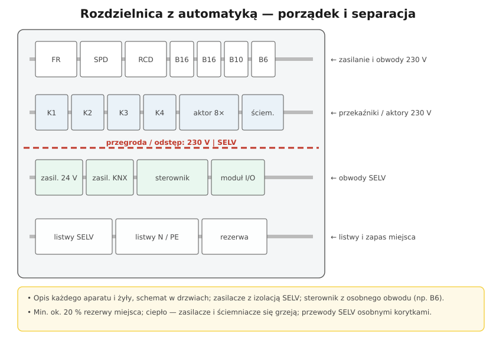

# 27.04 — Automatyka w rozdzielnicy

> **Moduł:** [27 — Inteligentny dom](README.md) · **Oznaczenia:** 🏠 · **Zakres SEP:** (c) · **Status:** ✅ pełny
>
> **Czytaj:**
>
> - Aparatura modułowa: [10.02](../10-aparatura-modulowa/10.02-stycznik-modulowy-i-przekaznik-bistabilny.md), [10.03](../10-aparatura-modulowa/10.03-programatory-czasowe-i-wylaczniki-zmierzchowe.md)
> - Montaż w rozdzielnicy: [15.07](../15-rozdzielnica-mieszkaniowa/15.07-montaz-i-porzadek-przewodow-w-rozdzielnicy.md)

[← poprzedni temat](27.03-systemy-przewodowe-knx-modbus-przeglad.md) · [spis modułu](README.md) · (koniec modułu) →

## Po co to jest

W nowoczesnym domu rozdzielnica to nie tylko wyłączniki: są w niej styczniki, przekaźniki bistabilne, programatory, aktory KNX, zasilacze 24 V, sterownik i moduły wejść/wyjść. Dobrze zrobiona — działa latami i daje się serwisować. Źle zrobiona — grzeje się, miesza 230 V z SELV i nikt poza autorem jej nie rozumie.

## Po ludzku

**Co trafia do rozdzielnicy z automatyką:**

- **styczniki modułowe** — załączanie większych mocy (bojler, grzejniki, pompa) sygnałem z automatyki lub taryfy ([10.02](../10-aparatura-modulowa/10.02-stycznik-modulowy-i-przekaznik-bistabilny.md)),
- **przekaźniki bistabilne** — oświetlenie z wielu przycisków,
- **programatory czasowe, zmierzchowe** ([10.03](../10-aparatura-modulowa/10.03-programatory-czasowe-i-wylaczniki-zmierzchowe.md)),
- **aktory KNX** albo moduły przekaźnikowe na szynę,
- **zasilacze** 12/24 V DC (SELV) dla sterownika, czujników, taśm LED,
- **sterownik** (PLC, centrala domowa) i **moduły wejść/wyjść**,
- **podliczniki energii** z wyjściem danych ([10.06](../10-aparatura-modulowa/10.06-podliczniki-energii.md)).

**Zasady porządku:**

1. **Podział na strefy** — rzędy 230 V (zabezpieczenia, styczniki, aktory) osobno od rzędu SELV (zasilacze, sterownik, magistrale). Między nimi **przegroda lub odstęp**; przewody SELV osobnymi korytkami.
2. **Zasilanie automatyki** z osobnego, opisanego obwodu (np. B6) — awaria gniazdka w kuchni nie wyłącza całego sterowania. Rozważ UPS dla sterownika i routera ([25.03](../25-transformatory-ups-agregaty/25.03-ups-rodzaje-i-zastosowanie.md)).
3. **Ciepło** — zasilacze, ściemniacze i styczniki się grzeją. Producenci podają odstępy (np. pół modułu przerwy) i maksymalną temperaturę. Obudowa musi mieć zapas miejsca — co najmniej ok. **20 % rezerwy**.
4. **Opis i dokumentacja** — każdy aparat opisany, przewody oznaczone na obu końcach, schemat w drzwiach rozdzielnicy, a plik z konfiguracją (adresy, programy) — u właściciela.
5. **Tryb ręczny** — dobre aktory i styczniki mają przełącznik ręczny/automat. Dzięki temu da się włączyć ogrzewanie czy pompę, gdy sterownik nie działa.
6. **Zasada „bezpieczny stan”** — przy awarii sterownika urządzenia powinny przejść w stan bezpieczny (np. grzałka wyłączona, a nie załączona na stałe).

## Jak to wygląda

*Na co patrzeć: opisy przy każdym aparacie. W rozdzielnicy z automatyką opisów jest więcej — także przy przekaźnikach i zasilaczach, nie tylko przy wyłącznikach.*

*Na co patrzeć: przełącznik trybu na froncie — „stałe świecenie” pozwala obejść automatykę. Taki tryb ręczny warto mieć przy każdej funkcji ważnej dla domu.*

## Schemat

## Pojęcia

| Pojęcie | Po ludzku | Termin normowy / symbol |
|---------|-----------|-------------------------|
| Sterownik PLC | Komputer przemysłowy sterujący urządzeniami | — |
| Moduł I/O | Wejścia i wyjścia sterownika | — |
| Tryb ręczny | Przełącznik pozwalający pominąć automatykę | HAND / AUTO |
| Stan bezpieczny | Stan urządzeń po awarii sterowania | fail-safe |
| Rezerwa miejsca | Wolne pola modułowe w obudowie | — |

## Liczby do zapamiętania

| Wielkość | Wartość | Kiedy obowiązuje | Źródło |
|----------|---------|------------------|--------|
| Rezerwa miejsca | ok. **20 %** wolnych pól | rozdzielnice domowe | dobra praktyka |
| Obwód zasilania automatyki | osobny, np. **B6** | sterownik, zasilacze | dobra praktyka |
| Napięcie zasilaczy automatyki | **12 / 24 V DC** (SELV) | sterowniki, czujniki | katalogi |
| Szerokość modułu | **17,5–18 mm** | aparatura na TH35 | PN-EN 60715 |

## W praktyce

- **Projekt przed montażem** — lista funkcji, lista obwodów sterowanych, rozmieszczenie aparatów, wielkość obudowy z rezerwą.
- **Przewody sterujące** (przyciski, czujniki) do rozdzielnicy — osobne listwy zaciskowe, opisane.
- **Przy pomiarach** — odłącz elektronikę lub mierz z odpowiednim napięciem, żeby jej nie uszkodzić ([23.03](../23-pomiary-odbiorcze-i-okresowe/23.03-rezystancja-izolacji.md)).
- **Przekazanie właścicielowi** — schemat, lista funkcji, instrukcja trybu ręcznego, kopia konfiguracji, dane do serwisu.

## Błędy i zagrożenia

- ⚠️ **Wymieszane przewody SELV i 230 V w jednym korytku bez separacji** — przeniesienie napięcia na obwody dotykane przez ludzi.
- **Zasilacze ściśnięte bez odstępów** — przegrzanie, skrócona żywotność, wyłączenia.
- **Sterowanie grzałki tylko przez sterownik, bez stanu bezpiecznego** — zawieszony program = grzałka na stałe.
- **Brak opisu i dokumentacji** — każda zmiana to zgadywanie.
- **Rozdzielnica „na styk”** — każde dołożenie aparatu to przeróbka.

## Przykład

**Zadanie.** Dom z KNX: 12 aktorów przekaźnikowych 4-kanałowych (po 4 moduły szerokości), 4 aktory ściemniające (po 4 moduły), zasilacz KNX (4 moduły), zasilacz 24 V (2 moduły), sterownik/serwer (4 moduły), router IP (2 moduły). Ile pól potrzeba na automatykę?

**Rozwiązanie.** 12 · 4 + 4 · 4 + 4 + 2 + 4 + 2 = 48 + 16 + 12 = **76 modułów**. Z rezerwą ok. 20 %: **ok. 92 moduły** — czyli osobna obudowa automatyki (np. 4 rzędy po 24 moduły) obok rozdzielnicy obwodów.

## Pytania SEP

1. **Jakie zasady należy zachować przy montażu w rozdzielnicy aparatów obwodów 230 V i obwodów bardzo niskiego napięcia?**

Odpowiedź

Obwody SELV/PELV muszą być oddzielone od obwodów 230 V: aparaty i przewody grupuje się osobno, stosuje przegrody lub odstępy i prowadzi przewody osobnymi korytkami albo stosuje przewody o izolacji na najwyższe występujące napięcie. Zasilacze bardzo niskiego napięcia muszą zapewniać separację ochronną (np. transformator bezpieczeństwa). Aparaty i przewody opisuje się, zachowuje odstępy wymagane ze względu na nagrzewanie, przewiduje rezerwę miejsca, a schemat rozdzielnicy aktualizuje się po każdej zmianie.

## Sprawdź się

1. Dlaczego warto zasilać sterownik i zasilacze automatyki z osobnego obwodu, a nie z obwodu gniazd?

Odpowiedź

Bo awaria lub przeciążenie w obwodzie gniazd (zadziałanie wyłącznika albo RCD) wyłączyłoby całą automatykę: oświetlenie, rolety, ogrzewanie. Osobny, opisany obwód zasilania automatyki ogranicza skutki awarii i ułatwia serwis.

## Źródła

- PN-EN 61439-3 — Rozdzielnice do obsługi przez osoby postronne (DBO).
- PN-HD 60364-4-41 — rozdz. 414 (SELV i PELV).
- [15.07 — Montaż i porządek przewodów w rozdzielnicy](../15-rozdzielnica-mieszkaniowa/15.07-montaz-i-porzadek-przewodow-w-rozdzielnicy.md).

---

[← poprzedni temat](27.03-systemy-przewodowe-knx-modbus-przeglad.md) · [spis modułu](README.md) · (koniec modułu) →
