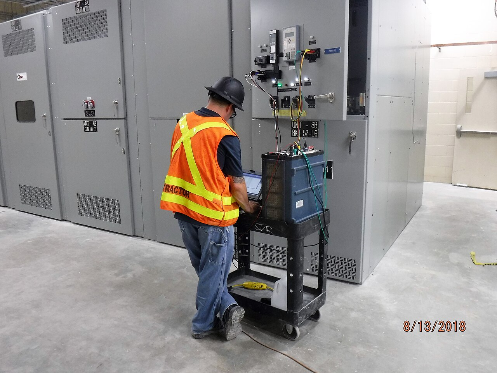
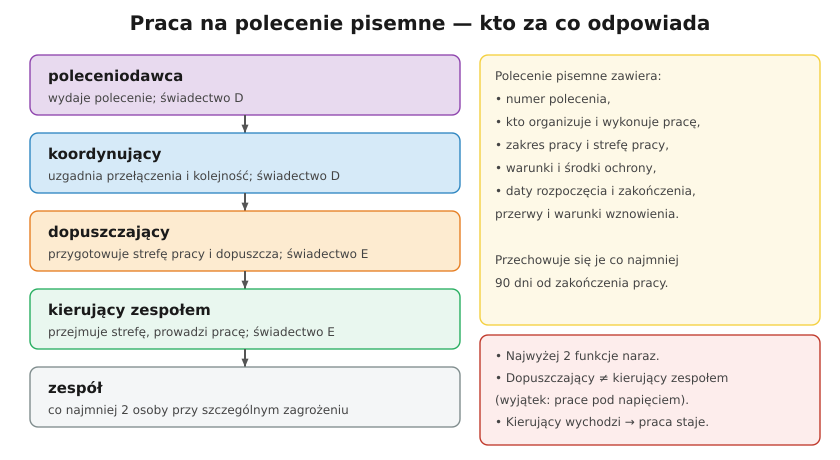

# 28.01 — Organizacja pracy i polecenia

> **Moduł:** [28 — BHP przy urządzeniach elektrycznych](README.md) · **Oznaczenia:** 📋 · **Zakres SEP:** (d) · **Status:** ✅ pełny
>
> **Czytaj:**
>
> - [Rozporządzenie Ministra Energii z 28 sierpnia 2019 r. w sprawie BHP przy urządzeniach energetycznych (t.j. Dz.U. 2021 poz. 1210)](https://api.sejm.gov.pl/eli/acts/DU/2021/1210/text.html)
> - Pięć zasad bezpiecznej pracy: [00.01](../00-bezpieczenstwo-najpierw/00.01-piec-zasad-bezpiecznej-pracy-przy-urzadzeniach.md)

← (początek modułu) · [spis modułu](README.md) · [następny temat →](28.02-prace-w-warunkach-szczegolnego-zagrozenia.md)

## Po co to jest

Na egzaminie SEP blok BHP jest obowiązkowy dla każdej grupy i stanowiska. Komisja pyta: kto może wydać polecenie, kiedy musi być pisemne, kim jest dopuszczający i kierujący zespołem, czego nie wolno łączyć. Podstawą jest **rozporządzenie Ministra Energii z 28 sierpnia 2019 r. w sprawie bezpieczeństwa i higieny pracy przy urządzeniach energetycznych** (tekst jednolity Dz.U. 2021 poz. 1210). W domu te role się nie pojawiają, ale ich sens — ktoś odpowiada za przygotowanie, ktoś za pracę — przydaje się zawsze.

## Po ludzku

**Kto w ogóle może pracować?** Prace eksploatacyjne wykonują **osoby upoważnione przez pracodawcę** (§ 6). Pracodawca prowadzi **wykaz upoważnionych** z zakresem i okresem upoważnienia (§ 5). Osoby bez upoważnienia (praktykanci, przedstawiciele organów nadzoru, serwis specjalistyczny) pracują tylko **pod nadzorem** upoważnionego, a pracownicy pomocniczy — przy pracach z listy ustalonej przez pracodawcę.

**Instrukcje u pracodawcy:**

- **instrukcja eksploatacji** urządzeń (§ 4) — jak urządzenie działa i jak je obsługiwać ([29.02](../29-eksploatacja/29.02-instrukcja-eksploatacji.md)),
- **instrukcja organizacji bezpiecznej pracy** (§ 33) — kto pełni jakie funkcje, jak się wydaje i przechowuje polecenia, jaki sprzęt ochronny i jak się go bada.

**Polecenie pisemne** — dokument, na podstawie którego wykonuje się prace stwarzające **zagrożenie ciężkiego uszczerbku na zdrowiu lub życia** — czyli prace w warunkach szczególnego zagrożenia ([28.02](28.02-prace-w-warunkach-szczegolnego-zagrozenia.md)). Polecenie zawiera (§ 28):

- **numer**,
- osoby wyznaczone do **organizacji i wykonania** pracy,
- **zakres pracy** i **strefę pracy**,
- **warunki i środki** zapewniające bezpieczeństwo,
- **termin rozpoczęcia i zakończenia**, przerwy i warunki wznowienia.

Polecenia przechowuje się co najmniej **90 dni** od zakończenia pracy.

**Bez polecenia pisemnego** (§ 29) wolno pracować przy: **ratowaniu życia, zdrowia lub środowiska**, **ochronie mienia** przed zniszczeniem (przez osoby upoważnione) i pracach **wymienionych w instrukcji** pracodawcy, wykonywanych przez upoważnionych.

**Role przy pracy na polecenie pisemne:**

- **poleceniodawca** — wydaje polecenie; świadectwo kwalifikacyjne na stanowisku **dozoru (D)**,
- **koordynujący** — gdy praca wpływa na ruch urządzeń: ustala kolejność łączeń, wydaje zgodę na przygotowanie i likwidację strefy pracy oraz na uruchomienie urządzeń; **D**,
- **dopuszczający** — przygotowuje strefę pracy, dopuszcza zespół, likwiduje strefę; świadectwo **eksploatacji (E)**,
- **kierujący zespołem** — przejmuje strefę, dobiera i instruuje ludzi, pilnuje bezpiecznej pracy; **E** i umiejętności zawodowe do danej pracy,
- **zespół** — co najmniej **2 osoby**.

**Łączenie funkcji:** najwyżej **dwie** naraz; **dopuszczający i kierujący zespołem to różne osoby** (wyjątek: technologia prac pod napięciem). Gdy kierujący zespołem opuszcza strefę pracy — **praca staje**, a zespół wychodzi (§ 31).

## Jak to wygląda

*Na co patrzeć: prace w rozdzielni to klasyczny przypadek pracy na polecenie — ktoś przygotował miejsce pracy (wyłączył, zabezpieczył, uziemił), ktoś inny kieruje zespołem wykonującym pomiary.*

## Schemat

## Pojęcia

| Pojęcie | Po ludzku | Termin normowy / symbol |
|---------|-----------|-------------------------|
| Polecenie pisemne | Dokument, na podstawie którego wykonuje się pracę niebezpieczną | § 28 rozporządzenia BHP |
| Poleceniodawca | Wydaje polecenie | świadectwo D |
| Koordynujący | Uzgadnia łączenia i ruch urządzeń | świadectwo D |
| Dopuszczający | Przygotowuje strefę i dopuszcza do pracy | świadectwo E |
| Kierujący zespołem | Prowadzi pracę zespołu | świadectwo E |
| Zespół | Co najmniej dwie osoby | § 2 pkt 12 |
| Strefa pracy | Przygotowane miejsce wykonywania pracy | § 2 pkt 5 |
| Instrukcja organizacji bezpiecznej pracy | Wewnętrzne zasady pracodawcy | § 33 |

## Liczby do zapamiętania

| Wielkość | Wartość | Kiedy obowiązuje | Źródło |
|----------|---------|------------------|--------|
| Zespół | co najmniej **2 osoby** | prace w warunkach szczególnego zagrożenia | rozp. BHP, § 2 pkt 12, § 27 ust. 4 |
| Łączenie funkcji | najwyżej **2** naraz | praca na polecenie pisemne | § 30 ust. 3 |
| Przechowywanie poleceń | co najmniej **90 dni** od zakończenia pracy | polecenia pisemne | § 28 ust. 4 |
| Poleceniodawca, koordynujący | świadectwo **D** | — | § 2 pkt 8–9 |
| Dopuszczający, kierujący zespołem | świadectwo **E** | — | § 2 pkt 10–11 |

## W praktyce

- **Firma wykonawcza u cudzego pracodawcy** (np. pomiary w zakładzie) — pracuje według instrukcji organizacji bezpiecznej pracy gospodarza; przy kilku pracodawcach w jednym miejscu wyznacza się koordynatora BHP (Kodeks pracy, art. 208).
- **Polecenie ustne / „telefoniczne”** — dopuszczalne tylko dla prac, które instrukcja pracodawcy pozwala wykonywać bez polecenia pisemnego.
- **Zmiana zakresu w trakcie** — nie wolno rozszerzać zakresu ani strefy pracy poza polecenie (§ 32). Nowy zakres = zmiana polecenia w trybie z instrukcji.
- **W domu** — nie ma poleceń, ale jest ta sama logika: jedna osoba wyłącza i pilnuje, druga pracuje; nikt nie załącza, dopóki pracujący nie potwierdzi zakończenia.

## Błędy i zagrożenia

- ⚠️ **Kierujący zespołem „na chwilę” wychodzi, a zespół pracuje dalej** — naruszenie § 31; wypadki zdarzają się właśnie wtedy.
- ⚠️ **Rozszerzenie pracy „przy okazji”** na urządzenie nieobjęte poleceniem — to urządzenie nie zostało przygotowane (wyłączone, uziemione).
- **Dopuszczający i kierujący to ta sama osoba** — nikt nie sprawdza przygotowania strefy drugą parą oczu.
- **Polecenie bez określonej strefy pracy** — zespół nie wie, gdzie kończy się bezpieczny obszar.

## Przykład

**Zadanie.** Monter z świadectwem E (eksploatacja) dostaje telefon od kierownika: „wymień uszkodzoną głowicę kablową w stacji, polecenie przyślę jutro”. Co jest źle?

**Rozwiązanie.** Praca przy urządzeniach w stacji (w pobliżu nieosłoniętych części pod napięciem, identyfikacja i przecinanie kabli) to praca w warunkach **szczególnego zagrożenia** — wymaga **polecenia pisemnego** przed rozpoczęciem, **zespołu** (min. 2 osoby), przygotowania strefy przez **dopuszczającego** i kierującego zespołem. „Polecenie jutro” nie istnieje — bez niego praca nie może się zacząć (chyba że to ratowanie życia lub mienia).

## Pytania SEP

1. **Co to jest polecenie pisemne i co powinno zawierać?**

Odpowiedź

To dokument wydany przez pracodawcę lub upoważnioną przez niego osobę (poleceniodawcę), na podstawie którego wykonuje się prace stwarzające możliwość wystąpienia zagrożenia ciężkiego uszczerbku na zdrowiu lub życia — w szczególności prace w warunkach szczególnego zagrożenia. Zawiera: numer polecenia; osoby wyznaczone do organizowania i wykonania pracy (koordynującego, dopuszczającego, kierującego zespołem, członków zespołu); zakres pracy i określenie strefy pracy; wymagane warunki i środki zapewniające bezpieczeństwo; termin rozpoczęcia i zakończenia pracy oraz przerwy i warunki wznowienia. Przechowuje się je co najmniej 90 dni od zakończenia pracy.

2. **Jakie funkcje wyróżnia się przy organizacji pracy na polecenie i jakie są wymagania kwalifikacyjne?**

Odpowiedź

Poleceniodawca — wydaje polecenie, ma świadectwo kwalifikacyjne na stanowisku dozoru. Koordynujący — koordynuje pracę wpływającą na ruch urządzeń, ustala kolejność łączeń, wydaje zgodę na przygotowanie i likwidację strefy pracy; świadectwo dozoru. Dopuszczający — przygotowuje strefę pracy, dopuszcza zespół do pracy i likwiduje strefę; świadectwo eksploatacji. Kierujący zespołem — przejmuje strefę, dobiera i instruuje członków zespołu, nadzoruje bezpieczne wykonanie pracy; świadectwo eksploatacji i umiejętności zawodowe. Można łączyć najwyżej dwie funkcje; funkcji dopuszczającego i kierującego zespołem nie łączy się (poza technologią prac pod napięciem).

3. **Kiedy można wykonywać pracę bez polecenia pisemnego?**

Odpowiedź

Przy ratowaniu zdrowia lub życia ludzkiego albo środowiska; przy zabezpieczaniu urządzeń przed zniszczeniem przez osoby upoważnione; oraz przy pracach eksploatacyjnych określonych w instrukcji pracodawcy, wykonywanych przez osoby upoważnione — w praktyce prace rutynowe, wykonywane w stałych miejscach, opisane w instrukcji eksploatacji.

## Sprawdź się

1. Dlaczego przepisy zabraniają łączenia funkcji dopuszczającego i kierującego zespołem?

Odpowiedź

Bo dopuszczenie to kontrola: jedna osoba przygotowuje strefę pracy (wyłącza, zabezpiecza, uziemia), druga ją przejmuje i sprawdza, zanim wprowadzi ludzi. Gdy obie role pełni ta sama osoba, nikt nie weryfikuje przygotowania — błąd jednej osoby przechodzi niezauważony.

## Źródła

- [Rozporządzenie Ministra Energii z 28 sierpnia 2019 r. w sprawie bezpieczeństwa i higieny pracy przy urządzeniach energetycznych — t.j. Dz.U. 2021 poz. 1210](https://api.sejm.gov.pl/eli/acts/DU/2021/1210/text.html) (§ 2, 4–6, 27–33).
- PN-EN 50110-1 — Eksploatacja urządzeń elektrycznych.
- Kodeks pracy, art. 208 (współdziałanie pracodawców).

---

← (początek modułu) · [spis modułu](README.md) · [następny temat →](28.02-prace-w-warunkach-szczegolnego-zagrozenia.md)
