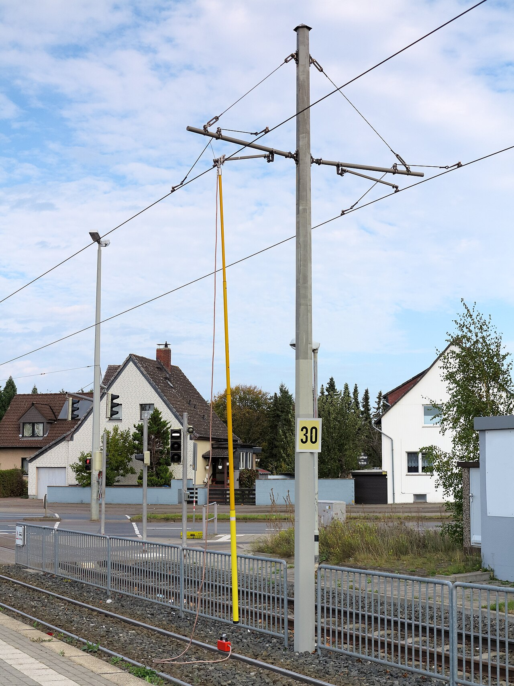
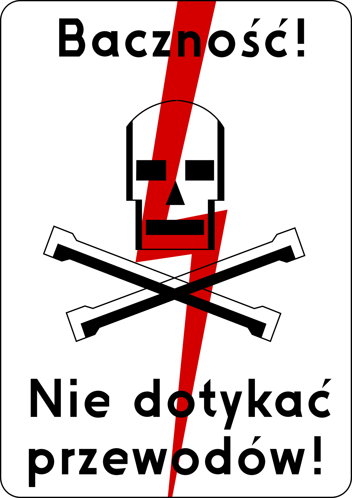
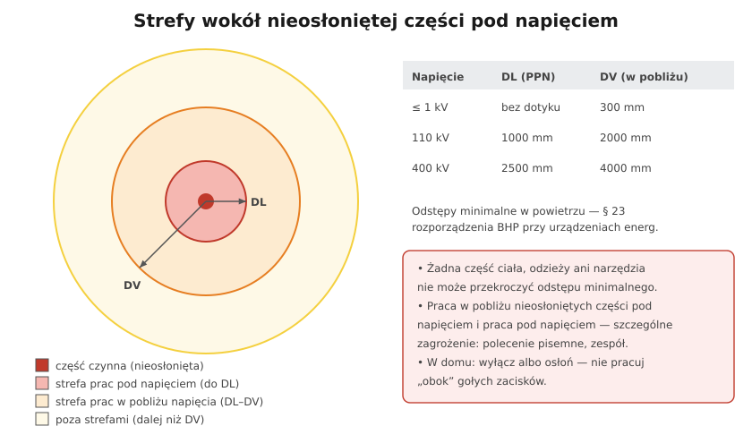

# 28.02 — Prace w warunkach szczególnego zagrożenia

> **Moduł:** [28 — BHP przy urządzeniach elektrycznych](README.md) · **Oznaczenia:** 📋 · **Zakres SEP:** (d) · **Status:** ✅ pełny
>
> **Czytaj:**
>
> - [Rozporządzenie BHP przy urządzeniach energetycznych, § 27 (t.j. Dz.U. 2021 poz. 1210)](https://api.sejm.gov.pl/eli/acts/DU/2021/1210/text.html)

[← poprzedni temat](28.01-organizacja-pracy-i-polecenia.md) · [spis modułu](README.md) · [następny temat →](28.03-przygotowanie-miejsca-pracy-i-dopuszczenie-do.md)

## Po co to jest

„Jakie prace zalicza się do prac w warunkach szczególnego zagrożenia?” — klasyczne pytanie egzaminacyjne. Odpowiedź jest w § 27 rozporządzenia BHP. To prace, przy których błąd często kończy się śmiercią, dlatego wymagają **polecenia pisemnego** i **zespołu** (asekuracja).

## Po ludzku

**Zasada (§ 27 ust. 1 i 4):** prace stwarzające możliwość wystąpienia zagrożenia **ciężkiego uszczerbku na zdrowiu lub życia** wykonuje się na podstawie **polecenia pisemnego**, przez **zespół** co najmniej dwóch osób — żeby ktoś mógł pomóc, wezwać pomoc, uwolnić porażonego ([31.01](../31-pierwsza-pomoc/31.01-uwolnienie-porazonego-spod-dzialania-pradu.md)).

**Lista z § 27 ust. 2 — prace elektryczne (najważniejsze na egzamin):**

- w **pobliżu nieosłoniętych urządzeń** elektroenergetycznych **pod napięciem**,
- **pod napięciem** — z wyjątkiem prac rutynowo wykonywanych przez upoważnione osoby w stałych miejscach, opisanych w instrukcji eksploatacji (np. pomiary, wymiana wkładek w określonych warunkach),
- przy urządzeniach **wyłączonych spod napięcia i uziemionych**, gdy z miejsca pracy **nie widać** założonych uziemień,
- przy **identyfikacji i przecinaniu kabli** elektroenergetycznych,
- przy **liniach napowietrznych wyłączonych**, które **krzyżują się** z liniami pod napięciem lub z siecią trakcyjną, oraz na skrzyżowaniach linii,
- na **wyłączonym torze linii wielotorowej** (≥ 1 kV), gdy inny tor jest pod napięciem,
- przy **sieciach trakcyjnych**.

**Prace ogólne (dotyczą też elektryków):**

- w **zbiornikach, kanałach, studzienkach**, komorach i innych przestrzeniach zamkniętych,
- w **wykopach i na wysokości**,
- **pożarowo niebezpieczne** w strefach zagrożenia wybuchem,
- w **wieżach i gondolach** elektrowni wiatrowych,
- w wykopach w pobliżu gazociągów i sieci cieplnych,
- przy rurociągach wody i pary (≥ 50 kPa), przy turbinach, w zasobnikach paliwa.

Pracodawca ustala **szczegółowy wykaz** takich prac u siebie (§ 27 ust. 3), biorąc pod uwagę ocenę ryzyka.

**Dlaczego „niewidoczne uziemienie” jest na liście?** Bo jeśli nie widzisz uziemiacza, nie masz pewności, że go nie zdjęto, ani że to właściwy obwód. Uziemienie zakłada się tak, żeby co najmniej jedno było **widoczne z miejsca pracy** (§ 25 ust. 2).

## Jak to wygląda

*Na co patrzeć: uziemiacz założony na sieć trakcyjną jest widoczny z daleka. Prace przy sieci trakcyjnej są na liście prac w warunkach szczególnego zagrożenia — także dlatego, że sąsiednie odcinki mogą być pod napięciem.*

*Na co patrzeć: tablice ostrzegawcze to część oznakowania strefy — ale same nie chronią. W pobliżu nieosłoniętych części pod napięciem pracuje się tylko na polecenie i w zespole.*

## Schemat

## Pojęcia

| Pojęcie | Po ludzku | Termin normowy / symbol |
|---------|-----------|-------------------------|
| Praca w warunkach szczególnego zagrożenia | Praca z ryzykiem śmierci lub ciężkiego urazu | § 27 rozporządzenia BHP |
| Asekuracja | Obecność drugiej osoby gotowej pomóc | — |
| Praca w pobliżu napięcia | Praca blisko nieosłoniętych części czynnych | odległość DV |
| Praca pod napięciem | Kontakt z częściami czynnymi lub wejście w strefę DL | PPN |
| Przestrzeń zamknięta | Zbiornik, kanał, studzienka | — |

## Liczby do zapamiętania

| Wielkość | Wartość | Kiedy obowiązuje | Źródło |
|----------|---------|------------------|--------|
| Zespół | **≥ 2 osoby** | prace szczególnie niebezpieczne | § 27 ust. 4 |
| Podstawa pracy | **polecenie pisemne** | jw. | § 27 ust. 1 |
| Uziemienie | min. **jedno widoczne** z miejsca pracy | prace przy urządzeniach wyłączonych | § 25 ust. 2 |
| Odstęp ≤ 1 kV | praca pod napięciem: **bez dotyku**; w pobliżu: **300 mm** | części nieosłonięte | § 23 ust. 3 |
| Rurociągi | **≥ 50 kPa** | demontaż armatury | § 27 ust. 2 pkt 17 |

## W praktyce

- **Rozdzielnica w bloku (WLZ, złącze)** — po wyłączeniu jednego obwodu w rozdzielnicy obok zostają gołe szyny i zaciski pod napięciem. To praca w pobliżu napięcia: osłoń, oznacz, pracuj z asekuracją.
- **Studzienka kablowa, kanał** — oprócz prądu: brak tlenu, gazy. Druga osoba na zewnątrz, pomiar atmosfery według instrukcji.
- **Praca na drabinie przy oprawie na hali** — wysokość + napięcie; porażenie oznacza upadek ([28.06](28.06-narzedzia-drabiny-i-praca-na-wysokosci.md)).
- **Identyfikacja kabla przed przecięciem** — tylko odpowiednią metodą (lokalizator, przyrząd do identyfikacji), a przecina się narzędziem z izolowanym, zdalnym napędem lub z uziemieniem kabla według instrukcji.

## Błędy i zagrożenia

- ⚠️ **Praca w pojedynkę** w miejscu, gdzie jest napięcie obok — nikt nie uwolni porażonego.
- ⚠️ **Przecinanie kabla „bo to na pewno ten”** — przecięcie kabla pod napięciem to łuk i ciężkie oparzenia ([04.05](../04-prad-a-czlowiek/04.05-luk-elektryczny-i-oparzenia.md)).
- **Uziemiacz za ścianą, poza wzrokiem** — nikt nie zauważy, że ktoś go zdjął.
- **Traktowanie wyłączonego toru linii wielotorowej jak bezpiecznego** — napięcie indukuje się od toru pracującego.

## Przykład

**Zadanie.** Elektryk ma wymienić oprawę w hali na wysokości 6 m z podnośnika, obok przebiega nieosłonięty szynoprzewód 400 V pod napięciem (odległość ok. 40 cm). Czy to praca w warunkach szczególnego zagrożenia?

**Rozwiązanie.** Tak, z dwóch powodów: **praca na wysokości** i **w pobliżu nieosłoniętych urządzeń pod napięciem**. Wymaga **polecenia pisemnego** i **zespołu**. Najlepiej wyłączyć szynoprzewód; jeśli nie można — osłonić go i pilnować, by ani ręka, ani narzędzie nie przekroczyły odstępu (dla ≤ 1 kV — 300 mm granicy strefy w pobliżu, bez dotyku części czynnych).

## Pytania SEP

1. **Jakie prace przy urządzeniach elektroenergetycznych zalicza się do prac w warunkach szczególnego zagrożenia?**

Odpowiedź

Według § 27 rozporządzenia w sprawie BHP przy urządzeniach energetycznych m.in.: prace w pobliżu nieosłoniętych urządzeń elektroenergetycznych znajdujących się pod napięciem; prace pod napięciem (z wyjątkiem prac rutynowych w stałych miejscach, określonych w instrukcji eksploatacji); prace przy urządzeniach wyłączonych i uziemionych, gdy z miejsca pracy nie widać założonych uziemień; prace przy identyfikacji i przecinaniu kabli; prace na skrzyżowaniach linii i przy wyłączonych liniach krzyżujących się z liniami pod napięciem lub trakcją; prace na wyłączonym torze linii wielotorowej; prace przy sieci trakcyjnej. Do tego prace ogólne: w zbiornikach, kanałach i przestrzeniach zamkniętych, w wykopach i na wysokości, pożarowo niebezpieczne w strefie zagrożenia wybuchem. Wykonuje je zespół co najmniej dwóch osób na podstawie polecenia pisemnego.

2. **Dlaczego prace w warunkach szczególnego zagrożenia wykonuje zespół, a nie jedna osoba?**

Odpowiedź

Żeby zapewnić asekurację: druga osoba może natychmiast przerwać zagrożenie (wyłączyć zasilanie), uwolnić porażonego spod działania prądu, udzielić pierwszej pomocy i wezwać pomoc. Przy porażeniu lub utracie przytomności w przestrzeni zamkniętej czy na wysokości poszkodowany sam sobie nie pomoże, a o przeżyciu decydują minuty.

## Sprawdź się

1. Dlaczego pomiary w rozdzielnicy wykonywane rutynowo przez elektryka zakładu nie zawsze wymagają polecenia pisemnego, mimo że to praca przy napięciu?

Odpowiedź

Bo § 27 ust. 2 wyłącza prace pod napięciem wykonywane rutynowo przez upoważnione osoby w stałych miejscach, określone w instrukcji eksploatacji — a § 29 pozwala wykonywać bez polecenia pisemnego prace wymienione w instrukcji pracodawcy. Warunkiem jest, że instrukcja je opisuje (sposób, środki ochrony), a wykonują je osoby upoważnione.

## Źródła

- [Rozporządzenie BHP przy urządzeniach energetycznych — t.j. Dz.U. 2021 poz. 1210](https://api.sejm.gov.pl/eli/acts/DU/2021/1210/text.html) (§ 23, 25, 27, 29).
- PN-EN 50110-1 — Eksploatacja urządzeń elektrycznych.
- [31.01 — Uwolnienie porażonego](../31-pierwsza-pomoc/31.01-uwolnienie-porazonego-spod-dzialania-pradu.md).

---

[← poprzedni temat](28.01-organizacja-pracy-i-polecenia.md) · [spis modułu](README.md) · [następny temat →](28.03-przygotowanie-miejsca-pracy-i-dopuszczenie-do.md)
