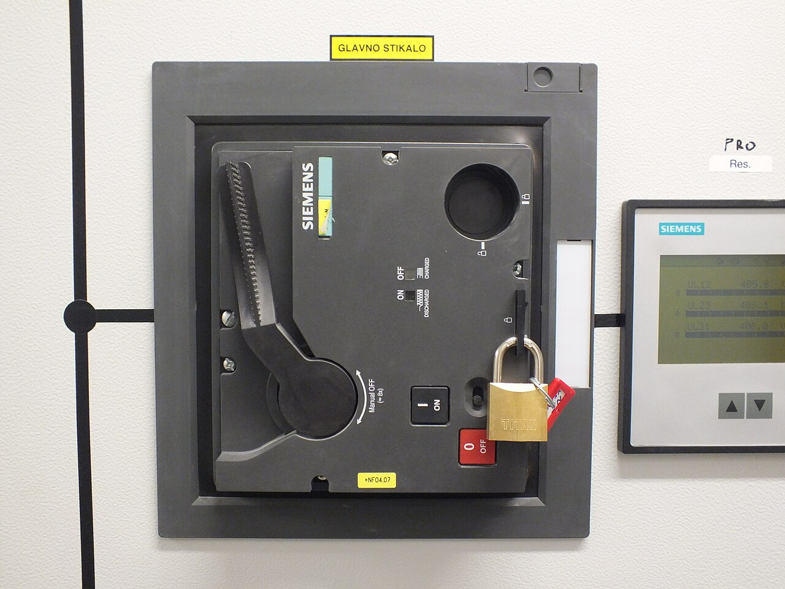
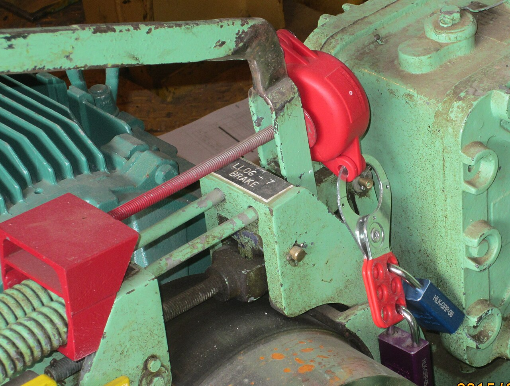
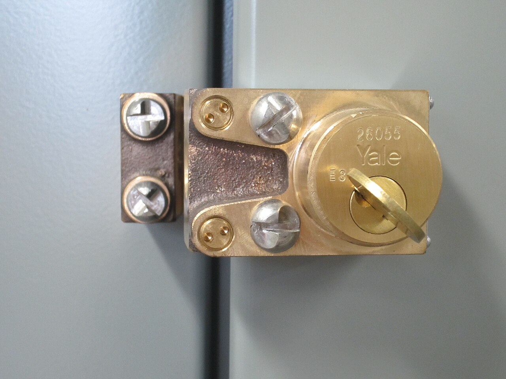
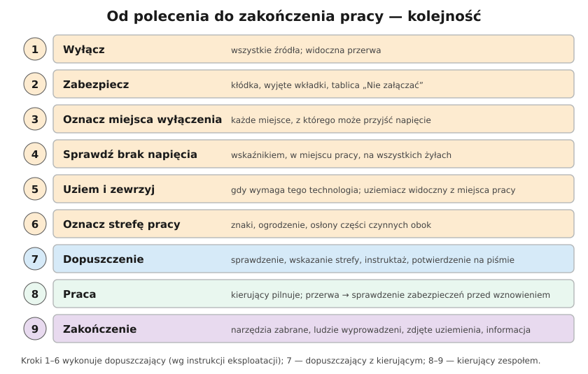

# 28.03 — Przygotowanie miejsca pracy i dopuszczenie do pracy

> **Moduł:** [28 — BHP przy urządzeniach elektrycznych](README.md) · **Oznaczenia:** 📋 · **Zakres SEP:** (d) · **Status:** ✅ pełny
>
> **Czytaj:**
>
> - [Rozporządzenie BHP przy urządzeniach energetycznych, § 24–25, 30–32](https://api.sejm.gov.pl/eli/acts/DU/2021/1210/text.html)
> - Sprawdzanie braku napięcia: [00.02](../00-bezpieczenstwo-najpierw/00.02-sprawdzanie-braku-napiecia-probnik-dwubiegunowy.md)

[← poprzedni temat](28.02-prace-w-warunkach-szczegolnego-zagrozenia.md) · [spis modułu](README.md) · [następny temat →](28.04-sprzet-ochronny-izolacyjny-i-ochrony-osobistej.md)

## Po co to jest

To serce BHP przy urządzeniach elektrycznych: jak zamienić „urządzenie pod napięciem” w „bezpieczne miejsce pracy” i jak wpuścić do niego ludzi. Pięć zasad z [00.01](../00-bezpieczenstwo-najpierw/00.01-piec-zasad-bezpiecznej-pracy-przy-urzadzeniach.md) jest tu ułożone w procedurę z rolami: dopuszczający przygotowuje, kierujący przejmuje, zespół pracuje.

## Po ludzku

**Przygotowanie strefy pracy (dopuszczający, § 24–25 i § 30):**

1. **Uzyskaj zgodę na łączenia** (od koordynującego, jeśli jest) i ustal ich kolejność.
2. **Wyłącz** — urządzenie odłącza się tak, żeby napięcie nie mogło się pojawić: od wszystkich stron zasilania, z **widoczną przerwą** (rozłącznik, wyjęte wkładki, wysunięty człon).
3. **Zabezpiecz przed przypadkowym lub samowolnym załączeniem** — kłódka na napędzie, wyjęte i zabrane wkładki, odłączony napęd, tablica „Nie załączać — pracują ludzie”.
4. **Oznacz miejsca wyłączenia** — każde, z którego może przyjść napięcie.
5. **Sprawdź brak napięcia** — wskaźnikiem właściwym dla napięcia, sprawdzonym przed i po; w miejscu pracy, na wszystkich biegunach ([00.02](../00-bezpieczenstwo-najpierw/00.02-sprawdzanie-braku-napiecia-probnik-dwubiegunowy.md)).
6. **Uziem i zewrzyj** — jeśli wymaga tego technologia pracy (zawsze na liniach i w stacjach, w instalacji nN w budynku zwykle się pomija); uziemienie tak, by praca była **w strefie uziemionej**, a co najmniej jedno uziemienie **widoczne z miejsca pracy**.
7. **Oznacz strefę pracy** — znaki bezpieczeństwa, ogrodzenie, osłony części pod napięciem w pobliżu.
8. **Poinformuj kierującego zespołem** o zagrożeniach (z udokumentowaniem).

**Dopuszczenie (dopuszczający + kierujący):**

- dopuszczający **sprawdza** przygotowanie strefy,
- **wskazuje** strefę pracy kierującemu i zespołowi — co jest wyłączone, co zostało pod napięciem,
- przeprowadza **instruktaż** o zagrożeniach,
- **potwierdza dopuszczenie na piśmie** i informuje koordynującego.

**Praca (kierujący zespołem):** przejmuje strefę, instruuje każdego członka zespołu, pilnuje stosowania sprzętu ochronnego i bezpiecznego wykonania pracy. **Nie wolno** rozszerzać zakresu ani strefy pracy ani zmieniać zabezpieczeń (np. zdejmować uziemień), o ile polecenie na to nie pozwala (§ 32).

**Przerwy (§ 31):** kierujący wychodzi — praca staje, zespół wychodzi. Przed **każdym** wznowieniem kierujący sprawdza zabezpieczenia strefy; jeśli się pogorszyły — ponowne dopuszczenie.

**Zakończenie:** kierujący potwierdza zakończenie, narzędzia i materiały usunięte, **zespół wyprowadzony**, środki ochrony (uziemienia, osłony, blokady) zdjęte, koordynujący poinformowany, że urządzenie jest gotowe do załączenia.

## Jak to wygląda

*Na co patrzeć: kłódka na dźwigni — nikt nie załączy wyłącznika, dopóki osoba z kluczem nie zakończy pracy. Klucz ma pracujący, nie „ktoś w biurze”.*

*Na co patrzeć: kilka kłódek na jednej zasuwie — każdy pracujący zakłada swoją. Urządzenie da się uruchomić dopiero, gdy ostatnia osoba zdejmie swoją kłódkę.*

*Na co patrzeć: blokada kluczowa — klucz zwalnia się dopiero po wyłączeniu i uziemieniu pola. Bez tego klucza drzwi do części pod napięciem się nie otworzą.*

## Schemat

## Pojęcia

| Pojęcie | Po ludzku | Termin normowy / symbol |
|---------|-----------|-------------------------|
| Przygotowanie strefy pracy | Zrobienie z urządzenia bezpiecznego miejsca | § 30 ust. 1 pkt 2 |
| Dopuszczenie | Formalne wpuszczenie zespołu do strefy | § 30 ust. 1 pkt 3 |
| Widoczna przerwa | Odłączenie, które da się zobaczyć | — |
| Blokada | Zabezpieczenie przed załączeniem (kłódka, klucz) | LOTO |
| Uziemiacz przenośny | Zestaw przewodów do uziemienia i zwarcia | PN-EN 61230 |
| Likwidacja strefy pracy | Zdjęcie zabezpieczeń po pracy | — |

## Liczby do zapamiętania

| Wielkość | Wartość | Kiedy obowiązuje | Źródło |
|----------|---------|------------------|--------|
| Kroki przygotowania | wyłącz → zabezpiecz → oznacz → sprawdź → uziem → oznacz strefę | prace przy urządzeniach wyłączonych | § 25 ust. 1 |
| Uziemienie widoczne | co najmniej **1** z miejsca pracy | gdy uziemia się urządzenie | § 25 ust. 2 |
| Wznowienie po przerwie | sprawdzenie zabezpieczeń **przed każdym** wznowieniem | przerwy w pracy | § 31 ust. 4 |
| Dopuszczenie | potwierdzone **na piśmie** | praca na polecenie | § 30 ust. 1 pkt 3 |

## W praktyce

- **W domu i w małej firmie** — te same kroki w skrócie: wyłącz właściwy wyłącznik, zablokuj (blokada na wyłącznik modułowy kosztuje kilkanaście złotych), naklej kartkę, sprawdź brak napięcia, osłoń to, co zostało pod napięciem.
- **Wiele osób przy jednym urządzeniu** — każda zakłada **swoją kłódkę** (zasuwa wielokłódkowa).
- **Kilka źródeł** — PV, UPS, agregat, magazyn: każde wyłącza się osobno i każde oznacza ([25](../25-transformatory-ups-agregaty/README.md), [26](../26-fotowoltaika-pompy-wallboxy/README.md)).
- **Kondensatory, kable długie** — po wyłączeniu mogą trzymać ładunek; uziemienie i zwarcie go rozładowuje.

## Błędy i zagrożenia

- ⚠️ **Sprawdzenie braku napięcia w innym miejscu niż miejsce pracy** — wyłączono inny obwód.
- ⚠️ **Uziemienie przed sprawdzeniem braku napięcia** — zwarcie na urządzeniu pod napięciem, łuk.
- ⚠️ **Zdjęcie uziemienia „na chwilę” do pomiaru** bez zgody i ponownego przygotowania.
- **Załączenie przed wyprowadzeniem wszystkich ludzi** — ktoś jeszcze jest w strefie.

## Przykład

**Zadanie.** Wymiana wyłącznika w polu odpływowym rozdzielnicy nn w zakładzie. Podaj kolejność czynności dopuszczającego.

**Rozwiązanie.** Zgoda na łączenia → wyłączenie odpływu i rozłącznika, wyjęcie wkładek (widoczna przerwa) → kłódka i tablica „Nie załączać — pracują ludzie” → oznaczenie miejsc wyłączenia → sprawdzenie braku napięcia wskaźnikiem w miejscu pracy na wszystkich fazach i N → uziemienie i zwarcie (jeśli wymaga instrukcja; zawsze, gdy odpływ może dostać napięcie zwrotne) → osłony na sąsiednich polach pod napięciem i oznaczenie strefy → instruktaż kierującego → **wskazanie strefy, pisemne dopuszczenie**.

## Pytania SEP

1. **Jakie czynności należy wykonać przed przystąpieniem do pracy przy urządzeniu wyłączonym spod napięcia?**

Odpowiedź

Wyłączyć napięcie ze wszystkich stron, z których może ono się pojawić, z widoczną przerwą; zabezpieczyć urządzenie przed przypadkowym lub samowolnym załączeniem (blokady, wyjęcie wkładek, tablice); wyraźnie oznaczyć miejsca wyłączenia; sprawdzić brak napięcia na wyłączonym urządzeniu w miejscu pracy; uziemić i zewrzeć urządzenie, jeśli wymaga tego technologia prac, tak aby praca odbywała się w strefie uziemionej i co najmniej jedno uziemienie było widoczne z miejsca pracy; oznaczyć strefę pracy znakami bezpieczeństwa i osłonić sąsiednie części czynne. Następnie dopuszczający dokonuje dopuszczenia zespołu.

2. **Na czym polega dopuszczenie do pracy?**

Odpowiedź

Dopuszczający sprawdza prawidłowość przygotowania strefy pracy, wskazuje ją zespołowi lub kierującemu zespołem (co zostało wyłączone, co pozostaje pod napięciem), przeprowadza instruktaż o zagrożeniach, potwierdza dopuszczenie na piśmie i informuje koordynującego. Kierujący zespołem przejmuje strefę pracy, instruuje członków zespołu i od tej chwili odpowiada za bezpieczne wykonanie pracy.

## Sprawdź się

1. Po przerwie obiadowej kierujący zespołem widzi, że zniknęła tablica „Nie załączać”, ale kłódka jest na miejscu. Co robi?

Odpowiedź

Nie wznawia pracy — zabezpieczenie strefy się pogorszyło. Przywraca brakujące oznakowanie (albo wzywa dopuszczającego), sprawdza wszystkie zabezpieczenia i brak napięcia, a jeśli są wątpliwości, czy ktoś nie manipulował przy urządzeniu — żąda ponownego dopuszczenia (§ 31 ust. 3–5).

## Źródła

- [Rozporządzenie BHP przy urządzeniach energetycznych — t.j. Dz.U. 2021 poz. 1210](https://api.sejm.gov.pl/eli/acts/DU/2021/1210/text.html) (§ 24, 25, 30, 31, 32).
- PN-EN 50110-1 — Eksploatacja urządzeń elektrycznych (rozdz. 6.2 — praca w stanie beznapięciowym).
- PN-EN 61230 — Prace pod napięciem. Przenośne urządzenia do uziemiania lub uziemiania i zwierania.

---

[← poprzedni temat](28.02-prace-w-warunkach-szczegolnego-zagrozenia.md) · [spis modułu](README.md) · [następny temat →](28.04-sprzet-ochronny-izolacyjny-i-ochrony-osobistej.md)
