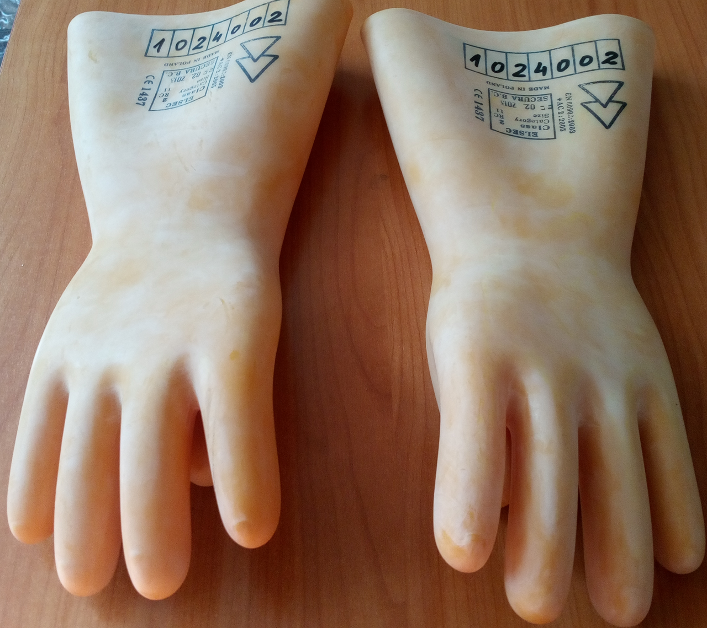
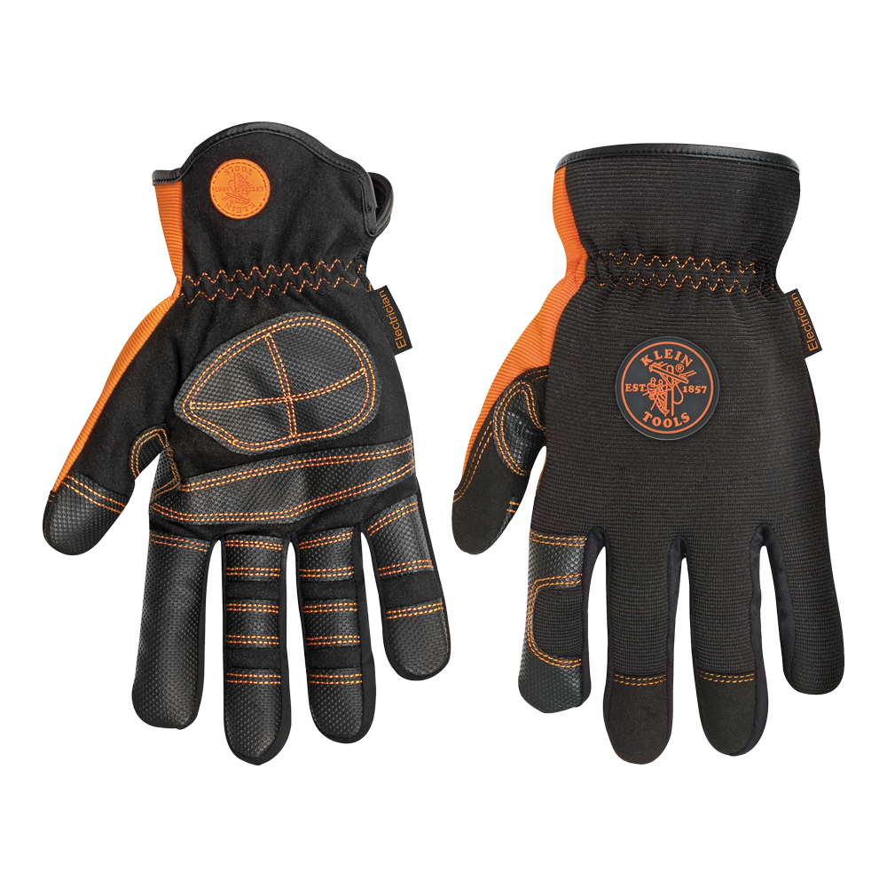
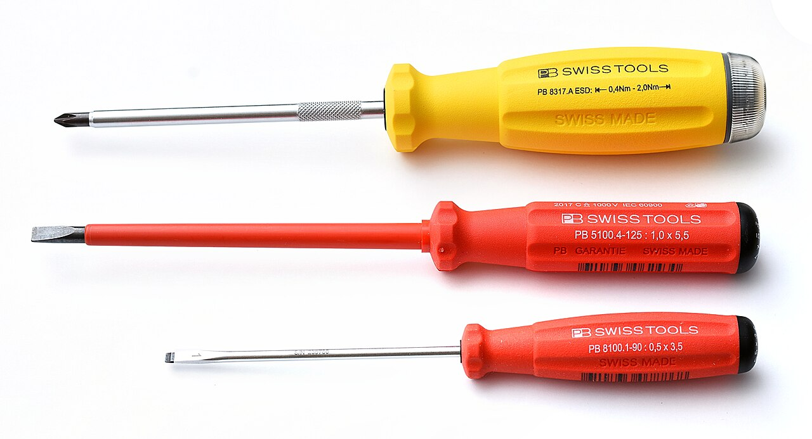
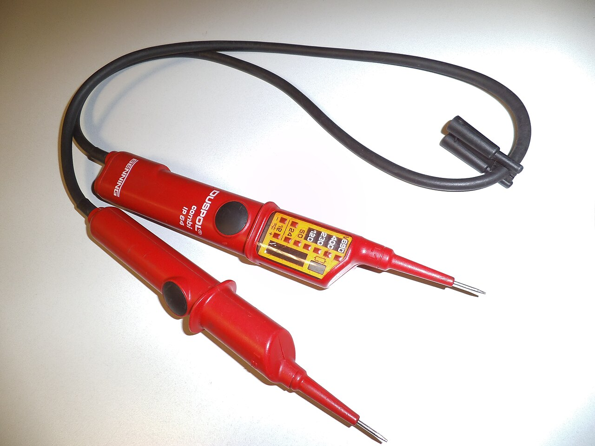
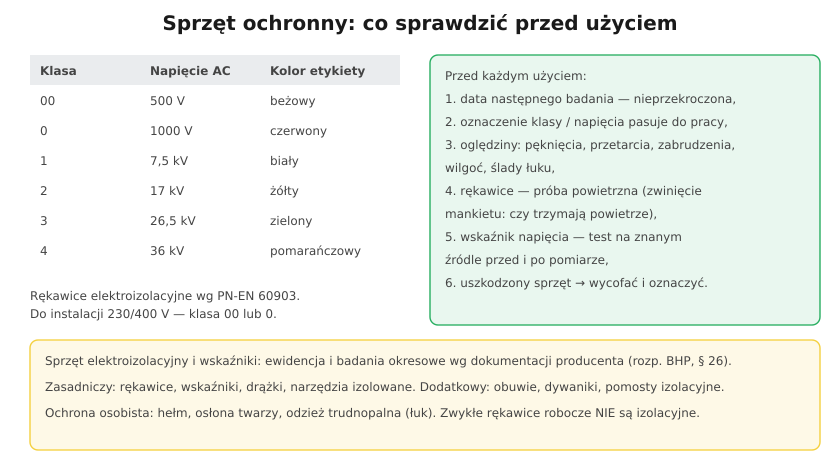

# 28.04 — Sprzęt ochronny izolacyjny i ochrony osobistej

> **Moduł:** [28 — BHP przy urządzeniach elektrycznych](README.md) · **Oznaczenia:** 📋 · **Zakres SEP:** (d) · **Status:** ✅ pełny
>
> **Czytaj:**
>
> - Wskaźniki napięcia: [22.04](../22-przyrzady-pomiarowe/22.04-wskazniki-napiecia-i-probniki.md)
> - Łuk elektryczny: [04.05](../04-prad-a-czlowiek/04.05-luk-elektryczny-i-oparzenia.md)

[← poprzedni temat](28.03-przygotowanie-miejsca-pracy-i-dopuszczenie-do.md) · [spis modułu](README.md) · [następny temat →](28.05-prace-pod-napieciem-dlaczego-nie.md)

## Po co to jest

Sprzęt ochronny chroni wtedy, gdy wszystko inne zawiodło: ktoś pomylił obwód, napięcie wróciło, zapalił się łuk. Na egzaminie pytają o podział sprzętu, klasy rękawic, badania okresowe i to, co sprawdza się przed użyciem.

## Po ludzku

**Sprzęt elektroizolacyjny** — izoluje człowieka od części pod napięciem lub od ziemi:

- **zasadniczy** (sam wystarcza przy danym napięciu, gdy jest dobrany): rękawice elektroizolacyjne (do 1 kV), **narzędzia izolowane 1000 V**, drążki izolacyjne, **wskaźniki napięcia**, uchwyty do wkładek bezpiecznikowych,
- **dodatkowy** (zwiększa bezpieczeństwo, sam nie wystarcza): obuwie i kalosze elektroizolacyjne, dywaniki i pomosty izolacyjne, osłony i kapturki izolacyjne.

**Sprzęt do przygotowania miejsca pracy:** uziemiacze przenośne, blokady i kłódki, tablice i znaki, ogrodzenia.

**Ochrona osobista:** hełm (z osłoną twarzy), okulary, **odzież trudnopalna / łukoodporna**, rękawice robocze (te **nie są** izolacyjne!).

**Rękawice elektroizolacyjne (PN-EN 60903)** mają **klasy**: 00 (500 V), 0 (1000 V), 1 (7,5 kV), 2 (17 kV), 3 (26,5 kV), 4 (36 kV) — napięcie robocze AC. Do instalacji nN — klasa **00 lub 0**. Często zakłada się na nie rękawice skórzane ochronne, żeby ich nie uszkodzić.

**Narzędzia izolowane (PN-EN 60900)** — oznaczone **podwójnym trójkątem i napisem 1000 V**. Izolacja jest badana fabrycznie napięciem 10 kV. Narzędzie z pękniętą lub przetartą izolacją — wycofać.

**Badania okresowe** — sprzęt elektroizolacyjny i wskaźniki napięcia podlegają **ewidencji** oraz **okresowym badaniom i sprawdzeniom** według dokumentacji producenta (§ 26 rozporządzenia BHP); zasady ewidencji i przechowywania ustala pracodawca w instrukcji organizacji bezpiecznej pracy. Na sprzęcie jest naklejka lub wpis z **datą następnego badania**.

**Przed każdym użyciem** (dobra praktyka i wymóg instrukcji producentów):

1. czy nie minął **termin badania**,
2. czy **klasa / napięcie** pasuje do urządzenia,
3. **oględziny** — pęknięcia, przetarcia, przebarwienia, wilgoć, zabrudzenia, ślady łuku,
4. **rękawice — próba powietrzna**: zwiń mankiet, zamknij powietrze, sprawdź, czy nie ucieka,
5. **wskaźnik napięcia** — sprawdź działanie przed i po pomiarze (na znanym źródle lub wbudowanym testerem).

**Przechowywanie** — sucho, z dala od słońca, smarów i ostrych przedmiotów; rękawice w pudełku, nie zgięte, nie wywinięte.

## Jak to wygląda

*Na co patrzeć: nadruk przy mankiecie — klasa, napięcie, symbol podwójnego trójkąta, numer i miejsce na datę badań. Bez czytelnego oznaczenia rękawice nie nadają się do użycia.*

*Na co patrzeć: to są **rękawice robocze**, a nie elektroizolacyjne — chronią przed otarciem i przecięciem, nie przed porażeniem. Nie ma na nich klasy ani podwójnego trójkąta.*

*Na co patrzeć: izolacja na całym trzonku aż do końcówki — przy narzędziach 1000 V odsłonięty jest tylko grot. Zwykły wkrętak z „gumową” rękojeścią to nie narzędzie izolowane.*

*Na co patrzeć: wskaźnik dwubiegunowy to sprzęt ochronny zasadniczy — sprawdza się nim brak napięcia. Jego sprawność kontroluje się przed i po każdym sprawdzeniu.*

## Schemat

## Pojęcia

| Pojęcie | Po ludzku | Termin normowy / symbol |
|---------|-----------|-------------------------|
| Sprzęt izolacyjny zasadniczy | Wystarczy sam przy danym napięciu | — |
| Sprzęt izolacyjny dodatkowy | Zwiększa ochronę, sam nie wystarcza | — |
| Rękawice elektroizolacyjne | Rękawice do pracy przy napięciu | PN-EN 60903, klasy 00–4 |
| Narzędzia izolowane | Narzędzia ręczne z izolacją 1000 V | PN-EN 60900, ▲▲ |
| Odzież łukoodporna | Chroni przed oparzeniem łukiem | PN-EN IEC 61482 |
| Próba powietrzna | Sprawdzenie szczelności rękawic | — |

## Liczby do zapamiętania

| Wielkość | Wartość | Kiedy obowiązuje | Źródło |
|----------|---------|------------------|--------|
| Rękawice klasy 00 / 0 | **500 V / 1000 V** AC | instalacje nN | PN-EN 60903 |
| Rękawice klasy 1–4 | **7,5 / 17 / 26,5 / 36 kV** | sieci SN | jw. |
| Narzędzia izolowane | **1000 V AC** (1500 V DC), próba **10 kV** | prace przy nN | PN-EN 60900 |
| Badania okresowe | wg **dokumentacji producenta**, z ewidencją | sprzęt elektroizolacyjny, wskaźniki | rozp. BHP, § 26 |

## W praktyce

- **Dobór do napięcia:** rękawice i narzędzia o napięciu nie niższym niż napięcie urządzenia.
- **Rękawice izolacyjne a zręczność** — przy precyzyjnej pracy zakłada się cieńsze rękawice klasy 00 i rękawice ochronne na wierzch (jeśli producent tak przewiduje).
- **Odzież przy pracy w rozdzielnicy** — bawełna lub odzież trudnopalna; syntetyki topią się na skórze przy łuku.
- **Biżuteria** (obrączka, zegarek, łańcuszek) — zdejmuje się przed pracą przy urządzeniach elektrycznych.
- **Domowy zestaw:** wskaźnik dwubiegunowy, wkrętaki i szczypce 1000 V, blokady wyłączników — to minimum.

## Błędy i zagrożenia

- ⚠️ **Rękawice robocze lub gumowe „ogrodowe” jako izolacyjne** — nie mają gwarantowanej wytrzymałości.
- ⚠️ **Sprzęt po terminie badania** albo bez oznaczenia — nie wiadomo, czy chroni.
- ⚠️ **Narzędzie z pękniętą izolacją** — izolacja kończy się tam, gdzie pęknięcie.
- **Neonówka zamiast wskaźnika napięcia** — nie jest sprzętem do stwierdzania braku napięcia ([22.04](../22-przyrzady-pomiarowe/22.04-wskazniki-napiecia-i-probniki.md)).
- **Syntetyczna odzież w rozdzielnicy** — przy łuku topi się i pogłębia oparzenia.

## Przykład

**Zadanie.** Na rękawicach elektroizolacyjnych jest nadruk „Class 0”, data ostatniego badania sprzed 8 miesięcy, a producent wymaga badań co 6 miesięcy. W rękawicy jest drobne przetarcie. Czy można w nich pracować w rozdzielnicy 400 V?

**Rozwiązanie.** **Nie**, z dwóch powodów: minął termin badania okresowego wymagany przez producenta, a przetarcie dyskwalifikuje rękawice niezależnie od daty. Klasa 0 (1000 V) byłaby odpowiednia do 400 V — ale tylko sprawne i aktualnie zbadane rękawice.

## Pytania SEP

1. **Jak dzieli się sprzęt ochronny stosowany przy pracach przy urządzeniach elektroenergetycznych?**

Odpowiedź

Na sprzęt elektroizolacyjny — zasadniczy (rękawice elektroizolacyjne do 1 kV, narzędzia izolowane, drążki izolacyjne, wskaźniki napięcia, uchwyty do wkładek), który przy danym napięciu sam zapewnia ochronę, i dodatkowy (obuwie i kalosze elektroizolacyjne, dywaniki, pomosty, osłony), który zwiększa bezpieczeństwo w połączeniu ze sprzętem zasadniczym; na sprzęt do przygotowania miejsca pracy (uziemiacze przenośne, blokady, tablice i znaki, ogrodzenia); oraz na środki ochrony indywidualnej (hełmy, osłony twarzy, okulary, odzież trudnopalna, rękawice ochronne).

2. **Co należy sprawdzić przed użyciem sprzętu ochronnego elektroizolacyjnego?**

Odpowiedź

Czy nie upłynął termin badania okresowego (oznaczenie na sprzęcie lub w ewidencji); czy sprzęt jest przeznaczony na napięcie urządzenia (klasa, oznaczenie); oględziny — brak pęknięć, przetarć, zabrudzeń, wilgoci, śladów działania łuku; w przypadku rękawic — próbę powietrzną szczelności; w przypadku wskaźnika napięcia — sprawdzenie działania przed i po użyciu. Sprzęt uszkodzony lub z przekroczonym terminem badań wycofuje się z użycia.

## Sprawdź się

1. Dlaczego rękawice elektroizolacyjne klasy 00 nie mogą być użyte przy pracy w pobliżu linii 15 kV?

Odpowiedź

Bo klasa 00 jest przeznaczona do napięcia roboczego 500 V AC. Przy 15 kV izolacja zostałaby przebita. Do SN potrzebne są rękawice klasy co najmniej 2 (17 kV) — i to w połączeniu z innymi środkami i technologią przewidzianą dla prac na tym napięciu.

## Źródła

- [Rozporządzenie BHP przy urządzeniach energetycznych — t.j. Dz.U. 2021 poz. 1210](https://api.sejm.gov.pl/eli/acts/DU/2021/1210/text.html) (§ 26, § 33).
- PN-EN 60903 — Prace pod napięciem. Rękawice z materiału izolacyjnego.
- PN-EN 60900 — Prace pod napięciem. Narzędzia ręczne do stosowania przy napięciu do 1000 V AC i 1500 V DC.
- PN-EN 61243-3 — Wskaźniki napięcia dwubiegunowe niskiego napięcia.

---

[← poprzedni temat](28.03-przygotowanie-miejsca-pracy-i-dopuszczenie-do.md) · [spis modułu](README.md) · [następny temat →](28.05-prace-pod-napieciem-dlaczego-nie.md)
