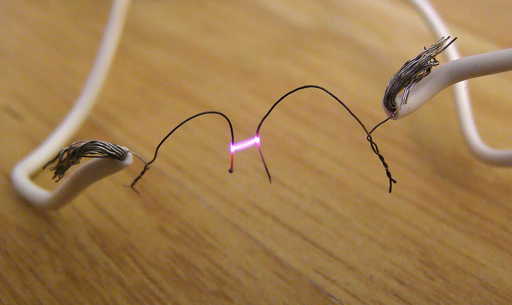
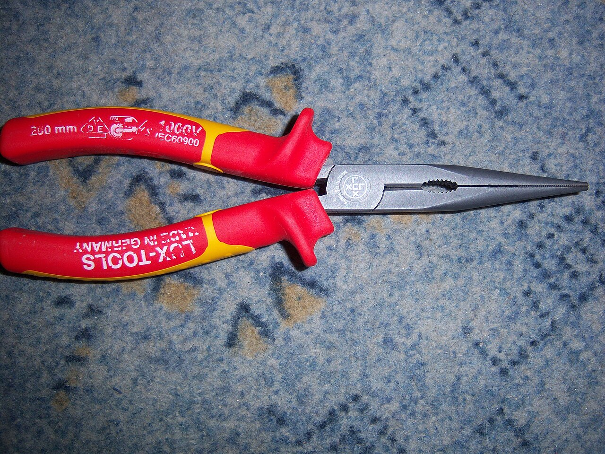
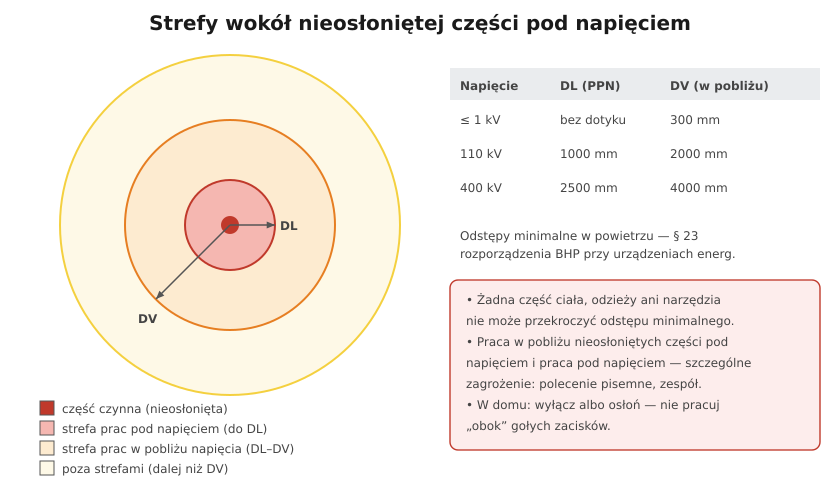

# 28.05 — Prace pod napięciem — dlaczego nie

> **Moduł:** [28 — BHP przy urządzeniach elektrycznych](README.md) · **Oznaczenia:** 📋 · **Zakres SEP:** (d) · **Status:** ✅ pełny
>
> **Czytaj:**
>
> - [Rozporządzenie BHP przy urządzeniach energetycznych, § 23](https://api.sejm.gov.pl/eli/acts/DU/2021/1210/text.html)
> - Prąd a człowiek i łuk: [04.05](../04-prad-a-czlowiek/04.05-luk-elektryczny-i-oparzenia.md)

[← poprzedni temat](28.04-sprzet-ochronny-izolacyjny-i-ochrony-osobistej.md) · [spis modułu](README.md) · [następny temat →](28.06-narzedzia-drabiny-i-praca-na-wysokosci.md)

## Po co to jest

Prace pod napięciem (PPN) istnieją — energetyka wykonuje je codziennie, żeby nie wyłączać odbiorców. Ale robią to **specjalnie wyszkolone zespoły**, ze specjalnym sprzętem i według zatwierdzonej technologii. Ten temat wyjaśnia, czym są PPN, czym różnią się od pracy „przy wyłączonym” i dlaczego w domu czy w zwykłej firmie **pracuje się wyłącznie na wyłączonym**.

## Po ludzku

**Trzy sposoby pracy (§ 23 ust. 1, PN-EN 50110-1):**

- **przy urządzeniu wyłączonym** spod napięcia — podstawowa, zalecana metoda ([28.03](28.03-przygotowanie-miejsca-pracy-i-dopuszczenie-do.md)),
- **w pobliżu napięcia** — w strefie między DL a DV; osłony, odstępy, nadzór,
- **pod napięciem** — dotykanie części czynnych lub wchodzenie w strefę DL, z zastosowaniem metod i środków ochrony gwarantujących bezpieczeństwo.

**Metody PPN:**

- **z odległości** (drążkowa) — narzędzia na drążkach izolacyjnych, monter poza strefą DL,
- **w kontakcie** (rękawicowa) — monter w rękawicach i z osłonami izolacyjnymi, dotyka części czynnych przez izolację; typowa w sieciach nN i SN,
- **na potencjale** — monter jest izolowany od ziemi i ma potencjał przewodu (linie WN).

**Warunki PPN:** szkolenie i **upoważnienie do PPN**, opracowana **technologia** (instrukcja), sprzęt atestowany i badany, warunki atmosferyczne (deszcz, burza — przerwa), zespół i nadzór. Instrukcja organizacji bezpiecznej pracy pracodawcy określa organizację, narzędzia i sprzęt PPN (§ 33 pkt 7).

**Dlaczego „nie” w normalnej pracy elektryka:**

- **łuk przy zwarciu** w rozdzielnicy nN ma ogromną energię — prąd zwarciowy przy złączu sięga kiloamperów, oparzenia są ciężkie ([04.05](../04-prad-a-czlowiek/04.05-luk-elektryczny-i-oparzenia.md)),
- **jeden poślizg wkrętaka** między fazą a PE zamienia drobną pracę w wypadek,
- **nie ma asekuracji** w postaci wyłączonego obwodu — każdy błąd jest od razu groźny,
- **przepisy:** praca pod napięciem to praca w warunkach **szczególnego zagrożenia** (polecenie pisemne, zespół) — chyba że to rutynowe czynności opisane w instrukcji (np. pomiary).

**Czynności pod napięciem, które elektryk jednak wykonuje:** **pomiary** (impedancja pętli, RCD, napięcia), **wymiana wkładek bezpiecznikowych** (według instrukcji: bez obciążenia, uchwytem do wkładek, w rękawicach i osłonie twarzy), **sprawdzanie braku napięcia**. Wszystkie wymagają sprzętu i procedury.

## Jak to wygląda

*Na co patrzeć: to łuk z cienkich drucików przy małym prądzie. Przy zwarciu w rozdzielnicy blisko złącza prąd jest tysiące razy większy — łuk wyrzuca stopiony metal i gorące gazy na odległość ramienia.*

*Na co patrzeć: narzędzia izolowane chronią przy przypadkowym dotknięciu — nie są „zezwoleniem” na pracę pod napięciem. Przy PPN potrzeba całej technologii, nie tylko narzędzi.*

## Schemat

## Pojęcia

| Pojęcie | Po ludzku | Termin normowy / symbol |
|---------|-----------|-------------------------|
| PPN | Praca pod napięciem | live working |
| DL | Granica strefy prac pod napięciem | PN-EN 50110-1 |
| DV | Granica strefy prac w pobliżu napięcia | jw. |
| Metoda w kontakcie | Praca w rękawicach izolacyjnych | metoda rękawicowa |
| Metoda z odległości | Praca narzędziami na drążkach | metoda drążkowa |
| Metoda na potencjale | Praca na potencjale przewodu (WN) | — |

## Liczby do zapamiętania

| Wielkość | Wartość | Kiedy obowiązuje | Źródło |
|----------|---------|------------------|--------|
| Odstęp PPN ≤ 1 kV | **bez dotyku** części czynnych (poza technologią PPN) | granica DL | rozp. BHP, § 23 ust. 3 |
| Strefa w pobliżu ≤ 1 kV | **300 mm** | granica DV | jw. |
| 110 kV | DL **1000 mm**, DV **2000 mm** | — | jw. |
| 400 kV | DL **2500 mm**, DV **4000 mm** | — | jw. |

## W praktyce

- **Domyślnie: wyłącz.** „Nie da się wyłączyć” rzadko jest prawdą — częściej to „nie chce się wyłączyć”. Zaplanuj prace z właścicielem.
- **Pomiary pod napięciem** — sprzęt kategorii CAT odpowiedniej do miejsca, przewody z osłoniętymi końcówkami, stabilna pozycja, druga ręka z dala od części przewodzących ([22.01](../22-przyrzady-pomiarowe/22.01-kategorie-pomiarowe-cat-iiiv-i-bezpieczenstwo.md)).
- **Wymiana wkładek** — tylko bez obciążenia (wyłącz odbiory), uchwytem/nasadką, w rękawicach i osłonie twarzy.
- **W rozdzielnicy po wyłączeniu wyłącznika głównego** — zaciski wejściowe dalej pod napięciem: to praca w pobliżu napięcia, osłoń je.

## Błędy i zagrożenia

- ⚠️ **„Tylko dokręcę zacisk pod napięciem”** — poślizg wkrętaka, zwarcie, łuk w twarz.
- ⚠️ **Praca w syntetycznej odzieży, z obrączką** przy częściach czynnych.
- **Wyjmowanie wkładki pod obciążeniem** — łuk przy rozłączaniu prądu.
- **Pomiar miernikiem w trybie prądowym** przyłożonym do napięcia — zwarcie przez miernik.

## Przykład

**Zadanie.** Klient prosi o dołożenie obwodu w rozdzielnicy mieszkania „bez wyłączania prądu, bo pracuje serwer”. Co robisz?

**Rozwiązanie.** Odmawiasz pracy pod napięciem. Proponujesz: zasilić serwer na czas pracy z UPS-a lub przedłużacza z innego, niewyłączanego źródła, uzgodnić krótkie okno serwisowe i pracować na wyłączonej rozdzielnicy (pięć zasad, blokada, sprawdzenie braku napięcia). Praca pod napięciem w rozdzielnicy mieszkaniowej to ryzyko łuku i porażenia — przy braku technologii PPN i zespołu niedopuszczalne.

## Pytania SEP

1. **Jakie są rodzaje prac ze względu na napięcie i czym się różnią?**

Odpowiedź

Prace przy urządzeniu wyłączonym spod napięcia — urządzenie odłączone, zabezpieczone przed załączeniem, sprawdzony brak napięcia, w razie potrzeby uziemione; podstawowy sposób pracy. Prace w pobliżu napięcia — wykonywane w strefie między granicą prac pod napięciem a granicą strefy w pobliżu (dla nN 300 mm), z osłonami, przegrodami i zachowaniem odstępów. Prace pod napięciem — z dotykaniem części czynnych lub wejściem w strefę prac pod napięciem, wykonywane wyłącznie przez wyszkolonych i upoważnionych pracowników według opracowanej technologii, ze specjalnym sprzętem; są pracami w warunkach szczególnego zagrożenia.

2. **Jak bezpiecznie wymienić wkładkę bezpiecznikową w urządzeniu pod napięciem?**

Odpowiedź

Według instrukcji eksploatacji: najpierw wyłączyć obciążenie (żeby nie przerywać prądu wkładką), używać uchwytu lub nasadki przeznaczonej do danego typu wkładek (dla NH — uchwyt z mankietem), rękawic elektroizolacyjnych i osłony twarzy, stać pewnie, nie dotykać innych części. Wkładkę zakłada się zgodną co do typu i prądu znamionowego; jeśli to możliwe, całą operację wykonuje się po wyłączeniu zasilania podstawy.

## Sprawdź się

1. Dlaczego narzędzia z izolacją 1000 V nie czynią z każdej pracy „bezpiecznej pracy pod napięciem”?

Odpowiedź

Bo chronią tylko przed porażeniem przez to jedno narzędzie. Nie chronią przed zwarciem i łukiem, gdy końcówka zetknie dwie części o różnym potencjale, przed dotknięciem części czynnych ręką lub łokciem ani przed upadkiem. PPN wymaga całej technologii: osłon, rękawic, odzieży, procedury, szkolenia i zespołu.

## Źródła

- [Rozporządzenie BHP przy urządzeniach energetycznych — t.j. Dz.U. 2021 poz. 1210](https://api.sejm.gov.pl/eli/acts/DU/2021/1210/text.html) (§ 23, 27, 33).
- PN-EN 50110-1 — Eksploatacja urządzeń elektrycznych (rozdz. 6.3 — prace pod napięciem, 6.4 — prace w pobliżu).

---

[← poprzedni temat](28.04-sprzet-ochronny-izolacyjny-i-ochrony-osobistej.md) · [spis modułu](README.md) · [następny temat →](28.06-narzedzia-drabiny-i-praca-na-wysokosci.md)
