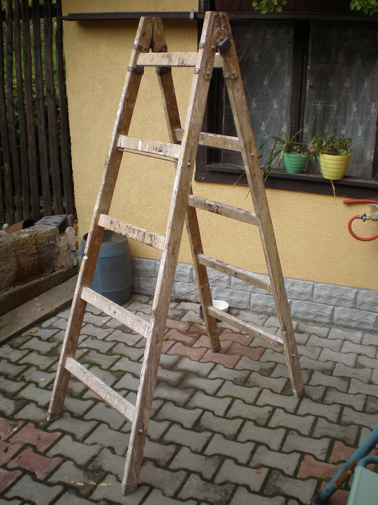
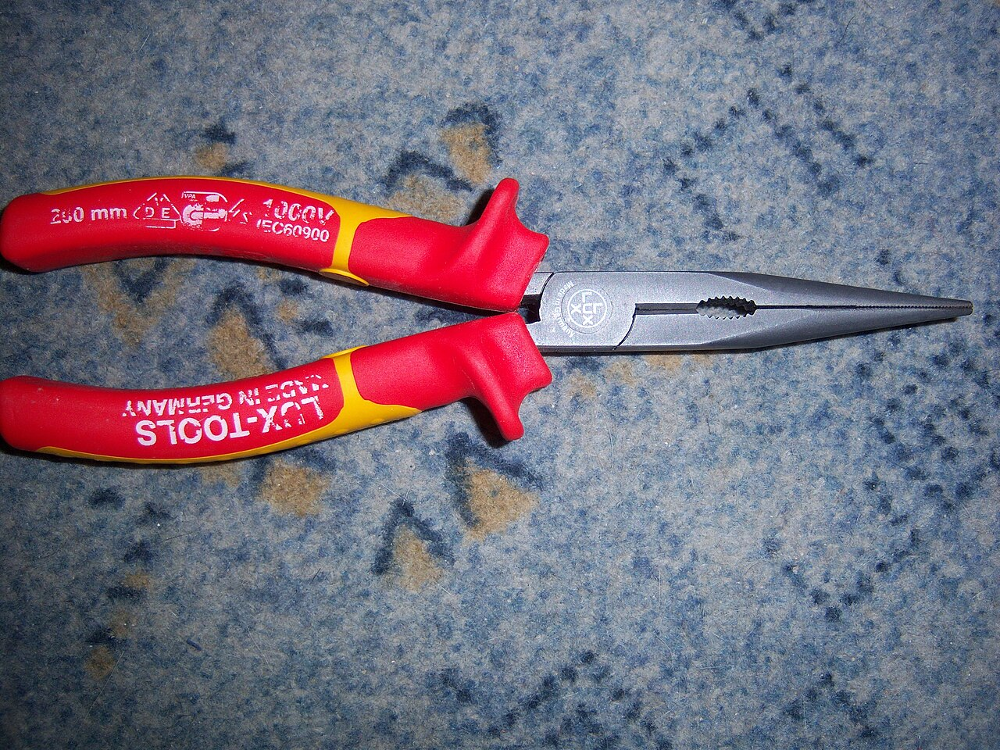
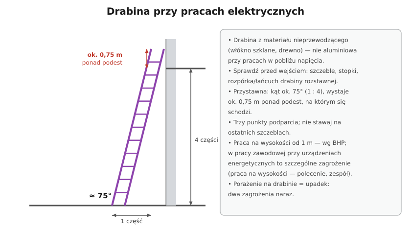

# 28.06 — Narzędzia, drabiny i praca na wysokości

> **Moduł:** [28 — BHP przy urządzeniach elektrycznych](README.md) · **Oznaczenia:** 📋 · **Zakres SEP:** (d) · **Status:** ✅ pełny
>
> **Czytaj:**
>
> - Ogólne przepisy BHP (rozporządzenie MPiPS z 26 września 1997 r., praca na wysokości)
> - Wkrętak dynamometryczny i narzędzia: [19.07](../19-prace-krok-po-kroku/19.07-zakanczanie-przewodow-tulejki-zaciski-momenty.md)

[← poprzedni temat](28.05-prace-pod-napieciem-dlaczego-nie.md) · [spis modułu](README.md) · (koniec modułu) →

## Po co to jest

Wielu elektryków ginie nie od prądu, tylko od upadku po „kopnięciu” na drabinie. Ten temat zbiera zasady dotyczące narzędzi, drabin i pracy na wysokości — z punktu widzenia elektryka.

## Po ludzku

**Narzędzia ręczne:**

- **izolowane 1000 V** (PN-EN 60900, podwójny trójkąt) — wkrętaki, szczypce, klucze do pracy przy instalacjach; przed użyciem oględziny izolacji,
- **dobre narzędzia do zakończeń** — ściągacze izolacji, zaciskarki tulejek, **wkrętak dynamometryczny** (zaciski aparatów mają podany moment),
- **elektronarzędzia** — sprawne przewody i wtyczki, klasa II lub z PE; na budowie zasilanie z rozdzielnicy z RCD ([17.05](../17-pomieszczenia-szczegolne/17.05-tymczasowa-instalacja-na-budowie.md)).

**Drabiny:**

- przy pracach w pobliżu napięcia — z materiału **nieprzewodzącego** (włókno szklane, drewno), **nie** aluminiowa,
- **przed wejściem:** stan szczebli i stopek, rozpórki lub łańcucha w drabinie rozstawnej, stabilne podłoże,
- **drabina przystawna** — kąt ok. **75°** (podstawa odsunięta o ok. ¼ wysokości), jeśli służy do wejścia na podest — wystaje ok. **0,75 m** ponad niego,
- **trzy punkty podparcia** (dwie nogi + ręka), nie stawaj na najwyższych szczeblach, nie wychylaj się poza drabinę, przesuń drabinę zamiast sięgać,
- narzędzia w torbie/pasie, nie w ręce przy wchodzeniu.

**Praca na wysokości** — według ogólnych przepisów BHP to praca na powierzchni **powyżej 1 m** nad poziomem podłogi lub ziemi (rozporządzenie w sprawie ogólnych przepisów BHP). Wymaga zabezpieczenia przed upadkiem (balustrady, podesty, rusztowania, podnośniki, sprzęt chroniący przed upadkiem z wysokości). W pracach przy urządzeniach energetycznych praca na wysokości jest pracą w warunkach **szczególnego zagrożenia** ([28.02](28.02-prace-w-warunkach-szczegolnego-zagrozenia.md)).

**Porażenie + wysokość = podwójne zagrożenie.** Nawet słabe „kopnięcie” (np. od prądu upływu przez zasilacz LED) wywołuje odruch, który zrzuca z drabiny. Dlatego na wysokości obwód zawsze wyłączony, a nie „tylko lampa zgaszona łącznikiem”.

## Jak to wygląda

*Na co patrzeć: drabina rozstawna musi mieć pewną rozpórkę lub łańcuch i równe podłoże. Drewniana nie przewodzi (gdy jest sucha i czysta), ale sprawdź stan szczebli — stare drewno pęka.*

*Na co patrzeć: oznaczenie 1000 V na rękojeści. Izolacja dwukolorowa — gdy przez zewnętrzną warstwę prześwituje kolor spodu, narzędzie jest do wymiany.*

## Schemat

## Pojęcia

| Pojęcie | Po ludzku | Termin normowy / symbol |
|---------|-----------|-------------------------|
| Praca na wysokości | Praca powyżej 1 m nad podłogą lub ziemią | ogólne przepisy BHP |
| Drabina przystawna | Opierana o ścianę | PN-EN 131 |
| Drabina rozstawna | Samostojąca, z rozpórką | PN-EN 131 |
| Narzędzie izolowane | Narzędzie ręczne do 1000 V AC | PN-EN 60900 |
| Trzy punkty podparcia | Zawsze trzy kończyny na drabinie | — |

## Liczby do zapamiętania

| Wielkość | Wartość | Kiedy obowiązuje | Źródło |
|----------|---------|------------------|--------|
| Praca na wysokości | **> 1 m** nad podłogą lub ziemią | wszystkie prace | ogólne przepisy BHP |
| Kąt drabiny przystawnej | ok. **75°** (1 : 4) | ustawienie drabiny | instrukcje drabin, PN-EN 131 |
| Wysunięcie ponad podest | ok. **0,75 m** | wejście na podest | przepisy BHP przy robotach budowlanych |
| Narzędzia izolowane | **1000 V AC / 1500 V DC** | prace przy nN | PN-EN 60900 |

## W praktyce

- **Oprawa na suficie** — wyłącz obwód w rozdzielnicy (nie łącznikiem), sprawdź brak napięcia z drabiny, dopiero potem odłączaj.
- **Podnośnik zamiast drabiny** przy pracy dłuższej lub wymagającej obu rąk.
- **Druga osoba** trzyma drabinę i podaje narzędzia — przy pracy w pobliżu napięcia to wymóg (zespół).
- **Narzędzia elektryczne** — sprawdzane okresowo (oględziny, pomiar izolacji/ciągłości PE według instrukcji pracodawcy).

## Błędy i zagrożenia

- ⚠️ **Aluminiowa drabina przy liniach napowietrznych lub w rozdzielni** — przewodzi.
- ⚠️ **Wymiana lampy „przy zgaszonym łączniku”** — łącznik mógł przerywać N, a w puszce może być faza z innego obwodu.
- **Stawanie na ostatnim szczeblu, sięganie w bok** — utrata równowagi.
- **Narzędzia z uszkodzoną izolacją** — ochrona istnieje tylko na papierze.

## Przykład

**Zadanie.** Drabina przystawna ma 4 m długości i ma sięgać do krawędzi podestu na wysokości 3,2 m, wystając 0,75 m ponad niego. Czy jest wystarczająca, przy kącie ok. 75°?

**Rozwiązanie.** Potrzebna długość wzdłuż drabiny do krawędzi: $3{,}2 / \sin 75° \approx 3{,}2 / 0{,}966 \approx 3{,}31$ m, plus 0,75 m wysunięcia → ok. **4,06 m**. Drabina 4 m jest **za krótka** — trzeba dłuższej (lub innego środka dostępu).

## Pytania SEP

1. **Jakie zasady obowiązują przy pracy na drabinie przy urządzeniach elektrycznych?**

Odpowiedź

Drabina musi być sprawna (szczeble, stopki, rozpórki) i dobrana do pracy, przy pracach w pobliżu napięcia — wykonana z materiału nieprzewodzącego. Ustawia się ją na stabilnym podłożu, przystawną pod kątem ok. 75°, z wysunięciem ponad podest, jeśli służy do wejścia. Zachowuje się trzy punkty podparcia, nie staje na najwyższych szczeblach i nie wychyla poza drabinę. Prace na wysokości powyżej 1 m wymagają zabezpieczenia przed upadkiem, a przy urządzeniach energetycznych są pracami w warunkach szczególnego zagrożenia — wykonuje je zespół na podstawie polecenia pisemnego. Urządzenie, przy którym się pracuje, powinno być wyłączone spod napięcia.

## Sprawdź się

1. Dlaczego nawet niegroźne porażenie (kilka mA) jest niebezpieczne na drabinie?

Odpowiedź

Bo prąd powyżej progu odczuwania wywołuje gwałtowny, mimowolny ruch (odruch cofnięcia ręki, skurcz). Na drabinie taki ruch łatwo kończy się utratą równowagi i upadkiem — skutki upadku z 2–3 m są często poważniejsze niż samo porażenie.

## Źródła

- Rozporządzenie Ministra Pracy i Polityki Socjalnej z 26 września 1997 r. w sprawie ogólnych przepisów bezpieczeństwa i higieny pracy (praca na wysokości).
- PN-EN 131 — Drabiny; PN-EN 60900 — Narzędzia ręczne do 1000 V AC.
- [Rozporządzenie BHP przy urządzeniach energetycznych — t.j. Dz.U. 2021 poz. 1210](https://api.sejm.gov.pl/eli/acts/DU/2021/1210/text.html) (§ 27 ust. 2 pkt 8).

---

[← poprzedni temat](28.05-prace-pod-napieciem-dlaczego-nie.md) · [spis modułu](README.md) · (koniec modułu) →
