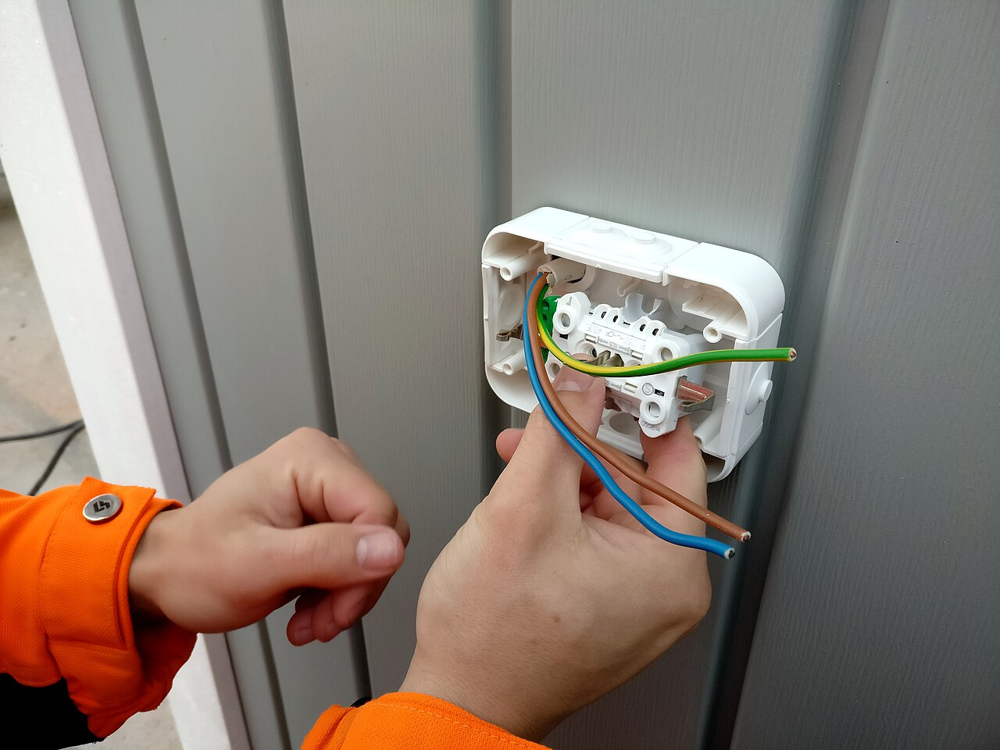
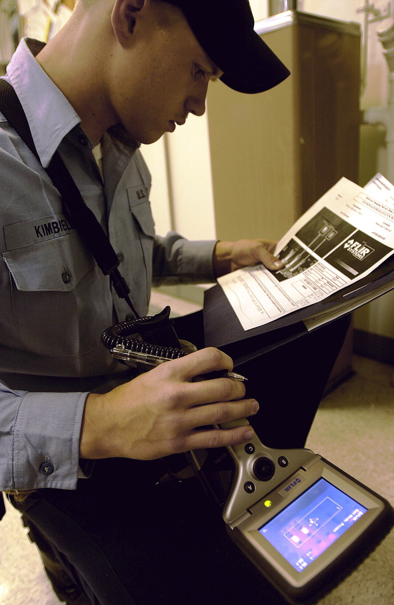
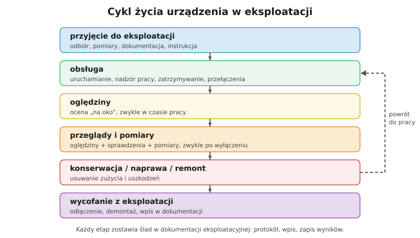

# 29.01 — Rodzaje prac eksploatacyjnych

> **Moduł:** [29 — Eksploatacja urządzeń i instalacji](README.md) · **Oznaczenia:** 📋 · **Zakres SEP:** (b) (c) · **Status:** ✅ pełny
>
> **Czytaj:**
>
> - Co wolno samemu, a co wymaga uprawnień: [00.03](../00-bezpieczenstwo-najpierw/00.03-co-wolno-zrobic-samemu-a-co-wymaga-uprawnien-i.md)
> - Ustawa Prawo energetyczne, art. 54; rozporządzenie Ministra Klimatu i Środowiska z 1 lipca 2022 r. w sprawie szczegółowych zasad stwierdzania posiadania kwalifikacji

← (początek modułu) · [spis modułu](README.md) · [następny temat →](29.02-instrukcja-eksploatacji.md)

## Po co to jest

Świadectwo kwalifikacyjne SEP wydaje się „na eksploatację” urządzeń, instalacji i sieci. Na egzaminie pada więc pytanie: **co to jest eksploatacja** i jakie prace obejmuje. Od odpowiedzi zależy też, co dokładnie wolno robić z danym świadectwem — grupa (G1, G2, G3) mówi „przy czym”, a stanowisko (E lub D) — „w jakiej roli”.

## Po ludzku

**Eksploatacja** to wszystko, co dzieje się z urządzeniem od zamontowania do demontażu. Rozporządzenie Ministra Klimatu i Środowiska z 1 lipca 2022 r. (Dz.U. 2022 poz. 1392, § 4) wymienia prace, które się na nią składają — i opisuje, na czym polegają:

- **obsługa** — czynności zmieniające **parametry pracy** urządzeń (załączanie, wyłączanie, przełączanie, regulacja), czyli prowadzenie urządzenia zgodnie z instrukcją,
- **konserwacja** — **zabezpieczenie i utrzymanie** urządzeń w należytym stanie technicznym: czyszczenie, dokręcanie połączeń, smarowanie, regulacje, wymiana drobnych zużywających się elementów,
- **remont i naprawa** — **usuwanie usterek i awarii**, żeby przywrócić wymagany stan techniczny (remont zwykle planowo i w szerszym zakresie, naprawa — po uszkodzeniu),
- **montaż i demontaż** — instalowanie lub usuwanie urządzeń oraz ich **podłączanie i odłączanie**,
- **czynności kontrolno-pomiarowe** — kontrola, **ocena stanu technicznego** i parametrów pracy, sprawdzanie efektywności (oględziny, próby, pomiary).

**Stanowiska:**

- **eksploatacji (E)** — osoba **wykonuje** prace,
- **dozoru (D)** — osoba **kieruje** pracami i **nadzoruje** je (poleceniodawca, koordynujący), a także np. przeprowadza kontrolę okresową instalacji w budynku (Prawo budowlane, art. 62 ust. 5).

**Zakres w świadectwie** — komisja wpisuje rodzaje urządzeń (np. „urządzenia, instalacje i sieci o napięciu nie wyższym niż 1 kV”) i zakres prac (np. „obsługa, konserwacja, remont, naprawa, montaż, demontaż, czynności kontrolno-pomiarowe”). Pracujesz tylko w granicach tego, co jest w świadectwie. Świadectwo jest ważne **5 lat** ([00.03](../00-bezpieczenstwo-najpierw/00.03-co-wolno-zrobic-samemu-a-co-wymaga-uprawnien-i.md)).

**Zasady eksploatacji** — urządzenie eksploatuje się:

- **zgodnie z instrukcją eksploatacji** i dokumentacją producenta,
- przez osoby z **kwalifikacjami** i **upoważnieniem** pracodawcy,
- z **zapisywaniem** wykonanych czynności (dokumentacja eksploatacyjna),
- w sposób zapewniający **bezpieczeństwo ludzi, mienia i środowiska** oraz niezawodność zasilania.

## Jak to wygląda

*Na co patrzeć: montaż gniazda to jeden z zakresów eksploatacji. Ta sama osoba może później wykonać pomiary (czynności kontrolno-pomiarowe) — o ile ma je w zakresie świadectwa.*

*Na co patrzeć: badanie termowizyjne pod obciążeniem to czynność kontrolno-pomiarowa wykonywana w ramach oględzin lub przeglądu — bez wyłączania urządzenia.*

## Schemat

## Pojęcia

| Pojęcie | Po ludzku | Termin normowy / symbol |
|---------|-----------|-------------------------|
| Eksploatacja | Wszystko, co się robi z urządzeniem w czasie jego życia | Prawo energetyczne, art. 54 |
| Obsługa | Uruchamianie, łączenia, regulacja | zmiana parametrów pracy (§ 4 ust. 2 pkt 1) |
| Konserwacja | Utrzymanie sprawności, drobne czynności | § 4 ust. 2 pkt 2 |
| Remont, naprawa | Usuwanie usterek i awarii | § 4 ust. 2 pkt 3 |
| Montaż, demontaż | Instalowanie, podłączanie, usuwanie | § 4 ust. 2 pkt 4 |
| Czynności kontrolno-pomiarowe | Oględziny, ocena stanu, pomiary | § 4 ust. 2 pkt 5 |
| Stanowisko E / D | Wykonawca / dozór | świadectwo kwalifikacyjne |

## Liczby do zapamiętania

| Wielkość | Wartość | Kiedy obowiązuje | Źródło |
|----------|---------|------------------|--------|
| Zakresy eksploatacji | **7**: obsługa, konserwacja, remont, naprawa, montaż, demontaż, kontrolno-pomiarowe | świadectwa kwalifikacyjne | rozp. z 2022 r. w sprawie kwalifikacji |
| Ważność świadectwa | **5 lat** | E i D | Prawo energetyczne, art. 54 ust. 1aa |
| Stanowiska | **E** (eksploatacja), **D** (dozór) | — | jw. |
| Grupy urządzeń | **G1** elektryczne, **G2** cieplne, **G3** gazowe | — | jw. |

## W praktyce

- **Sprawdź swoje świadectwo** — zakres napięć i rodzajów prac. Pomiary wymagają wpisanego zakresu „czynności kontrolno-pomiarowe”.
- **Konserwacja a remont** — dokręcenie zacisków w rozdzielnicy to konserwacja; wymiana całej rozdzielnicy — remont lub montaż. Zakres decyduje o tym, jaka dokumentacja jest potrzebna.
- **Dozór** — osoba z D przyjmuje odpowiedzialność za organizację prac i za stan urządzeń; w firmie zwykle kierownik lub mistrz.

## Błędy i zagrożenia

- **Praca poza zakresem świadectwa** (np. pomiary bez zakresu kontrolno-pomiarowego, urządzenia > 1 kV z świadectwem do 1 kV).
- **Brak zapisu** wykonanej konserwacji czy naprawy — za rok nikt nie wie, co było robione.
- **Mylenie „naprawy” z „przeróbką”** — zmiana obwodu, przekroju czy zabezpieczenia to modyfikacja instalacji: wymaga pomiarów i aktualizacji dokumentacji.

## Przykład

**Zadanie.** Elektryk z świadectwem E (G1, do 1 kV, obsługa, konserwacja, naprawa, montaż, demontaż) chce wykonać okresowe pomiary instalacji w bloku i podpisać protokół kontroli okresowej z art. 62 Prawa budowlanego. Może?

**Rozwiązanie.** **Nie.** Brakuje mu zakresu **czynności kontrolno-pomiarowych** — więc nie może wykonywać pomiarów. A kontrolę okresową instalacji z art. 62 przeprowadzają osoby z kwalifikacjami wymaganymi przy **dozorze** (D). Potrzebne jest świadectwo E z zakresem pomiarowym do wykonania pomiarów i osoba z D do przeprowadzenia kontroli.

## Pytania SEP

1. **Co obejmuje eksploatacja urządzeń, instalacji i sieci?**

Odpowiedź

Według rozporządzenia w sprawie stwierdzania kwalifikacji (§ 4) eksploatacja obejmuje: obsługę (czynności zmieniające parametry pracy urządzeń — załączanie, wyłączanie, przełączanie, regulacja), konserwację (zabezpieczenie i utrzymanie należytego stanu technicznego), remont i naprawę (usuwanie usterek i awarii w celu przywrócenia wymaganego stanu technicznego), montaż i demontaż (instalowanie, podłączanie, odłączanie i usuwanie urządzeń) oraz czynności kontrolno-pomiarowe (kontrola i ocena stanu technicznego i parametrów pracy). Eksploatację prowadzi się zgodnie z instrukcją eksploatacji, przez osoby posiadające kwalifikacje i upoważnienie, z dokumentowaniem wykonanych czynności.

2. **Czym różni się stanowisko eksploatacji od stanowiska dozoru?**

Odpowiedź

Stanowisko eksploatacji (E) dotyczy osób wykonujących prace eksploatacyjne — obsługę, konserwację, remonty, montaż, pomiary. Stanowisko dozoru (D) dotyczy osób kierujących czynnościami osób wykonujących prace oraz sprawujących nadzór nad eksploatacją urządzeń: wydających polecenia, organizujących pracę, odpowiadających za stan techniczny i dokumentację. Osoba z dozorem przeprowadza też m.in. kontrole okresowe instalacji w budynkach według Prawa budowlanego.

## Sprawdź się

1. Czy wymiana przepalonej wkładki bezpiecznikowej to naprawa, konserwacja czy obsługa?

Odpowiedź

Najczęściej traktuje się ją jako czynność **obsługi** (przywrócenie zasilania według instrukcji eksploatacji), poprzedzoną ustaleniem przyczyny zadziałania. Jeśli przyczyną było uszkodzenie, jego usunięcie to już **naprawa**.

## Źródła

- Ustawa z 10 kwietnia 1997 r. Prawo energetyczne, art. 54.
- [Rozporządzenie Ministra Klimatu i Środowiska z 1 lipca 2022 r. w sprawie szczegółowych zasad stwierdzania posiadania kwalifikacji przez osoby zajmujące się eksploatacją urządzeń, instalacji i sieci — Dz.U. 2022 poz. 1392](https://api.sejm.gov.pl/eli/acts/DU/2022/1392/text.html) (§ 4).
- Ustawa Prawo budowlane, art. 62.

---

← (początek modułu) · [spis modułu](README.md) · [następny temat →](29.02-instrukcja-eksploatacji.md)
