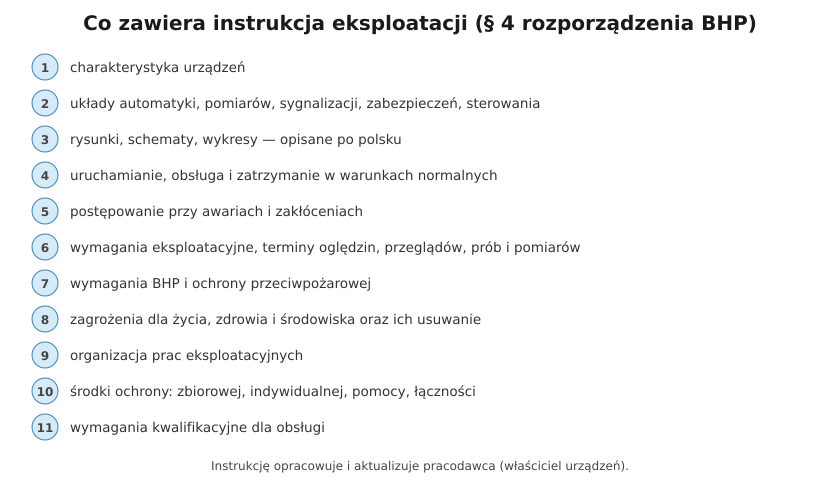

# 29.02 — Instrukcja eksploatacji

> **Moduł:** [29 — Eksploatacja urządzeń i instalacji](README.md) · **Oznaczenia:** 📋 · **Zakres SEP:** (b) (c) · **Status:** ✅ pełny
>
> **Czytaj:**
>
> - [Rozporządzenie BHP przy urządzeniach energetycznych, § 4 (t.j. Dz.U. 2021 poz. 1210)](https://api.sejm.gov.pl/eli/acts/DU/2021/1210/text.html)

[← poprzedni temat](29.01-rodzaje-prac-eksploatacyjnych.md) · [spis modułu](README.md) · [następny temat →](29.03-dokumentacja-techniczna-i-eksploatacyjna.md)

## Po co to jest

„Co powinna zawierać instrukcja eksploatacji?” — jedno z najczęstszych pytań na egzaminie D i E. Instrukcja to podstawowy dokument, według którego eksploatuje się urządzenie: z niej wynika, kto co robi, jak często się sprawdza i co robić przy awarii. Rozporządzenie BHP mówi, że prace eksploatacyjne prowadzi się **zgodnie z instrukcją eksploatacji**.

## Po ludzku

**Kto ją robi:** pracodawca (właściciel, zarządca urządzeń) **opracowuje** instrukcję i ją **aktualizuje** (§ 4 ust. 2). W praktyce pisze ją osoba z dozorem, na podstawie dokumentacji producenta, projektu i przepisów.

**Co musi zawierać (§ 4 ust. 1 rozporządzenia BHP):**

1. **charakterystykę** urządzeń,
2. opis układów **automatyki, pomiarów, sygnalizacji, zabezpieczeń i sterowania**,
3. **rysunki, schematy i wykresy** — opisane w języku polskim,
4. czynności przy **uruchamianiu, obsłudze i zatrzymywaniu** w warunkach normalnej pracy,
5. postępowanie w razie **awarii, zakłóceń** i nieprawidłowości,
6. **wymagania eksploatacyjne** i **terminy** oględzin, przeglądów, prób i pomiarów,
7. wymagania **BHP i ochrony przeciwpożarowej**,
8. **zagrożenia** dla życia, zdrowia i środowiska oraz sposoby ich usuwania,
9. **organizację** prac eksploatacyjnych,
10. **środki ochrony** — zbiorowej, indywidualnej, pomocy i łączności,
11. **wymagania kwalifikacyjne** dla osób obsługujących.

**Kiedy aktualizować:** po każdej zmianie urządzeń, układu zasilania, przepisów; po awarii, która pokazała luki w instrukcji; okresowo (np. przy przeglądzie dokumentacji).

**W domu** formalnej instrukcji eksploatacji się nie pisze, ale jej „domowa” wersja bardzo się przydaje: opisana rozdzielnica, schemat, lista obwodów, gdzie jest wyłącznik główny, jak wyłączyć PV i magazyn, kiedy nacisnąć TEST RCD, kiedy są pomiary okresowe.

## Jak to wygląda

*Na co patrzeć: opisane przewody i aparaty to „pierwsza strona” instrukcji eksploatacji. Bez opisu nawet najlepsza instrukcja nie pomoże w awarii.*

## Schemat

## Pojęcia

| Pojęcie | Po ludzku | Termin normowy / symbol |
|---------|-----------|-------------------------|
| Instrukcja eksploatacji | Jak obsługiwać, sprawdzać i naprawiać urządzenie | § 4 rozporządzenia BHP |
| Instrukcja organizacji bezpiecznej pracy | Kto i jak organizuje prace | § 33 rozporządzenia BHP |
| Instrukcja stanowiskowa | Skrót dla obsługi przy urządzeniu | — |
| DTR | Dokumentacja techniczno-ruchowa producenta | — |

## Liczby do zapamiętania

| Wielkość | Wartość | Kiedy obowiązuje | Źródło |
|----------|---------|------------------|--------|
| Elementy instrukcji | **11** punktów | instrukcja eksploatacji | rozp. BHP, § 4 ust. 1 |
| Język schematów i opisów | **polski** | rysunki, schematy, wykresy | jw., § 4 ust. 1 pkt 3 |
| Kto opracowuje i aktualizuje | **pracodawca** | — | jw., § 4 ust. 2 |

## W praktyce

- **Zacznij od dokumentacji producenta** (DTR) — instrukcja eksploatacji nie przepisuje jej w całości, ale wskazuje, co z niej obowiązuje.
- **Terminy oględzin i przeglądów** — w instrukcji, z uwzględnieniem przepisów (np. art. 62 Prawa budowlanego dla budynku) i zaleceń producenta.
- **Postępowanie przy awarii** — konkretne kroki i telefony, a nie ogólnik „postępować zgodnie z przepisami”.
- **Dostępność** — instrukcja musi być tam, gdzie jest potrzebna (przy urządzeniu, w dyspozytorni), a ludzie muszą ją znać (szkolenie, potwierdzenie).

## Błędy i zagrożenia

- **Instrukcja nieaktualna** — opisuje urządzenia, których już nie ma, albo pomija nowe źródło zasilania (PV, agregat).
- **Instrukcja „do szuflady”** — nikt jej nie zna, więc nie spełnia swojej roli.
- **Brak terminów** oględzin i przeglądów — nie wiadomo, kiedy co sprawdzać.
- **Schematy po angielsku lub bez opisu** — niezgodne z wymaganiem opisu w języku polskim.

## Przykład

**Zadanie.** Wymień, co powinna zawierać instrukcja eksploatacji rozdzielnicy głównej budynku biurowego zasilanego z sieci i z agregatu przez SZR.

**Rozwiązanie.** Charakterystyka rozdzielnicy, agregatu i SZR; opis automatyki SZR, pomiarów, sygnalizacji i zabezpieczeń; schemat jednokreskowy i opis pól po polsku; czynności przy normalnej pracy (załączanie, przełączanie ręczne, testy agregatu); postępowanie przy zaniku sieci, awarii SZR, pożarze; terminy oględzin, przeglądów, pomiarów i prób agregatu; wymagania BHP i ppoż. (wyłącznik ppoż., gaśnice); zagrożenia (dwa źródła, praca agregatu, paliwo); organizacja prac (kto łączy, kto dopuszcza); środki ochrony; wymagane kwalifikacje obsługi.

## Pytania SEP

1. **Co powinna zawierać instrukcja eksploatacji urządzeń?**

Odpowiedź

Według § 4 rozporządzenia w sprawie BHP przy urządzeniach energetycznych: charakterystykę urządzeń; opis układów automatyki, pomiarów, sygnalizacji, zabezpieczeń i sterowania; rysunki, schematy i wykresy opisane w języku polskim; czynności związane z uruchamianiem, obsługą i zatrzymaniem urządzeń w warunkach normalnej pracy; zasady postępowania w razie awarii i zakłóceń; wymagania eksploatacyjne oraz terminy oględzin, przeglądów, prób i pomiarów; wymagania BHP i ochrony przeciwpożarowej; zagrożenia dla życia, zdrowia i środowiska oraz sposoby ich usuwania; organizację prac eksploatacyjnych; środki ochrony zbiorowej, indywidualnej, pomocy i łączności; wymagania kwalifikacyjne dla osób zajmujących się eksploatacją. Opracowuje ją i aktualizuje pracodawca.

## Sprawdź się

1. Do instalacji w zakładzie dołożono instalację PV 40 kW. Co trzeba zrobić z instrukcją eksploatacji?

Odpowiedź

Zaktualizować ją: dodać charakterystykę instalacji PV i falowników, zmienić schematy (nowe źródło), opisać sposób wyłączania strony AC i DC, postępowanie przy pożarze i awarii, terminy przeglądów i pomiarów PV, nowe zagrożenia (strona DC pod napięciem w dzień) i wymagania kwalifikacyjne — i zapoznać z nią obsługę.

## Źródła

- [Rozporządzenie Ministra Energii z 28 sierpnia 2019 r. w sprawie BHP przy urządzeniach energetycznych — t.j. Dz.U. 2021 poz. 1210](https://api.sejm.gov.pl/eli/acts/DU/2021/1210/text.html) (§ 4, § 33).

---

[← poprzedni temat](29.01-rodzaje-prac-eksploatacyjnych.md) · [spis modułu](README.md) · [następny temat →](29.03-dokumentacja-techniczna-i-eksploatacyjna.md)
