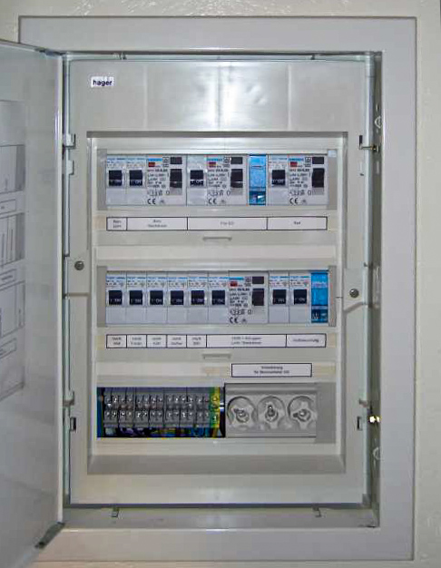
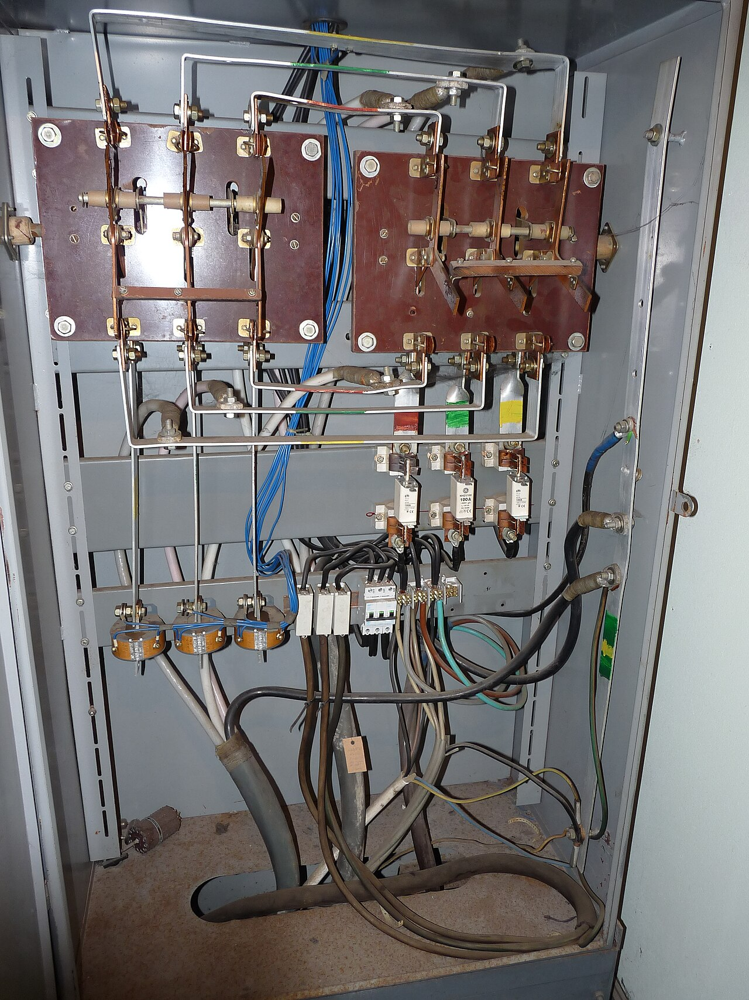
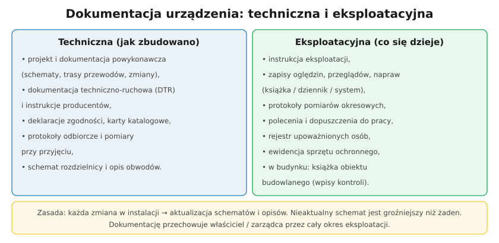

# 29.03 — Dokumentacja techniczna i eksploatacyjna

> **Moduł:** [29 — Eksploatacja urządzeń i instalacji](README.md) · **Oznaczenia:** 📋 · **Zakres SEP:** (b) (c) · **Status:** ✅ pełny
>
> **Czytaj:**
>
> - Opis rozdzielnicy i schematy: [15.02](../15-rozdzielnica-mieszkaniowa/15.02-schemat-jednokreskowy-jak-czytac-i-jak-rysowac.md), [15.03](../15-rozdzielnica-mieszkaniowa/15.03-oznaczanie-obwodow-i-opis-rozdzielnicy.md)
> - Protokół z pomiarów: [23.08](../23-pomiary-odbiorcze-i-okresowe/23.08-protokol-z-pomiarow-i-terminy-badan-okresowych.md)

[← poprzedni temat](29.02-instrukcja-eksploatacji.md) · [spis modułu](README.md) · [następny temat →](29.04-ogledziny-przeglady-i-konserwacja.md)

## Po co to jest

Instalacja bez dokumentacji jest jak samochód bez dowodu i książki serwisowej: działa, ale nikt nie wie, co w niej jest i co było robione. Na egzaminie pytają o rodzaje dokumentacji; w praktyce dobra dokumentacja oszczędza godziny przy każdej awarii i każdej rozbudowie.

## Po ludzku

**Dokumentacja techniczna** — opisuje, **jak urządzenie zbudowano**:

- **projekt** (budowlany, wykonawczy) i **dokumentacja powykonawcza** — projekt z naniesionymi zmianami, które zrobiono w trakcie budowy,
- **schematy**: jednokreskowy rozdzielnicy, trasy przewodów, zestawienie obwodów ([15.02](../15-rozdzielnica-mieszkaniowa/15.02-schemat-jednokreskowy-jak-czytac-i-jak-rysowac.md)),
- **dokumentacja techniczno-ruchowa (DTR)** i instrukcje producentów urządzeń,
- **deklaracje zgodności**, karty katalogowe, certyfikaty,
- **protokoły odbiorcze**: sprawdzenia odbiorcze i pomiary przy przekazaniu do eksploatacji ([29.05](29.05-przyjmowanie-urzadzen-do-eksploatacji.md)).

**Dokumentacja eksploatacyjna** — opisuje, **co się z urządzeniem dzieje**:

- **instrukcja eksploatacji** ([29.02](29.02-instrukcja-eksploatacji.md)),
- **zapisy** z oględzin, przeglądów, konserwacji, napraw i remontów (dziennik, książka urządzenia, system komputerowy),
- **protokoły pomiarów okresowych** ([23.08](../23-pomiary-odbiorcze-i-okresowe/23.08-protokol-z-pomiarow-i-terminy-badan-okresowych.md)),
- **polecenia pisemne** i zapisy dopuszczeń (przechowywane min. 90 dni),
- **rejestr osób upoważnionych**, ewidencja **sprzętu ochronnego** z terminami badań,
- dla budynku — **książka obiektu budowlanego** (także elektroniczna c-KOB), do której wpisuje się kontrole okresowe i dołącza protokoły (Prawo budowlane).

**Najważniejsza zasada:** po każdej zmianie w instalacji **aktualizuje się schematy i opisy**. Nieaktualny schemat jest groźniejszy niż brak schematu — bo się mu wierzy.

## Jak to wygląda

*Na co patrzeć: opisy obwodów to najprostsza dokumentacja „na miejscu”. W drzwiach takiej rozdzielnicy powinien być też schemat jednokreskowy.*

*Na co patrzeć: brak opisów, brak schematu, dekady przeróbek — tak wygląda instalacja bez dokumentacji. Każda praca zaczyna się tu od godzin „rozpoznawania”.*

## Schemat

## Pojęcia

| Pojęcie | Po ludzku | Termin normowy / symbol |
|---------|-----------|-------------------------|
| Dokumentacja powykonawcza | Projekt z naniesionymi zmianami z budowy | Prawo budowlane |
| DTR | Instrukcja producenta urządzenia | dokumentacja techniczno-ruchowa |
| Schemat jednokreskowy | Uproszczony schemat rozdzielnicy | — |
| Książka obiektu budowlanego | Rejestr kontroli i zdarzeń w budynku | KOB, c-KOB |
| Dokumentacja eksploatacyjna | Zapisy z życia urządzenia | — |

## Liczby do zapamiętania

| Wielkość | Wartość | Kiedy obowiązuje | Źródło |
|----------|---------|------------------|--------|
| Kontrola instalacji elektrycznej budynku | co najmniej **raz na 5 lat** | wszystkie budynki | Prawo budowlane, art. 62 ust. 1 pkt 2 |
| Polecenia pisemne | przechowywanie **≥ 90 dni** | po zakończeniu pracy | rozp. BHP, § 28 ust. 4 |
| Książka obiektu | przez **cały okres** użytkowania obiektu | budynki | Prawo budowlane |

## W praktyce

- **Po każdej pracy** zostaw ślad: co zrobiono, gdzie, kto, kiedy, wyniki pomiarów.
- **Zdjęcia rozdzielnicy i tras** przed zamknięciem ścian — tania i skuteczna dokumentacja powykonawcza w domu.
- **Dokumentacja PV, pompy ciepła, wallboxa** — instrukcje, protokoły, ustawienia — trzymaj razem z dokumentacją instalacji.
- **Przy sprzedaży domu** — przekaż dokumentację nowemu właścicielowi; to realnie podnosi wartość.

## Błędy i zagrożenia

- ⚠️ **Nieaktualny schemat** — wyłączasz obwód „ze schematu”, a pracujesz przy innym.
- **Brak protokołów pomiarów** — nie da się wykazać, że instalacja była sprawna (ubezpieczyciel, sąd).
- **Dokumentacja tylko w głowie** jednego elektryka — znika razem z nim.

## Przykład

**Zadanie.** Po remoncie mieszkania dołożono dwa obwody (płyta indukcyjna, klimatyzacja) i wymieniono RCD na typ A. Jakie dokumenty należy zaktualizować lub sporządzić?

**Rozwiązanie.** **Schemat jednokreskowy** rozdzielnicy i **opis obwodów** na drzwiach, **zestawienie obwodów** (przekroje, zabezpieczenia), **protokół z pomiarów** nowych obwodów i badania RCD, dokumenty urządzeń (instrukcje płyty i klimatyzatora, karta RCD). Jeśli budynek ma książkę obiektu — wpis o zmianie i kontroli przez zarządcę.

## Pytania SEP

1. **Jakie dokumenty składają się na dokumentację techniczną i eksploatacyjną urządzeń elektrycznych?**

Odpowiedź

Dokumentacja techniczna: projekt i dokumentacja powykonawcza (schematy, plany tras, zestawienia obwodów), dokumentacja techniczno-ruchowa i instrukcje producentów, deklaracje zgodności i certyfikaty, protokoły odbiorcze i wyniki pomiarów przy przyjęciu do eksploatacji. Dokumentacja eksploatacyjna: instrukcja eksploatacji, zapisy z oględzin, przeglądów, konserwacji, napraw i remontów, protokoły pomiarów okresowych, dokumentacja poleceń i dopuszczeń, rejestr osób upoważnionych, ewidencja sprzętu ochronnego, a dla budynku — książka obiektu budowlanego z protokołami kontroli. Dokumentację aktualizuje się po każdej zmianie i przechowuje przez cały okres eksploatacji.

## Sprawdź się

1. Czym różni się dokumentacja powykonawcza od projektu?

Odpowiedź

Projekt pokazuje, jak instalacja miała wyglądać. Dokumentacja powykonawcza to projekt poprawiony o zmiany wprowadzone w czasie budowy — pokazuje, jak instalacja wygląda naprawdę (trasy, przekroje, zabezpieczenia). Do eksploatacji potrzebna jest właśnie powykonawcza.

## Źródła

- Ustawa Prawo budowlane — art. 62 (kontrole okresowe), art. 64 (książka obiektu budowlanego).
- [Rozporządzenie BHP przy urządzeniach energetycznych — t.j. Dz.U. 2021 poz. 1210](https://api.sejm.gov.pl/eli/acts/DU/2021/1210/text.html) (§ 4, § 5, § 26, § 28).

---

[← poprzedni temat](29.02-instrukcja-eksploatacji.md) · [spis modułu](README.md) · [następny temat →](29.04-ogledziny-przeglady-i-konserwacja.md)
