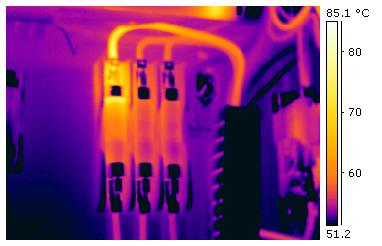
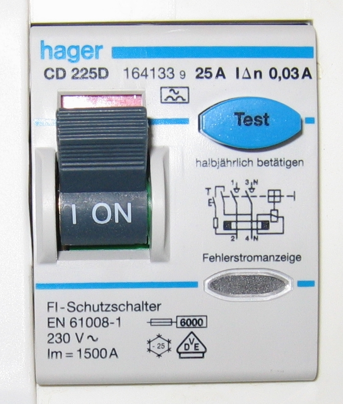
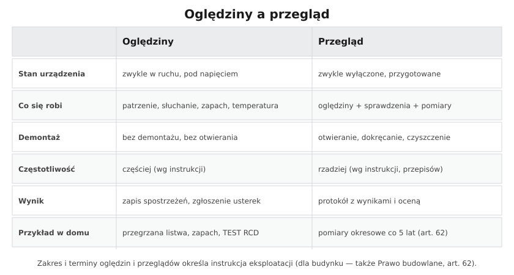

# 29.04 — Oględziny, przeglądy i konserwacja

> **Moduł:** [29 — Eksploatacja urządzeń i instalacji](README.md) · **Oznaczenia:** 📋 · **Zakres SEP:** (b) (c) · **Status:** ✅ pełny
>
> **Czytaj:**
>
> - Pomiary okresowe: [23.08](../23-pomiary-odbiorcze-i-okresowe/23.08-protokol-z-pomiarow-i-terminy-badan-okresowych.md)
> - Termowizja: [22.06](../22-przyrzady-pomiarowe/22.06-kamera-termowizyjna-kiedy-sie-przydaje.md)

[← poprzedni temat](29.03-dokumentacja-techniczna-i-eksploatacyjna.md) · [spis modułu](README.md) · [następny temat →](29.05-przyjmowanie-urzadzen-do-eksploatacji.md)

## Po co to jest

„Czym różnią się oględziny od przeglądu?” — pytanie z egzaminu i bardzo praktyczne rozróżnienie. Oględziny są szybkie i częste, przegląd — dokładny i rzadszy. Oba wyłapują usterki, zanim zamienią się w awarię lub pożar.

## Po ludzku

**Oględziny** — sprawdzenie stanu urządzenia **zmysłami** (wzrok, słuch, węch, dotyk obudowy), zwykle **w czasie pracy**, bez demontażu. Co się ogląda:

- stan **obudów, osłon, drzwi**, zamknięć, oznaczeń i tablic,
- **ślady przegrzania** — przebarwienia, zapach spalenizny, stopiona izolacja, brzęczenie,
- **wskazania** przyrządów, sygnalizacja, lampki, liczniki,
- stan przewodów, dławików, uszczelnień, czystość, wilgoć, obecność zwierząt,
- działanie prostych funkcji: **przycisk TEST RCD**, oświetlenie awaryjne,
- dostęp do urządzeń (czy nic nie zastawia rozdzielnicy).

**Przegląd** — oględziny **plus** sprawdzenia, pomiary i drobne czynności konserwacyjne; zwykle **po wyłączeniu** i przygotowaniu miejsca pracy:

- oględziny wnętrza, **dokręcenie połączeń** (momentem wg producenta), czyszczenie,
- sprawdzenie **działania** aparatów, blokad, napędów, zabezpieczeń,
- **pomiary** (izolacja, ciągłość PE, pętla zwarcia, RCD, uziemienia), termowizja pod obciążeniem,
- ocena stanu i **protokół** z zaleceniami.

**Konserwacja** — czynności utrzymujące sprawność (czyszczenie, smarowanie, dokręcanie, wymiana zużytych drobnych elementów) — wykonywane zwykle przy przeglądzie albo według harmonogramu.

**Terminy** określa **instrukcja eksploatacji** (na podstawie zaleceń producenta i przepisów). Dla budynku obowiązuje dodatkowo **kontrola okresowa co najmniej co 5 lat** (Prawo budowlane, art. 62) — instalacja elektryczna i piorunochronna: stan połączeń, osprzętu, zabezpieczeń, ochrony przeciwporażeniowej, rezystancja izolacji i uziemień.

## Jak to wygląda

*Na co patrzeć: jeden element wyraźnie cieplejszy od sąsiednich przy podobnym obciążeniu — to sygnał do przeglądu: wyłączyć, dokręcić lub wymienić.*

*Na co patrzeć: zalecenie producenta na froncie — test przyciskiem to najprostsza oględzinowa czynność, którą może zrobić każdy użytkownik.*

## Schemat

## Pojęcia

| Pojęcie | Po ludzku | Termin normowy / symbol |
|---------|-----------|-------------------------|
| Oględziny | Sprawdzenie „na oko” bez demontażu | — |
| Przegląd | Oględziny + sprawdzenia + pomiary + konserwacja | — |
| Konserwacja | Czynności utrzymujące sprawność | — |
| Kontrola okresowa | Obowiązkowa kontrola budynku | Prawo budowlane, art. 62 |
| Termowizja | Obraz temperatury elementów | — |

## Liczby do zapamiętania

| Wielkość | Wartość | Kiedy obowiązuje | Źródło |
|----------|---------|------------------|--------|
| Kontrola instalacji elektrycznej i piorunochronnej | **≥ raz na 5 lat** | każdy budynek | Prawo budowlane, art. 62 ust. 1 pkt 2 |
| Kontrola roczna | **raz w roku** (bez domów jednorodzinnych) | m.in. stan techniczny elementów narażonych na czynniki atmosferyczne | art. 62 ust. 1 pkt 1 |
| Test RCD przyciskiem | wg producenta, np. **co pół roku** | użytkownik | instrukcja RCD |
| Różnica temperatur w termowizji | **> 15 °C** względem podobnego elementu → pilnie | ocena wyników | 22.06 |

## W praktyce

- **Lista kontrolna oględzin** dla rozdzielnicy domowej (np. raz na kwartał): drzwi zamykają się, nic nie zastawia dostępu, brak zapachu i przebarwień, aparaty opisane, TEST RCD działa, brak śladów wilgoci.
- **Przegląd** — przy okazji pomiarów okresowych: wyłączenie, dokręcenie zacisków momentem, odkurzenie, pomiary, protokół.
- **Nowa instalacja** — pierwszy przegląd z dokręceniem po pierwszym sezonie pracy (zaciski „siadają”), szczególnie przy aluminium i przewodach o dużym przekroju.
- **Zapis** — nawet krótka notatka „oględziny OK, data, podpis” buduje historię urządzenia.

## Błędy i zagrożenia

- ⚠️ **Dokręcanie zacisków pod napięciem „przy okazji oględzin”** — to już praca pod napięciem.
- **Przegląd bez zapisu** — formalnie i praktycznie się nie odbył.
- **Ignorowanie drobnych sygnałów** (ciepła obudowa, brzęczenie) — to wczesne objawy luźnych połączeń ([20.06](../20-diagnostyka-usterek/20.06-grzejace-sie-zaciski-i-zapach-spalenizny.md)).
- **Dokręcanie „na siłę”** bez momentu — uszkodzenie zacisku lub przewodu.

## Przykład

**Zadanie.** Właściciel domu pyta, co powinien robić sam, a co zlecać. Podziel czynności.

**Rozwiązanie.** **Sam (oględziny):** raz na kilka miesięcy przegląd wzrokowy rozdzielnicy, zapach, ciepło obudów, test RCD przyciskiem według zalecenia producenta, kontrola przedłużaczy i wtyczek. **Zlecić elektrykowi (przegląd):** co najmniej co 5 lat kontrola okresowa z pomiarami (izolacja, pętla, RCD, ciągłość PE), dokręcenie zacisków, termowizja przy dużych obciążeniach, protokół. Kontrolę z art. 62 przeprowadza osoba z kwalifikacjami dozoru.

## Pytania SEP

1. **Czym różnią się oględziny od przeglądu urządzeń elektrycznych?**

Odpowiedź

Oględziny to sprawdzenie stanu technicznego urządzenia bez jego demontażu, zwykle w czasie pracy, za pomocą zmysłów: ocena obudów, osłon, oznaczeń, śladów przegrzania, wskazań przyrządów, czystości i działania sygnalizacji. Przegląd obejmuje oględziny oraz sprawdzenie działania, pomiary i czynności konserwacyjne (dokręcanie połączeń, czyszczenie, regulacje), zwykle po wyłączeniu urządzenia; kończy się protokołem z oceną stanu. Zakres i terminy obu określa instrukcja eksploatacji, a dla budynków dodatkowo Prawo budowlane (kontrola instalacji elektrycznej co najmniej raz na 5 lat).

2. **Co obejmuje kontrola okresowa instalacji elektrycznej budynku wymagana przez Prawo budowlane?**

Odpowiedź

Według art. 62 Prawa budowlanego — co najmniej raz na 5 lat — sprawdzenie stanu technicznego i przydatności do użytkowania instalacji elektrycznej i piorunochronnej w zakresie stanu sprawności połączeń, osprzętu, zabezpieczeń i środków ochrony od porażeń, oporności izolacji przewodów oraz uziemień instalacji i aparatów. Przeprowadzają ją osoby z kwalifikacjami wymaganymi przy dozorze nad eksploatacją urządzeń, instalacji i sieci energetycznych; wynik dokumentuje się protokołem, który dołącza się do książki obiektu budowlanego.

## Sprawdź się

1. Dlaczego termowizję wykonuje się pod obciążeniem, a dokręcanie zacisków po wyłączeniu?

Odpowiedź

Bo luźne połączenie nagrzewa się tylko wtedy, gdy płynie prąd — bez obciążenia kamera nic nie pokaże. Dokręcanie to praca przy częściach czynnych z narzędziem, więc wykonuje się je po wyłączeniu i przygotowaniu miejsca pracy, żeby nie pracować pod napięciem.

## Źródła

- Ustawa Prawo budowlane, art. 62.
- PN-HD 60364-6 — Sprawdzanie (sprawdzanie okresowe).
- [22.06 — Kamera termowizyjna](../22-przyrzady-pomiarowe/22.06-kamera-termowizyjna-kiedy-sie-przydaje.md); [23.08 — Protokół i terminy](../23-pomiary-odbiorcze-i-okresowe/23.08-protokol-z-pomiarow-i-terminy-badan-okresowych.md).

---

[← poprzedni temat](29.03-dokumentacja-techniczna-i-eksploatacyjna.md) · [spis modułu](README.md) · [następny temat →](29.05-przyjmowanie-urzadzen-do-eksploatacji.md)
