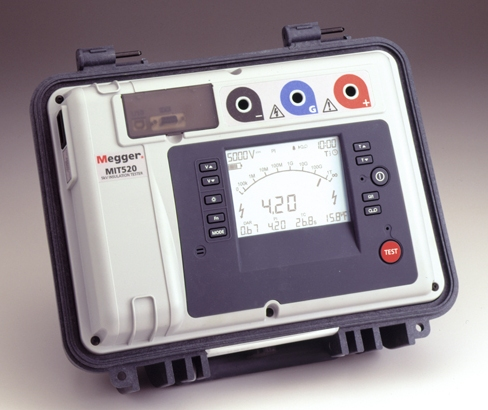
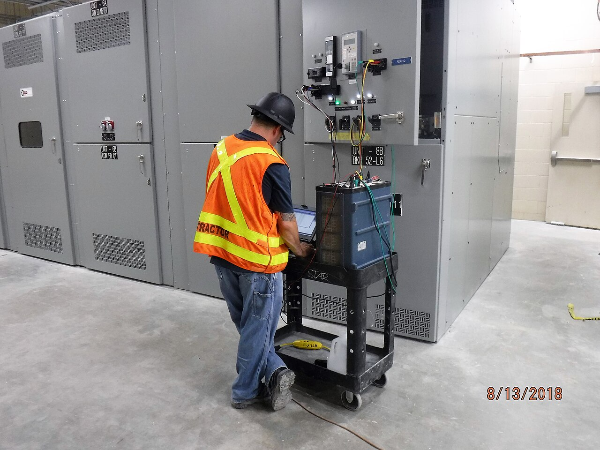
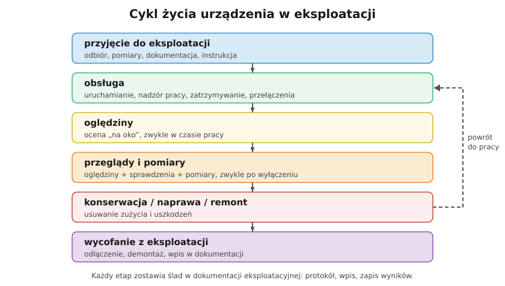

# 29.05 — Przyjmowanie urządzeń do eksploatacji

> **Moduł:** [29 — Eksploatacja urządzeń i instalacji](README.md) · **Oznaczenia:** 📋 · **Zakres SEP:** (b) (c) · **Status:** ✅ pełny
>
> **Czytaj:**
>
> - Sprawdzenia odbiorcze: [23.01](../23-pomiary-odbiorcze-i-okresowe/23.01-ogledziny-instalacji.md)
> - Mikroinstalacja i przyłączenie: [26.03](../26-fotowoltaika-pompy-wallboxy/26.03-falownik-i-przylaczenie-mikroinstalacji.md)

[← poprzedni temat](29.04-ogledziny-przeglady-i-konserwacja.md) · [spis modułu](README.md) · (koniec modułu) →

## Po co to jest

Nowa instalacja, nowe urządzenie albo urządzenie po remoncie nie zaczyna pracować „bo już jest podłączone”. Najpierw przechodzi **przyjęcie do eksploatacji**: sprawdzenie, czy jest zgodne z projektem i przepisami, czy działa, czy jest dokumentacja i czy ludzie umieją je obsługiwać. Na egzaminie pada pytanie o warunki przyjęcia urządzenia do eksploatacji.

## Po ludzku

**Urządzenie można przyjąć do eksploatacji, gdy:**

1. **jest wykonane zgodnie z projektem** (lub dokumentacją) i przepisami — sprawdzone oględzinami,
2. przeszło **sprawdzenia odbiorcze** — próby i pomiary według PN-HD 60364-6 (ciągłość PE, izolacja, samoczynne wyłączenie, RCD, biegunowość, kolejność faz, próby działania) ([23.01](../23-pomiary-odbiorcze-i-okresowe/23.01-ogledziny-instalacji.md)),
3. jest **komplet dokumentacji**: powykonawcza, schematy, DTR, deklaracje zgodności, **protokoły** z pomiarów i prób,
4. jest **instrukcja eksploatacji** (lub zaktualizowana istniejąca),
5. **obsługa jest przeszkolona** i ma wymagane kwalifikacje,
6. urządzenie jest **oznaczone** (opisy, tablice, oznaczenia obwodów) i ma wymagany **sprzęt ochronny i ppoż.**,
7. spełniono wymagania **formalne**: odbiór budynku, zgłoszenie mikroinstalacji do OSD, wymagane uzgodnienia.

**Przyjęcie dokumentuje się protokołem** (odbioru / przyjęcia do eksploatacji) z listą usterek do usunięcia i decyzją. Urządzenie wpisuje się do **ewidencji** i od tej chwili obowiązują terminy oględzin i przeglądów z instrukcji.

**Po remoncie lub naprawie** — to samo w zakresie, którego dotyczyła praca: sprawdzenie, pomiary, aktualizacja dokumentacji, zapis.

**W domu** odpowiednikiem przyjęcia jest **odbiór od elektryka**: protokół z pomiarów, opisana rozdzielnica, schemat, instrukcje urządzeń, gwarancje. Bez protokołu nie wiesz, czy instalacja jest bezpieczna — a ubezpieczyciel po pożarze zapyta właśnie o niego.

## Jak to wygląda

*Na co patrzeć: pomiar rezystancji izolacji to jeden z obowiązkowych pomiarów odbiorczych. Wynik trafia do protokołu, który jest warunkiem przyjęcia instalacji do eksploatacji.*

*Na co patrzeć: przed oddaniem rozdzielni do pracy wykonuje się próby i pomiary według programu uruchomienia. Dopiero ich wynik pozwala podpisać protokół przyjęcia.*

## Schemat

## Pojęcia

| Pojęcie | Po ludzku | Termin normowy / symbol |
|---------|-----------|-------------------------|
| Przyjęcie do eksploatacji | Formalne oddanie urządzenia do pracy | protokół przyjęcia |
| Sprawdzenia odbiorcze | Oględziny, próby i pomiary nowej instalacji | PN-HD 60364-6 |
| Protokół odbioru | Dokument z wynikami i decyzją | — |
| Ewidencja urządzeń | Lista urządzeń w eksploatacji | — |
| Ruch próbny | Krótka praca pod nadzorem przed przyjęciem | — |

## Liczby do zapamiętania

| Wielkość | Wartość | Kiedy obowiązuje | Źródło |
|----------|---------|------------------|--------|
| Izolacja obwodów do 500 V | **≥ 1 MΩ** przy 500 V DC | pomiary odbiorcze | PN-HD 60364-6 |
| Warunki przyjęcia | **7**: zgodność, sprawdzenia, dokumentacja, instrukcja, szkolenie, oznaczenia, formalności | przyjęcie do eksploatacji | zasady eksploatacji |
| Kontrola okresowa po przyjęciu | **≤ 5 lat** | instalacje w budynkach | Prawo budowlane, art. 62 |

## W praktyce

- **Program uruchomienia** dla większych urządzeń: kolejność prób, kryteria, kto podpisuje.
- **Usterki nieistotne** (np. brak opisu jednego obwodu) — mogą trafić do protokołu z terminem usunięcia; **usterki bezpieczeństwa** (np. brak ciągłości PE) — wstrzymują przyjęcie.
- **Mikroinstalacja PV** — przed zgłoszeniem do OSD: pomiary strony AC i DC, protokół, dokumentacja falownika ([26.03](../26-fotowoltaika-pompy-wallboxy/26.03-falownik-i-przylaczenie-mikroinstalacji.md)).
- **Przekazanie użytkownikowi** — pokaż wyłącznik główny, RCD i TEST, opis obwodów, jak wyłączyć PV i inne źródła.

## Błędy i zagrożenia

- ⚠️ **Załączenie bez pomiarów** „bo się spieszy” — brak ciągłości PE wychodzi dopiero przy porażeniu.
- **Przyjęcie bez dokumentacji** — późniejsza eksploatacja na ślepo.
- **Brak szkolenia obsługi** — obsługa nie wie, jak wyłączyć urządzenie w awarii.
- **Protokół „na zapas”** bez wykonanych pomiarów — fałszowanie dokumentacji, odpowiedzialność wykonawcy.

## Przykład

**Zadanie.** Firma wykonała instalację elektryczną w nowym domu. Wymień dokumenty, które inwestor powinien dostać przy odbiorze.

**Rozwiązanie.** Dokumentacja powykonawcza (schemat rozdzielnicy, trasy, zestawienie obwodów), **protokoły z pomiarów odbiorczych** (ciągłość, izolacja, pętla zwarcia, RCD, uziemienie), instrukcje i karty urządzeń (RCD, SPD, aparatura, osprzęt), opis rozdzielnicy, oświadczenie o zgodności wykonania z projektem i przepisami, dane wykonawcy z numerami świadectw kwalifikacyjnych, gwarancja.

## Pytania SEP

1. **Jakie warunki muszą być spełnione, aby przyjąć urządzenie lub instalację do eksploatacji?**

Odpowiedź

Urządzenie musi być wykonane zgodnie z projektem i przepisami, co potwierdzają oględziny; muszą być wykonane z wynikiem pozytywnym sprawdzenia odbiorcze — próby i pomiary (m.in. ciągłość przewodów ochronnych, rezystancja izolacji, skuteczność samoczynnego wyłączenia, działanie RCD); musi być kompletna dokumentacja techniczna (powykonawcza, DTR, deklaracje, protokoły); musi istnieć instrukcja eksploatacji; obsługa musi być przeszkolona i mieć wymagane kwalifikacje; urządzenie musi być oznaczone i wyposażone w wymagany sprzęt ochronny i przeciwpożarowy. Przyjęcie dokumentuje się protokołem.

## Sprawdź się

1. Dlaczego po wymianie tylko jednego wyłącznika różnicowoprądowego w rozdzielnicy trzeba wykonać pomiary?

Odpowiedź

Bo nowy aparat (i każde połączenie przy nim) trzeba sprawdzić przed oddaniem do pracy: czy wyzwala przy właściwym prądzie i w wymaganym czasie, czy obwody za nim są poprawnie połączone (N we właściwej grupie), czy zachowana jest ciągłość PE. Wyniki zapisuje się w protokole — to „przyjęcie do eksploatacji po naprawie” w małej skali.

## Źródła

- PN-HD 60364-6 — Sprawdzanie (sprawdzanie odbiorcze).
- Ustawa Prawo budowlane (odbiór obiektu, kontrole okresowe).
- [Rozporządzenie BHP przy urządzeniach energetycznych — t.j. Dz.U. 2021 poz. 1210](https://api.sejm.gov.pl/eli/acts/DU/2021/1210/text.html) (§ 4).

---

[← poprzedni temat](29.04-ogledziny-przeglady-i-konserwacja.md) · [spis modułu](README.md) · (koniec modułu) →
