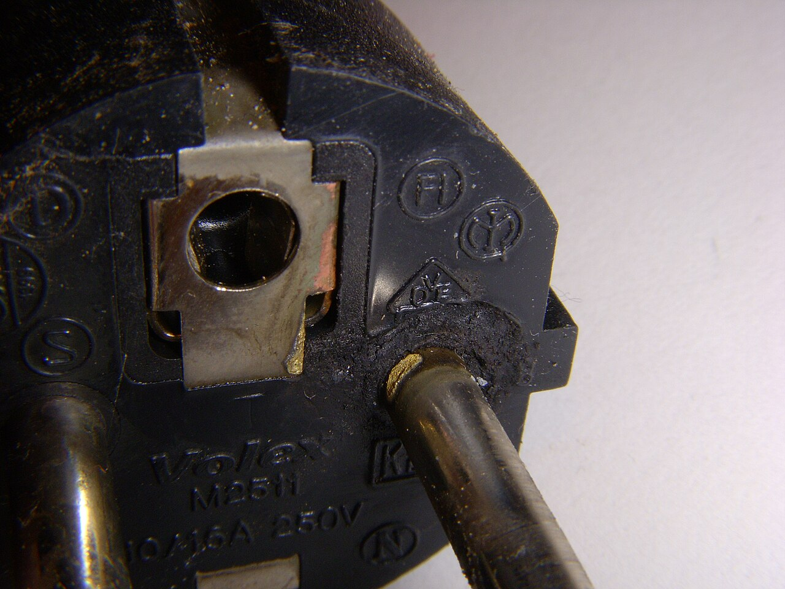
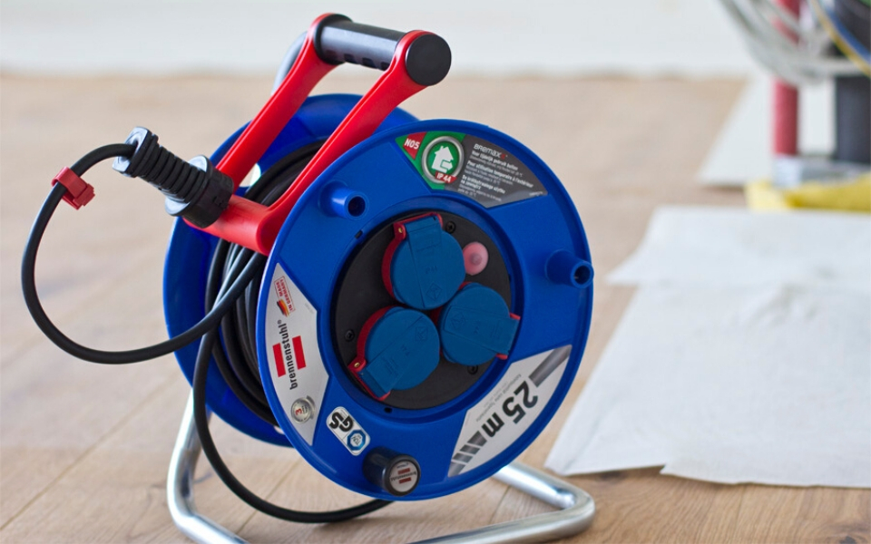
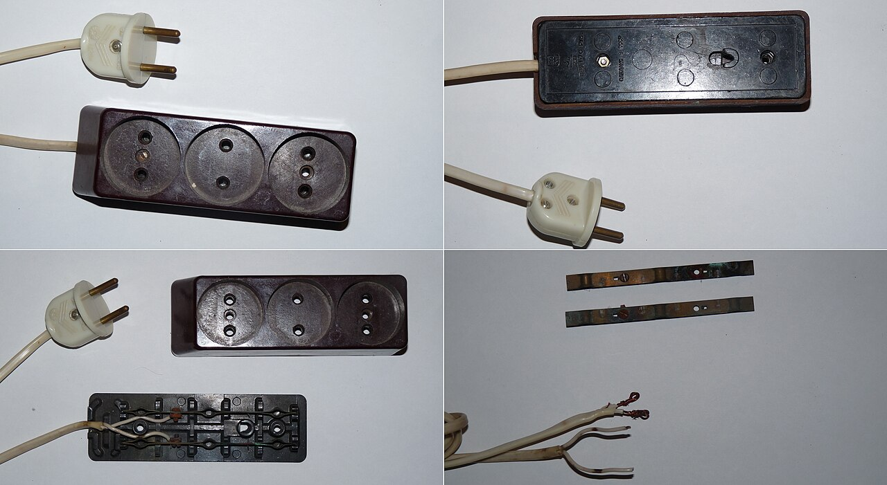

# 30.01 — Przyczyny pożarów od instalacji elektrycznej

> **Moduł:** [30 — Pożar i awaria](README.md) · **Oznaczenia:** 📋 · **Zakres SEP:** (d) (e) · **Status:** ✅ pełny
>
> **Czytaj:**
>
> - Grzejące się połączenia: [20.06](../20-diagnostyka-usterek/20.06-grzejace-sie-zaciski-i-zapach-spalenizny.md)
> - Detektory iskrzenia AFDD: [10.05](../10-aparatura-modulowa/10.05-detektory-iskrzenia-afdd.md)

← (początek modułu) · [spis modułu](README.md) · [następny temat →](30.02-gasnice-do-urzadzen-elektrycznych.md)

## Po co to jest

Instalacja elektryczna to jedno z najczęstszych źródeł pożarów w budynkach. Pożar rzadko zaczyna się „od zwarcia, które wyłączył bezpiecznik” — zwykle od czegoś, czego zabezpieczenia nie widzą: grzejącego się zacisku, przetartej żyły w przedłużaczu, listwy wpiętej w listwę. Zrozumienie mechanizmów to podstawa zarówno na egzaminie („jakie są przyczyny pożarów od instalacji?”), jak i przy każdym przeglądzie.

## Po ludzku

**1. Luźne lub złe połączenie** — najczęstszy winowajca. Mała powierzchnia styku ma opór; płynący prąd wydziela ciepło $P = I^2 R$. Przy 16 A i oporze styku 0,1 Ω to już **25 W** w jednym punkcie — jak lutownica zamknięta w puszce. Wyłącznik nadprądowy tego nie widzi, bo prąd jest normalny ([20.06](../20-diagnostyka-usterek/20.06-grzejace-sie-zaciski-i-zapach-spalenizny.md)).

**2. Przeciążenie** — przewód długo obciążony ponad obciążalność (zła koordynacja zabezpieczenia, przedłużacz na bębnie, listwa na listwie). Izolacja się przegrzewa, starzeje i kruszeje.

**3. Uszkodzona izolacja** — prąd upływu do ziemi lub do PE płynie przez zwęglone tworzywo, wilgoć, kurz. Już **kilkaset mA** przez materiał palny może go zapalić — dlatego istnieje **RCD przeciwpożarowy** (IΔn do 300 mA).

**4. Łuk szeregowy** — przerwana lub przetarta żyła, uszkodzona wtyczka: prąd płynie przez iskrzącą szczelinę. Prąd jest **mniejszy** niż normalnie, więc ani MCB, ani RCD nie zadziała. Wykrywa go **AFDD** ([10.05](../10-aparatura-modulowa/10.05-detektory-iskrzenia-afdd.md)).

**5. Zwarcie** — łuk zwarciowy wyrzuca stopiony metal. Zabezpieczenie zadziała, ale jeśli impedancja pętli jest za duża, za późno ([23.04](../23-pomiary-odbiorcze-i-okresowe/23.04-impedancja-petli-zwarcia.md)).

**6. Przepięcia** — przebicie izolacji, zapłon elektroniki ([09](../09-ochrona-przeciwprzepieciowa/README.md)).

**7. Urządzenia i użytkowanie** — tanie ładowarki, baterie litowe ładowane bez nadzoru, grzejniki przy zasłonach, oprawy z żarówkami zbyt dużej mocy, lampy zakryte izolacją termiczną.

## Jak to wygląda

*Na co patrzeć: przebarwiony bolec i nadtopione tworzywo — tak wygląda połączenie, które się grzało. Wyłącznik nie zadziałał ani razu.*

*Na co patrzeć: przewód nawinięty na bębnie nie oddaje ciepła — przy dużym obciążeniu topi się izolacja między zwojami. Pod obciążeniem bęben zawsze rozwija się w całości.*

*Na co patrzeć: zaczernione, skorodowane styki — każdy to dodatkowy opór i źródło ciepła. Stare listwy trafiają do kosza, nie do naprawy.*

## Schemat

## Pojęcia

| Pojęcie | Po ludzku | Termin normowy / symbol |
|---------|-----------|-------------------------|
| Opór przejścia | Opór na styku dwóch przewodników | rezystancja zestykowa |
| Łuk szeregowy | Iskrzenie w przerwanej żyle | arc fault (series) |
| Łuk równoległy | Iskrzenie między żyłami lub do PE | arc fault (parallel) |
| RCD przeciwpożarowy | RCD do ochrony przed pożarem od prądów upływu | IΔn ≤ 300 mA |
| AFDD | Urządzenie wykrywające iskrzenie | PN-EN 62606 |

## Liczby do zapamiętania

| Wielkość | Wartość | Kiedy obowiązuje | Źródło |
|----------|---------|------------------|--------|
| Moc w złym styku | $P = I^2 R$: 16 A × 0,1 Ω → **25,6 W** | luźny zacisk | prawo Joule'a |
| RCD przeciwpożarowy | **IΔn ≤ 300 mA** | miejsca zagrożone pożarem | PN-HD 60364-4-42 |
| Bęben przedłużacza | moc dopuszczalna **zwinięty ≪ rozwinięty** (wg tabliczki) | przedłużacze bębnowe | tabliczka producenta |

## W praktyce

- **Przegląd = szukanie ciepła:** termowizja pod obciążeniem, dotyk obudów, zapach. Dokręcanie zacisków momentem z instrukcji ([19.07](../19-prace-krok-po-kroku/19.07-zakanczanie-przewodow-tulejki-zaciski-momenty.md)).
- **Przedłużacze i listwy** — nie łączy się ich szeregowo, nie zasila się z nich grzejników i czajników na stałe.
- **Aluminium** — połączenia Al wymagają szczególnej uwagi (pełzanie, tlenki) ([21.02](../21-stare-instalacje/21.02-przewody-aluminiowe-zagrozenia-i-postepowanie.md)).
- **AFDD** — warto w sypialniach, pokojach dzieci, budynkach drewnianych i tam, gdzie są przedłużacze.

## Błędy i zagrożenia

- ⚠️ **„Wyłącznik nie wybija, więc jest dobrze”** — grzejące się połączenie i łuk szeregowy nie wywołują zadziałania MCB.
- ⚠️ **Wymiana wyłącznika na większy, bo „wybija”** — przewód traci ochronę przed przeciążeniem.
- **Zacisk dokręcony „na czuja”** — za słabo: grzanie; za mocno: uszkodzony przewód.
- **Oprawa zakryta izolacją termiczną** w suficie podwieszanym — przegrzanie.

## Przykład

**Zadanie.** Zacisk gniazda kuchennego ma opór przejścia 0,05 Ω (luźna śruba). Czajnik 2000 W pracuje 5 minut. Ile ciepła powstaje w zacisku?

**Rozwiązanie.** Prąd: $I = 2000 / 230 \approx 8{,}7$ A. Moc w zacisku: $P = I^2 R = 8{,}7^2 \cdot 0{,}05 \approx 3{,}8$ W. Energia w 5 min: $3{,}8 \cdot 300 \approx 1140$ J — w małym zacisku zamkniętym w puszce to wystarczy, żeby z czasem stopić izolację. Przy kilku cyklach dziennie zacisk jeszcze się luzuje (rozszerzalność cieplna) i opór rośnie.

## Pytania SEP

1. **Jakie są najczęstsze przyczyny pożarów od instalacji elektrycznych i jak im zapobiegać?**

Odpowiedź

Najczęstsze przyczyny to: nagrzewanie się złych lub luźnych połączeń (opór przejścia), przeciążenia przewodów (zabezpieczenia niedobrane do obciążalności, przedłużacze), uszkodzenia izolacji i prądy upływu, łuk szeregowy na uszkodzonych przewodach, zwarcia przy zbyt dużej impedancji pętli, przepięcia oraz niewłaściwe użytkowanie urządzeń. Zapobiega się przez prawidłowy dobór przewodów i zabezpieczeń, staranne wykonanie i okresowe dokręcanie połączeń, stosowanie wyłączników różnicowoprądowych (w tym przeciwpożarowych do 300 mA), detektorów iskrzenia AFDD i ograniczników przepięć, okresowe pomiary i oględziny (w tym termowizję) oraz zakaz prowizorycznych instalacji.

## Sprawdź się

1. Dlaczego RCD 30 mA może zapobiec pożarowi, a wyłącznik nadprądowy B16 nie?

Odpowiedź

Bo pożar od uszkodzonej izolacji może zacząć się przy prądzie upływu rzędu setek miliamperów, płynącym przez zwęglone tworzywo do PE. Dla B16 to nic — reaguje na amperów. RCD wykrywa już kilkanaście–kilkadziesiąt mA różnicy i wyłącza obwód, zanim prąd rozgrzeje materiał.

## Źródła

- PN-HD 60364-4-42 — Ochrona przed skutkami oddziaływania cieplnego.
- PN-EN 62606 — Urządzenia do wykrywania zakłóceń łukowych (AFDD).
- [20.06 — Grzejące się zaciski](../20-diagnostyka-usterek/20.06-grzejace-sie-zaciski-i-zapach-spalenizny.md); [10.05 — AFDD](../10-aparatura-modulowa/10.05-detektory-iskrzenia-afdd.md).

---

← (początek modułu) · [spis modułu](README.md) · [następny temat →](30.02-gasnice-do-urzadzen-elektrycznych.md)
