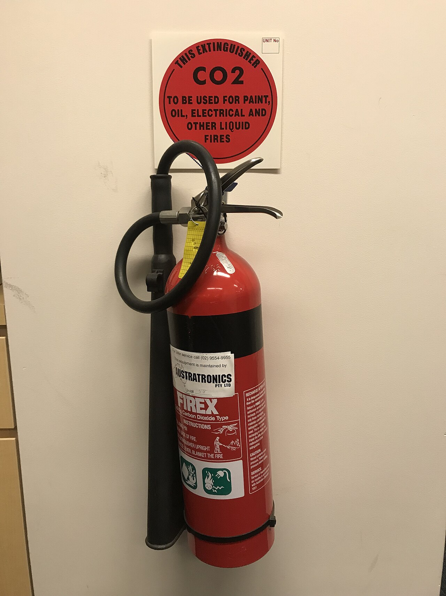
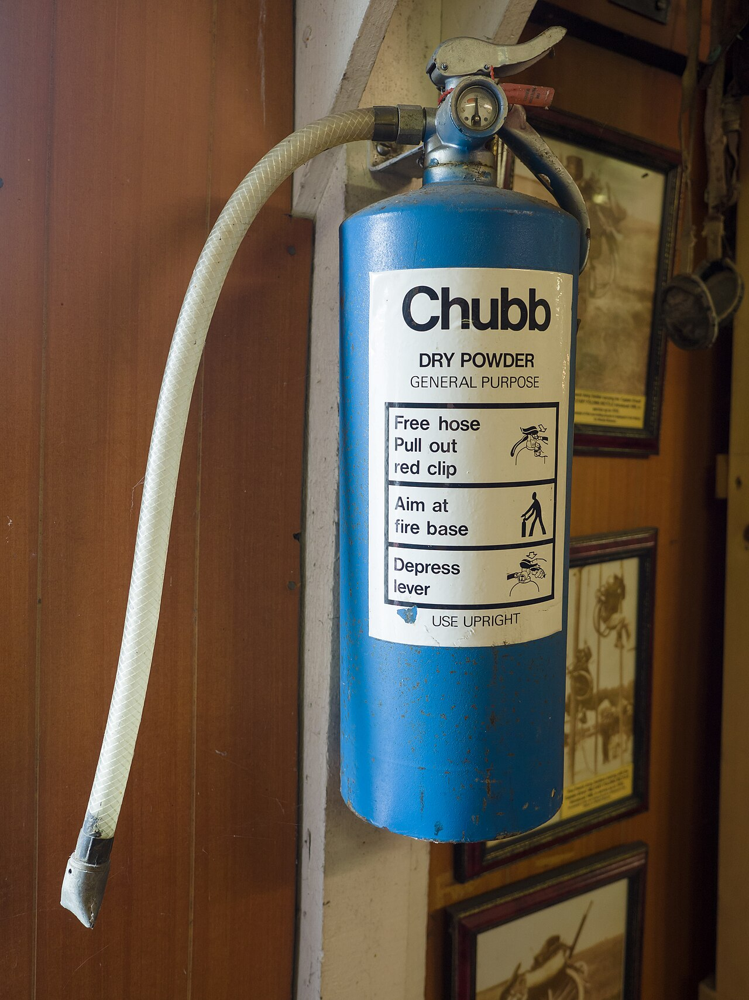
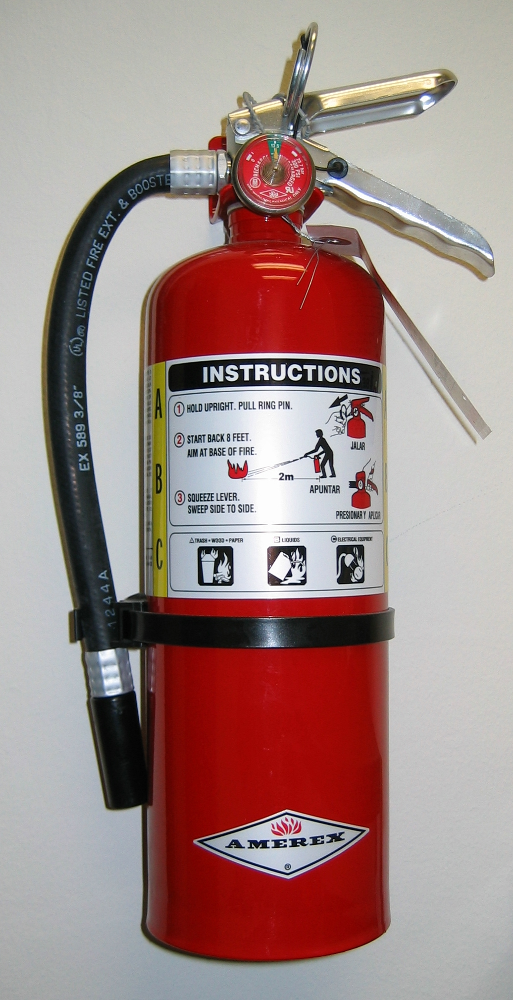
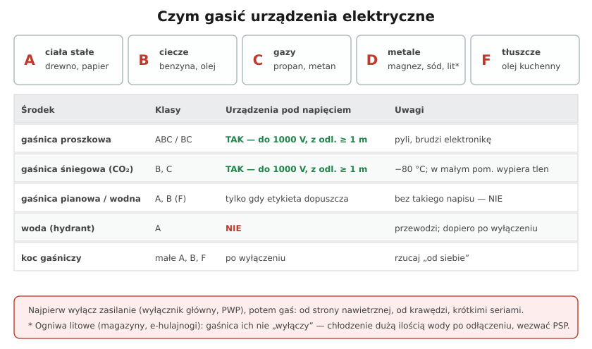

# 30.02 — Gaśnice do urządzeń elektrycznych

> **Moduł:** [30 — Pożar i awaria](README.md) · **Oznaczenia:** 📋 · **Zakres SEP:** (d) (e) · **Status:** ✅ pełny
>
> **Czytaj:**
>
> - [KPPSP Sejny — zasady obsługi gaśnic i hydrantów](https://www.gov.pl/web/kppsp-sejny/zasady-obslugi-gasnic-i-hydrantow-wewnetrznych-w-budynkach-przeznaczonych-na-pobyt-ludzi)
> - Rozporządzenie MSWiA z 7 czerwca 2010 r. w sprawie ochrony przeciwpożarowej budynków, innych obiektów budowlanych i terenów

[← poprzedni temat](30.01-przyczyny-pozarow-od-instalacji-elektrycznej.md) · [spis modułu](README.md) · [następny temat →](30.03-przeciwpozarowy-wylacznik-pradu.md)

## Po co to jest

„Jakimi gaśnicami gasi się urządzenia elektryczne pod napięciem i z jakiej odległości?” — pytanie z banku egzaminacyjnego. Odpowiedź ratuje życie: woda i piana przewodzą, a strumień może porazić gaszącego. W domu i w pracy trzeba wiedzieć, która gaśnica wisi na ścianie i co jest napisane na jej etykiecie.

## Po ludzku

**Grupy pożarów (PN-EN 2):** **A** — ciała stałe (drewno, papier, tworzywa), **B** — ciecze i topiące się ciała stałe, **C** — gazy, **D** — metale, **F** — tłuszcze i oleje kuchenne. Prąd elektryczny nie jest osobną grupą — pali się izolacja (A) lub olej (B), a napięcie decyduje tylko o tym, **czym wolno gasić**.

**Do urządzeń pod napięciem:**

- **gaśnica proszkowa** (ABC lub BC) — do urządzeń pod napięciem **do 1000 V**, z odległości **co najmniej 1 m**. Skuteczna, ale proszek wszędzie wnika i niszczy elektronikę,
- **gaśnica śniegowa (CO₂)** — klasy B i C, do **1000 V z 1 m**. Nie brudzi, dobra do szaf elektrycznych i serwerowni. Gaz wychodzi z temperaturą ok. **−80 °C** — trzyma się za uchwyt, nie za dyszę; w małym pomieszczeniu wypiera tlen,
- **gaśnica pianowa lub wodna (mgłowa)** — **tylko jeśli na etykiecie jest wyraźne dopuszczenie** do urządzeń pod napięciem (przeszła badanie dielektryczne, napis np. „do 1000 V z odległości 1 m”). Bez takiego napisu — **nie**.

**Nie wolno:** woda z hydrantu lub wiadra przy urządzeniach pod napięciem — dopiero po wyłączeniu.

**Jak gasić:**

1. Wyłącz zasilanie, jeśli możesz zrobić to bezpiecznie (wyłącznik główny, PWP) — wtedy nawet woda staje się dopuszczalna.
2. Zerwij plombę, wyciągnij zawleczkę; gaśnica proszkowa działa tylko **w pozycji pionowej**.
3. Podejdź od strony **nawietrznej** (wiatr / ciąg w plecy), zachowaj odległość z etykiety.
4. Kieruj strumień **na źródło** ognia, zaczynając od krawędzi, krótkimi seriami.
5. Po ugaszeniu obserwuj — tlące się elementy mogą się ponownie zapalić.

**Ogniwa litowe** (magazyny energii, hulajnogi, laptopy) mają własny „tlen” w środku — gaśnica tłumi płomień, ale ogniwo dalej się grzeje. Potrzebne długie chłodzenie wodą po odłączeniu zasilania; dzwoń 112.

**Rozmieszczenie i przeglądy** (rozporządzenie MSWiA z 2010 r.): gaśnice w miejscach widocznych i łatwo dostępnych, przy wejściach i ciągach komunikacyjnych; przeglądy i konserwacja **co najmniej raz w roku**.

## Jak to wygląda

*Na co patrzeć: charakterystyczna duża dysza (tuba) i tabliczka „CO₂” — także do pożarów elektrycznych. Dyszy nie trzyma się gołą ręką: przy wypływie jest bardzo zimna.*

*Na co patrzeć: instrukcja w kilku krokach na etykiecie — przy gaśnicy nie ma czasu na czytanie, więc zapoznaj się z nią wcześniej. W Polsce gaśnice proszkowe są zwykle czerwone, z oznaczeniem GP.*

*Na co patrzeć: piktogramy grup pożarów na etykiecie i manometr — wskazówka w zielonym polu oznacza, że gaśnica jest naładowana.*

## Schemat

## Pojęcia

| Pojęcie | Po ludzku | Termin normowy / symbol |
|---------|-----------|-------------------------|
| Grupy pożarów | Co się pali | A, B, C, D, F (PN-EN 2) |
| Gaśnica proszkowa | Gasi proszkiem | GP |
| Gaśnica śniegowa | Gasi dwutlenkiem węgla | GS, CO₂ |
| Gaśnica pianowa / wodna | Gasi pianą lub mgłą wodną | GWP / GW |
| Badanie dielektryczne | Sprawdzenie, czy strumień nie przewodzi | PN-EN 3-7 |
| Koc gaśniczy | Tkanina do przykrycia małego ognia | — |

## Liczby do zapamiętania

| Wielkość | Wartość | Kiedy obowiązuje | Źródło |
|----------|---------|------------------|--------|
| Gaśnica proszkowa / śniegowa | do **1000 V**, z odległości **≥ 1 m** | urządzenia pod napięciem | instrukcje PSP, etykiety |
| Temperatura CO₂ przy wypływie | ok. **−80 °C** | gaśnica śniegowa | jw. |
| Przegląd gaśnic | co najmniej **raz w roku** | gaśnice w obiektach | rozp. MSWiA z 2010 r. |
| Grupy pożarów | **A, B, C, D, F** | klasyfikacja | PN-EN 2 |

## W praktyce

- **W domu:** gaśnica proszkowa 2–6 kg (ABC) przy wyjściu lub w kuchni, koc gaśniczy w kuchni, czujki dymu i czadu. Gaśnica w samochodzie też się przyda.
- **Przy rozdzielnicy w firmie:** gaśnica śniegowa (CO₂) — mniej szkód w aparaturze.
- **Przeczytaj etykietę** gaśnicy, którą masz pod ręką — zanim będzie potrzebna.
- **Po użyciu** gaśnicę trzeba ponownie napełnić; częściowo zużyta nie gwarantuje działania.

## Błędy i zagrożenia

- ⚠️ **Woda na rozdzielnicę pod napięciem** — porażenie gaszącego.
- ⚠️ **Gaśnica pianowa bez dopuszczenia elektrycznego** — piana przewodzi.
- ⚠️ **CO₂ w małym, zamkniętym pomieszczeniu** — ryzyko uduszenia; po gaszeniu wywietrz.
- **Gaszenie z bliska** — poniżej odległości z etykiety strumień może przenieść napięcie.
- **Gaszenie zamiast ewakuacji**, gdy pożar jest już duży — gaśnica podręczna jest na pożar w zarodku.

## Przykład

**Zadanie.** W pomieszczeniu technicznym pali się izolacja przewodów przy rozdzielnicy 400 V. Pod ręką: gaśnica pianowa bez dopuszczenia elektrycznego, gaśnica śniegowa 5 kg i hydrant. Czego użyjesz i w jakiej kolejności?

**Rozwiązanie.** Jeśli to możliwe — **wyłączasz zasilanie** rozdzielnicy wyłącznikiem przed nią (wyłącznik główny w innym miejscu, PWP). Gasisz **gaśnicą śniegową** z odległości **co najmniej 1 m**. Gaśnicy pianowej i hydrantu **nie używasz**, dopóki nie masz pewności, że zasilanie jest wyłączone. Jednocześnie ktoś dzwoni na 112.

## Pytania SEP

1. **Jakimi środkami gaśniczymi można gasić urządzenia elektryczne pod napięciem?**

Odpowiedź

Urządzenia elektryczne pod napięciem do 1000 V gasi się gaśnicami proszkowymi (ABC, BC) i śniegowymi (CO₂), zachowując odległość co najmniej 1 m od urządzenia (lub podaną na gaśnicy). Gaśnice pianowe i wodne można stosować tylko wtedy, gdy producent wyraźnie dopuszcza je do gaszenia urządzeń pod napięciem (oznaczenie na etykiecie po badaniu dielektrycznym). Nie wolno używać wody z hydrantów ani zwykłych gaśnic pianowych. Jeśli to możliwe, przed gaszeniem należy wyłączyć zasilanie — po wyłączeniu można stosować także wodę.

2. **Jak prawidłowo posługiwać się gaśnicą?**

Odpowiedź

Zerwać plombę i wyjąć zawleczkę, uruchomić gaśnicę (gaśnica proszkowa działa w pozycji pionowej), podejść do ognia od strony nawietrznej, zachowując odległość podaną na gaśnicy (dla urządzeń pod napięciem co najmniej 1 m), kierować strumień na źródło ognia, zaczynając od jego krawędzi, gasić krótkimi seriami. Gaśnicę śniegową trzymać wyłącznie za uchwyt. Po ugaszeniu obserwować miejsce pożaru; zużytą gaśnicę przekazać do napełnienia.

## Sprawdź się

1. Dlaczego po wyłączeniu zasilania wolno już gasić instalację wodą?

Odpowiedź

Bo zagrożenie porażeniem przez strumień wody wynikało tylko z napięcia. Po wyłączeniu (i upewnieniu się, że nie ma innych źródeł: PV, UPS, magazyn) woda jest zwykłym środkiem gaśniczym dla grupy A — skutecznym przy palącej się izolacji i konstrukcji.

## Źródła

- [KPPSP Sejny — zasady obsługi gaśnic i hydrantów wewnętrznych](https://www.gov.pl/web/kppsp-sejny/zasady-obslugi-gasnic-i-hydrantow-wewnetrznych-w-budynkach-przeznaczonych-na-pobyt-ludzi).
- [IMDiK PAN — zasady obsługi podręcznego sprzętu gaśniczego (PDF)](https://www.imdik.pan.pl/images/Załącznik_nr_5._Zasady_obsługi_podręcznego_sprzętu_gaśniczego.pdf).
- PN-EN 2 — Klasyfikacja pożarów; PN-EN 3-7 — Gaśnice przenośne.
- Rozporządzenie MSWiA z 7 czerwca 2010 r. w sprawie ochrony przeciwpożarowej budynków, innych obiektów budowlanych i terenów.

---

[← poprzedni temat](30.01-przyczyny-pozarow-od-instalacji-elektrycznej.md) · [spis modułu](README.md) · [następny temat →](30.03-przeciwpozarowy-wylacznik-pradu.md)
