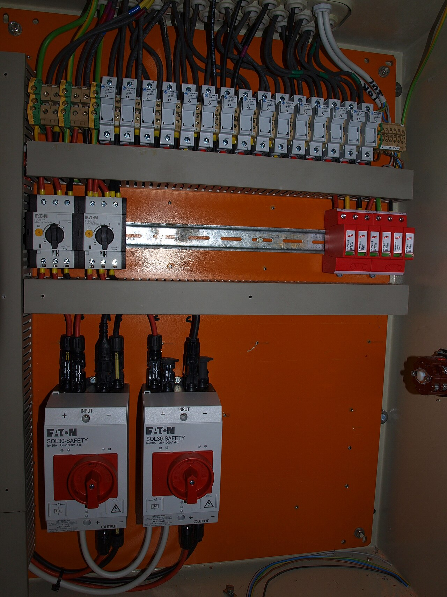
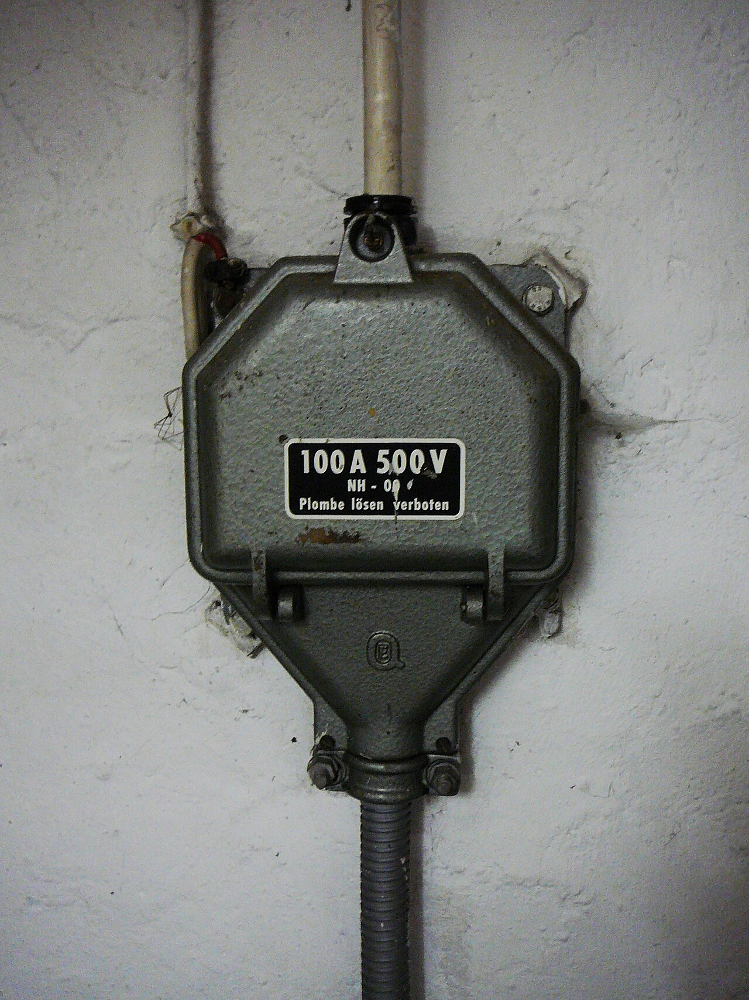
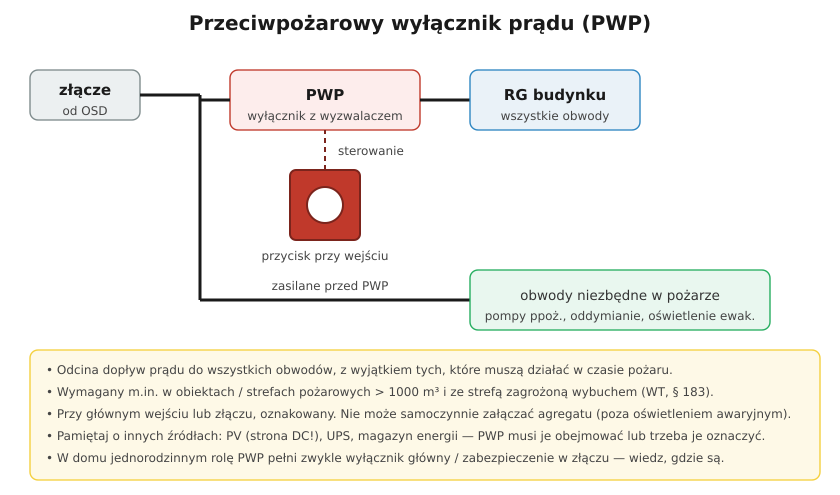

# 30.03 — Przeciwpożarowy wyłącznik prądu

> **Moduł:** [30 — Pożar i awaria](README.md) · **Oznaczenia:** 📋 · **Zakres SEP:** (d) (e) · **Status:** ✅ pełny
>
> **Czytaj:**
>
> - Rozporządzenie w sprawie warunków technicznych budynków (WT), § 183 ust. 2–4
> - Wyłącznik główny i rozłącznik: [10.01](../10-aparatura-modulowa/10.01-rozlacznik-izolacyjny-wylacznik-glowny.md)

[← poprzedni temat](30.02-gasnice-do-urzadzen-elektrycznych.md) · [spis modułu](README.md) · [następny temat →](30.04-postepowanie-przy-awarii.md)

## Po co to jest

Strażak, który wchodzi do płonącego budynku, musi mieć pewność, że instalacja nie jest pod napięciem — inaczej gaszenie wodą grozi porażeniem. Do tego służy **przeciwpożarowy wyłącznik prądu (PWP)**: jeden przycisk przy wejściu odcina zasilanie budynku. Na egzaminie: „do czego służy PWP i gdzie się go montuje?”.

## Po ludzku

**Co robi PWP:** odcina dopływ prądu do **wszystkich obwodów** budynku, **z wyjątkiem** tych, które muszą działać w czasie pożaru: pompy pożarowe i hydroforowe, oddymianie, oświetlenie ewakuacyjne, windy dla ekip ratowniczych, systemy sygnalizacji pożaru.

**Kiedy jest wymagany (WT, § 183):** w budynkach i strefach pożarowych o kubaturze **powyżej 1000 m³** oraz w strefach zagrożonych wybuchem.

**Gdzie:** w pobliżu **głównego wejścia** do budynku lub **złącza** — tam, gdzie strażak trafi od razu; **oznakowany**. Uruchamia się go przyciskiem (w czerwonej skrzynce za szybką), który steruje wyłącznikiem lub rozłącznikiem w rozdzielnicy głównej.

**Jak jest zbudowany:**

- **wyzwalacz napięciowy (wzrostowy)** — przycisk podaje napięcie na cewkę wyłącznika; potrzebuje pewnego zasilania i kontroli ciągłości obwodu sterowania,
- **wyzwalacz podnapięciowy (zanikowy)** — przycisk przerywa obwód, a zanik napięcia wyłącza wyłącznik; uszkodzenie przewodu sterowania też wyłącza budynek (bezpieczniej, ale grozi przypadkowymi wyłączeniami).

**Zasada z WT:** zadziałanie PWP **nie może samoczynnie załączać** drugiego źródła zasilania (np. agregatu) — wyjątek to źródło zasilające oświetlenie awaryjne.

**Inne źródła w budynku** — PV, magazyn energii, UPS, agregat. PWP odcinający tylko sieć nie wyłączy paneli na dachu (strona DC jest pod napięciem w dzień, [26.02](../26-fotowoltaika-pompy-wallboxy/26.02-strona-dc-zagrozenia-i-zabezpieczenia.md)). Przy PV stosuje się wyłączniki/rozłączniki strony DC sterowane razem z PWP, optymalizatory lub systemy szybkiego wyłączania — według projektu uzgodnionego z rzeczoznawcą ppoż.

**Dom jednorodzinny** — PWP zwykle nie jest wymagany. Jego rolę pełni **wyłącznik główny** w rozdzielnicy lub zabezpieczenie w złączu. Każdy domownik powinien wiedzieć, gdzie są i jak je wyłączyć.

## Jak to wygląda

*Na co patrzeć: czerwone pokrętła na dole to rozłączniki strony DC („wyłączniki strażackie”) — odcinają kable od paneli od reszty budynku. Moduły na dachu nadal mają napięcie, ale nie ma go w przewodach wewnątrz domu za rozłącznikiem.*

*Na co patrzeć: złącze budynku — w nim są zabezpieczenia, którymi energetyka lub strażacy mogą odciąć cały budynek. PWP montuje się blisko złącza albo głównego wejścia.*

## Schemat

## Pojęcia

| Pojęcie | Po ludzku | Termin normowy / symbol |
|---------|-----------|-------------------------|
| PWP | Przycisk wyłączający zasilanie budynku | przeciwpożarowy wyłącznik prądu |
| Wyzwalacz wzrostowy | Wyłącza po podaniu napięcia na cewkę | wyzwalacz napięciowy |
| Wyzwalacz zanikowy | Wyłącza po zaniku napięcia | wyzwalacz podnapięciowy |
| Obwody ppoż. | Zasilanie urządzeń działających w pożarze | — |
| Strefa pożarowa | Część budynku oddzielona ścianami ogniowymi | — |

## Liczby do zapamiętania

| Wielkość | Wartość | Kiedy obowiązuje | Źródło |
|----------|---------|------------------|--------|
| Kubatura obiektu / strefy | **> 1000 m³** | wymóg PWP | WT, § 183 ust. 2 |
| Strefa zagrożona wybuchem | PWP **wymagany** | niezależnie od kubatury | jw. |
| Miejsce | przy **głównym wejściu** lub **złączu**, oznakowany | — | WT, § 183 ust. 3 |
| Drugie źródło | **nie** załącza się samoczynnie (poza oświetleniem awaryjnym) | po zadziałaniu PWP | WT, § 183 ust. 4 |

## W praktyce

- **Próby PWP** — okresowo, według instrukcji eksploatacji i instrukcji bezpieczeństwa pożarowego; po próbie sprawdzić, że wszystko wróciło do pracy.
- **Opis** — przy przycisku: „Przeciwpożarowy wyłącznik prądu”, a w instrukcji: co wyłącza, czego nie wyłącza (obwody ppoż., PV, UPS).
- **UPS i agregaty** — sprawdź, czy PWP je obejmuje; UPS bez sygnału z PWP będzie dalej zasilał obwody ([25.03](../25-transformatory-ups-agregaty/25.03-ups-rodzaje-i-zastosowanie.md)).
- **Kable obwodów ppoż.** — o odpowiedniej odporności ogniowej (np. PH90), żeby działały w czasie pożaru.

## Błędy i zagrożenia

- ⚠️ **PWP, który „nie wyłącza” PV, magazynu lub UPS** — strażacy zakładają, że budynek jest bez napięcia.
- ⚠️ **Agregat startujący po zadziałaniu PWP** — przywraca napięcie w budynku, w którym gaszą strażacy.
- **Przycisk zastawiony, nieoznakowany lub w zamkniętym pomieszczeniu** — nikt go nie użyje.
- **Pompy pożarowe zasilane za PWP** — wyłączą się razem z budynkiem.

## Przykład

**Zadanie.** Hala magazynowa 6000 m³ ma instalację PV 50 kW na dachu, UPS dla serwerowni i agregat z SZR. Co musi uwzględnić projekt PWP?

**Rozwiązanie.** PWP przy wejściu lub złączu, odcinający wszystkie obwody poza ppoż. (oświetlenie ewakuacyjne, oddymianie, SSP). **Agregat** — zablokowanie startu przez SZR po zadziałaniu PWP. **UPS** — wyłączenie wyjścia sygnałem z PWP (EPO) albo wyraźne oznaczenie obwodów, które dalej mają napięcie. **PV** — rozłączniki DC sterowane z PWP lub system szybkiego wyłączania; całość uzgodniona z rzeczoznawcą ppoż. i opisana dla straży.

## Pytania SEP

1. **Do czego służy przeciwpożarowy wyłącznik prądu i gdzie się go montuje?**

Odpowiedź

Służy do odcięcia dopływu prądu do wszystkich obwodów budynku w czasie pożaru, z wyjątkiem obwodów zasilających instalacje i urządzenia, których działanie jest niezbędne podczas pożaru (np. pompy pożarowe, oddymianie, oświetlenie ewakuacyjne). Zgodnie z warunkami technicznymi stosuje się go w obiektach i strefach pożarowych o kubaturze powyżej 1000 m³ oraz zagrożonych wybuchem. Umieszcza się go w pobliżu głównego wejścia do obiektu lub złącza i odpowiednio oznakowuje. Jego zadziałanie nie może powodować samoczynnego załączenia drugiego źródła zasilania, z wyjątkiem źródła oświetlenia awaryjnego.

## Sprawdź się

1. Dlaczego wyzwalacz zanikowy w PWP uważa się za „bezpieczniejszy”, a jednocześnie bywa kłopotliwy?

Odpowiedź

Bo każde uszkodzenie obwodu sterowania (przerwany przewód, brak napięcia sterowania) powoduje wyłączenie — PWP nie może „po cichu” przestać działać. Ta sama cecha sprawia, że przypadkowe uszkodzenie przewodu albo zanik napięcia pomocniczego wyłącza cały budynek bez pożaru.

## Źródła

- Rozporządzenie Ministra Infrastruktury z 12 kwietnia 2002 r. w sprawie warunków technicznych, jakim powinny odpowiadać budynki i ich usytuowanie (WT), § 183 ust. 2–4.
- [Gramwzielone — magazyny energii a przeciwpożarowy wyłącznik prądu](https://www.gramwzielone.pl/?p=20318452).

---

[← poprzedni temat](30.02-gasnice-do-urzadzen-elektrycznych.md) · [spis modułu](README.md) · [następny temat →](30.04-postepowanie-przy-awarii.md)
