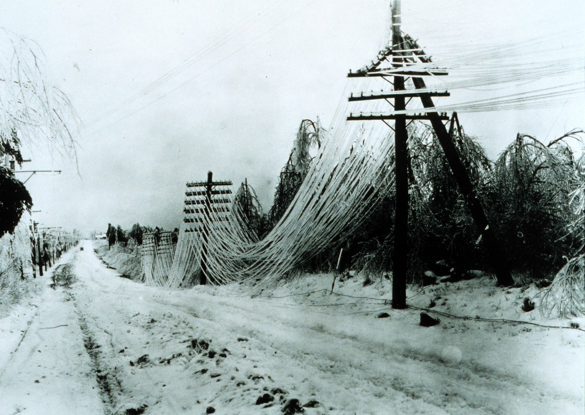
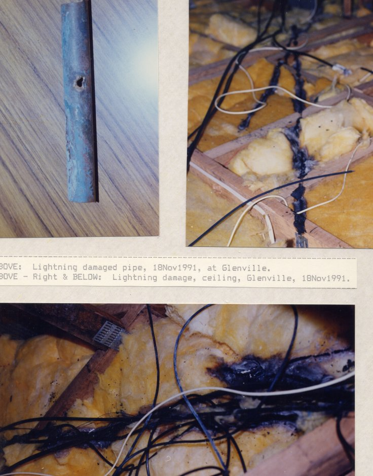
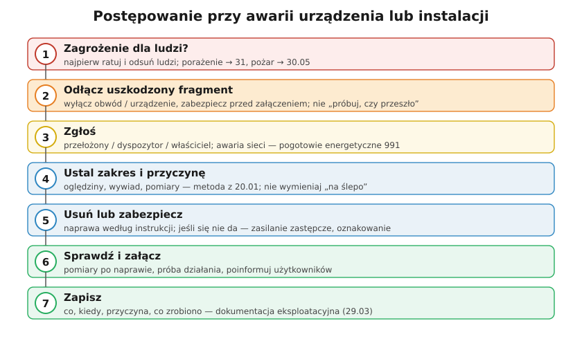

# 30.04 — Postępowanie przy awarii

> **Moduł:** [30 — Pożar i awaria](README.md) · **Oznaczenia:** 📋 · **Zakres SEP:** (d) (e) · **Status:** ✅ pełny
>
> **Czytaj:**
>
> - Diagnostyka usterek: [20.01](../20-diagnostyka-usterek/20.01-metoda-szukania-usterek.md)
> - Czerwone flagi: [00.04](../00-bezpieczenstwo-najpierw/00.04-czerwone-flagi-kiedy-przerwac-prace-i-wezwac.md)

[← poprzedni temat](30.03-przeciwpozarowy-wylacznik-pradu.md) · [spis modułu](README.md) · [następny temat →](30.05-pozar-w-rozdzielnicy-kolejnosc-dzialan.md)

## Po co to jest

Awaria to zdarzenie, w którym urządzenie przestało działać prawidłowo albo stwarza zagrożenie: zanik napięcia, zanik fazy, przerwa N, zalanie rozdzielnicy, uszkodzony kabel, dymiący silnik. Zakres (e) egzaminu SEP to właśnie „postępowanie w razie awarii, pożaru lub innego zagrożenia”. Komisja oczekuje schematu: **ludzie → odłączenie → zgłoszenie → ustalenie przyczyny → usunięcie → sprawdzenie → zapis**.

## Po ludzku

**1. Ludzie najpierw.** Czy ktoś jest porażony, poparzony, czy coś się pali? Wtedy działasz jak w [31](../31-pierwsza-pomoc/README.md) albo [30.05](30.05-pozar-w-rozdzielnicy-kolejnosc-dzialan.md).

**2. Odłącz i zabezpiecz.** Wyłącz uszkodzony obwód lub urządzenie, zabezpiecz przed ponownym załączeniem. **Nie** załączaj „na próbę”, żeby zobaczyć, czy przeszło — to klasyczny sposób na pożar lub porażenie.

**3. Zgłoś.** Według instrukcji eksploatacji: przełożonemu, dyspozytorowi, właścicielowi. Awaria w sieci (brak prądu w okolicy, zerwany przewód, uszkodzone złącze) — **pogotowie energetyczne 991**. Zagrożenie życia — **112**.

**4. Ustal zakres i przyczynę.** Oględziny, wywiad (co się działo przed awarią), pomiary — metoda z [20.01](../20-diagnostyka-usterek/20.01-metoda-szukania-usterek.md). Wymiana bezpiecznika bez ustalenia przyczyny to zaproszenie do kolejnej awarii.

**5. Usuń lub zabezpiecz.** Naprawa według instrukcji; jeśli się nie da — zasilanie zastępcze, oznakowanie, wyłączenie części instalacji do czasu naprawy.

**6. Sprawdź i załącz.** Po naprawie pomiary (izolacja, ciągłość PE, RCD), próba działania, informacja dla użytkowników.

**7. Zapisz.** Co się stało, kiedy, przyczyna, co zrobiono, kto — w dokumentacji eksploatacyjnej ([29.03](../29-eksploatacja/29.03-dokumentacja-techniczna-i-eksploatacyjna.md)).

**Typowe awarie i pierwsze kroki:**

- **zanik jednej fazy** — część gniazd nie działa, silniki buczą: wyłącz odbiorniki trójfazowe, sprawdź zabezpieczenia przedlicznikowe, zgłoś 991,
- **przerwa N w instalacji trójfazowej** — jedne żarówki jaśniej, inne ciemniej, urządzenia się psują: **natychmiast wyłącznik główny** ([20.05](../20-diagnostyka-usterek/20.05-przerwa-w-przewodzie-neutralnym.md)),
- **woda w rozdzielnicy / zalane gniazda** — nie wchodź w wodę; wyłącz z suchego miejsca albo 991/112,
- **zapach spalenizny, ciepła obudowa** — wyłącz obwód, szukaj przyczyny ([20.06](../20-diagnostyka-usterek/20.06-grzejace-sie-zaciski-i-zapach-spalenizny.md)).

## Jak to wygląda

*Na co patrzeć: zerwane przewody na ziemi — awaria sieci, której nie naprawia się samemu. Nie podchodzić, zatrzymać innych, zgłosić 991 i 112.*

*Na co patrzeć: po uderzeniu pioruna uszkodzenia bywają ukryte w stropie i ścianach. Instalacji nie załącza się „bo działa” — najpierw oględziny i pomiary izolacji.*

## Schemat

## Pojęcia

| Pojęcie | Po ludzku | Termin normowy / symbol |
|---------|-----------|-------------------------|
| Awaria | Nagłe uszkodzenie lub zagrożenie | — |
| Pogotowie energetyczne | Dyżur operatora sieci od awarii | 991 |
| Zasilanie zastępcze | Tymczasowe zasilanie na czas naprawy | — |
| Instrukcja eksploatacji | Mówi, co robić przy awarii | 29.02 |

## Liczby do zapamiętania

| Wielkość | Wartość | Kiedy obowiązuje | Źródło |
|----------|---------|------------------|--------|
| Numer alarmowy | **112** | zagrożenie życia, pożar | — |
| Pogotowie energetyczne | **991** | awarie sieci, brak napięcia, zerwane przewody | OSD |
| Izolacja po zalaniu / pożarze | **≥ 1 MΩ** przy 500 V przed ponownym załączeniem | instalacje do 500 V | PN-HD 60364-6 |

## W praktyce

- **Lista telefonów** (991 właściwego OSD, elektryk, administrator) — przy rozdzielnicy lub w instrukcji.
- **Latarka i wskaźnik napięcia** w miejscu znanym wszystkim domownikom.
- **Po powrocie napięcia po długiej awarii** — załączaj odbiorniki stopniowo (prąd rozruchu całego domu naraz może wybić zabezpieczenia).
- **Dokumentuj szkody** (zdjęcia, opis) — przy przepięciach i uszkodzeniach od sieci przydają się do reklamacji u OSD lub ubezpieczyciela.

## Błędy i zagrożenia

- ⚠️ **Wielokrotne załączanie wyłącznika, który wybija** — każde załączenie to łuk w miejscu usterki.
- ⚠️ **Wchodzenie do zalanego pomieszczenia z rozdzielnicą pod napięciem.**
- **Naprawa „na szybko” bez zapisu** — następna osoba nie wie, co zmieniono.
- **Wymiana wkładki na większą**, bo „przepala się” — przyczyna zostaje, przewód traci ochronę.

## Przykład

**Zadanie.** W domu po burzy nie działa połowa gniazd, a pompa ciepła buczy i nie startuje. Wyłączniki w RG są załączone. Co robisz?

**Rozwiązanie.** Objawy wskazują na **zanik jednej fazy**. Wyłączasz pompę ciepła i inne odbiorniki trójfazowe (praca na dwóch fazach je przegrzewa). Sprawdzasz zabezpieczenia przedlicznikowe w złączu (jeśli masz dostęp i uprawnienia) albo napięcia na zaciskach wyłącznika głównego. Jeśli fazy brak przed licznikiem — **991**. Po powrocie fazy — załączasz odbiorniki stopniowo i zapisujesz zdarzenie.

## Pytania SEP

1. **Jak należy postępować w razie awarii urządzenia lub instalacji elektrycznej?**

Odpowiedź

W pierwszej kolejności zapewnić bezpieczeństwo ludzi (uwolnienie porażonych, ewakuacja, pierwsza pomoc). Następnie odłączyć uszkodzone urządzenie lub obwód i zabezpieczyć przed ponownym załączeniem, ograniczając skutki awarii. Zawiadomić przełożonego, dyspozytora lub właściciela zgodnie z instrukcją eksploatacji, a w razie awarii sieci — pogotowie energetyczne. Ustalić zakres i przyczynę awarii (oględziny, pomiary), usunąć ją lub zabezpieczyć miejsce, a po naprawie sprawdzić stan urządzenia (pomiary, próby) przed ponownym załączeniem. Zdarzenie i wykonane czynności odnotować w dokumentacji eksploatacyjnej.

## Sprawdź się

1. Dlaczego po zalaniu rozdzielnicy nie wystarczy jej wysuszyć i załączyć?

Odpowiedź

Bo woda zostawia osady i korozję, może wniknąć do aparatów i przewodów, obniżając rezystancję izolacji. Przed załączeniem trzeba ocenić stan aparatów (często do wymiany), zmierzyć rezystancję izolacji i sprawdzić działanie RCD — inaczej grozi to zwarciem, pożarem lub porażeniem.

## Źródła

- PN-HD 60364-6 — Sprawdzanie.
- [00.04 — Czerwone flagi](../00-bezpieczenstwo-najpierw/00.04-czerwone-flagi-kiedy-przerwac-prace-i-wezwac.md); [20.01 — Metoda szukania usterek](../20-diagnostyka-usterek/20.01-metoda-szukania-usterek.md).

---

[← poprzedni temat](30.03-przeciwpozarowy-wylacznik-pradu.md) · [spis modułu](README.md) · [następny temat →](30.05-pozar-w-rozdzielnicy-kolejnosc-dzialan.md)
