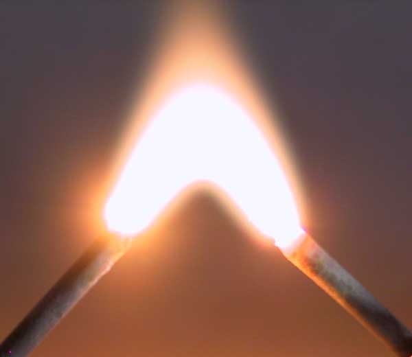
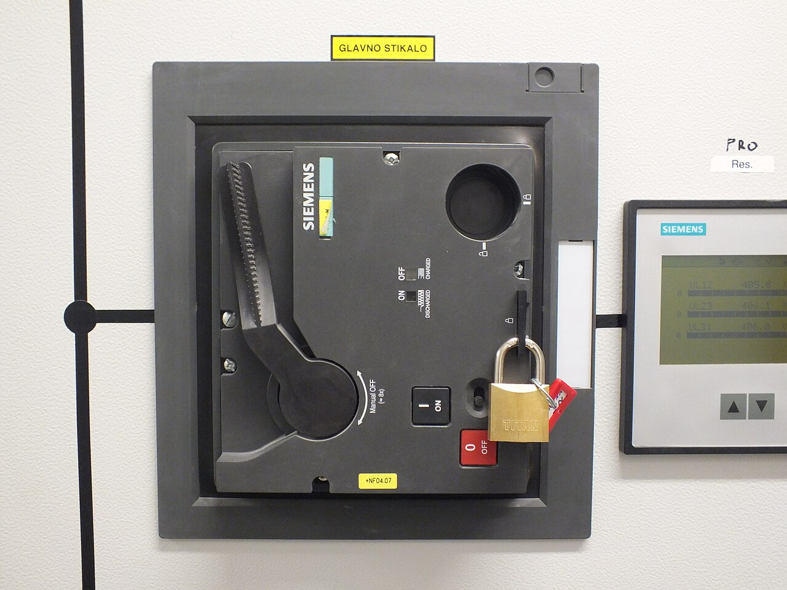
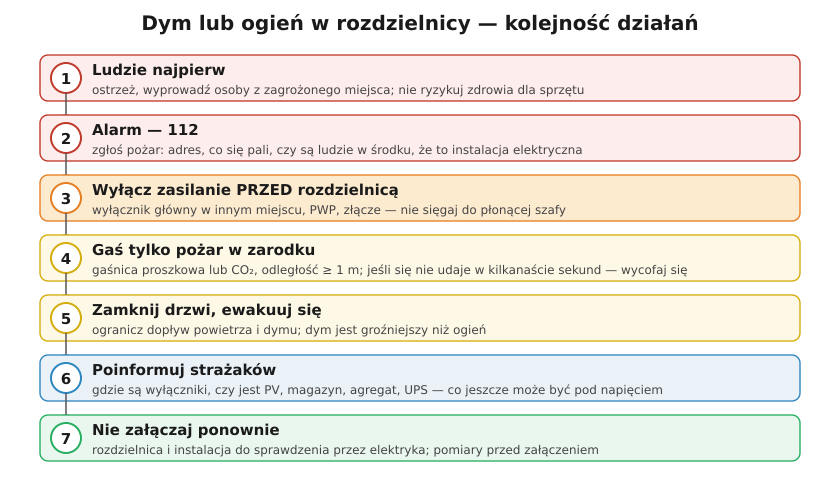

# 30.05 — Pożar w rozdzielnicy — kolejność działań

> **Moduł:** [30 — Pożar i awaria](README.md) · **Oznaczenia:** 📋 · **Zakres SEP:** (d) (e) · **Status:** ✅ pełny
>
> **Czytaj:**
>
> - Gaśnice: [30.02](30.02-gasnice-do-urzadzen-elektrycznych.md); PWP: [30.03](30.03-przeciwpozarowy-wylacznik-pradu.md)

[← poprzedni temat](30.04-postepowanie-przy-awarii.md) · [spis modułu](README.md) · (koniec modułu) →

## Po co to jest

„Jak postępujesz, gdy z rozdzielnicy wydobywa się dym?” — pytanie pojawia się na egzaminie w wielu wersjach. Krótka wersja jest w [00.04](../00-bezpieczenstwo-najpierw/00.04-czerwone-flagi-kiedy-przerwac-prace-i-wezwac.md); tu — pełna kolejność działań, z uzasadnieniem każdego kroku.

## Po ludzku

**1. Ludzie najpierw.** Ostrzeż innych, wyprowadź osoby z zagrożonego miejsca. Dym z palącej się izolacji (PVC) jest toksyczny — chlorowodór, tlenek węgla. Sprzęt nie jest wart zatrucia.

**2. Alarm — 112.** Powiedz: adres, co się pali (rozdzielnica, instalacja elektryczna), czy ktoś jest w środku, czy są inne źródła (PV, magazyn, agregat). W firmie — także uruchom alarm pożarowy według instrukcji.

**3. Wyłącz zasilanie PRZED rozdzielnicą.** Nie sięgaj do płonącej szafy. Wyłącz: wyłącznik główny w innym miejscu, rozdzielnicę nadrzędną, **PWP**, zabezpieczenia w złączu. Pamiętaj o innych źródłach — falownik PV, magazyn, UPS, agregat.

**4. Gaś tylko pożar w zarodku.** Gaśnica **proszkowa lub śniegowa (CO₂)**, odległość **co najmniej 1 m**, od strony nawietrznej. Jeśli w ciągu kilkunastu sekund ogień nie maleje — **wycofaj się**.

**5. Zamknij drzwi, ewakuuj się.** Zamknięte drzwi ograniczają dopływ powietrza i rozprzestrzenianie się dymu. Nie wracaj po rzeczy.

**6. Poinformuj strażaków.** Gdzie są wyłączniki, co zostało wyłączone, co może być pod napięciem (PV na dachu, magazyn, UPS), gdzie są dokumentacja i schemat.

**7. Nie załączaj ponownie.** Po pożarze rozdzielnica i instalacja muszą zostać sprawdzone: oględziny, wymiana uszkodzonych aparatów i przewodów, pomiary — dopiero wtedy załączenie ([30.04](30.04-postepowanie-przy-awarii.md)).

## Jak to wygląda

*Na co patrzeć: łuk ma temperaturę tysięcy stopni i zapala wszystko w pobliżu. Pożar w rozdzielnicy często zaczyna się od łuku na luźnym zacisku lub szynie.*

*Na co patrzeć: wyłącznik główny w osobnym polu — wyłączasz zasilanie palącej się części z bezpiecznego miejsca, zamiast sięgać do płonącej szafy.*

## Schemat

## Pojęcia

| Pojęcie | Po ludzku | Termin normowy / symbol |
|---------|-----------|-------------------------|
| Pożar w zarodku | Mały ogień, który da się ugasić gaśnicą | — |
| Rozdzielnica nadrzędna | Rozdzielnica zasilająca daną rozdzielnicę | — |
| Instrukcja bezpieczeństwa pożarowego | Dokument z zasadami ewakuacji i alarmowania | rozp. MSWiA z 2010 r. |
| Produkty spalania PVC | Toksyczne gazy z palącej się izolacji | HCl, CO |

## Liczby do zapamiętania

| Wielkość | Wartość | Kiedy obowiązuje | Źródło |
|----------|---------|------------------|--------|
| Numer alarmowy | **112** (straż: 998) | pożar | — |
| Odległość gaszenia | **≥ 1 m** | urządzenia pod napięciem do 1000 V | 30.02 |
| Czas „próby” gaszenia | **kilkanaście sekund** — potem ewakuacja | gaśnica podręczna | zasady PSP |

## W praktyce

- **Wiedz, gdzie jest wyłącznik nadrzędny** dla każdej rozdzielnicy, przy której pracujesz.
- **Gaśnica CO₂** blisko rozdzielnic w firmie; w domu — proszkowa przy wyjściu.
- **Czujka dymu** w pomieszczeniu z rozdzielnicą (np. w korytarzu, pomieszczeniu technicznym) — wczesne ostrzeżenie.
- **Schemat i opis** rozdzielnicy także poza nią (np. w teczce przy wejściu) — dla strażaków.

## Błędy i zagrożenia

- ⚠️ **Otwieranie drzwiczek płonącej rozdzielnicy** — dopływ powietrza, płomień w twarz, łuk.
- ⚠️ **Gaszenie wodą lub pianą bez wyłączenia** — porażenie.
- ⚠️ **Załączenie po „ugaszeniu”, żeby sprawdzić, co działa.**
- **Gaszenie zamiast alarmowania** — cenne minuty stracone, gdy ogień się rozwija.

## Przykład

**Zadanie.** W piwnicy bloku z rozdzielnicy wydobywa się dym, słychać trzaski. Jesteś elektrykiem administracji. Opisz swoje działania.

**Rozwiązanie.** Ostrzegasz mieszkańców w pobliżu i nie pozwalasz nikomu zbliżać się do rozdzielnicy. Dzwonisz na **112**. Wyłączasz zasilanie **przed** tą rozdzielnicą — w złączu budynku lub w rozdzielnicy głównej (albo PWP). Jeśli ogień jest mały — gasisz **gaśnicą CO₂ lub proszkową z odległości ≥ 1 m**. Jeśli nie — zamykasz drzwi piwnicy i czekasz na straż przy wejściu, przekazujesz informacje o wyłączeniach. Po pożarze — nie załączasz, dopóki rozdzielnica nie zostanie naprawiona i sprawdzona; sporządzasz notatkę.

## Pytania SEP

1. **Jak należy postępować w razie pożaru urządzeń elektrycznych?**

Odpowiedź

Zaalarmować osoby zagrożone i zorganizować ich ewakuację, wezwać straż pożarną (112) i powiadomić przełożonego. Wyłączyć napięcie w obrębie pożaru — wyłącznikiem zasilającym umieszczonym przed miejscem pożaru, przeciwpożarowym wyłącznikiem prądu lub w złączu — pamiętając o innych źródłach zasilania. Przystąpić do gaszenia pożaru w zarodku podręcznym sprzętem gaśniczym przeznaczonym do urządzeń elektrycznych (gaśnice proszkowe i śniegowe do 1000 V, z odległości co najmniej 1 m); wody i piany używać dopiero po wyłączeniu napięcia. Jeśli pożaru nie da się ugasić — opuścić pomieszczenie, zamykając drzwi. Po przybyciu straży przekazać informacje o stanie wyłączeń i zagrożeniach. Po pożarze nie załączać urządzeń przed ich sprawdzeniem.

## Sprawdź się

1. Dlaczego przy pożarze rozdzielnicy wyłącza się zasilanie „przed” nią, a nie wyłącznikiem głównym w tej rozdzielnicy?

Odpowiedź

Bo dojście do płonącej rozdzielnicy grozi poparzeniem, zatruciem dymem i łukiem. Ponadto zaciski wejściowe i szyny przed wyłącznikiem głównym tej rozdzielnicy pozostają pod napięciem — a często właśnie tam jest źródło pożaru. Wyłączenie w rozdzielnicy nadrzędnej lub w złączu odcina także te części.

## Źródła

- [IMDiK PAN — zasady obsługi podręcznego sprzętu gaśniczego (PDF)](https://www.imdik.pan.pl/images/Załącznik_nr_5._Zasady_obsługi_podręcznego_sprzętu_gaśniczego.pdf).
- Rozporządzenie MSWiA z 7 czerwca 2010 r. w sprawie ochrony przeciwpożarowej budynków, innych obiektów budowlanych i terenów.
- [00.04 — Czerwone flagi](../00-bezpieczenstwo-najpierw/00.04-czerwone-flagi-kiedy-przerwac-prace-i-wezwac.md).

---

[← poprzedni temat](30.04-postepowanie-przy-awarii.md) · [spis modułu](README.md) · (koniec modułu) →
