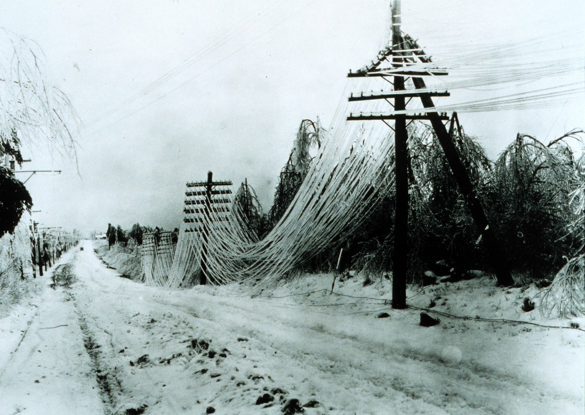
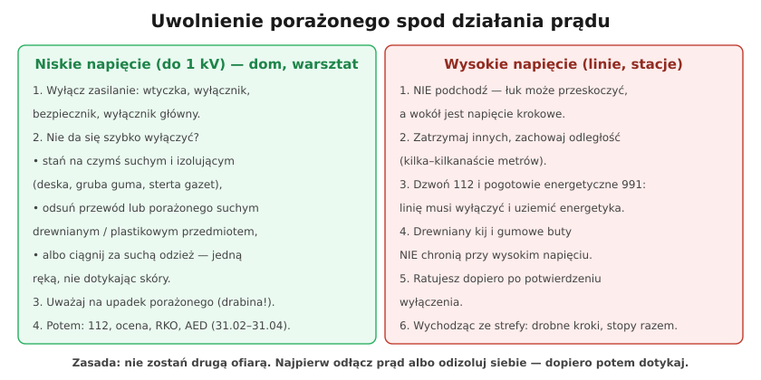

# 31.01 — Uwolnienie porażonego spod działania prądu

> **Moduł:** [31 — Pierwsza pomoc przy porażeniu](README.md) · **Oznaczenia:** 📋 · **Zakres SEP:** (d) (e) · **Status:** ✅ pełny
>
> **Czytaj:**
>
> - Prąd a człowiek: [04.01](../04-prad-a-czlowiek/04.01-jak-prad-dziala-na-organizm-progi-odczuwania.md), napięcie krokowe: [04.03](../04-prad-a-czlowiek/04.03-napiecie-dotykowe-i-krokowe-napiecia.md)

← (początek modułu) · [spis modułu](README.md) · [następny temat →](31.02-ocena-stanu-i-wezwanie-pomocy.md)

## Po co to jest

„Jak uwolnić porażonego spod działania prądu?” — pytanie, które pada niemal na każdym egzaminie SEP, i sytuacja, w której od pierwszych sekund zależy życie. Najczęstszy błąd ratownika: chwyta porażonego gołymi rękami i sam zostaje porażony. Prąd o natężeniu powyżej progu samouwolnienia (ok. 10 mA) zaciska mięśnie — porażony **nie może puścić** przewodu ([04.01](../04-prad-a-czlowiek/04.01-jak-prad-dziala-na-organizm-progi-odczuwania.md)).

## Po ludzku

**Zasada nadrzędna: nie zostań drugą ofiarą.** Zanim dotkniesz porażonego, prąd musi być odłączony albo ty musisz być od niego odizolowany.

**Niskie napięcie (do 1 kV — dom, warsztat, budowa):**

1. **Odłącz zasilanie** — wyciągnij wtyczkę, wyłącz łącznik, wyłącznik nadprądowy, wyłącznik główny. To najszybszy i najpewniejszy sposób.
2. **Nie da się szybko wyłączyć?**
   - **odizoluj się od ziemi**: stań na suchej desce, gumowej macie, stercie gazet, suchym ubraniu,
   - **odsuń przewód lub porażonego** suchym przedmiotem nieprzewodzącym: drewnianą listwą, kijem od szczotki, plastikową rurką,
   - albo **odciągnij za suchą odzież**, jedną ręką, nie dotykając skóry; drugą rękę trzymaj przy sobie.
3. **Uważaj na upadek** — porażony na drabinie spadnie, gdy prąd zniknie. Jeśli możesz, asekuruj.
4. Po uwolnieniu: **112**, ocena przytomności i oddechu, RKO i AED ([31.02](31.02-ocena-stanu-i-wezwanie-pomocy.md)–[31.04](31.04-aed.md)).

**Wysokie napięcie (linie napowietrzne SN, stacje, trakcja):**

- **nie zbliżaj się** — łuk może przeskoczyć na odległość, a wokół miejsca kontaktu z ziemią jest **napięcie krokowe** ([04.03](../04-prad-a-czlowiek/04.03-napiecie-dotykowe-i-krokowe-napiecia.md)),
- zatrzymaj innych, zachowaj odległość (kilka–kilkanaście metrów; im wyższe napięcie, tym dalej),
- wezwij **112** i **pogotowie energetyczne 991** — linię musi wyłączyć i uziemić energetyka,
- drewniany kij i gumowe buty **nie chronią** przy wysokim napięciu,
- do porażonego podchodzisz dopiero po potwierdzeniu wyłączenia; wychodząc ze strefy — **drobnymi krokami, stopy razem**.

## Jak to wygląda

*Na co patrzeć: zerwane przewody linii — jeśli ktoś leży obok nich, nie biegniesz do niego. Najpierw 991 i 112, wyłączenie linii, dopiero potem pomoc.*

## Schemat

## Pojęcia

| Pojęcie | Po ludzku | Termin normowy / symbol |
|---------|-----------|-------------------------|
| Uwolnienie spod działania prądu | Przerwanie przepływu prądu przez porażonego | — |
| Próg samouwolnienia | Prąd, przy którym nie da się puścić przewodu | ok. 10 mA AC |
| Napięcie krokowe | Napięcie między stopami na ziemi | $U_S$ |
| Przedmiot nieprzewodzący | Suche drewno, tworzywo, guma | — |

## Liczby do zapamiętania

| Wielkość | Wartość | Kiedy obowiązuje | Źródło |
|----------|---------|------------------|--------|
| Próg samouwolnienia | ok. **10 mA** AC | 50 Hz, dorośli | IEC 60479-1 (04.01) |
| Granica niskiego napięcia | **1 kV** AC | metody uwalniania | przepisy |
| Numery | **112**, pogotowie energetyczne **991** | zdarzenia z prądem | — |

## W praktyce

- **Zawsze wiedz, gdzie jest wyłącznik** obwodu, przy którym ktoś pracuje — to oszczędza sekundy.
- **Praca w zespole** przy urządzeniach pod napięciem ([28.02](../28-bhp-przy-urzadzeniach/28.02-prace-w-warunkach-szczegolnego-zagrozenia.md)) — druga osoba to ratownik.
- **Mokre podłoże** (łazienka, ogród) — szczególna ostrożność: woda przewodzi, sucha izolacja pod stopami jest kluczowa.
- **Po uwolnieniu** nawet przytomny i „zdrowy” porażony idzie do lekarza ([31.05](31.05-oparzenia-elektryczne-dlaczego-zawsze-do-lekarza.md)).

## Błędy i zagrożenia

- ⚠️ **Chwytanie porażonego gołymi rękami** przed odłączeniem prądu.
- ⚠️ **Podchodzenie do porażonego przy zerwanej linii WN** — napięcie krokowe, łuk.
- **Używanie mokrego lub metalowego przedmiotu** do odsunięcia przewodu.
- **Pozostawienie porażonego na wysokości bez asekuracji** — upadek po odłączeniu.

## Przykład

**Zadanie.** W garażu kolega trzyma uszkodzoną szlifierkę, drga i nie może jej puścić. Przedłużacz jest wpięty do gniazda 3 m dalej, rozdzielnica w korytarzu. Co robisz?

**Rozwiązanie.** Najszybciej: **wyciągasz wtyczkę przedłużacza** z gniazda (3 m — kilka sekund). Nie dotykasz kolegi, dopóki prąd płynie. Gdyby wtyczka była niedostępna — wyłącznik w rozdzielnicy, a jeśli i to za daleko — stajesz na czymś suchym i **odpychasz szlifierkę lub przewód drewnianym przedmiotem**. Po uwolnieniu: ocena przytomności i oddechu, **112**, w razie potrzeby RKO i AED; nawet jeśli kolega czuje się dobrze — do lekarza.

## Pytania SEP

1. **Jak uwolnić porażonego spod działania prądu elektrycznego przy napięciu do 1 kV?**

Odpowiedź

Najlepiej przez wyłączenie napięcia: wyjęcie wtyczki z gniazda, wyłączenie łącznika, wyłącznika lub wykręcenie bezpiecznika. Jeśli szybkie wyłączenie nie jest możliwe, należy odizolować się od ziemi (stanąć na suchej desce, gumie, ubraniu) i odsunąć przewód lub odciągnąć porażonego za pomocą suchego przedmiotu nieprzewodzącego (drewno, tworzywo) albo chwytając za suchą odzież jedną ręką, nie dotykając jego ciała. Trzeba zabezpieczyć porażonego przed upadkiem. Po uwolnieniu ocenia się jego stan, wzywa pomoc (112) i w razie potrzeby rozpoczyna resuscytację.

2. **Jak postąpić, gdy porażenie nastąpiło od urządzeń wysokiego napięcia?**

Odpowiedź

Nie zbliżać się do porażonego ani do urządzeń (możliwy przeskok łuku i napięcie krokowe), nie dopuszczać innych osób. Natychmiast powiadomić służby energetyczne (pogotowie energetyczne, dyspozytora) o konieczności wyłączenia urządzenia oraz wezwać pomoc (112). Uwolnienie porażonego jest możliwe dopiero po wyłączeniu napięcia przez uprawnione osoby; przy WN uwalniać mogą tylko osoby przeszkolone, z odpowiednim sprzętem izolacyjnym. Strefę opuszcza się drobnymi krokami ze złączonymi stopami.

## Sprawdź się

1. Dlaczego nie wolno chwycić porażonego za rękę, nawet jeśli „tylko trochę kopie”?

Odpowiedź

Bo ciało porażonego jest pod napięciem. Ratownik dotykający go i stojący na ziemi zamyka obwód — prąd płynie także przez niego, a skurcz mięśni może uniemożliwić mu puszczenie. Zamiast jednej ofiary są dwie.

## Źródła

- [Polska Rada Resuscytacji — Wytyczne ERC 2025 (broszura, PDF)](https://www.prc.krakow.pl/wp-content/uploads/2026/04/Broszura-ERC-2025-i.pdf).
- [04.01 — Jak prąd działa na organizm](../04-prad-a-czlowiek/04.01-jak-prad-dziala-na-organizm-progi-odczuwania.md).

---

← (początek modułu) · [spis modułu](README.md) · [następny temat →](31.02-ocena-stanu-i-wezwanie-pomocy.md)
