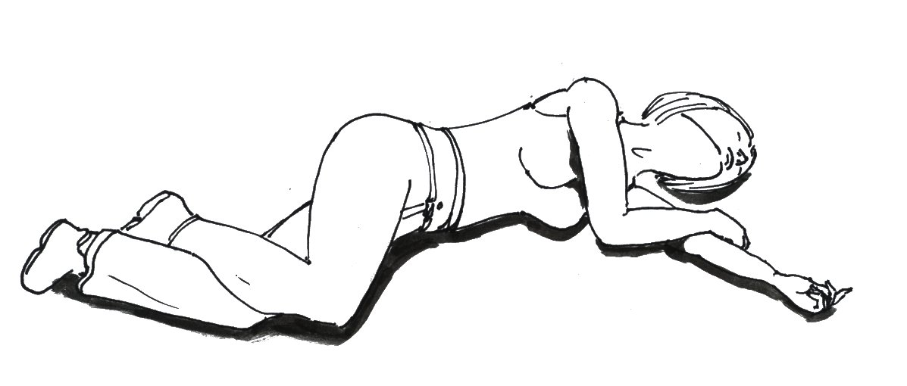
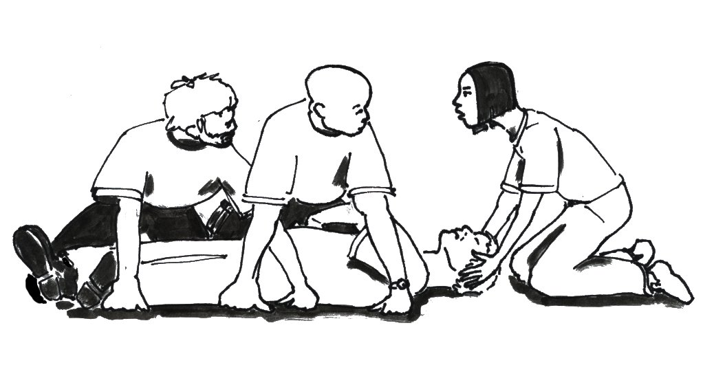
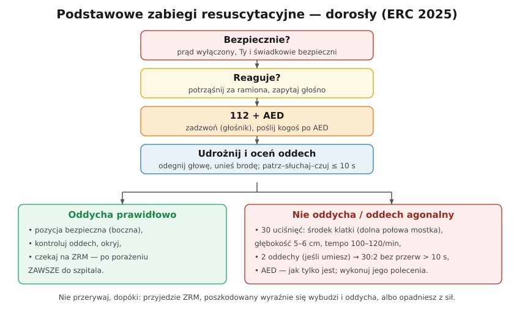

# 31.02 — Ocena stanu i wezwanie pomocy

> **Moduł:** [31 — Pierwsza pomoc przy porażeniu](README.md) · **Oznaczenia:** 📋 · **Zakres SEP:** (d) (e) · **Status:** ✅ pełny
>
> **Czytaj:**
>
> - [Polska Rada Resuscytacji — Wytyczne ERC 2025 (broszura, PDF)](https://www.prc.krakow.pl/wp-content/uploads/2026/04/Broszura-ERC-2025-i.pdf)

[← poprzedni temat](31.01-uwolnienie-porazonego-spod-dzialania-pradu.md) · [spis modułu](README.md) · [następny temat →](31.03-resuscytacja-krazeniowo-oddechowa.md)

## Po co to jest

Po uwolnieniu porażonego masz kilkanaście sekund na decyzję: czy oddycha, czy zaczynać resuscytację, kto dzwoni po pomoc. Ten temat to krótka, powtarzalna sekwencja, którą trzeba umieć „na ślepo” — także na egzaminie: „opisz postępowanie przy porażeniu po uwolnieniu poszkodowanego”.

## Po ludzku

**Sekwencja według wytycznych ERC 2025:**

1. **Bezpieczeństwo** — prąd wyłączony, nic nie spada, ty i świadkowie jesteście bezpieczni.
2. **Czy reaguje?** — delikatnie potrząśnij za ramiona i zapytaj głośno: „Czy wszystko w porządku?”.
3. **Wezwij pomoc — 112** (albo poproś kogoś); włącz **tryb głośnomówiący** — dyspozytor poprowadzi cię przez RKO. Poślij kogoś po **AED**.
4. **Udrożnij drogi oddechowe** — na plecach, odegnij głowę, unieś brodę.
5. **Oceń oddech** — patrz, słuchaj, wyczuwaj **nie dłużej niż 10 sekund**. **Oddech agonalny** (rzadkie, nieregularne westchnienia) **to nie jest prawidłowy oddech** — traktuj jak brak oddechu.

**Co dalej:**

- **nie oddycha prawidłowo** → **RKO 30:2** i AED ([31.03](31.03-resuscytacja-krazeniowo-oddechowa.md), [31.04](31.04-aed.md)),
- **oddycha, ale jest nieprzytomny** → **pozycja bezpieczna (boczna ustalona)**, kontrola oddechu co chwilę, okrycie przed wychłodzeniem, czekanie na zespół ratownictwa medycznego (ZRM),
- **przytomny** → posadź lub połóż, uspokój, sprawdź oparzenia i urazy (upadek!), nie pozwól mu „wrócić do pracy”: **po porażeniu zawsze kontakt z lekarzem** ([31.05](31.05-oparzenia-elektryczne-dlaczego-zawsze-do-lekarza.md)).

**Co powiedzieć dyspozytorowi 112:** gdzie jesteś (adres, charakterystyczne punkty), co się stało (porażenie prądem — jakie napięcie), ilu jest poszkodowanych, w jakim są stanie (przytomny? oddycha?), czy zagrożenie nadal istnieje. Nie rozłączaj się pierwszy.

## Jak to wygląda

*Na co patrzeć: głowa odchylona, usta skierowane w dół (wydzieliny wypływają), zgięta noga stabilizuje pozycję. Oddech kontroluje się regularnie — jeśli ustanie, wracasz do RKO.*

*Na co patrzeć: obracanie poszkodowanego na bok — przy podejrzeniu urazu (upadek z drabiny) robi się to ostrożnie, utrzymując głowę w osi ciała.*

## Schemat

## Pojęcia

| Pojęcie | Po ludzku | Termin normowy / symbol |
|---------|-----------|-------------------------|
| BLS | Podstawowe zabiegi resuscytacyjne | Basic Life Support |
| Oddech agonalny | Rzadkie westchnienia przy zatrzymaniu krążenia | gasping |
| Pozycja bezpieczna | Ułożenie nieprzytomnego, który oddycha | pozycja boczna ustalona |
| ZRM | Zespół ratownictwa medycznego | — |
| Udrożnienie dróg oddechowych | Odgięcie głowy i uniesienie brody | — |

## Liczby do zapamiętania

| Wielkość | Wartość | Kiedy obowiązuje | Źródło |
|----------|---------|------------------|--------|
| Ocena oddechu | **≤ 10 s** | po udrożnieniu | ERC 2025 |
| Numer alarmowy | **112** (także 999 — pogotowie) | wezwanie pomocy | — |
| AED „po drodze” | gdy da się go przynieść i uruchomić w **≤ 1 min** | ratownik sam | ERC 2025 |

## W praktyce

- **Jesteś sam?** Najpierw 112 na głośniku, potem RKO. Po AED idziesz sam tylko wtedy, gdy jest bardzo blisko (do minuty).
- **Na budowie / w zakładzie** — wiedz, gdzie jest AED i apteczka; aplikacje i mapy AED pomagają znaleźć najbliższy.
- **Uraz kręgosłupa** (upadek) — gdy poszkodowany oddycha, nie poruszaj go bez potrzeby; ale drożność dróg oddechowych jest ważniejsza niż kręgosłup.
- **Szkolenie praktyczne** z pierwszej pomocy — raz na kilka lat; same wiadomości nie wystarczą.

## Błędy i zagrożenia

- ⚠️ **Mylenie oddechu agonalnego z oddychaniem** — opóźnienie RKO.
- ⚠️ **Zbyt długie sprawdzanie oddechu i tętna** — laik nie bada tętna, tylko oddech, do 10 s.
- **Odejście od poszkodowanego bez wezwania pomocy.**
- **Puszczenie porażonego do domu**, „bo już mu lepiej”.

## Przykład

**Zadanie.** Po uwolnieniu porażony leży, nie reaguje na głos, oddycha regularnie. Jesteś z kolegą. Co robicie?

**Rozwiązanie.** Kolega dzwoni na **112** (głośnik) i przynosi AED, jeśli jest w pobliżu. Ty udrażniasz drogi oddechowe i potwierdzasz prawidłowy oddech (≤ 10 s). Układasz poszkodowanego w **pozycji bezpiecznej**, okrywasz, **regularnie kontrolujesz oddech**. Jeśli przestanie oddychać prawidłowo — od razu na plecy i **RKO 30:2**, AED.

## Pytania SEP

1. **Opisz postępowanie z porażonym po uwolnieniu go spod działania prądu.**

Odpowiedź

Upewnić się, że miejsce jest bezpieczne. Ocenić przytomność (potrząsnąć za ramiona, zapytać głośno). Wezwać pomoc — numer 112 (najlepiej na głośniku) i polecić przyniesienie AED. Udrożnić drogi oddechowe (odgięcie głowy, uniesienie brody) i ocenić oddech przez nie więcej niż 10 sekund. Jeśli poszkodowany nie oddycha lub oddycha nieprawidłowo — rozpocząć resuscytację 30 uciśnięć : 2 oddechy i jak najszybciej użyć AED. Jeśli oddycha prawidłowo, ale jest nieprzytomny — ułożyć w pozycji bezpiecznej, okryć i stale kontrolować oddech do przyjazdu pomocy. Opatrzyć oparzenia i urazy. Każdy porażony powinien zostać zbadany przez lekarza, nawet gdy czuje się dobrze.

## Sprawdź się

1. Dlaczego wytyczne każą laikowi oceniać oddech, a nie tętno?

Odpowiedź

Bo badanie tętna przez osoby bez wprawy jest zawodne i zajmuje za dużo czasu — łatwo „wyczuć” własne tętno albo go nie znaleźć. Brak prawidłowego oddechu u nieprzytomnego to wystarczający sygnał do rozpoczęcia RKO.

## Źródła

- [Polska Rada Resuscytacji — Wytyczne ERC 2025 (broszura, PDF)](https://www.prc.krakow.pl/wp-content/uploads/2026/04/Broszura-ERC-2025-i.pdf).
- [Polska Rada Resuscytacji — Wytyczne resuscytacji 2025 (PDF)](https://www.prc.krakow.pl/wp-content/uploads/2025/10/WytResusc_net.pdf).

---

[← poprzedni temat](31.01-uwolnienie-porazonego-spod-dzialania-pradu.md) · [spis modułu](README.md) · [następny temat →](31.03-resuscytacja-krazeniowo-oddechowa.md)
