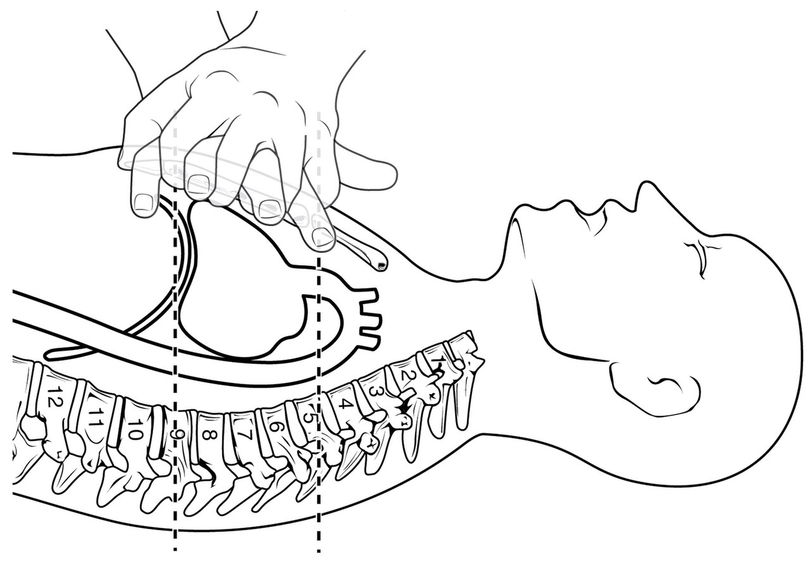
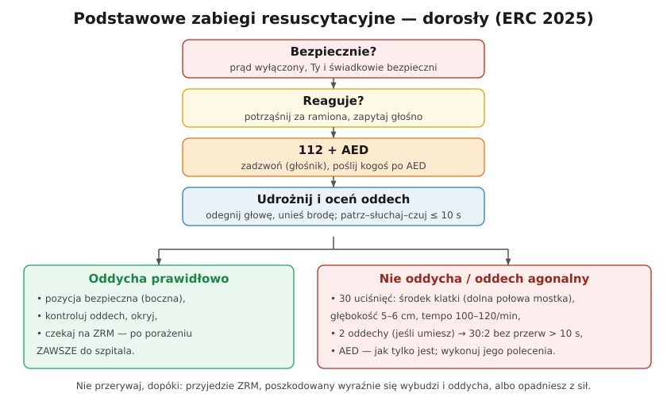

# 31.03 — Resuscytacja krążeniowo-oddechowa

> **Moduł:** [31 — Pierwsza pomoc przy porażeniu](README.md) · **Oznaczenia:** 📋 · **Zakres SEP:** (d) (e) · **Status:** ✅ pełny
>
> **Czytaj:**
>
> - [Polska Rada Resuscytacji — Wytyczne ERC 2025 (broszura, PDF)](https://www.prc.krakow.pl/wp-content/uploads/2026/04/Broszura-ERC-2025-i.pdf)

[← poprzedni temat](31.02-ocena-stanu-i-wezwanie-pomocy.md) · [spis modułu](README.md) · [następny temat →](31.04-aed.md)

## Po co to jest

Prąd przepływający przez klatkę piersiową może wywołać **migotanie komór** — serce drży zamiast pompować krew ([04.01](../04-prad-a-czlowiek/04.01-jak-prad-dziala-na-organizm-progi-odczuwania.md)). Bez pomocy mózg obumiera w ciągu kilku minut. Resuscytacja krążeniowo-oddechowa (RKO) nie „naprawia” serca, ale **utrzymuje przepływ krwi** do mózgu, dopóki AED lub ratownicy nie przywrócą rytmu.

## Po ludzku

**Uciśnięcia klatki piersiowej** (najważniejsza część):

- poszkodowany **na plecach, na twardym podłożu**,
- uklęknij obok, ręce **jedna na drugiej** na **środku klatki piersiowej** (dolna połowa mostka),
- **ramiona wyprostowane**, barki nad dłońmi — uciskasz ciężarem ciała, nie siłą rąk,
- głębokość **5–6 cm**, tempo **100–120 na minutę** (rytm piosenek ok. 110 BPM),
- po każdym uciśnięciu **pozwól klatce wrócić** — nie odrywaj dłoni, ale nie opieraj się.

**Oddechy ratownicze** (jeśli jesteś przeszkolony):

- po **30 uciśnięciach** — **2 oddechy**: odegnij głowę, zatkaj nos, obejmij usta, wdmuchuj ok. **1 sekundę**, aż klatka się uniesie,
- przerwa w uciśnięciach **nie dłużej niż 10 s**,
- kontynuuj **30:2**.

**Nie umiesz lub nie chcesz robić oddechów?** Rób **ciągłe uciśnięcia** 100–120/min — to też daje dużą szansę przeżycia (ERC 2025).

**Kiedy przerwać:** gdy ratownik medyczny przejmie działania, gdy poszkodowany **wyraźnie się wybudzi** (rusza się, otwiera oczy, oddycha prawidłowo) albo gdy opadniesz z sił. Przy dwóch ratownikach — zmiana co ok. **2 minuty**, bez przerw.

## Jak to wygląda

*Na co patrzeć: serce leży między mostkiem a kręgosłupem. Ucisk 5–6 cm „wyciska” z niego krew, a odprężenie pozwala mu się napełnić — dlatego pełne odprężenie jest tak samo ważne jak sam ucisk.*

## Schemat

## Pojęcia

| Pojęcie | Po ludzku | Termin normowy / symbol |
|---------|-----------|-------------------------|
| RKO | Uciskanie klatki i oddechy ratownicze | resuscytacja krążeniowo-oddechowa, CPR |
| Migotanie komór | Chaotyczne drżenie serca bez pompowania | VF |
| Zatrzymanie krążenia | Serce nie pompuje krwi | NZK |
| 30:2 | 30 uciśnięć, 2 oddechy | — |
| RKO tylko z uciskaniem | Ciągłe uciśnięcia bez oddechów | hands-only CPR |

## Liczby do zapamiętania

| Wielkość | Wartość | Kiedy obowiązuje | Źródło |
|----------|---------|------------------|--------|
| Stosunek | **30 : 2** | dorośli | ERC 2025 |
| Głębokość | **5–6 cm** | dorośli | jw. |
| Tempo | **100–120/min** | jw. | jw. |
| Oddech ratowniczy | ok. **1 s** każdy | jw. | jw. |
| Przerwa w uciśnięciach | **≤ 10 s** | na oddechy | jw. |
| Zmiana ratowników | co ok. **2 min** | dwóch ratowników | jw. |

## W praktyce

- **Twarde podłoże** — na łóżku uciśnięcia są nieskuteczne; przenieś na podłogę, jeśli to możliwe.
- **Złamane żebra** zdarzają się przy prawidłowej RKO — nie przerywaj z tego powodu.
- **Telefon na głośniku** — dyspozytor 112 liczy razem z tobą i mówi, co robić.
- **Maseczka do RKO** w apteczce ułatwia oddechy ratownicze.

## Błędy i zagrożenia

- ⚠️ **Zbyt płytkie lub zbyt wolne uciśnięcia** — krew nie dopływa do mózgu.
- ⚠️ **Długie przerwy** (szukanie AED, zmiana ratowników) — każda przerwa obniża ciśnienie do zera.
- **Uciskanie brzucha lub żeber z boku** zamiast środka klatki.
- **Przerwanie RKO po kilku minutach**, „bo nic się nie dzieje” — RKO rzadko sama przywraca rytm; trzeba czekać na AED i ZRM.

## Przykład

**Zadanie.** Przez ile czasu trwa jeden cykl 30:2, jeśli uciskasz w tempie 110/min, a dwa oddechy zajmują 6 s? Ile cykli wykonasz w ciągu 2 minut?

**Rozwiązanie.** 30 uciśnięć przy 110/min: $30 / 110 \cdot 60 \approx 16{,}4$ s. Cykl: 16,4 + 6 ≈ **22 s**. W 2 minutach (120 s): ok. **5 cykli** — tyle mniej więcej trwa okres między analizami AED.

## Pytania SEP

1. **Jak prowadzi się resuscytację krążeniowo-oddechową u osoby dorosłej?**

Odpowiedź

Poszkodowanego układa się na plecach na twardym podłożu. Ratownik kładzie splecione dłonie na środku klatki piersiowej (dolna połowa mostka) i przy wyprostowanych ramionach uciska na głębokość 5–6 cm w tempie 100–120 uciśnięć na minutę, pozwalając klatce w pełni powrócić po każdym uciśnięciu. Po 30 uciśnięciach wykonuje 2 oddechy ratownicze (po ok. 1 s, do uniesienia klatki), z przerwą nie dłuższą niż 10 s, i kontynuuje w stosunku 30:2. Jeśli ratownik nie potrafi lub nie może wykonywać oddechów, prowadzi ciągłe uciśnięcia. Jak najszybciej używa się AED. RKO prowadzi się do przejęcia przez zespół ratownictwa, powrotu oznak życia (poszkodowany budzi się, oddycha prawidłowo) lub wyczerpania ratownika.

## Sprawdź się

1. Dlaczego przy RKO tak ważne jest pełne odprężenie klatki po każdym uciśnięciu?

Odpowiedź

Bo w czasie odprężenia serce i duże naczynia napełniają się krwią. Jeśli ratownik opiera się na klatce, serce nie ma się czym napełnić i kolejne uciśnięcie „pompuje” mniej krwi.

## Źródła

- [Polska Rada Resuscytacji — Wytyczne ERC 2025 (broszura, PDF)](https://www.prc.krakow.pl/wp-content/uploads/2026/04/Broszura-ERC-2025-i.pdf).
- [Polska Rada Resuscytacji — Wytyczne resuscytacji 2025 (PDF)](https://www.prc.krakow.pl/wp-content/uploads/2025/10/WytResusc_net.pdf).

---

[← poprzedni temat](31.02-ocena-stanu-i-wezwanie-pomocy.md) · [spis modułu](README.md) · [następny temat →](31.04-aed.md)
