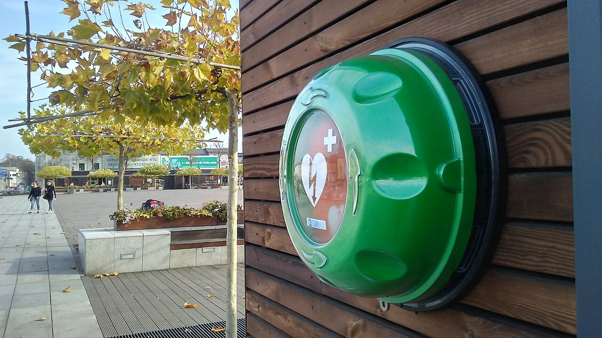
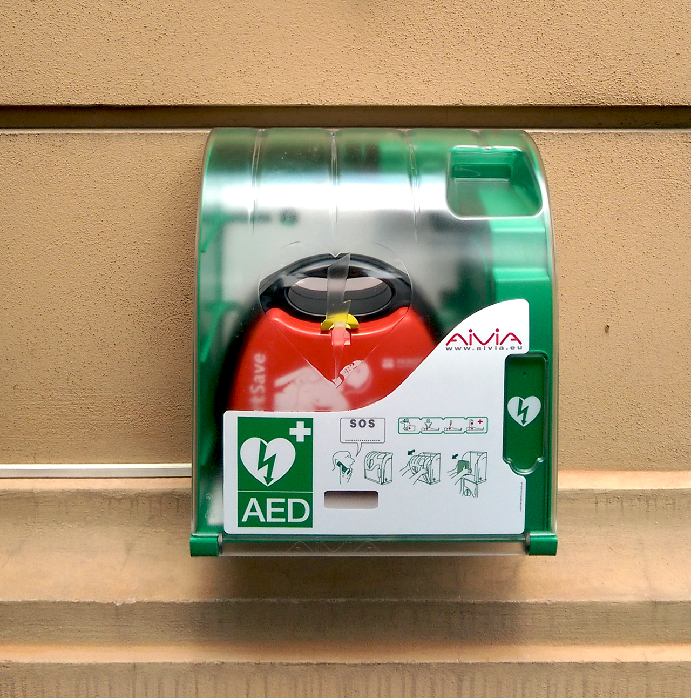
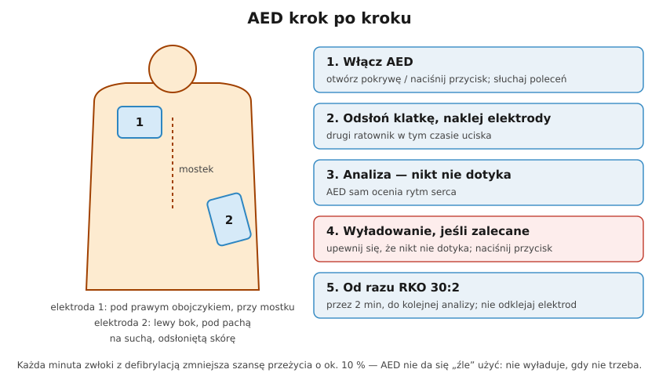

# 31.04 — AED

> **Moduł:** [31 — Pierwsza pomoc przy porażeniu](README.md) · **Oznaczenia:** 📋 · **Zakres SEP:** (d) (e) · **Status:** ✅ pełny
>
> **Czytaj:**
>
> - [Polska Rada Resuscytacji — Wytyczne ERC 2025 (broszura, PDF)](https://www.prc.krakow.pl/wp-content/uploads/2026/04/Broszura-ERC-2025-i.pdf)

[← poprzedni temat](31.03-resuscytacja-krazeniowo-oddechowa.md) · [spis modułu](README.md) · [następny temat →](31.05-oparzenia-elektryczne-dlaczego-zawsze-do-lekarza.md)

## Po co to jest

Migotanie komór wywołane prądem przerywa się **defibrylacją** — silnym, krótkim impulsem, który „resetuje” serce. Automatyczny defibrylator zewnętrzny (**AED**) robi to sam: analizuje rytm i wyładowuje tylko wtedy, gdy trzeba. Jego obsługa jest prosta — urządzenie mówi, co robić — a skuteczność zależy przede wszystkim od **czasu**.

## Po ludzku

**Czas ma znaczenie:** każda minuta opóźnienia defibrylacji zmniejsza szansę przeżycia o ok. **10 %** (ERC 2025). Dlatego AED przynosi ktoś inny, podczas gdy ty uciskasz.

**Kroki:**

1. **Włącz AED** — otwórz pokrywę lub naciśnij przycisk; od tej chwili słuchaj poleceń głosowych.
2. **Odsłoń klatkę piersiową** i **przyklej elektrody** na suchą skórę (wytrzyj mokrą, usuń plastry z lekami):
   - jedna **pod prawym obojczykiem**, obok mostka,
   - druga **na lewym boku**, poniżej pachy.
   Jeśli jest drugi ratownik — **uciska w tym czasie**.
3. **Analiza** — AED mówi „nie dotykać pacjenta”; nikt go nie dotyka.
4. **Wyładowanie zalecane** — upewnij się głośno, że nikt nie dotyka („odsuń się!”), naciśnij przycisk (AED półautomatyczny) albo AED wyładuje sam (automatyczny).
5. **Od razu RKO 30:2** przez 2 minuty — do następnej analizy. **Nie odklejaj elektrod**, nawet jeśli poszkodowany zacznie oddychać.

**AED nie zrobi krzywdy** — nie wyładuje, jeśli rytm tego nie wymaga. Nie ma „złego” użycia AED u osoby bez oddechu.

**Szczególne sytuacje:** mokre podłoże — przenieś poszkodowanego na suche, wytrzyj klatkę; owłosiona klatka — szybkie przetarcie lub zgolenie (golarka bywa w zestawie); widoczny rozrusznik pod skórą — elektroda obok niego, nie na nim; dzieci — elektrody lub tryb pediatryczny, a jeśli ich brak — użyj tego, co masz.

**Gdzie szukać AED:** dworce, urzędy, szkoły, sklepy, zakłady pracy — zielony znak z sercem i błyskawicą; aplikacje i mapy AED.

## Jak to wygląda

*Na co patrzeć: zielona skrzynka ze znakiem serca i błyskawicy — dostępna publicznie, bez klucza. Warto zapamiętać, gdzie jest najbliższa od domu i miejsca pracy.*

*Na co patrzeć: piktogramy na szafce pokazują kolejne kroki. Sam AED po otwarciu też prowadzi głosem — nie trzeba niczego pamiętać poza tym, żeby go użyć.*

## Schemat

## Pojęcia

| Pojęcie | Po ludzku | Termin normowy / symbol |
|---------|-----------|-------------------------|
| AED | Automatyczny defibrylator zewnętrzny | Automated External Defibrillator |
| Defibrylacja | Impuls przerywający migotanie komór | — |
| Rytm do defibrylacji | Migotanie komór, częstoskurcz bez tętna | VF / pVT |
| AED półautomatyczny | Wyładowanie po naciśnięciu przycisku | — |
| AED automatyczny | Wyładowuje sam po ostrzeżeniu | — |

## Liczby do zapamiętania

| Wielkość | Wartość | Kiedy obowiązuje | Źródło |
|----------|---------|------------------|--------|
| Spadek szansy przeżycia | ok. **10 % na minutę** zwłoki | defibrylacja | ERC 2025 |
| RKO między analizami | **2 min** | praca z AED | jw. |
| Przeżycie przy pomocy świadków | ok. **15 %** (wobec mniejszej bez pomocy) | pozaszpitalne NZK | jw. |

## W praktyce

- **Zapamiętaj najbliższy AED** w pracy i przy domu; w zakładach pracy AED bywa przy portierni.
- **Po porażeniu prądem** AED jest szczególnie wartościowy — migotanie komór to typowy skutek porażenia prądem przemiennym.
- **Elektrody zostają** na klatce do przyjazdu ZRM — ratownicy podłączą je do swojego defibrylatora.
- **Szkolenie z AED** trwa godzinę — warto.

## Błędy i zagrożenia

- ⚠️ **Dotykanie poszkodowanego w czasie analizy lub wyładowania.**
- ⚠️ **Zwłoka z RKO po wyładowaniu** — RKO wraca natychmiast.
- **Szukanie AED zamiast uciskania**, gdy jesteś sam, a AED jest daleko.
- **Bojaźń przed użyciem AED** — urządzenie samo decyduje o wyładowaniu.

## Przykład

**Zadanie.** Porażony elektryk nie oddycha. Ty uciskasz, kolega przybiega z AED po 4 minutach. Co dalej?

**Rozwiązanie.** Nie przerywasz uciśnięć. Kolega **włącza AED**, odsłania klatkę, **przykleja elektrody** (pod prawym obojczykiem, na lewym boku). Na komendę analizy **oboje odsuwacie się**. Jeśli AED zaleca wyładowanie — kolega sprawdza, że nikt nie dotyka, i naciska przycisk. Natychmiast wracasz do **RKO 30:2** przez 2 minuty; zmieniacie się przy kolejnej analizie.

## Pytania SEP

1. **Kiedy i jak używa się automatycznego defibrylatora zewnętrznego (AED)?**

Odpowiedź

AED używa się u osoby nieprzytomnej, która nie oddycha lub oddycha nieprawidłowo, jak najszybciej po rozpoczęciu RKO. Należy włączyć urządzenie i wykonywać jego polecenia: odsłonić klatkę piersiową, przykleić elektrody na suchą skórę (pod prawym obojczykiem i na lewym boku poniżej pachy), w czasie analizy rytmu nie dotykać poszkodowanego, a gdy wyładowanie jest zalecane — upewnić się, że nikt go nie dotyka, i nacisnąć przycisk. Po wyładowaniu (lub gdy nie jest zalecane) natychmiast wrócić do RKO 30:2 do kolejnej analizy po 2 minutach. Elektrod nie odkleja się do przyjazdu zespołu ratownictwa.

## Sprawdź się

1. Dlaczego AED jest szczególnie ważny przy porażeniu prądem przemiennym 50 Hz?

Odpowiedź

Bo prąd przemienny przepływający przez serce w podatnej fazie cyklu często wywołuje migotanie komór — rytm, który da się przerwać tylko defibrylacją. RKO jedynie podtrzymuje krążenie; bez defibrylacji szansa na powrót prawidłowego rytmu jest niewielka.

## Źródła

- [Polska Rada Resuscytacji — Wytyczne ERC 2025 (broszura, PDF)](https://www.prc.krakow.pl/wp-content/uploads/2026/04/Broszura-ERC-2025-i.pdf).

---

[← poprzedni temat](31.03-resuscytacja-krazeniowo-oddechowa.md) · [spis modułu](README.md) · [następny temat →](31.05-oparzenia-elektryczne-dlaczego-zawsze-do-lekarza.md)
