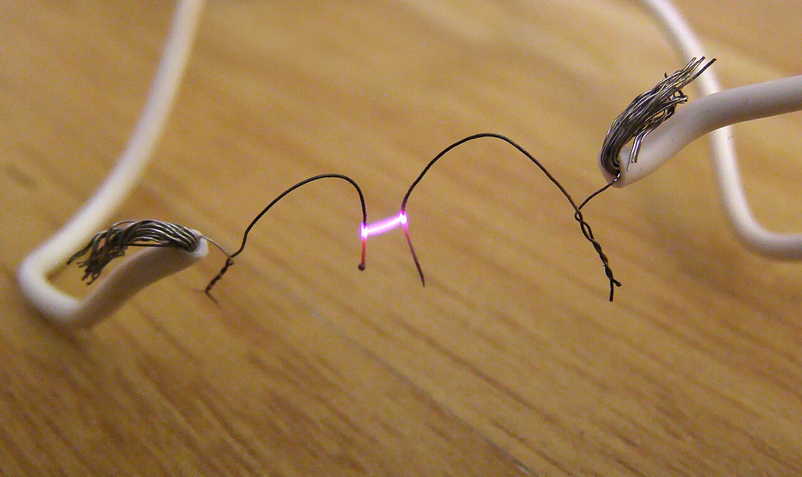
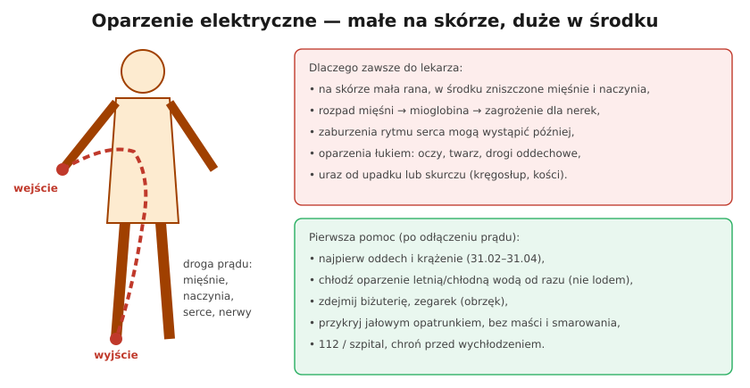

# 31.05 — Oparzenia elektryczne — dlaczego zawsze do lekarza

> **Moduł:** [31 — Pierwsza pomoc przy porażeniu](README.md) · **Oznaczenia:** 📋 · **Zakres SEP:** (d) (e) · **Status:** ✅ pełny
>
> **Czytaj:**
>
> - Łuk elektryczny i oparzenia: [04.05](../04-prad-a-czlowiek/04.05-luk-elektryczny-i-oparzenia.md)
> - 🇬🇧 [ILCOR — cooling of thermal burns (FA 770)](https://costr.ilcor.org/document/duration-of-cooling-with-water-for-thermal-burns-as-a-first-aid-intervention-fa-770-systematic-review)

[← poprzedni temat](31.04-aed.md) · [spis modułu](README.md) · (koniec modułu) →

## Po co to jest

Porażony często wstaje, mówi „nic mi nie jest” i chce wracać do pracy. Tymczasem uraz elektryczny bywa zdradliwy: na skórze mała rana, a pod nią zniszczone mięśnie, naczynia i nerwy; serce może zacząć „wariować” później. Dlatego zasada jest prosta: **po porażeniu prądem sieciowym — zawsze lekarz**.

## Po ludzku

**Dlaczego oparzenie elektryczne jest inne niż termiczne:**

- prąd płynie **przez ciało** — od miejsca wejścia do wyjścia — i grzeje tkanki **po drodze** (mięśnie, naczynia, nerwy mają mały opór),
- na skórze widać tylko **dwie małe rany** (wejście i wyjście), a uszkodzenie wewnątrz może być rozległe,
- **rozpad mięśni** uwalnia do krwi mioglobinę, która może uszkodzić **nerki**,
- **zaburzenia rytmu serca** mogą wystąpić **po pewnym czasie**,
- **łuk elektryczny** daje oparzenia termiczne twarzy, rąk, oczu (ultrafiolet), a gorące gazy — dróg oddechowych ([04.05](../04-prad-a-czlowiek/04.05-luk-elektryczny-i-oparzenia.md)),
- skurcz mięśni lub upadek → **urazy** kręgosłupa, złamania.

**Pierwsza pomoc (po odłączeniu prądu):**

1. **Najpierw oddech i krążenie** — RKO i AED mają pierwszeństwo przed opatrywaniem ran ([31.02](31.02-ocena-stanu-i-wezwanie-pomocy.md)–[31.04](31.04-aed.md)).
2. **Chłodź oparzenie od razu** bieżącą chłodną (nie lodowatą) wodą — zwykle ok. 10–20 minut; ILCOR zaleca natychmiastowe aktywne chłodzenie bieżącą wodą, bez wskazania konkretnego czasu. Pilnuj, żeby poszkodowany się nie wychłodził.
3. **Zdejmij** pierścionki, zegarek, bransoletę — obrzęk narasta.
4. **Przykryj** jałowym opatrunkiem lub czystą folią spożywczą; **bez maści, kremów, olejów**; nie przekłuwaj pęcherzy.
5. **Wezwij 112** lub zawieź do szpitala (SOR) — nie odwoź porażonego „do domu”.

**Kiedy natychmiast 112 (nie samemu do lekarza):** utrata przytomności nawet na chwilę, zaburzenia oddychania, ból w klatce piersiowej, kołatanie serca, oparzenia, prąd płynący przez klatkę piersiową (ręka–ręka, ręka–noga), porażenie wysokim napięciem.

## Jak to wygląda

*Na co patrzeć: nawet mały łuk ma temperaturę tysięcy stopni. Oparzenia łukiem dotyczą skóry, ale też oczu i dróg oddechowych — dlatego osłona twarzy przy pracach w rozdzielnicy.*

## Schemat

## Pojęcia

| Pojęcie | Po ludzku | Termin normowy / symbol |
|---------|-----------|-------------------------|
| Oparzenie elektryczne | Uszkodzenie tkanek przez przepływ prądu | — |
| Znamię prądowe | Mała rana w miejscu wejścia / wyjścia prądu | — |
| Rabdomioliza | Rozpad mięśni | — |
| Mioglobina | Białko z mięśni, groźne dla nerek | — |
| Oparzenie łukiem | Oparzenie termiczne od łuku | — |

## Liczby do zapamiętania

| Wielkość | Wartość | Kiedy obowiązuje | Źródło |
|----------|---------|------------------|--------|
| Chłodzenie oparzenia | **od razu**, bieżącą wodą, zwykle ok. **10–20 min** | oparzenia termiczne i elektryczne | ILCOR (FA 770) |
| Po porażeniu | **zawsze** kontakt z lekarzem | prąd sieciowy i wyższe napięcia | 04.01 |
| Temperatura łuku | **tysiące °C** | łuk elektryczny | 04.05 |

## W praktyce

- **W apteczce w pracy:** opatrunki hydrożelowe na oparzenia, folia NRC (koc termiczny), rękawiczki.
- **Zapisz okoliczności:** napięcie, droga prądu, czas, utrata przytomności — lekarz będzie o to pytał.
- **Zgłoś wypadek przy pracy** według procedur pracodawcy — także, gdy „nic się nie stało”.
- **Oczy po łuku** — piasek pod powiekami, światłowstręt kilka godzin później: okulista.

## Błędy i zagrożenia

- ⚠️ **„Nic mi nie jest, wracam do roboty”** — zaburzenia rytmu i uszkodzenia nerek mogą ujawnić się później.
- ⚠️ **Lód, maści, smarowanie masłem** — pogłębiają uszkodzenie, utrudniają leczenie.
- **Chłodzenie dużej powierzchni ciała długo zimną wodą** — wychłodzenie.
- **Opatrywanie ran przed oceną oddechu** — porażony bez oddechu potrzebuje RKO, nie bandaża.

## Przykład

**Zadanie.** Elektryk dotknął fazy w puszce lewą ręką, prąd wyszedł przez prawą, opartą o rurę. Ma małe zaczerwienienie na palcu, czuje się „trochę dziwnie”, serce „kołacze”. Mówi, że pojedzie do domu. Co robisz?

**Rozwiązanie.** Droga **ręka–ręka** prowadzi przez klatkę piersiową, a kołatanie serca to możliwe zaburzenia rytmu — dzwonisz na **112**. Do przyjazdu ZRM: posadź lub połóż, nie pozwól mu chodzić i prowadzić, schłodź oparzenie palca, zdejmij obrączkę. Przekaż ratownikom: napięcie 230 V, droga prądu, czas zdarzenia, objawy.

## Pytania SEP

1. **Dlaczego każda osoba porażona prądem powinna zostać zbadana przez lekarza?**

Odpowiedź

Bo skutki porażenia mogą nie być widoczne od razu: prąd uszkadza tkanki wzdłuż drogi przepływu (mięśnie, naczynia, nerwy), a na skórze widać tylko niewielkie znamiona prądowe. Rozpad mięśni może prowadzić do niewydolności nerek, a zaburzenia rytmu serca mogą wystąpić z opóźnieniem. Mogą też wystąpić oparzenia łukiem (oczy, drogi oddechowe) i urazy wskutek upadku. Lekarz oceni stan i zdecyduje o obserwacji, np. monitorowaniu EKG.

2. **Jak udzielić pierwszej pomocy przy oparzeniu elektrycznym?**

Odpowiedź

Najpierw uwolnić poszkodowanego spod działania prądu i ocenić oddech — w razie potrzeby rozpocząć RKO i użyć AED. Następnie jak najszybciej chłodzić oparzone miejsca bieżącą chłodną wodą (nie lodem), uważając na wychłodzenie, zdjąć biżuterię i zegarek, przykryć oparzenia jałowym opatrunkiem bez stosowania maści i nie przekłuwać pęcherzy. Wezwać pomoc medyczną (112) lub zapewnić transport do szpitala; poszkodowanego nie zostawiać samego.

## Sprawdź się

1. Dlaczego przy oparzeniu prądem wielkość rany na skórze nie mówi nic o ciężkości urazu?

Odpowiedź

Bo skóra ma duży opór, więc prąd szybko przez nią przechodzi i płynie dalej przez tkanki o małym oporze — mięśnie, naczynia, nerwy. Tam wydziela się ciepło i tam powstają największe uszkodzenia, niewidoczne z zewnątrz.

## Źródła

- 🇬🇧 [ILCOR CoSTR — Duration of cooling with water for thermal burns (FA 770)](https://costr.ilcor.org/document/duration-of-cooling-with-water-for-thermal-burns-as-a-first-aid-intervention-fa-770-systematic-review).
- [Polska Rada Resuscytacji — Wytyczne resuscytacji 2025 (PDF)](https://www.prc.krakow.pl/wp-content/uploads/2025/10/WytResusc_net.pdf).
- [04.05 — Łuk elektryczny i oparzenia](../04-prad-a-czlowiek/04.05-luk-elektryczny-i-oparzenia.md).

---

[← poprzedni temat](31.04-aed.md) · [spis modułu](README.md) · (koniec modułu) →
