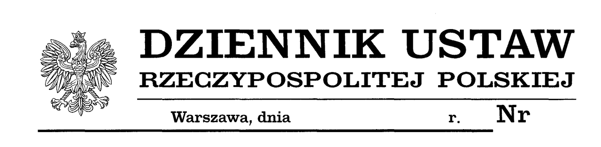
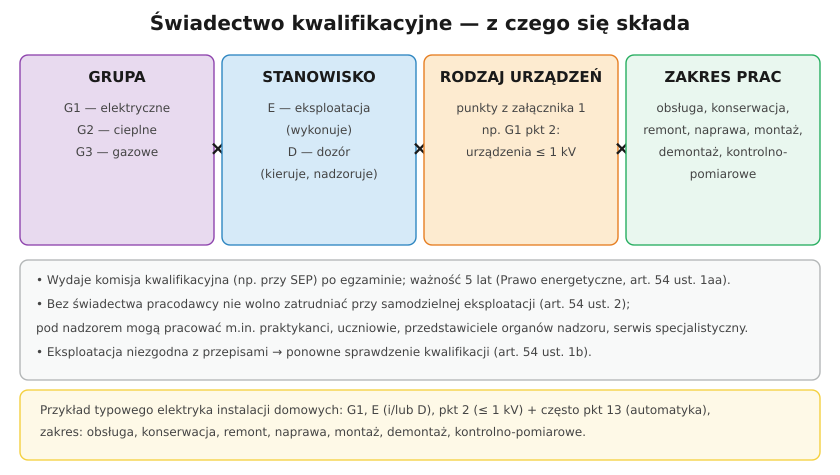

# 32.01 — Prawo energetyczne i świadectwa kwalifikacyjne

> **Moduł:** [32 — Przepisy i normy](README.md) · **Oznaczenia:** 📋 · **Zakres SEP:** (a) (b) (c) (d) (e) · **Status:** ✅ pełny
>
> **Czytaj:**
>
> - [Prawo energetyczne, art. 54 (lexlege)](https://lexlege.pl/prawo-energetyczne/art-54/)
> - Co wolno samemu: [00.03](../00-bezpieczenstwo-najpierw/00.03-co-wolno-zrobic-samemu-a-co-wymaga-uprawnien-i.md)

← (początek modułu) · [spis modułu](README.md) · [następny temat →](32.02-rozporzadzenie-o-kwalifikacjach-grupy-punkty.md)

## Po co to jest

Dlaczego w ogóle trzeba zdawać egzamin SEP? Bo **ustawa Prawo energetyczne** (art. 54) wymaga, by osoby zajmujące się eksploatacją urządzeń, instalacji i sieci miały **kwalifikacje potwierdzone świadectwem**. Ten temat to „podstawa prawna” egzaminu: kto musi mieć świadectwo, kto je wydaje, jak długo jest ważne i kto może pracować bez niego.

## Po ludzku

**Art. 54 ust. 1:** osoby zajmujące się **eksploatacją** sieci oraz urządzeń i instalacji określonych w rozporządzeniu (moduł [32.02](32.02-rozporzadzenie-o-kwalifikacjach-grupy-punkty.md)) **muszą mieć kwalifikacje potwierdzone świadectwem** wydanym przez **komisję kwalifikacyjną**.

**Ważność (ust. 1aa):** świadectwo traci ważność po **5 latach** od wydania. Po tym czasie trzeba ponownie zdać egzamin.

**Ponowne sprawdzenie (ust. 1b):** jeśli eksploatacja jest prowadzona niezgodnie z przepisami, sprawdzenie kwalifikacji powtarza się (może tego zażądać m.in. pracodawca lub organ nadzoru).

**Zakaz zatrudniania bez kwalifikacji (ust. 2):** pracodawca nie może zatrudnić przy **samodzielnej** eksploatacji osoby bez świadectwa. Może jednak dopuścić do prac **pod nadzorem** osoby uprawnionej:

- osoby w trakcie **przygotowania zawodowego**,
- **uczniów** szkół kształcących w zawodzie,
- przedstawicieli **organów nadzoru**,
- osoby prowadzące **specjalistyczne prace serwisowe**.

**Kiedy świadectwo nie jest wymagane (§ 5 rozporządzenia z 2022 r.):** do samej **obsługi** urządzeń elektrycznych o napięciu **do 1 kV i mocy do 20 kW**, jeśli ich dokumentacja określa zasady obsługi, oraz do obsługi urządzeń cieplnych **do 50 kW**. Dotyczy to tylko obsługi — nie montażu, naprawy ani pomiarów ([00.03](../00-bezpieczenstwo-najpierw/00.03-co-wolno-zrobic-samemu-a-co-wymaga-uprawnien-i.md)).

**Komisje kwalifikacyjne (ust. 3):** powołuje je na **5 lat** m.in. **Prezes URE** (np. komisje przy oddziałach SEP), a także właściwi ministrowie — na wniosek przedsiębiorcy, stowarzyszenia naukowo-technicznego lub jednostki organizacyjnej.

**Szczegóły** — grupy urządzeń, stanowiska E i D, zakres egzaminu — określa rozporządzenie wydane na podstawie art. 54 ust. 6 ([32.02](32.02-rozporzadzenie-o-kwalifikacjach-grupy-punkty.md)).

**Prace we własnym domu** — przepisy nie mówią tego wprost; to temat [00.03](../00-bezpieczenstwo-najpierw/00.03-co-wolno-zrobic-samemu-a-co-wymaga-uprawnien-i.md). Pewne jest jedno: kontrolę okresową instalacji budynku (Prawo budowlane, art. 62) przeprowadza osoba z kwalifikacjami dozoru.

## Jak to wygląda

*Na co patrzeć: ustawy i rozporządzenia ogłasza się w Dzienniku Ustaw. Obowiązujący tekst sprawdzasz w tekście jednolitym (ISAP, eli.gov.pl) — nie w starych opracowaniach.*

## Schemat

## Pojęcia

| Pojęcie | Po ludzku | Termin normowy / symbol |
|---------|-----------|-------------------------|
| Świadectwo kwalifikacyjne | „Uprawnienia SEP” | art. 54 Prawa energetycznego |
| Komisja kwalifikacyjna | Komisja egzaminacyjna | powołana np. przez Prezesa URE |
| Eksploatacja | Obsługa, konserwacja, remont, naprawa, montaż, demontaż, pomiary | rozp. z 2022 r., § 4 |
| Samodzielna eksploatacja | Praca bez nadzoru osoby uprawnionej | art. 54 ust. 2 |
| URE | Urząd Regulacji Energetyki | — |

## Liczby do zapamiętania

| Wielkość | Wartość | Kiedy obowiązuje | Źródło |
|----------|---------|------------------|--------|
| Ważność świadectwa | **5 lat** | E i D | art. 54 ust. 1aa |
| Kadencja komisji | **5 lat** | komisje kwalifikacyjne | art. 54 ust. 3 |
| Grupy pod nadzorem bez świadectwa | **4** (przygotowanie zawodowe, uczniowie, organy nadzoru, serwis) | art. 54 ust. 2 | jw. |
| Obsługa bez świadectwa | urządzenia **≤ 1 kV i ≤ 20 kW** (z instrukcją), cieplne **≤ 50 kW** | tylko obsługa | rozp. z 2022 r., § 5 |

## W praktyce

- **Sprawdź datę** na swoim świadectwie — po 5 latach praca bez nowego świadectwa jest pracą bez kwalifikacji.
- **Kopia świadectwa** u pracodawcy i w teczce dokumentów przy pomiarach — numer świadectwa wpisuje się do protokołów.
- **Uczeń / praktykant** w zespole — tylko pod nadzorem osoby uprawnionej.
- **Zakres świadectwa** (grupa, punkty, zakres prac) ogranicza, co wolno ci robić ([32.02](32.02-rozporzadzenie-o-kwalifikacjach-grupy-punkty.md)).

## Błędy i zagrożenia

- **Praca z wygasłym świadectwem** — formalnie brak kwalifikacji; problem przy wypadku i odpowiedzialności.
- **Podpisywanie protokołów przez osobę bez właściwego zakresu** (np. bez czynności kontrolno-pomiarowych).
- **Uczeń wysłany „sam na chwilę”** do pracy przy urządzeniu — naruszenie art. 54 ust. 2.

## Przykład

**Zadanie.** Firma zatrudnia: elektryka ze świadectwem E wydanym 6 lat temu, ucznia technikum i serwisanta producenta falowników. Kto może samodzielnie wykonywać prace eksploatacyjne?

**Rozwiązanie.** **Nikt z nich.** Świadectwo elektryka **wygasło** (5 lat). Uczeń i serwisant mogą pracować **tylko pod nadzorem** osoby z ważnym świadectwem (art. 54 ust. 2). Firma potrzebuje osoby z ważnym świadectwem; elektryk powinien ponownie zdać egzamin.

## Pytania SEP

1. **Kto i na jakiej podstawie musi posiadać świadectwo kwalifikacyjne?**

Odpowiedź

Na podstawie art. 54 ustawy Prawo energetyczne osoby zajmujące się eksploatacją sieci oraz urządzeń i instalacji określonych w rozporządzeniu w sprawie stwierdzania kwalifikacji (grupy 1–3, stanowiska eksploatacji i dozoru) muszą posiadać kwalifikacje potwierdzone świadectwem wydanym przez komisję kwalifikacyjną. Świadectwo jest ważne 5 lat. Zabrania się zatrudniania przy samodzielnej eksploatacji osób bez kwalifikacji; pod nadzorem osoby uprawnionej mogą pracować osoby w trakcie przygotowania zawodowego, uczniowie, przedstawiciele organów nadzoru i osoby prowadzące specjalistyczne prace serwisowe.

## Sprawdź się

1. Czy po wygaśnięciu świadectwa można dalej wykonywać prace „pod własnym nadzorem”, skoro ma się doświadczenie?

Odpowiedź

Nie. Po 5 latach świadectwo traci ważność i osoba nie ma potwierdzonych kwalifikacji. Może pracować wyłącznie tak jak osoba bez świadectwa — pod nadzorem uprawnionego, i tylko w przypadkach z art. 54 ust. 2 — dopóki ponownie nie zda egzaminu.

## Źródła

- [Ustawa Prawo energetyczne, art. 54 (stan prawny 26.08.2026, lexlege)](https://lexlege.pl/prawo-energetyczne/art-54/).
- [Rozporządzenie MKiŚ z 1 lipca 2022 r. — Dz.U. 2022 poz. 1392](https://api.sejm.gov.pl/eli/acts/DU/2022/1392/text.html).

---

← (początek modułu) · [spis modułu](README.md) · [następny temat →](32.02-rozporzadzenie-o-kwalifikacjach-grupy-punkty.md)
