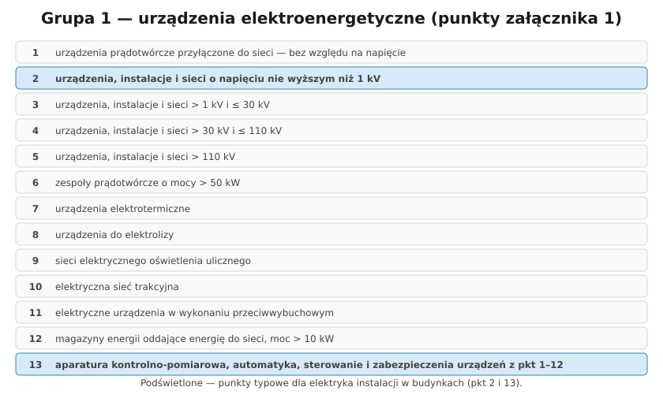

# 32.02 — Rozporządzenie o kwalifikacjach: grupy, punkty, stanowiska E i D

> **Moduł:** [32 — Przepisy i normy](README.md) · **Oznaczenia:** 📋 · **Zakres SEP:** (a) (b) (c) (d) (e) · **Status:** ✅ pełny
>
> **Czytaj:**
>
> - [Rozporządzenie MKiŚ z 1 lipca 2022 r. w sprawie stwierdzania kwalifikacji — Dz.U. 2022 poz. 1392](https://api.sejm.gov.pl/eli/acts/DU/2022/1392/text.html)
> - Zakres egzaminu w repozytorium: [sep/zakres.md](../../sep/zakres.md)

[← poprzedni temat](32.01-prawo-energetyczne-i-swiadectwa-kwalifikacyjne.md) · [spis modułu](README.md) · [następny temat →](32.03-prawo-budowlane-kontrole-okresowe.md)

## Po co to jest

Rozporządzenie o kwalifikacjach mówi, **co dokładnie** jest na świadectwie: grupa, stanowisko, punkty urządzeń, zakres prac — i z czego jest egzamin. Na wniosku o egzamin trzeba to wskazać, a na egzaminie komisja może zapytać, co oznacza „G1, E, pkt 2” w twoim świadectwie.

## Po ludzku

**Grupy urządzeń (załącznik nr 1):**

- **Grupa 1** — urządzenia, instalacje i sieci **elektroenergetyczne** (wytwarzające, przetwarzające, przesyłające i zużywające energię elektryczną),
- **Grupa 2** — urządzenia **cieplne** (kotły, sieci ciepłownicze, pompy ciepła o większej mocy itd.),
- **Grupa 3** — urządzenia **gazowe**.

**Punkty grupy 1** (w skrócie):

1. urządzenia prądotwórcze przyłączone do sieci — bez względu na napięcie,
2. **urządzenia, instalacje i sieci o napięciu nie wyższym niż 1 kV**,
3. powyżej 1 kV do 30 kV,
4. powyżej 30 kV do 110 kV,
5. powyżej 110 kV,
6. zespoły prądotwórcze o mocy powyżej 50 kW,
7. urządzenia elektrotermiczne,
8. urządzenia do elektrolizy,
9. sieci elektrycznego oświetlenia ulicznego,
10. elektryczna sieć trakcyjna,
11. urządzenia w wykonaniu przeciwwybuchowym,
12. urządzenia do magazynowania energii oddające ją do sieci, o mocy powyżej 10 kW,
13. **aparatura kontrolno-pomiarowa** oraz urządzenia i instalacje automatycznej regulacji, sterowania i zabezpieczeń urządzeń z pkt 1–12.

**Wyjątek (§ 5):** samej obsługi urządzeń elektrycznych do 1 kV i 20 kW (gdy dokumentacja określa zasady obsługi) i urządzeń cieplnych do 50 kW nie wymaga świadectwa.

**Stanowiska (§ 4):** **eksploatacji (E)** — osoby wykonujące prace; **dozoru (D)** — osoby kierujące czynnościami osób na stanowisku E lub sprawujące nadzór nad eksploatacją.

**Zakres prac:** obsługa, konserwacja, remont, naprawa, montaż, demontaż, czynności kontrolno-pomiarowe — w świadectwie wpisuje się ten, o który się wnioskuje i z którego się zdało.

**Zakres egzaminu (§ 6):** dla E — zasady budowy i działania, eksploatacji, wykonywania prac, BHP i ppoż. z pierwszą pomocą, postępowanie przy awarii (litery (a)–(e) w tym repozytorium); dla D — dodatkowo przepisy o przyłączaniu, dokumentacji, normy i warunki techniczne, dysponowanie mocą ([sep/zakres.md](../../sep/zakres.md)).

## Jak to wygląda

*Na co patrzeć: rozporządzenie o kwalifikacjach ogłoszono w Dzienniku Ustaw z 2022 r. pod pozycją 1392 — to ono, a nie dawne przepisy z 2003 r., określa dziś grupy i punkty.*

## Schemat

## Pojęcia

| Pojęcie | Po ludzku | Termin normowy / symbol |
|---------|-----------|-------------------------|
| G1, G2, G3 | Grupy urządzeń: elektryczne, cieplne, gazowe | załącznik nr 1 |
| Punkt | Rodzaj urządzeń w grupie | np. G1 pkt 2 |
| Stanowisko E | Wykonuje prace | § 4 ust. 1 pkt 1 |
| Stanowisko D | Kieruje i nadzoruje | § 4 ust. 1 pkt 2 |
| Zakres egzaminu | Wiedza wymagana od kandydata | § 6 |

## Liczby do zapamiętania

| Wielkość | Wartość | Kiedy obowiązuje | Źródło |
|----------|---------|------------------|--------|
| Punkty grupy 1 | **13** | załącznik nr 1 | rozp. z 2022 r. |
| Typowy elektryk instalacji | **G1 pkt 2** (≤ 1 kV), często + **pkt 13** | budynki | jw. |
| Zespoły prądotwórcze | pkt 6: **> 50 kW** | agregaty | jw. |
| Magazyny energii | pkt 12: **> 10 kW** | oddające energię do sieci | jw. |
| Stanowiska | **2**: E i D | — | § 4 |

## W praktyce

- **Wniosek** — wskaż grupę, stanowisko, punkty i zakres prac zgodne z tym, co faktycznie robisz (np. pomiary wymagają „kontrolno-pomiarowych”).
- **Punkt 13** — przydatny, gdy pracujesz z automatyką, sterowaniem, zabezpieczeniami.
- **Fotowoltaika** — mikroinstalacja to urządzenie prądotwórcze przyłączone do sieci (pkt 1); w praktyce instalatorzy PV często mają pkt 1 i 2.
- **Dozór** — potrzebny m.in. do kontroli okresowych z art. 62 Prawa budowlanego i do roli poleceniodawcy.

## Błędy i zagrożenia

- **Świadectwo tylko z pkt 2 przy pracy przy zespołach prądotwórczych > 50 kW** albo sieciach > 1 kV — praca poza zakresem.
- **Brak zakresu „kontrolno-pomiarowe”** przy wykonywaniu pomiarów i podpisywaniu protokołów.
- **Mylenie stanowisk** — osoba z samym E nie może przeprowadzać kontroli wymagających dozoru.

## Przykład

**Zadanie.** Elektryk montuje instalacje w domach, mikroinstalacje PV i wykonuje pomiary okresowe, które sam podpisuje jako kontrolę z art. 62. Jakiego świadectwa potrzebuje?

**Rozwiązanie.** **G1**, punkty **1** (urządzenia prądotwórcze przyłączone do sieci — PV) i **2** (≤ 1 kV), zakres: montaż, naprawa, konserwacja, obsługa, **kontrolno-pomiarowe**. Stanowisko **E** do wykonywania prac i pomiarów oraz **D** — do przeprowadzania kontroli okresowej budynku.

## Pytania SEP

1. **Jakie grupy urządzeń i stanowiska wyróżnia rozporządzenie w sprawie stwierdzania kwalifikacji?**

Odpowiedź

Rozporządzenie Ministra Klimatu i Środowiska z 1 lipca 2022 r. wyróżnia trzy grupy urządzeń: grupę 1 — urządzenia, instalacje i sieci elektroenergetyczne, grupę 2 — urządzenia cieplne, grupę 3 — urządzenia gazowe; w każdej grupie urządzenia są podzielone na punkty (np. G1 pkt 2 — urządzenia, instalacje i sieci o napięciu nie wyższym niż 1 kV). Wyróżnia dwa stanowiska: eksploatacji — dla osób wykonujących prace w zakresie obsługi, konserwacji, remontu, naprawy, montażu, demontażu i czynności kontrolno-pomiarowych, oraz dozoru — dla osób kierujących pracą osób na stanowisku eksploatacji lub sprawujących nadzór nad eksploatacją.

## Sprawdź się

1. Dlaczego instalator, który montuje tylko magazyny energii 5 kW w domach, nie potrzebuje G1 pkt 12?

Odpowiedź

Bo pkt 12 obejmuje magazyny energii o mocy **powyżej 10 kW**. Magazyn 5 kW w instalacji domowej mieści się w urządzeniach ≤ 1 kV (pkt 2), a jeśli pracuje z falownikiem PV przyłączonym do sieci — w praktyce także w pkt 1.

## Źródła

- [Rozporządzenie MKiŚ z 1 lipca 2022 r. — Dz.U. 2022 poz. 1392](https://api.sejm.gov.pl/eli/acts/DU/2022/1392/text.html) (§ 4, § 5, § 6, załącznik nr 1).
- [SEP Kraków — wzór wniosku (lista punktów grupy 1, PDF)](https://sep.krakow.pl/uploads/editor/Wzor-E1-6841a11d80f8d.pdf).

---

[← poprzedni temat](32.01-prawo-energetyczne-i-swiadectwa-kwalifikacyjne.md) · [spis modułu](README.md) · [następny temat →](32.03-prawo-budowlane-kontrole-okresowe.md)
