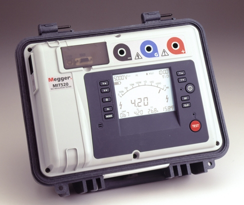
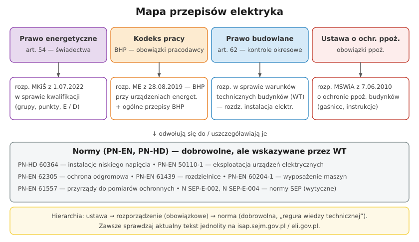

# 32.03 — Prawo budowlane — kontrole okresowe

> **Moduł:** [32 — Przepisy i normy](README.md) · **Oznaczenia:** 📋 · **Zakres SEP:** (a) (b) (c) (d) (e) · **Status:** ✅ pełny
>
> **Czytaj:**
>
> - Ustawa z 7 lipca 1994 r. Prawo budowlane (t.j. Dz.U. 2026 poz. 524), art. 61, 62, 64
> - Protokół i terminy: [23.08](../23-pomiary-odbiorcze-i-okresowe/23.08-protokol-z-pomiarow-i-terminy-badan-okresowych.md)

[← poprzedni temat](32.02-rozporzadzenie-o-kwalifikacjach-grupy-punkty.md) · [spis modułu](README.md) · [następny temat →](32.04-warunki-techniczne-budynkow-instalacja.md)

## Po co to jest

Prawo budowlane mówi, że właściciel budynku musi go utrzymywać w dobrym stanie i **okresowo kontrolować** — także instalację elektryczną i piorunochronną. To podstawa „pomiarów co 5 lat”, o które pytają klienci, zarządcy i komisja egzaminacyjna.

## Po ludzku

**Art. 61** — właściciel lub zarządca obiektu ma obowiązek utrzymywać go w należytym stanie technicznym i estetycznym.

**Art. 62 ust. 1 — kontrole okresowe:**

- **pkt 1 — co najmniej raz w roku:** stan techniczny elementów narażonych na szkodliwe wpływy atmosferyczne, instalacji gazowych, przewodów kominowych (dymowych, spalinowych, wentylacyjnych),
- **pkt 2 — co najmniej raz na 5 lat:** stan techniczny i przydatność do użytkowania obiektu, w tym **badanie instalacji elektrycznej i piorunochronnej** w zakresie **stanu sprawności połączeń, osprzętu, zabezpieczeń i środków ochrony od porażeń, oporności izolacji przewodów oraz uziemień instalacji i aparatów**,
- **pkt 3 — dwa razy w roku** (do 31 maja i do 30 listopada): duże budynki (powierzchnia zabudowy > 2000 m²) i inne obiekty o powierzchni dachu > 1000 m².

**Kto nie musi:** kontrola roczna (pkt 1) nie dotyczy m.in. budynków **jednorodzinnych**, zagrodowych i letniskowych (ust. 2). Kontrola **pięcioletnia z badaniem instalacji elektrycznej dotyczy także domów jednorodzinnych**.

**Kto przeprowadza (art. 62 ust. 5):** kontrolę instalacji elektrycznych, piorunochronnych i gazowych przeprowadzają osoby z kwalifikacjami wymaganymi przy **dozorze** nad eksploatacją urządzeń, instalacji i sieci energetycznych i gazowych (świadectwo D). Pomiary może wykonać osoba z E i zakresem kontrolno-pomiarowym.

**Dokumentowanie (art. 64):** protokoły kontroli dołącza się do **książki obiektu budowlanego** (prowadzonej także w formie elektronicznej — c-KOB), która jest przechowywana przez cały okres użytkowania.

**Skutki zaniedbania:** grzywna za brak kontroli; a w razie pożaru lub wypadku — problem z odpowiedzialnością i odszkodowaniem.

## Jak to wygląda

*Na co patrzeć: „oporność izolacji przewodów” z art. 62 to dokładnie ten pomiar. Przepis wymienia też uziemienia i środki ochrony od porażeń — czyli pętlę zwarcia i RCD.*

## Schemat

## Pojęcia

| Pojęcie | Po ludzku | Termin normowy / symbol |
|---------|-----------|-------------------------|
| Kontrola okresowa | Obowiązkowy przegląd budynku | art. 62 Prawa budowlanego |
| Kontrola roczna | Elementy narażone na pogodę, gaz, kominy | art. 62 ust. 1 pkt 1 |
| Kontrola pięcioletnia | Cały obiekt + instalacja elektryczna i odgromowa | art. 62 ust. 1 pkt 2 |
| Książka obiektu budowlanego | Rejestr kontroli i zdarzeń | art. 64, c-KOB |
| Właściciel / zarządca | Odpowiada za utrzymanie obiektu | art. 61 |

## Liczby do zapamiętania

| Wielkość | Wartość | Kiedy obowiązuje | Źródło |
|----------|---------|------------------|--------|
| Kontrola instalacji elektrycznej i piorunochronnej | **≥ raz na 5 lat** | każdy budynek, także jednorodzinny | art. 62 ust. 1 pkt 2 |
| Kontrola roczna | **≥ raz w roku** (bez jednorodzinnych) | gaz, kominy, elementy zewnętrzne | art. 62 ust. 1 pkt 1, ust. 2 |
| Duże obiekty | **2 × w roku** (do 31.05 i 30.11) | zabudowa > 2000 m², dach > 1000 m² | art. 62 ust. 1 pkt 3 |
| Kto przeprowadza | kwalifikacje **dozoru** | instalacje elektryczne | art. 62 ust. 5 |

## W praktyce

- **Zakres pomiarów** do kontroli 5-letniej: ciągłość PE i połączeń wyrównawczych, rezystancja izolacji, impedancja pętli (samoczynne wyłączenie), RCD, rezystancja uziemień, oględziny ([23](../23-pomiary-odbiorcze-i-okresowe/README.md)).
- **Protokół** z wynikami, oceną i zaleceniami, z numerami świadectw — do książki obiektu ([23.08](../23-pomiary-odbiorcze-i-okresowe/23.08-protokol-z-pomiarow-i-terminy-badan-okresowych.md)).
- **Wspólnota mieszkaniowa** — zarządca zleca kontrolę części wspólnych; instalacje w lokalach — w zależności od ustaleń i zakresu.
- **Norma** zaleca częstsze badania w niektórych obiektach — przepisy dają minimum.

## Błędy i zagrożenia

- **Przekonanie, że dom jednorodzinny „nie musi”** — zwolnienie dotyczy tylko kontroli rocznej.
- **Protokół podpisany przez osobę bez D** jako kontrola z art. 62.
- **Kontrola „na papierze”** bez pomiarów — fałszowanie dokumentacji.

## Przykład

**Zadanie.** Właściciel domu jednorodzinnego z 2018 r. pyta, czy musi robić przeglądy instalacji elektrycznej. Co odpowiadasz?

**Rozwiązanie.** **Tak** — art. 62 ust. 1 pkt 2 wymaga kontroli co najmniej **raz na 5 lat**, w tym badania instalacji elektrycznej i piorunochronnej (połączenia, osprzęt, zabezpieczenia, ochrona przeciwporażeniowa, izolacja, uziemienia). Zwolnienie dla domów jednorodzinnych dotyczy tylko **kontroli rocznej**. Kontrolę przeprowadza osoba z kwalifikacjami dozoru; protokół trzeba przechowywać (książka obiektu).

## Pytania SEP

1. **Jakie kontrole okresowe instalacji elektrycznej przewiduje Prawo budowlane i kto je wykonuje?**

Odpowiedź

Art. 62 ust. 1 pkt 2 Prawa budowlanego wymaga co najmniej raz na 5 lat okresowej kontroli stanu technicznego i przydatności do użytkowania obiektu, obejmującej badanie instalacji elektrycznej i piorunochronnej w zakresie stanu sprawności połączeń, osprzętu, zabezpieczeń i środków ochrony od porażeń, oporności izolacji przewodów oraz uziemień instalacji i aparatów. Obowiązek dotyczy także budynków jednorodzinnych (zwolnienie obejmuje tylko kontrolę roczną). Duże obiekty kontroluje się dodatkowo dwa razy w roku. Kontrolę instalacji elektrycznych przeprowadzają osoby posiadające kwalifikacje wymagane przy dozorze nad eksploatacją urządzeń, instalacji i sieci energetycznych. Wyniki dokumentuje się protokołem dołączanym do książki obiektu budowlanego.

## Sprawdź się

1. Czym różni się kontrola okresowa z art. 62 od pomiarów odbiorczych nowej instalacji?

Odpowiedź

Pomiary odbiorcze wykonuje się raz, przed przekazaniem instalacji do użytkowania, i potwierdzają, że jest wykonana poprawnie (PN-HD 60364-6). Kontrola okresowa jest obowiązkiem właściciela przez cały okres użytkowania — sprawdza, czy instalacja nadal jest sprawna i bezpieczna, a jej wynik trafia do książki obiektu.

## Źródła

- Ustawa z 7 lipca 1994 r. Prawo budowlane (t.j. Dz.U. 2026 poz. 524), art. 61, 62, 64.
- [23.08 — Protokół z pomiarów i terminy badań okresowych](../23-pomiary-odbiorcze-i-okresowe/23.08-protokol-z-pomiarow-i-terminy-badan-okresowych.md).

---

[← poprzedni temat](32.02-rozporzadzenie-o-kwalifikacjach-grupy-punkty.md) · [spis modułu](README.md) · [następny temat →](32.04-warunki-techniczne-budynkow-instalacja.md)
