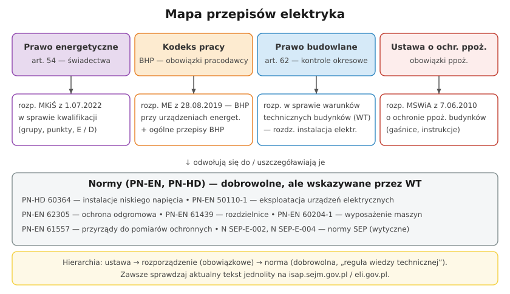

# 32.04 — Warunki techniczne budynków — instalacja elektryczna

> **Moduł:** [32 — Przepisy i normy](README.md) · **Oznaczenia:** 📋 · **Zakres SEP:** (a) (b) (c) (d) (e) · **Status:** ✅ pełny
>
> **Czytaj:**
>
> - [Elektroonline — nowe warunki techniczne opóźnione (21.09.2026)](https://elektroonline.pl/rynek/nowe-warunki-techniczne-opoznione-projektantow-ratuje-18-miesieczny-okres-przejsciowy/)
> - [Energetyczny Projekt — WT 2026: co obowiązuje (19.10.2026)](https://domy.energetycznyprojekt.pl/warunki-techniczne-2026/)

[← poprzedni temat](32.03-prawo-budowlane-kontrole-okresowe.md) · [spis modułu](README.md) · [następny temat →](32.05-bhp-przy-urzadzeniach-energetycznych.md)

## Po co to jest

**Warunki techniczne (WT)** — rozporządzenie w sprawie warunków technicznych, jakim powinny odpowiadać budynki i ich usytuowanie — to podstawowy przepis „jak ma być zbudowana instalacja elektryczna w budynku”. Na egzaminie (zwłaszcza D) pada pytanie: jakie wymagania stawiają WT instalacji elektrycznej? W praktyce WT decydują o RCD, rozdzieleniu PE i N, przewodach miedzianych czy PWP.

## Po ludzku

**Stan prawny (listopad 2026 r.) — uwaga, to się zmienia:**

- przez lata obowiązywało **rozporządzenie Ministra Infrastruktury z 12 kwietnia 2002 r.** (wielokrotnie zmieniane),
- to rozporządzenie **utraciło moc 20 września 2026 r.** — termin wynikał z ustawy o zapewnianiu dostępności osobom ze szczególnymi potrzebami; w ISAP/ELI ma status „uznany za uchylony”,
- **nowe WT do listopada 2026 r. nie zostały ogłoszone** — projekt przeszedł konsultacje i trafił do notyfikacji w Komisji Europejskiej, a ministerstwo nie podało daty,
- lukę łata ustawa z 31 lipca 2026 r., która dodała do Prawa budowlanego **art. 102a–102c**: przez **18 miesięcy od 20 września 2026 r.** (do 20 marca 2028 r.) projekt może być sporządzony według przepisów obowiązujących do 19 września 2026 r., jeśli inwestor złoży **oświadczenie** (przy wniosku o pozwolenie na budowę albo zgłoszeniu); art. 102b obejmuje część robót bez pozwolenia i zgłoszenia,
- część przypadków (np. niektóre roboty wymagające zgłoszenia, postępowania naprawcze) budzi wątpliwości prawników — w konkretnej sprawie pytaj projektanta albo urząd,
- dla elektryka w praktyce punktem odniesienia pozostają wymagania § 183 dawnych WT (projekty w okresie przejściowym) i normy PN-HD 60364, które i tak opisują, jak zrobić instalację zgodnie z zasadami wiedzy technicznej,
- przed projektem zawsze **sprawdź aktualny stan** (ISAP, komunikaty Ministerstwa Rozwoju i Technologii).

**Wymagania dla instalacji elektrycznej (dotychczasowe WT, § 183 ust. 1)** — w instalacji należy stosować m.in.:

1. **złącza** umożliwiające odłączenie budynku od sieci, zabezpieczone przed uszkodzeniami i osobami niepowołanymi,
2. **oddzielne przewody ochronny (PE) i neutralny (N)** w obwodach rozdzielczych i odbiorczych (czyli układ TN-S za punktem rozdziału),
3. **urządzenia różnicowoprądowe** uzupełniające ochronę przeciwporażeniową i przeciwpożarową,
4. **wyłączniki nadprądowe** w obwodach odbiorczych,
5. **selektywność** zabezpieczeń,
6. **przeciwpożarowe wyłączniki prądu** (gdzie wymagane — [30.03](../30-pozar-i-awaria/30.03-przeciwpozarowy-wylacznik-pradu.md)),
7. **połączenia wyrównawcze** główne i miejscowe,
8. prowadzenie przewodów **w liniach prostych**, równoległych do krawędzi ścian i stropów,
9. przewody z żyłami **wyłącznie miedzianymi** przy przekroju **do 10 mm²**,
10. **ochronę przeciwprzepięciową**.

**§ 183 ust. 1a** — połączeniami wyrównawczymi obejmuje się m.in. metalowe instalacje wody, gazu, ogrzewania, kanalizacji, szyby dźwigowe, przewody kominowe i wentylacyjne.

**§ 183 ust. 2–4** — PWP: obiekty / strefy pożarowe > 1000 m³ i strefy zagrożone wybuchem; przy wejściu lub złączu; nie może samoczynnie załączać drugiego źródła (poza oświetleniem awaryjnym).

**Normy w WT** — WT przywołują Polskie Normy (wykaz w załączniku); ich spełnienie to sposób na spełnienie wymagań rozporządzenia ([32.06](32.06-normy-pn-hd-60364-i-pozostale.md)).

## Jak to wygląda

*Na co patrzeć: osobne listwy N i PE, wyłączniki różnicowoprądowe i nadprądowe, miedziane przewody — to wymagania z § 183 WT widoczne w każdej nowej rozdzielnicy.*

## Schemat

## Pojęcia

| Pojęcie | Po ludzku | Termin normowy / symbol |
|---------|-----------|-------------------------|
| WT | Rozporządzenie o warunkach technicznych budynków | rozp. MI z 12.04.2002 r. |
| Okres przejściowy | Możliwość projektowania wg starych WT | art. 102a–102c Prawa budowlanego |
| Złącze | Miejsce przyłączenia budynku do sieci | § 183 ust. 1 pkt 1 |
| Selektywność | Wyłącza się tylko zabezpieczenie najbliższe zwarciu | § 183 ust. 1 pkt 5 |

## Liczby do zapamiętania

| Wielkość | Wartość | Kiedy obowiązuje | Źródło |
|----------|---------|------------------|--------|
| Przewody wyłącznie Cu | przekrój **≤ 10 mm²** | instalacje w budynkach | WT, § 183 ust. 1 pkt 9 |
| PWP | obiekty / strefy **> 1000 m³**, strefy Ex | ochrona ppoż. | WT, § 183 ust. 2 |
| Utrata mocy WT z 2002 r. | **20.09.2026** | nowe WT nieogłoszone (XI 2026) | ustawa o zapewnianiu dostępności; ELI DU/2002/690 |
| Okres przejściowy | **18 miesięcy** od **20.09.2026** (do 20.03.2028) | projekty wg dotychczasowych WT, oświadczenie inwestora | art. 102a–102c Prawa budowlanego |
| Wymagania § 183 ust. 1 | **10** punktów | instalacja elektryczna | WT |

## W praktyce

- **Remont starej instalacji** — nowe obwody wykonuje się według aktualnych wymagań (PE i N osobno, RCD, Cu), nawet jeśli reszta budynku jest stara ([21](../21-stare-instalacje/README.md)).
- **Projekt** — sprawdź, według której wersji WT jest robiony (oświadczenie inwestora w okresie przejściowym).
- **Aluminium powyżej 10 mm²** (np. WLZ) jest dopuszczone — ale z odpowiednimi zaciskami ([21.02](../21-stare-instalacje/21.02-przewody-aluminiowe-zagrozenia-i-postepowanie.md)).
- **Śledź zmiany** — nowe WT mają m.in. objąć magazyny energii, PV i infrastrukturę światłowodową.

## Błędy i zagrożenia

- **Powoływanie się na nieaktualny tekst** WT lub na projekt rozporządzenia jak na obowiązujący przepis.
- **Mostkowanie N i PE w gniazdach** w nowej instalacji — sprzeczne z wymaganiem oddzielnych przewodów.
- **Przewody aluminiowe 2,5 mm²** w nowej instalacji — niedozwolone (Cu do 10 mm²).

## Przykład

**Zadanie.** W nowym domu wykonawca zastosował w obwodach gniazd przewody YDY 3×2,5, ale bez RCD, „bo przecież jest PE”. Czy to zgodne z WT?

**Rozwiązanie.** **Nie.** § 183 ust. 1 pkt 3 WT wymaga stosowania **urządzeń różnicowoprądowych** jako uzupełnienia ochrony przeciwporażeniowej i przeciwpożarowej, a PN-HD 60364-4-41 wymaga RCD 30 mA m.in. dla gniazd ogólnego przeznaczenia. Przewód PE nie zastępuje RCD — chroni przy uszkodzeniu izolacji do obudowy, ale nie przy dotyku bezpośrednim.

## Pytania SEP

1. **Jakie wymagania stawiają warunki techniczne budynków instalacji elektrycznej?**

Odpowiedź

Rozporządzenie w sprawie warunków technicznych (§ 183) wymaga m.in.: złączy umożliwiających odłączenie budynku od sieci, zabezpieczonych przed uszkodzeniem i dostępem osób niepowołanych; oddzielnych przewodów ochronnego i neutralnego w obwodach rozdzielczych i odbiorczych; urządzeń różnicowoprądowych uzupełniających ochronę przeciwporażeniową i przeciwpożarową; wyłączników nadprądowych w obwodach odbiorczych; selektywności zabezpieczeń; przeciwpożarowych wyłączników prądu w wymaganych obiektach; połączeń wyrównawczych głównych i miejscowych; prowadzenia przewodów w liniach prostych równoległych do krawędzi ścian i stropów; przewodów wyłącznie miedzianych do przekroju 10 mm²; ochrony przeciwprzepięciowej. Szczegóły rozwiązań określają przywołane normy, przede wszystkim PN-HD 60364.

## Sprawdź się

1. Co oznacza dla elektryka 18-miesięczny okres przejściowy z art. 102a Prawa budowlanego?

Odpowiedź

Że choć rozporządzenie z 2002 r. utraciło moc 20 września 2026 r., a nowe WT nie zostały ogłoszone, przez 18 miesięcy (do 20 marca 2028 r.) projekt (w tym instalacji elektrycznej) może być sporządzony według warunków technicznych obowiązujących do 19 września 2026 r., jeśli inwestor złoży oświadczenie. Cały projekt musi wtedy konsekwentnie spełniać te same, dotychczasowe wymagania.

## Źródła

- Rozporządzenie Ministra Infrastruktury z 12 kwietnia 2002 r. w sprawie warunków technicznych, jakim powinny odpowiadać budynki i ich usytuowanie, § 183.
- Ustawa z 31 lipca 2026 r. o zmianie ustawy o samorządach zawodowych architektów oraz inżynierów budownictwa oraz ustawy — Prawo budowlane (art. 102a–102c Prawa budowlanego).
- [ELI — status rozporządzenia DU/2002/690 („uznany za uchylony”)](https://eli.gov.pl/eli/DU/2002/690/ogl).
- [Skarbiec.biz — warunki techniczne po 20 września: stare przepisy wygasły, nowych nadal nie ma (24.09.2026)](https://skarbiec.biz/nieruchomosci/warunki-techniczne-po-20-wrzesnia-stare-przepisy-wygasly-nowych-nadal-nie-ma).
- [OnGeo — brak nowych warunków technicznych, okres przejściowy](https://blog.ongeo.pl/warunki-techniczne-2026-okres-przejsciowy).
- [Elektroonline — nowe WT opóźnione, 18-miesięczny okres przejściowy](https://elektroonline.pl/rynek/nowe-warunki-techniczne-opoznione-projektantow-ratuje-18-miesieczny-okres-przejsciowy/).
- [Energetyczny Projekt — warunki techniczne 2026: co obowiązuje](https://domy.energetycznyprojekt.pl/warunki-techniczne-2026/).

---

[← poprzedni temat](32.03-prawo-budowlane-kontrole-okresowe.md) · [spis modułu](README.md) · [następny temat →](32.05-bhp-przy-urzadzeniach-energetycznych.md)
