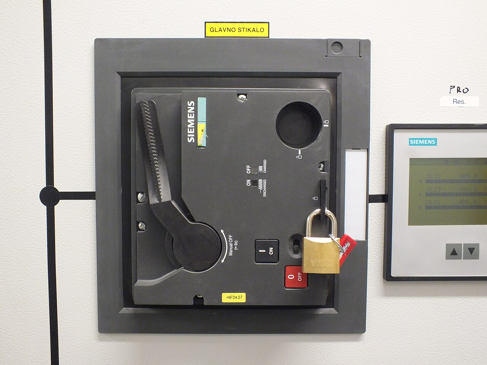
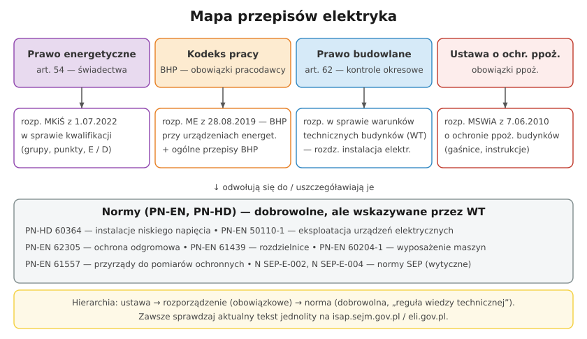

# 32.05 — BHP przy urządzeniach energetycznych — rozporządzenie

> **Moduł:** [32 — Przepisy i normy](README.md) · **Oznaczenia:** 📋 · **Zakres SEP:** (a) (b) (c) (d) (e) · **Status:** ✅ pełny
>
> **Czytaj:**
>
> - [Rozporządzenie ME z 28 sierpnia 2019 r. w sprawie BHP przy urządzeniach energetycznych — t.j. Dz.U. 2021 poz. 1210](https://api.sejm.gov.pl/eli/acts/DU/2021/1210/text.html)
> - Szczegóły: [moduł 28](../28-bhp-przy-urzadzeniach/README.md)

[← poprzedni temat](32.04-warunki-techniczne-budynkow-instalacja.md) · [spis modułu](README.md) · [następny temat →](32.06-normy-pn-hd-60364-i-pozostale.md)

## Po co to jest

BHP elektryka opiera się na trzech warstwach przepisów: **Kodeksie pracy** (ogólne obowiązki pracodawcy i pracownika), **ogólnych przepisach BHP** i **rozporządzeniu o BHP przy urządzeniach energetycznych** (szczególne zasady dla elektryków). Ten temat to mapa tych przepisów; ich treść „w działaniu” jest w [module 28](../28-bhp-przy-urzadzeniach/README.md).

## Po ludzku

**Kodeks pracy:**

- **art. 207** — pracodawca odpowiada za stan BHP w zakładzie,
- **art. 208** — gdy w jednym miejscu pracują pracownicy różnych pracodawców — współpraca i koordynator BHP,
- **art. 210 § 1** — gdy warunki pracy nie odpowiadają przepisom BHP i stwarzają **bezpośrednie zagrożenie** dla zdrowia lub życia, pracownik **ma prawo powstrzymać się od pracy**, zawiadamiając niezwłocznie przełożonego,
- **art. 211** — pracownik musi znać przepisy BHP, stosować środki ochrony, dbać o sprzęt, niezwłocznie zawiadamiać o wypadku i zagrożeniu,
- **szkolenia BHP** — wstępne (instruktaż ogólny i stanowiskowy) przed rozpoczęciem pracy oraz **okresowe**: dla stanowisk robotniczych co najmniej **co 3 lata**, a przy pracach **szczególnie niebezpiecznych** — **co roku** (rozporządzenie w sprawie szkolenia BHP).

**Rozporządzenie o BHP przy urządzeniach energetycznych (2019, t.j. 2021 poz. 1210):**

- **§ 4** — instrukcja eksploatacji ([29.02](../29-eksploatacja/29.02-instrukcja-eksploatacji.md)),
- **§ 5–6** — upoważnienia, wykaz upoważnionych, praca pod nadzorem,
- **§ 23** — prace pod napięciem, w pobliżu i przy wyłączonym; odstępy DL/DV,
- **§ 24–25** — przygotowanie urządzenia: wyłączenie, zabezpieczenie, oznaczenie, sprawdzenie, uziemienie,
- **§ 26** — sprzęt ochronny: ewidencja, badania według producenta,
- **§ 27–29** — prace w warunkach szczególnego zagrożenia, polecenie pisemne, prace bez polecenia,
- **§ 30–32** — role, dopuszczenie, przerwy, zakończenie, zakazy,
- **§ 33** — instrukcja organizacji bezpiecznej pracy.

**Normy uzupełniające:** **PN-EN 50110-1** (eksploatacja urządzeń elektrycznych — pięć zasad, prace pod napięciem i w pobliżu), normy na sprzęt (PN-EN 60903 rękawice, PN-EN 60900 narzędzia, PN-EN 61243-3 wskaźniki).

## Jak to wygląda

*Na co patrzeć: kłódka na wyłączniku — „zabezpieczenie przed przypadkowym lub samowolnym załączeniem” z § 25 rozporządzenia BHP w praktyce.*

## Schemat

## Pojęcia

| Pojęcie | Po ludzku | Termin normowy / symbol |
|---------|-----------|-------------------------|
| Instrukcja eksploatacji | Jak obsługiwać urządzenie | § 4 |
| Instrukcja organizacji bezpiecznej pracy | Kto i jak organizuje prace | § 33 |
| Prawo powstrzymania się od pracy | Odmowa pracy przy bezpośrednim zagrożeniu | art. 210 KP |
| Szkolenie okresowe BHP | Odnawianie wiedzy BHP | rozp. w sprawie szkolenia BHP |
| PN-EN 50110-1 | Norma o eksploatacji urządzeń elektrycznych | — |

## Liczby do zapamiętania

| Wielkość | Wartość | Kiedy obowiązuje | Źródło |
|----------|---------|------------------|--------|
| Szkolenie okresowe — robotnicze | co najmniej **co 3 lata** | stanowiska robotnicze | rozp. w sprawie szkolenia BHP |
| Szkolenie przy pracach szczególnie niebezpiecznych | **co roku** | jw. | jw. |
| Polecenia pisemne | przechowywanie **≥ 90 dni** | — | rozp. BHP, § 28 ust. 4 |
| Zespół | **≥ 2 osoby** | szczególne zagrożenie | § 27 ust. 4 |

## W praktyce

- **Odmowa pracy** — gdy każą pracować pod napięciem bez technologii i sprzętu albo bez polecenia przy szczególnym zagrożeniu: art. 210 KP, zawiadom przełożonego.
- **Instrukcje u pracodawcy** — zapytaj o instrukcję organizacji bezpiecznej pracy, wykaz prac szczególnie niebezpiecznych, ewidencję sprzętu.
- **Firma jednoosobowa** — przepisy BHP przy urządzeniach dotyczą pracodawcy, ale zdrowy rozsądek każe stosować te same zasady także pracując na własny rachunek.

## Błędy i zagrożenia

- **„Szef kazał”** jako usprawiedliwienie pracy z naruszeniem BHP — pracownik też ma obowiązki (art. 211) i prawa (art. 210).
- **Brak szkolenia stanowiskowego** przed dopuszczeniem do pracy.
- **Powoływanie się na stare rozporządzenie BHP** (z 1999 lub 2013 r.) zamiast obowiązującego z 2019 r.

## Przykład

**Zadanie.** Kierownik każe ci wymienić wyłącznik w rozdzielnicy pod napięciem, „bo produkcja nie może stanąć”. Firma nie ma technologii prac pod napięciem. Co robisz?

**Rozwiązanie.** Odmawiasz pracy pod napięciem — to praca w warunkach szczególnego zagrożenia, bez technologii, sprzętu i polecenia pisemnego (§ 23, § 27 rozporządzenia BHP). Masz prawo powstrzymać się od pracy (**art. 210 KP**), zawiadamiając przełożonego. Proponujesz rozwiązanie: krótkie wyłączenie w zaplanowanym oknie, zasilanie zastępcze dla krytycznych odbiorników, praca według polecenia i instrukcji.

## Pytania SEP

1. **Jakie przepisy regulują bezpieczeństwo pracy przy urządzeniach elektrycznych?**

Odpowiedź

Podstawą jest Kodeks pracy (obowiązki pracodawcy i pracownika, szkolenia, prawo powstrzymania się od pracy) oraz rozporządzenie w sprawie ogólnych przepisów BHP. Szczegółowe zasady pracy przy urządzeniach energetycznych określa rozporządzenie Ministra Energii z 28 sierpnia 2019 r. w sprawie bezpieczeństwa i higieny pracy przy urządzeniach energetycznych (instrukcje eksploatacji i organizacji bezpiecznej pracy, upoważnienia, polecenia, prace w warunkach szczególnego zagrożenia, przygotowanie miejsca pracy, sprzęt ochronny). Uzupełniają je normy, m.in. PN-EN 50110-1 (eksploatacja urządzeń elektrycznych) oraz normy dotyczące sprzętu ochronnego.

## Sprawdź się

1. Kiedy pracownik może odmówić wykonania polecenia przełożonego, powołując się na BHP?

Odpowiedź

Gdy warunki pracy nie odpowiadają przepisom BHP i stwarzają bezpośrednie zagrożenie dla jego zdrowia lub życia albo gdy wykonywana przez niego praca grozi takim niebezpieczeństwem innym osobom (art. 210 KP). Musi niezwłocznie zawiadomić przełożonego; za czas powstrzymania się od pracy zachowuje prawo do wynagrodzenia.

## Źródła

- [Rozporządzenie Ministra Energii z 28 sierpnia 2019 r. w sprawie BHP przy urządzeniach energetycznych — t.j. Dz.U. 2021 poz. 1210](https://api.sejm.gov.pl/eli/acts/DU/2021/1210/text.html).
- Ustawa z 26 czerwca 1974 r. Kodeks pracy — art. 207, 208, 210, 211, 237³.
- [Rozporządzenie w sprawie szkolenia w dziedzinie BHP — t.j. Dz.U. 2024 poz. 1327](https://eli.gov.pl/eli/DU/2024/1327/ogl/pol/pdf).

---

[← poprzedni temat](32.04-warunki-techniczne-budynkow-instalacja.md) · [spis modułu](README.md) · [następny temat →](32.06-normy-pn-hd-60364-i-pozostale.md)
