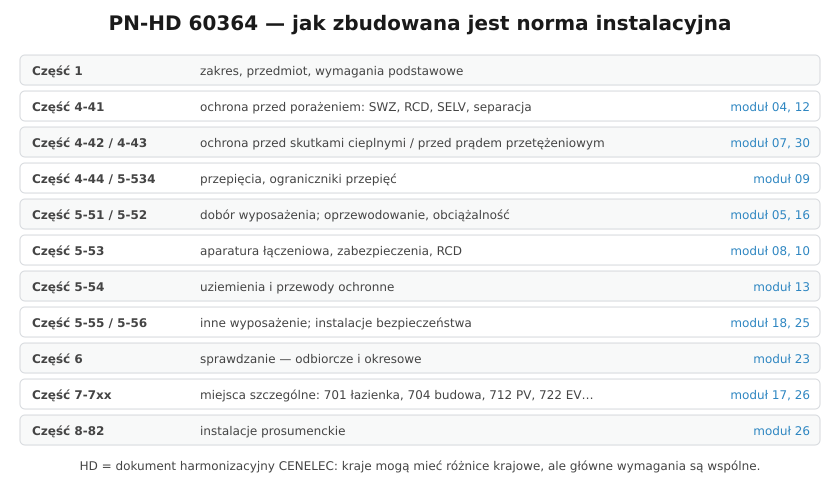

# 32.06 — Normy: PN-HD 60364 i pozostałe

> **Moduł:** [32 — Przepisy i normy](README.md) · **Oznaczenia:** 📋 · **Zakres SEP:** (a) (b) (c) (d) (e) · **Status:** ✅ pełny
>
> **Czytaj:**
>
> - Ustawa z 12 września 2002 r. o normalizacji (art. 5 ust. 3 — stosowanie Polskich Norm jest dobrowolne)
> - [Polski Komitet Normalizacyjny — katalog norm](https://www.pkn.pl/)

[← poprzedni temat](32.05-bhp-przy-urzadzeniach-energetycznych.md) · [spis modułu](README.md) · (koniec modułu) →

## Po co to jest

Przepisy mówią „co” (np. „ochrona przeciwporażeniowa musi być skuteczna”), a normy — „jak” (np. „czas wyłączenia w obwodzie 230 V do 32 A — 0,4 s”). Na egzaminie D pada pytanie: „jakie normy dotyczą instalacji niskiego napięcia w budynkach?”. W tym repozytorium prawie każdy temat odwołuje się do konkretnej części PN-HD 60364 — tu jest ich mapa.

## Po ludzku

**Status norm:** stosowanie Polskich Norm jest **dobrowolne** (ustawa o normalizacji). Ale:

- **WT przywołują normy** (wykaz w załączniku) — ich spełnienie to sposób spełnienia wymagań rozporządzenia,
- normy to **zasady wiedzy technicznej** — przy sporze, wypadku lub w sądzie biegły sprawdza zgodność z normami,
- odstąpienie od normy wymaga wykazania, że rozwiązanie jest **co najmniej tak samo bezpieczne**.

**PN-HD 60364 — Instalacje elektryczne niskiego napięcia** (HD = dokument harmonizacyjny CENELEC):

- **część 1** — zakres i wymagania podstawowe,
- **część 4** — **ochrona dla zapewnienia bezpieczeństwa**: 4-41 porażenie ([12](../12-ochrona-przeciwporazeniowa/README.md)), 4-42 skutki cieplne, 4-43 przetężenia ([07](../07-zabezpieczenia-nadpradowe/README.md)), 4-44 zaburzenia napięciowe,
- **część 5** — **dobór i montaż wyposażenia**: 5-51 zasady ogólne, 5-52 oprzewodowanie ([05](../05-przewody-i-kable/README.md), [16](../16-planowanie-obwodow/README.md)), 5-53 aparatura (RCD, [08](../08-wylaczniki-roznicowopradowe/README.md)), 5-534 ograniczniki przepięć ([09](../09-ochrona-przeciwprzepieciowa/README.md)), 5-54 uziemienia i przewody ochronne ([13](../13-uziemienia-i-wyrownanie/README.md)), 5-55, 5-56 instalacje bezpieczeństwa,
- **część 6** — **sprawdzanie** odbiorcze i okresowe ([23](../23-pomiary-odbiorcze-i-okresowe/README.md)),
- **część 7-7xx** — **miejsca szczególne**: 701 łazienki, 702 baseny, 704 budowy, 705 rolnictwo, 712 PV, 714 oświetlenie zewnętrzne, 722 ładowanie EV i inne ([17](../17-pomieszczenia-szczegolne/README.md), [26](../26-fotowoltaika-pompy-wallboxy/README.md)),
- **część 8-82** — instalacje prosumenckie.

**Inne normy ważne dla elektryka:**

- **PN-EN 50110-1** — eksploatacja urządzeń elektrycznych (pięć zasad, prace pod napięciem i w pobliżu),
- **PN-EN 61439** — rozdzielnice i sterownice niskonapięciowe (3 — rozdzielnice DBO dla laików),
- **PN-EN 62305** — ochrona odgromowa,
- **PN-EN 61557** — przyrządy do pomiarów ochronnych,
- **PN-EN 60204-1** — wyposażenie elektryczne maszyn,
- **PN-EN 50160** — parametry napięcia w sieciach publicznych,
- **PN-IEC 60038** — napięcia znormalizowane (230/400 V),
- **normy SEP**: **N SEP-E-002** (instalacje w budynkach mieszkalnych — podstawy planowania), **N SEP-E-004** (linie kablowe — projektowanie i budowa).

**Normy są płatne** (PKN), ale w czytelni PKN i w wielu bibliotekach technicznych można je przejrzeć; streszczenia i komentarze publikuje SEP i prasa branżowa.

## Jak to wygląda

*Na co patrzeć: każdy element tej rozdzielnicy ma „swoją” część normy — przewody (5-52), RCD (5-53), listwa PE (5-54), sprawdzenie po montażu (6), a sama obudowa — PN-EN 61439-3.*

## Schemat

## Pojęcia

| Pojęcie | Po ludzku | Termin normowy / symbol |
|---------|-----------|-------------------------|
| PN | Polska Norma | — |
| PN-EN | Norma europejska wprowadzona w Polsce | — |
| PN-HD | Dokument harmonizacyjny CENELEC | — |
| PKN | Polski Komitet Normalizacyjny | — |
| Zasady wiedzy technicznej | Uznane reguły dobrej praktyki | — |
| N SEP | Normy Stowarzyszenia Elektryków Polskich | — |

## Liczby do zapamiętania

| Wielkość | Wartość | Kiedy obowiązuje | Źródło |
|----------|---------|------------------|--------|
| Stosowanie norm | **dobrowolne** | z zastrzeżeniem przywołania w przepisach | ustawa o normalizacji, art. 5 ust. 3 |
| Napięcie znamionowe sieci | **230/400 V** | sieci nN | PN-IEC 60038 |
| Tolerancja napięcia | **±10 %** | sieci publiczne | PN-EN 50160 |
| Miejsca szczególne | część **7-7xx** (np. 701, 712, 722) | łazienki, PV, EV | PN-HD 60364 |

## W praktyce

- **Na egzaminie** wystarczy znać strukturę i główne wymagania — nikt nie oczekuje numerów punktów.
- **W pracy** trzymaj się aktualnych wydań; stare (np. sprzed 2009 r.) mogą mieć inne wartości.
- **Instrukcja producenta** aparatu też jest „normą” dla tego aparatu — zawiera wymagania wynikające z norm wyrobu.
- **Komentarze SEP** i poradniki są dobrym wstępem przed lekturą samej normy.

## Błędy i zagrożenia

- **„Norma jest dobrowolna, więc nie muszę”** — przy wypadku i tak ocenia się, czy instalacja odpowiadała zasadom wiedzy technicznej.
- **Cytowanie wycofanych norm** (np. dawnych PN-IEC 60364 lub norm z lat 80.) jako obowiązujących.
- **Mylenie normy wyrobu z normą instalacyjną** — PN-EN 61008 opisuje RCD, a to, gdzie i jaki RCD zastosować, opisuje PN-HD 60364.

## Przykład

**Zadanie.** Do których części PN-HD 60364 zajrzysz, projektując łazienkę z ogrzewaniem podłogowym i gniazdem przy umywalce?

**Rozwiązanie.** **7-701** (łazienki — strefy, IP, RCD, połączenia wyrównawcze), **4-41** (ochrona przeciwporażeniowa, RCD 30 mA), **5-52** (dobór przewodów i ich ułożenie, także przewodu grzejnego), **5-54** (przewody ochronne, połączenia wyrównawcze), na koniec **6** (sprawdzenie odbiorcze). Plus instrukcja producenta maty grzejnej.

## Pytania SEP

1. **Jakie normy dotyczą instalacji elektrycznych niskiego napięcia w budynkach?**

Odpowiedź

Podstawową normą jest wieloarkuszowa PN-HD 60364 „Instalacje elektryczne niskiego napięcia”: część 1 (wymagania podstawowe), część 4 (ochrona dla zapewnienia bezpieczeństwa — m.in. 4-41 ochrona przed porażeniem, 4-42 przed skutkami cieplnymi, 4-43 przed prądem przetężeniowym, 4-44 przed zaburzeniami napięciowymi), część 5 (dobór i montaż wyposażenia — 5-52 oprzewodowanie, 5-53 aparatura, 5-534 ograniczniki przepięć, 5-54 uziemienia i przewody ochronne), część 6 (sprawdzanie) oraz część 7 (wymagania dla instalacji i lokalizacji specjalnych, np. łazienek, placów budowy, instalacji PV, punktów ładowania pojazdów). Uzupełniają ją m.in. PN-EN 61439 (rozdzielnice), PN-EN 62305 (ochrona odgromowa), PN-EN 50110-1 (eksploatacja), PN-EN 61557 (przyrządy pomiarowe) i normy SEP (N SEP-E-002). Stosowanie norm jest dobrowolne, ale rozporządzenie o warunkach technicznych je przywołuje i stanowią one zasady wiedzy technicznej.

## Sprawdź się

1. Dlaczego mimo dobrowolności norm instalację wykonuje się według PN-HD 60364?

Odpowiedź

Bo rozporządzenie o warunkach technicznych przywołuje te normy, więc ich spełnienie jest najprostszym sposobem wykazania zgodności z przepisami. Dodatkowo normy są uznanymi zasadami wiedzy technicznej — przy wypadku, sporze czy kontroli ocenia się instalację właśnie według nich, a odstępstwo trzeba uzasadnić równoważnym poziomem bezpieczeństwa.

## Źródła

- Ustawa z 12 września 2002 r. o normalizacji, art. 5 ust. 3.
- PN-HD 60364 (seria) — Instalacje elektryczne niskiego napięcia.
- PN-EN 50110-1; PN-EN 61439; PN-EN 62305; PN-EN 61557; PN-EN 50160; PN-IEC 60038.
- [Polski Komitet Normalizacyjny](https://www.pkn.pl/).

---

[← poprzedni temat](32.05-bhp-przy-urzadzeniach-energetycznych.md) · [spis modułu](README.md) · (koniec modułu) →
