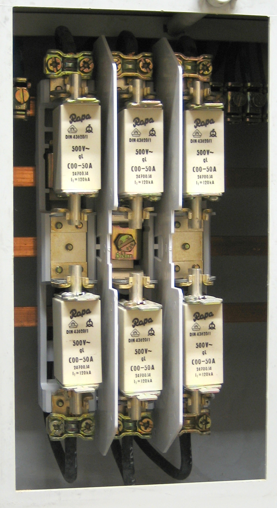
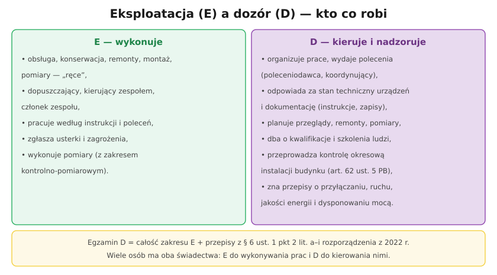

# 33.01 — Zakres egzaminu na stanowisku dozoru

> **Moduł:** [33 — Dozór (D)](README.md) · **Oznaczenia:** 📋 · **Zakres SEP:** dozór (D), § 6 ust. 1 pkt 2 · **Status:** ✅ pełny
>
> **Czytaj:**
>
> - [Zakres egzaminu → moduły](../../sep/zakres.md)
> - [Rozporządzenie MKiŚ z 1 lipca 2022 r. — Dz.U. 2022 poz. 1392](https://api.sejm.gov.pl/eli/acts/DU/2022/1392/text.html) (§ 6)

← (początek modułu) · [spis modułu](README.md) · [następny temat →](33.02-obowiazki-osoby-dozoru.md)

## Po co to jest

Świadectwo **dozoru (D)** jest potrzebne każdemu, kto kieruje pracami innych, wydaje polecenia, odpowiada za stan urządzeń albo przeprowadza kontrole okresowe budynków. Egzamin na D obejmuje **cały zakres E** oraz dodatkowe przepisy — o przyłączaniu, jakości energii, dokumentacji, racjonalnym użytkowaniu energii i dysponowaniu mocą. Ten temat pokazuje, co dokładnie dochodzi i gdzie to jest w repozytorium.

## Po ludzku

**§ 6 ust. 1 pkt 2 rozporządzenia z 2022 r.** — na stanowisku dozoru sprawdza się znajomość:

- **(a)** przepisów o **przyłączaniu** urządzeń do sieci, **dostarczaniu energii**, prowadzeniu ruchu i eksploatacji → [33.03](33.03-przylaczanie-do-sieci-i-dostarczanie-energii.md), [14](../14-od-slupa-do-gniazdka/README.md),
- **(b)** zasad **programowania pracy** urządzeń z uwzględnieniem **racjonalnego użytkowania energii** → [33.05](33.05-racjonalne-uzytkowanie-energii.md),
- **(c)** przepisów o eksploatacji i **prowadzeniu dokumentacji** → [33.04](33.04-prowadzenie-dokumentacji-technicznej-i.md), [29](../29-eksploatacja/README.md),
- **(d)** przepisów o **budowie urządzeń**, norm i **warunków technicznych** → [32](../32-przepisy-i-normy/README.md) i moduły techniczne,
- **(e)** postępowania przy **awarii, pożarze**, zagrożeniu → [30](../30-pozar-i-awaria/README.md), [20](../20-diagnostyka-usterek/README.md),
- **(f)** przepisów **BHP**, ppoż., pierwszej pomocy, ochrony środowiska → [28](../28-bhp-przy-urzadzeniach/README.md), [31](../31-pierwsza-pomoc/README.md),
- **(g)** postępowania przy awarii, pożarze lub zagrożeniu **bezpieczeństwa ruchu urządzeń przyłączonych do sieci** → [33.06](33.06-dysponowanie-moca-i-postepowanie-przy.md),
- **(h)** zasad **dysponowania mocą** → [33.06](33.06-dysponowanie-moca-i-postepowanie-przy.md),
- **(i)** zasad wykonywania prac: obsługi, konserwacji, remontu, montażu, kontrolno-pomiarowych → [19](../19-prace-krok-po-kroku/README.md), [23](../23-pomiary-odbiorcze-i-okresowe/README.md), [29](../29-eksploatacja/README.md).

**Jak wygląda egzamin D w praktyce:** komisja pyta mniej o „jak podłączyć”, a bardziej o „kto odpowiada”, „na jakiej podstawie”, „co musi być w dokumentacji”, „jak zorganizować pracę”. Dobra odpowiedź zawiera **przepis** (choćby nazwę aktu), **procedurę** i **odpowiedzialność**.

## Jak to wygląda

*Na co patrzeć: osoba dozoru odpowiada za takie urządzenie „całościowo” — za jego stan, instrukcję, przeglądy, ludzi, którzy przy nim pracują, i za to, co się dzieje, gdy trzeba ograniczyć pobór mocy.*

## Schemat

## Pojęcia

| Pojęcie | Po ludzku | Termin normowy / symbol |
|---------|-----------|-------------------------|
| Stanowisko dozoru | Kierowanie pracą i nadzór nad eksploatacją | § 4 ust. 1 pkt 2 |
| Zakres egzaminu D | Wiedza wymagana od dozoru | § 6 ust. 1 pkt 2 lit. a–i |
| Prowadzenie ruchu | Bieżące sterowanie pracą sieci i urządzeń | — |
| Dysponowanie mocą | Zarządzanie mocą w systemie | — |
| IRiESD | Instrukcja ruchu i eksploatacji sieci dystrybucyjnej | dokument OSD |

## Liczby do zapamiętania

| Wielkość | Wartość | Kiedy obowiązuje | Źródło |
|----------|---------|------------------|--------|
| Obszary egzaminu D | **9** (lit. a–i) + cały zakres E | stanowisko dozoru | rozp. z 2022 r., § 6 |
| Ważność świadectwa D | **5 lat** | — | Prawo energetyczne, art. 54 ust. 1aa |
| Kontrola okresowa budynku | wymaga kwalifikacji **D** | art. 62 ust. 5 PB | 32.03 |

## W praktyce

- **Przygotowanie do D:** najpierw zakres E (moduły 00–32), potem ten moduł i przepisy z modułu 32.
- **Na egzaminie** odpowiadaj trójstopniowo: przepis → procedura → odpowiedzialność.
- **W pracy** osoba D często nie wykonuje prac sama — ale musi umieć ocenić, czy wykonano je poprawnie.

## Błędy i zagrożenia

- **Traktowanie D jako „wyższego E”** — to inna rola: organizacja i odpowiedzialność, nie tylko wiedza techniczna.
- **Podpisywanie kontroli okresowej z samym E.**
- **Brak znajomości IRiESD swojego operatora** przy obiektach przyłączonych do SN.

## Przykład

**Zadanie.** Kierownik utrzymania ruchu w zakładzie (moc umowna 800 kW) przygotowuje się do egzaminu D. Które obszary ze zbioru a–i są dla niego szczególnie ważne?

**Rozwiązanie.** **(a)** przyłączanie i dostarczanie energii — zakład ma umowę z OSD i grupę przyłączeniową III; **(b)** racjonalne użytkowanie — moc umowna, kompensacja mocy biernej, audyt; **(c)** dokumentacja; **(g)** i **(h)** — przy mocy umownej ≥ 300 kW zakład jest objęty planem ograniczeń (stopnie zasilania); plus BHP (f) i organizacja prac (i).

## Pytania SEP

1. **Czym różni się zakres egzaminu na stanowisku dozoru od zakresu na stanowisku eksploatacji?**

Odpowiedź

Egzamin na stanowisku dozoru obejmuje cały zakres wymagany na stanowisku eksploatacji oraz dodatkowo znajomość: przepisów dotyczących przyłączania urządzeń i instalacji do sieci, dostarczania energii, prowadzenia ruchu i eksploatacji; zasad programowania pracy urządzeń z uwzględnieniem racjonalnego użytkowania energii; przepisów o prowadzeniu dokumentacji technicznej i eksploatacyjnej; przepisów o budowie urządzeń, norm i warunków technicznych; zasad postępowania w razie awarii i zagrożenia bezpieczeństwa ruchu urządzeń przyłączonych do sieci; zasad dysponowania mocą; przepisów BHP, ppoż., pierwszej pomocy i ochrony środowiska (§ 6 ust. 1 pkt 2 rozporządzenia z 2022 r.).

## Sprawdź się

1. Dlaczego osoba dozoru musi znać przepisy o przyłączaniu, choć sama nie buduje przyłączy?

Odpowiedź

Bo odpowiada za urządzenia przyłączone do sieci: za zgodność z warunkami przyłączenia i umową (moc, zabezpieczenia, układ pomiarowy, jakość energii, moc bierna), za współpracę z operatorem (wyłączenia, przełączenia, ograniczenia) i za dokumentację wymaganą przy każdej zmianie przyłączenia.

## Źródła

- [Rozporządzenie MKiŚ z 1 lipca 2022 r. — Dz.U. 2022 poz. 1392](https://api.sejm.gov.pl/eli/acts/DU/2022/1392/text.html) (§ 4, § 6).
- [sep/zakres.md — zakres egzaminu i moduły](../../sep/zakres.md).

---

← (początek modułu) · [spis modułu](README.md) · [następny temat →](33.02-obowiazki-osoby-dozoru.md)
