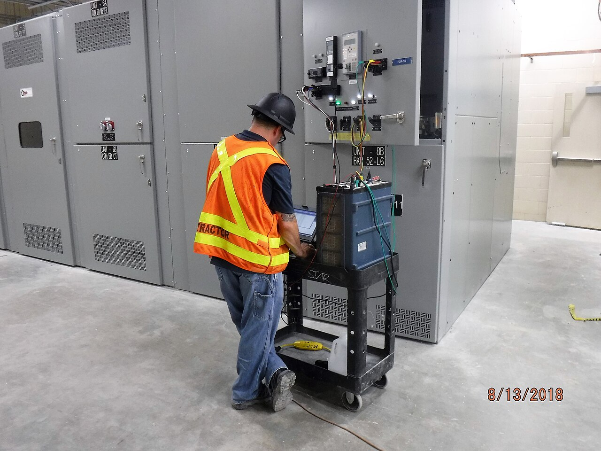
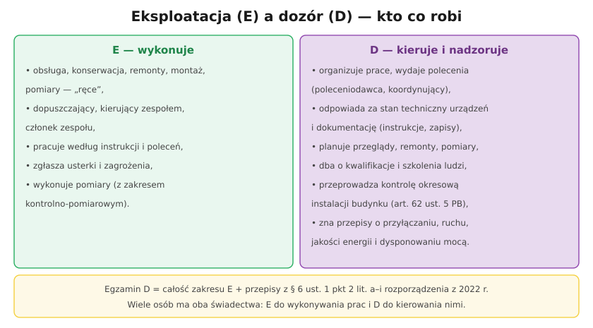

# 33.02 — Obowiązki osoby dozoru

> **Moduł:** [33 — Dozór (D)](README.md) · **Oznaczenia:** 📋 · **Zakres SEP:** dozór (D), § 6 ust. 1 pkt 2 · **Status:** ✅ pełny
>
> **Czytaj:**
>
> - [Rozporządzenie BHP przy urządzeniach energetycznych — t.j. Dz.U. 2021 poz. 1210](https://api.sejm.gov.pl/eli/acts/DU/2021/1210/text.html)
> - Organizacja pracy: [28.01](../28-bhp-przy-urzadzeniach/28.01-organizacja-pracy-i-polecenia.md)

[← poprzedni temat](33.01-zakres-egzaminu-na-stanowisku-dozoru.md) · [spis modułu](README.md) · [następny temat →](33.03-przylaczanie-do-sieci-i-dostarczanie-energii.md)

## Po co to jest

Osoba dozoru to „kierownik” eksploatacji: od niej zależy, czy urządzenia są sprawne, czy ludzie pracują bezpiecznie i czy dokumentacja jest kompletna. Na egzaminie D pada pytanie: „jakie są obowiązki osoby dozoru?”. Odpowiedź łączy przepisy BHP, Prawo budowlane i zasady eksploatacji.

## Po ludzku

**Organizacja i nadzór pracy:**

- pełni funkcje **poleceniodawcy** i **koordynującego** (świadectwo D) — wydaje polecenia, ustala kolejność łączeń, zezwala na przygotowanie i likwidację strefy pracy ([28.01](../28-bhp-przy-urzadzeniach/28.01-organizacja-pracy-i-polecenia.md)),
- dobiera ludzi do prac — z właściwymi kwalifikacjami i **upoważnieniami**,
- dba o wykaz prac w warunkach szczególnego zagrożenia i o ich organizację.

**Stan techniczny urządzeń:**

- **plan** oględzin, przeglądów, pomiarów i remontów (według instrukcji eksploatacji),
- decyzje o **wyłączeniu** urządzenia niesprawnego lub zagrażającego,
- **przyjmowanie do eksploatacji** po montażu i remoncie ([29.05](../29-eksploatacja/29.05-przyjmowanie-urzadzen-do-eksploatacji.md)).

**Dokumentacja:**

- opracowanie i aktualizacja **instrukcji eksploatacji** i instrukcji organizacji bezpiecznej pracy (w imieniu pracodawcy),
- nadzór nad zapisami eksploatacyjnymi, protokołami, ewidencją sprzętu ochronnego ([33.04](33.04-prowadzenie-dokumentacji-technicznej-i.md)).

**Ludzie:**

- **szkolenia** stanowiskowe i okresowe, instruktaże przed pracą,
- kontrola, czy ludzie mają **ważne świadectwa** (5 lat) i badania lekarskie,
- egzekwowanie BHP i stosowania sprzętu ochronnego.

**Kontrole budynków:** osoba z D przeprowadza **kontrolę okresową instalacji elektrycznej** (art. 62 ust. 5 Prawa budowlanego) i podpisuje protokół ([32.03](../32-przepisy-i-normy/32.03-prawo-budowlane-kontrole-okresowe.md)).

**Współpraca z operatorem i odbiorcami:** uzgadnianie wyłączeń, realizacja ograniczeń mocy, zgłaszanie zakłóceń ([33.06](33.06-dysponowanie-moca-i-postepowanie-przy.md)).

## Jak to wygląda

*Na co patrzeć: zespół wykonuje badania — ale ktoś musiał je zaplanować, wydać polecenie, przygotować urządzenia i przyjąć wyniki. To praca dozoru.*

## Schemat

## Pojęcia

| Pojęcie | Po ludzku | Termin normowy / symbol |
|---------|-----------|-------------------------|
| Poleceniodawca | Wydaje polecenia pisemne | świadectwo D |
| Koordynujący | Koordynuje pracę i łączenia | świadectwo D |
| Upoważnienie | Zgoda pracodawcy na wykonywanie określonych prac | § 5 rozp. BHP |
| Plan przeglądów | Harmonogram oględzin, przeglądów, pomiarów | instrukcja eksploatacji |
| Kontrola okresowa | Badanie instalacji budynku | art. 62 PB |

## Liczby do zapamiętania

| Wielkość | Wartość | Kiedy obowiązuje | Źródło |
|----------|---------|------------------|--------|
| Ważność świadectw podwładnych | **5 lat** | kontrola przez dozór | art. 54 ust. 1aa PE |
| Przechowywanie poleceń | **≥ 90 dni** | po zakończeniu pracy | rozp. BHP, § 28 ust. 4 |
| Łączenie funkcji | najwyżej **2** | praca na polecenie | rozp. BHP, § 30 ust. 3 |
| Kontrola instalacji budynku | **≥ co 5 lat**, przez osobę z D | art. 62 PB | 32.03 |

## W praktyce

- **Kalendarz** terminów: świadectwa, badania lekarskie, szkolenia BHP, badania sprzętu ochronnego, przeglądy i pomiary — w jednym miejscu.
- **Odprawa przed pracą** — krótka, ale udokumentowana.
- **Odwaga, by wyłączyć** — dozór ma prawo i obowiązek wyłączyć urządzenie zagrażające, nawet kosztem przestoju.

## Błędy i zagrożenia

- **„Papierowy” dozór** — podpisy bez faktycznego nadzoru.
- **Dopuszczanie ludzi z wygasłymi świadectwami** lub bez upoważnienia.
- **Brak reakcji na zgłoszone usterki** — odpowiedzialność za skutki spada na dozór.

## Przykład

**Zadanie.** Monter zgłasza, że rozłącznik w polu SN „grzeje się” (termowizja: +35 °C względem sąsiednich faz). Co robi osoba dozoru?

**Rozwiązanie.** Ocenia zagrożenie (ΔT > 15 °C — pilne), uzgadnia z operatorem lub odbiorcami **wyłączenie** pola, wydaje **polecenie** na przegląd (zespół, dopuszczenie, uziemienie), organizuje naprawę (dokręcenie, wymianę styków), zleca **pomiary** po naprawie, **przyjmuje** urządzenie do ponownej eksploatacji i dba o **zapis** w dokumentacji.

## Pytania SEP

1. **Jakie są obowiązki osoby na stanowisku dozoru?**

Odpowiedź

Osoba dozoru kieruje czynnościami osób wykonujących prace eksploatacyjne i sprawuje nadzór nad eksploatacją urządzeń: organizuje prace i wydaje polecenia (funkcje poleceniodawcy i koordynującego), dobiera pracowników z wymaganymi kwalifikacjami i upoważnieniami, planuje i nadzoruje oględziny, przeglądy, pomiary i remonty, decyduje o wyłączeniu niesprawnych urządzeń i przyjmowaniu ich do eksploatacji, nadzoruje prowadzenie dokumentacji technicznej i eksploatacyjnej (instrukcje, zapisy, protokoły, ewidencja sprzętu ochronnego), dba o szkolenia i przestrzeganie przepisów BHP i ppoż., współpracuje z operatorem sieci (wyłączenia, ograniczenia mocy) oraz może przeprowadzać kontrole okresowe instalacji w budynkach.

## Sprawdź się

1. Czy osoba dozoru odpowiada za wypadek, jeśli nie była na miejscu pracy?

Odpowiedź

Może odpowiadać, jeśli wypadek wynikał z błędów organizacji: złego polecenia, dopuszczenia osoby bez kwalifikacji, braku przygotowania strefy pracy, nieaktualnej instrukcji czy niesprawnego sprzętu ochronnego. Dozór odpowiada za organizację i nadzór, nie tylko za to, co zobaczył osobiście.

## Źródła

- [Rozporządzenie BHP przy urządzeniach energetycznych — t.j. Dz.U. 2021 poz. 1210](https://api.sejm.gov.pl/eli/acts/DU/2021/1210/text.html) (§ 2, § 5, § 28–33).
- Ustawa Prawo budowlane, art. 62 ust. 5.
- Kodeks pracy, art. 212 (obowiązki osoby kierującej pracownikami).

---

[← poprzedni temat](33.01-zakres-egzaminu-na-stanowisku-dozoru.md) · [spis modułu](README.md) · [następny temat →](33.03-przylaczanie-do-sieci-i-dostarczanie-energii.md)
