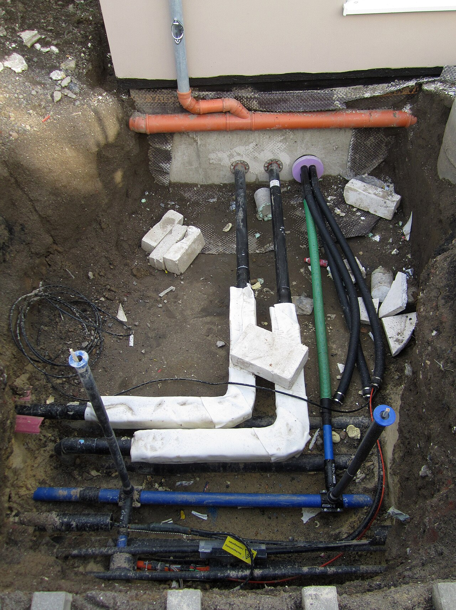
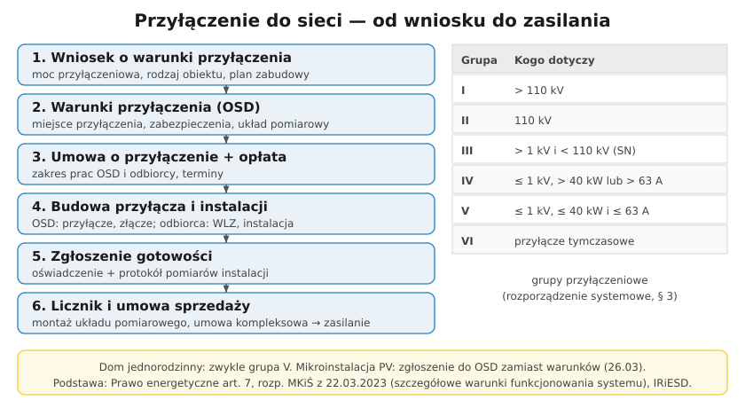
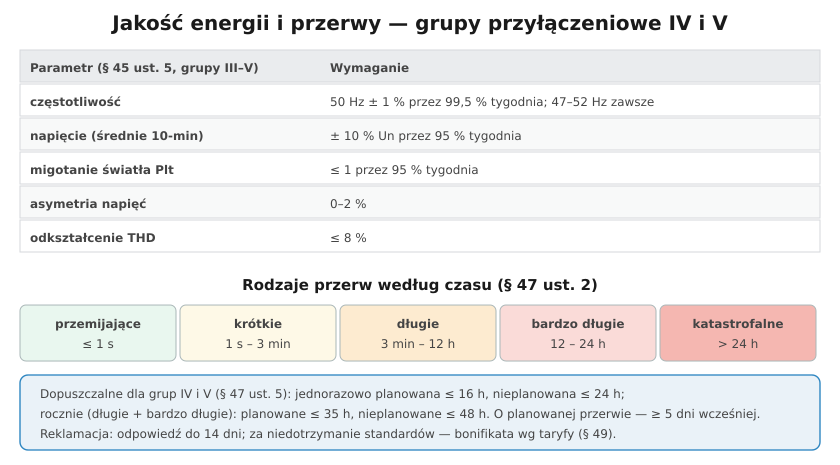

# 33.03 — Przyłączanie do sieci i dostarczanie energii — przepisy

> **Moduł:** [33 — Dozór (D)](README.md) · **Oznaczenia:** 📋 · **Zakres SEP:** dozór (D), § 6 ust. 1 pkt 2 · **Status:** ✅ pełny
>
> **Czytaj:**
>
> - [Rozporządzenie MKiŚ z 22 marca 2023 r. w sprawie szczegółowych warunków funkcjonowania systemu elektroenergetycznego (Dz.U. 2023 poz. 819) — tekst w serwisie ENEA Operator (PDF)](https://www.operator.enea.pl/sites/operator/files/2025-06/D20230819-D20232280.pdf)
> - Od słupa do gniazdka: [14](../14-od-slupa-do-gniazdka/README.md)

[← poprzedni temat](33.02-obowiazki-osoby-dozoru.md) · [spis modułu](README.md) · [następny temat →](33.04-prowadzenie-dokumentacji-technicznej-i.md)

## Po co to jest

Każdy obiekt zasilany z sieci jest do niej **przyłączony** według określonych reguł: wniosek, warunki przyłączenia, umowa, budowa, licznik, umowa sprzedaży. Operator ma obowiązek dostarczać energię o określonej **jakości** i z ograniczonymi **przerwami**. Osoba dozoru musi znać te reguły — przy rozbudowie zakładu, zmianie mocy, reklamacji jakości napięcia.

## Po ludzku

**Podstawy prawne:**

- **Prawo energetyczne, art. 7** — obowiązek operatora zawarcia umowy o przyłączenie, jeśli są techniczne i ekonomiczne warunki,
- **rozporządzenie systemowe** — Ministra Klimatu i Środowiska z **22 marca 2023 r.** w sprawie szczegółowych warunków funkcjonowania systemu elektroenergetycznego (Dz.U. 2023 poz. 819, t.j. 2025 poz. 919),
- **IRiESD** — instrukcja ruchu i eksploatacji sieci dystrybucyjnej danego operatora (szczegóły techniczne),
- **taryfa** operatora — opłaty, bonifikaty, zasady rozliczeń.

**Grupy przyłączeniowe (§ 3):**

- **I** — powyżej 110 kV, **II** — 110 kV, **III** — powyżej 1 kV i poniżej 110 kV (SN),
- **IV** — do 1 kV, moc przyłączeniowa powyżej 40 kW lub zabezpieczenie przedlicznikowe powyżej 63 A,
- **V** — do 1 kV, moc do 40 kW i zabezpieczenie do 63 A (typowy dom),
- **VI** — przyłączenie tymczasowe (np. plac budowy).

**Procedura:** wniosek o warunki przyłączenia → **warunki przyłączenia** (OSD) → **umowa o przyłączenie** i opłata → budowa (OSD — przyłącze i złącze; odbiorca — instalacja za złączem) → zgłoszenie gotowości z **protokołem pomiarów** → montaż **układu pomiarowego** → **umowa sprzedaży / kompleksowa** → zasilanie.

**Jakość energii (§ 45 ust. 5 — grupy III–V, sieć bez zakłóceń):**

- częstotliwość **50 Hz ± 1 %** przez 99,5 % tygodnia,
- napięcie (średnie 10-minutowe) **± 10 %** napięcia znamionowego przez 95 % tygodnia,
- wskaźnik migotania światła **Plt ≤ 1**, asymetria **0–2 %**, odkształcenie **THD ≤ 8 %**.

**Przerwy (§ 47):** przemijające (≤ 1 s), krótkie (≤ 3 min), długie (≤ 12 h), bardzo długie (≤ 24 h), katastrofalne (> 24 h). Dla grup **IV i V**: jednorazowa przerwa **planowana ≤ 16 h**, **nieplanowana ≤ 24 h**; rocznie planowane ≤ **35 h**, nieplanowane ≤ **48 h**.

**Standardy obsługi (§ 49):** zgłoszenia awarii przez całą dobę; o przerwie planowanej operator powiadamia **co najmniej 5 dni wcześniej**; odpowiedź na reklamację **do 14 dni**; pomiar jakości energii na wniosek odbiorcy (jeśli parametry są dotrzymane — koszt pokrywa wnioskujący); **bonifikaty** za niedotrzymanie standardów według taryfy.

## Jak to wygląda

*Na co patrzeć: kabel energetyczny w rurze osłonowej — przyłącze buduje operator do złącza, a za złączem zaczyna się instalacja odbiorcy. Granicę ustala umowa o przyłączenie.*

## Schemat

## Pojęcia

| Pojęcie | Po ludzku | Termin normowy / symbol |
|---------|-----------|-------------------------|
| Warunki przyłączenia | Dokument OSD: jak i gdzie przyłączyć | Prawo energetyczne, art. 7 |
| Umowa o przyłączenie | Umowa na budowę przyłącza | jw. |
| Moc przyłączeniowa | Moc, na którą zbudowano przyłącze | — |
| Moc umowna | Moc zamówiona w umowie | — |
| Grupa przyłączeniowa | Kategoria przyłączanego podmiotu | § 3 rozp. systemowego |
| IRiESD | Szczegółowe zasady operatora | — |
| Bonifikata | Rekompensata za niedotrzymanie standardów | taryfa |

## Liczby do zapamiętania

| Wielkość | Wartość | Kiedy obowiązuje | Źródło |
|----------|---------|------------------|--------|
| Grupa V | **≤ 1 kV, ≤ 40 kW, ≤ 63 A** | typowy dom | rozp. systemowe, § 3 |
| Napięcie | **± 10 %** Un przez 95 % tygodnia | grupy III–V | § 45 ust. 5 |
| THD | **≤ 8 %** | jw. | jw. |
| Przerwa jednorazowa (IV–V) | planowana **≤ 16 h**, nieplanowana **≤ 24 h** | — | § 47 ust. 5 |
| Przerwy roczne (IV–V) | planowane **≤ 35 h**, nieplanowane **≤ 48 h** | długie i bardzo długie | jw. |
| Powiadomienie o przerwie planowanej | **≥ 5 dni** wcześniej | — | § 49 |
| Odpowiedź na reklamację | **≤ 14 dni** | — | § 49 |

## W praktyce

- **Zwiększenie mocy** (pompa ciepła, wallbox, nowa hala) — wniosek o nowe warunki przyłączenia; nie „dokładaj” mocy bez umowy.
- **Wyłączenia PV przy 253 V** ([26.03](../26-fotowoltaika-pompy-wallboxy/26.03-falownik-i-przylaczenie-mikroinstalacji.md)) — napięcie powyżej +10 % to niedotrzymanie parametrów; reklamacja do OSD z danymi.
- **Przerwy powyżej limitów** — wniosek o bonifikatę według taryfy.
- **Znaj swoje dokumenty:** warunki przyłączenia, umowa, IRiESD, taryfa — to podstawa każdej rozmowy z operatorem.

## Błędy i zagrożenia

- **Przekroczenie mocy umownej / przyłączeniowej** — opłaty, wybijanie zabezpieczeń, odmowa przyłączenia nowych urządzeń.
- **Powoływanie się na stare rozporządzenie systemowe z 2007 r.** — od 2023 r. obowiązuje nowe.
- **Reklamacja bez pomiaru** — zawsze dołącz rejestrację napięcia (np. z falownika lub analizatora).

## Przykład

**Zadanie.** Odbiorca w grupie V skarży się, że w sobotę od 8:00 do 20:00 nie było prądu (prace planowane, ogłoszenie pojawiło się w piątek). Czy operator dotrzymał standardów?

**Rozwiązanie.** Czas przerwy planowanej — **12 h ≤ 16 h** — mieści się w limicie jednorazowym. Ale powiadomienie **dzień wcześniej** narusza wymóg **co najmniej 5 dni** (§ 49). Odbiorca może złożyć reklamację i wniosek o **bonifikatę** według taryfy operatora.

## Pytania SEP

1. **Jakie parametry jakościowe energii elektrycznej musi dotrzymać operator dla odbiorców przyłączonych do sieci niskiego napięcia?**

Odpowiedź

Według rozporządzenia w sprawie szczegółowych warunków funkcjonowania systemu elektroenergetycznego (2023 r., § 45) dla grup przyłączeniowych III–V, w sieci pracującej bez zakłóceń: częstotliwość 50 Hz ±1% przez 99,5% tygodnia (47–52 Hz przez cały tydzień); średnie 10-minutowe wartości napięcia w granicach ±10% napięcia znamionowego przez 95% czasu tygodnia; wskaźnik długookresowego migotania światła Plt nie większy niż 1 przez 95% czasu; asymetria napięć do 2%; współczynnik odkształcenia THD nie większy niż 8%. Rozporządzenie określa też dopuszczalne czasy przerw: dla grup IV i V przerwa planowana jednorazowo do 16 h, nieplanowana do 24 h, łącznie w roku odpowiednio 35 h i 48 h.

2. **Jak przebiega przyłączenie obiektu do sieci dystrybucyjnej?**

Odpowiedź

Podmiot składa do operatora wniosek o określenie warunków przyłączenia (z mocą przyłączeniową i danymi obiektu). Operator wydaje warunki przyłączenia, a następnie strony zawierają umowę o przyłączenie, określającą zakres prac, terminy i opłatę. Operator buduje przyłącze do złącza, odbiorca — instalację za złączem. Po zgłoszeniu gotowości (z protokołem sprawdzeń instalacji) operator montuje układ pomiarowy, a odbiorca zawiera umowę sprzedaży lub kompleksową — wtedy następuje załączenie zasilania. Podstawą są art. 7 Prawa energetycznego, rozporządzenie systemowe i IRiESD operatora.

## Sprawdź się

1. Dlaczego operator w warunkach przyłączenia określa moc przyłączeniową i zabezpieczenie przedlicznikowe?

Odpowiedź

Bo na ich podstawie dobiera przekroje przyłącza, transformator i zabezpieczenia w sieci, a także grupę przyłączeniową i taryfę. Zabezpieczenie przedlicznikowe ogranicza pobór do mocy, na którą zbudowano przyłącze, i chroni sieć przed przeciążeniem przez odbiorcę.

## Źródła

- [Rozporządzenie MKiŚ z 22 marca 2023 r. — tekst (ENEA Operator, PDF)](https://www.operator.enea.pl/sites/operator/files/2025-06/D20230819-D20232280.pdf).
- [arslege — § 45 parametry jakościowe](https://arslege.pl/parametry-jakosciowe-energii-elektrycznej-w-przypadku-sieci-funkcjonujacej-bez-zaklocen/k2078/a146052/); [§ 47 rodzaje przerw](https://arslege.pl/rodzaje-przerw-w-dostarczaniu-energii-elektrycznej/k2078/a146056/); [§ 49 standardy obsługi](https://arslege.pl/standardy-jakosciowe-obslugi-odbiorcow/k2078/a146060/).
- Ustawa Prawo energetyczne, art. 7.

---

[← poprzedni temat](33.02-obowiazki-osoby-dozoru.md) · [spis modułu](README.md) · [następny temat →](33.04-prowadzenie-dokumentacji-technicznej-i.md)
