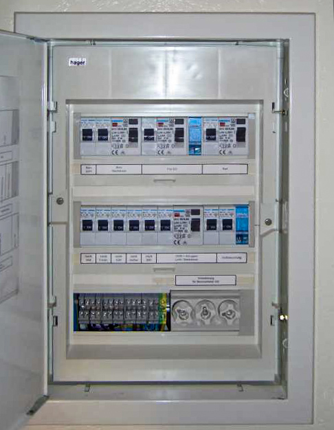
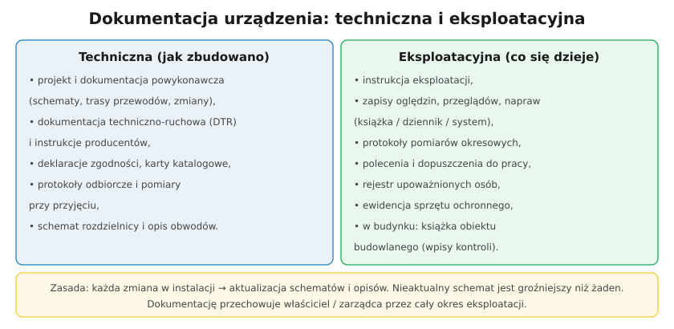

# 33.04 — Prowadzenie dokumentacji technicznej i eksploatacyjnej

> **Moduł:** [33 — Dozór (D)](README.md) · **Oznaczenia:** 📋 · **Zakres SEP:** dozór (D), § 6 ust. 1 pkt 2 · **Status:** ✅ pełny
>
> **Czytaj:**
>
> - Dokumentacja: [29.03](../29-eksploatacja/29.03-dokumentacja-techniczna-i-eksploatacyjna.md), instrukcja: [29.02](../29-eksploatacja/29.02-instrukcja-eksploatacji.md)

[← poprzedni temat](33.03-przylaczanie-do-sieci-i-dostarczanie-energii.md) · [spis modułu](README.md) · [następny temat →](33.05-racjonalne-uzytkowanie-energii.md)

## Po co to jest

Moduł 29 opisuje, **jakie** dokumenty istnieją. Na stanowisku dozoru pytanie brzmi inaczej: **jak prowadzić** dokumentację, żeby była kompletna, aktualna i dostępna, kto za nią odpowiada i jak długo się ją przechowuje. To obszar (c) egzaminu D.

## Po ludzku

**Kto odpowiada:** właściciel / pracodawca. W praktyce dokumentację prowadzi i nadzoruje osoba dozoru.

**System dokumentacji eksploatacyjnej:**

- **ewidencja urządzeń** — lista urządzeń z danymi (typ, numer, lokalizacja, data przyjęcia do eksploatacji),
- **instrukcje eksploatacji** dla urządzeń (§ 4 rozporządzenia BHP), **instrukcja organizacji bezpiecznej pracy** (§ 33), instrukcje stanowiskowe,
- **harmonogram** oględzin, przeglądów, pomiarów, remontów,
- **zapisy** z wykonanych czynności: dziennik operacyjny / książka urządzenia / system komputerowy,
- **protokoły** pomiarów i prób, **protokoły przyjęcia** do eksploatacji,
- **dokumentacja prac**: polecenia pisemne (min. 90 dni), zapisy dopuszczeń,
- **ewidencja sprzętu ochronnego** z terminami badań (§ 26),
- **wykaz osób upoważnionych** z zakresem i okresem (§ 5),
- **dokumentacja zdarzeń**: awarie, wypadki, zakłócenia — przyczyny i działania.

**Dokumentacja techniczna** — aktualna dokumentacja powykonawcza, schematy, DTR; **każda zmiana** w instalacji → aktualizacja schematów i instrukcji.

**Budynek** — protokoły kontroli okresowych w **książce obiektu budowlanego** (art. 64 PB; także c-KOB), przechowywanej przez cały okres użytkowania.

**Dobre praktyki:**

- jedno miejsce (teczka, system), jednoznaczne oznaczenia urządzeń zgodne z opisami na obiekcie (§ 7 rozporządzenia BHP),
- wersjonowanie — data i autor zmiany,
- dostępność — instrukcja przy urządzeniu, kopia u dozoru,
- przegląd dokumentacji co najmniej przy każdej zmianie i okresowo.

## Jak to wygląda

*Na co patrzeć: oznaczenia na obiekcie muszą być takie same jak w dokumentacji — inaczej schemat nie pomoże przy przełączeniach.*

## Schemat

## Pojęcia

| Pojęcie | Po ludzku | Termin normowy / symbol |
|---------|-----------|-------------------------|
| Ewidencja urządzeń | Lista urządzeń w eksploatacji | — |
| Dziennik operacyjny | Zapis łączeń i zdarzeń | — |
| Harmonogram eksploatacji | Plan przeglądów i pomiarów | instrukcja eksploatacji |
| Oznaczenie urządzeń | Jednoznaczna identyfikacja na obiekcie | § 7 rozp. BHP |
| Książka obiektu budowlanego | Rejestr kontroli budynku | art. 64 PB |

## Liczby do zapamiętania

| Wielkość | Wartość | Kiedy obowiązuje | Źródło |
|----------|---------|------------------|--------|
| Polecenia pisemne | **≥ 90 dni** | po zakończeniu pracy | rozp. BHP, § 28 ust. 4 |
| Książka obiektu | **cały okres** użytkowania | budynki | Prawo budowlane |
| Instrukcja eksploatacji | **11** elementów | każde urządzenie / instalacja | rozp. BHP, § 4 |

## W praktyce

- **Przy przejęciu obiektu** — inwentaryzacja dokumentacji: czego brakuje, co jest nieaktualne; plan uzupełnienia.
- **Po awarii** — opis zdarzenia, przyczyna, działania, wnioski (zmiana instrukcji?).
- **Digitalizacja** — skany protokołów, zdjęcia rozdzielnic, system przypomnień o terminach.

## Błędy i zagrożenia

- **Dokumentacja „do szuflady”** — nieaktualna, nikt jej nie zna.
- **Różne oznaczenia** na obiekcie i w schemacie — ryzyko wyłączenia nie tego pola.
- **Brak zapisu zmian** — kolejna osoba pracuje według starego schematu.

## Przykład

**Zadanie.** W zakładzie dobudowano rozdzielnię z trzema nowymi odpływami i baterią kondensatorów. Jakie dokumenty musi zaktualizować dozór?

**Rozwiązanie.** Schemat jednokreskowy i dokumentację powykonawczą, **ewidencję urządzeń**, **instrukcję eksploatacji** (nowe urządzenia, łączenia, kondensatory — rozładowanie przed pracą), harmonogram przeglądów i pomiarów, **protokoły przyjęcia** do eksploatacji z pomiarami, oznaczenia na obiekcie, a jeśli zmieniły się zagrożenia — instrukcję organizacji bezpiecznej pracy i szkolenie ludzi.

## Pytania SEP

1. **Jak należy prowadzić dokumentację techniczną i eksploatacyjną urządzeń?**

Odpowiedź

Dokumentację prowadzi właściciel lub pracodawca, a nadzoruje ją osoba dozoru. Obejmuje ona dokumentację techniczną (projekt i dokumentację powykonawczą, schematy, DTR, deklaracje, protokoły odbiorcze) oraz eksploatacyjną (instrukcje eksploatacji i organizacji bezpiecznej pracy, ewidencję urządzeń, harmonogramy i zapisy oględzin, przeglądów, pomiarów i remontów, protokoły, dokumentację poleceń i dopuszczeń, ewidencję sprzętu ochronnego, wykaz osób upoważnionych, opisy awarii). Dokumentacja musi być aktualizowana po każdej zmianie, zgodna z oznaczeniami na obiekcie, dostępna dla osób obsługi i przechowywana przez wymagany czas (np. polecenia co najmniej 90 dni, książka obiektu przez cały okres użytkowania).

## Sprawdź się

1. Dlaczego oznaczenia urządzeń na obiekcie muszą być zgodne z dokumentacją?

Odpowiedź

Bo łączenia i przygotowanie miejsca pracy wykonuje się według schematów i poleceń. Jeśli pole w dokumentacji nazywa się inaczej niż na obiekcie, łatwo wyłączyć niewłaściwe pole, a pracować przy tym, które dalej jest pod napięciem.

## Źródła

- [Rozporządzenie BHP przy urządzeniach energetycznych — t.j. Dz.U. 2021 poz. 1210](https://api.sejm.gov.pl/eli/acts/DU/2021/1210/text.html) (§ 4, 5, 7, 26, 28, 33).
- Ustawa Prawo budowlane, art. 62, 64.

---

[← poprzedni temat](33.03-przylaczanie-do-sieci-i-dostarczanie-energii.md) · [spis modułu](README.md) · [następny temat →](33.05-racjonalne-uzytkowanie-energii.md)
