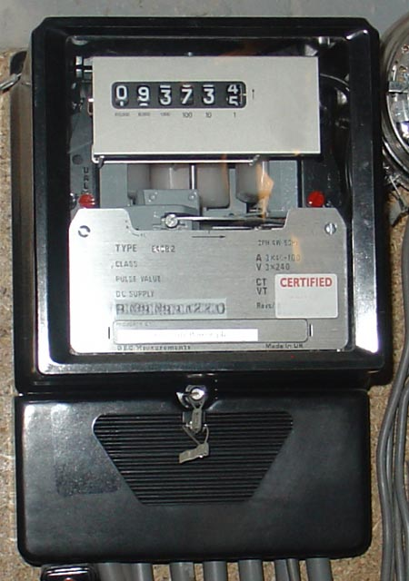
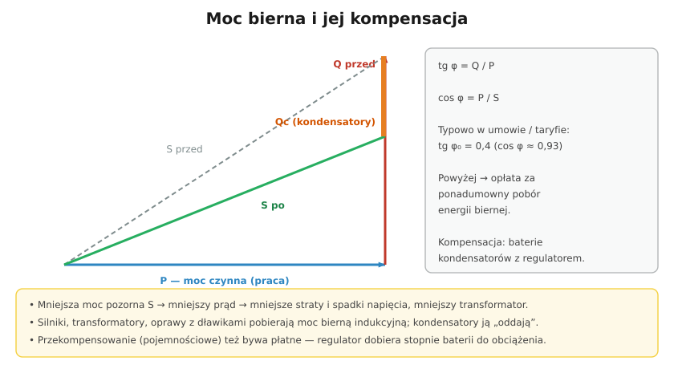

# 33.05 — Racjonalne użytkowanie energii

> **Moduł:** [33 — Dozór (D)](README.md) · **Oznaczenia:** 📋 · **Zakres SEP:** dozór (D), § 6 ust. 1 pkt 2 · **Status:** ✅ pełny
>
> **Czytaj:**
>
> - Moc czynna, bierna i pozorna: [02.04](../02-prad-przemienny-230-400/02.04-moc-czynna-bierna-i-pozorna-wspolczynnik-mocy.md)
> - Taryfy i moc przyłączeniowa: [14.05](../14-od-slupa-do-gniazdka/14.05-moc-przylaczeniowa-i-taryfy.md)

[← poprzedni temat](33.04-prowadzenie-dokumentacji-technicznej-i.md) · [spis modułu](README.md) · [następny temat →](33.06-dysponowanie-moca-i-postepowanie-przy.md)

## Po co to jest

Obszar (b) egzaminu D to „programowanie pracy urządzeń z uwzględnieniem racjonalnego użytkowania energii”. W praktyce: dobrać moc umowną, nie płacić za energię bierną, przesuwać pobór do tańszych stref, stosować sprawne silniki i napędy, wiedzieć o obowiązkach z ustawy o efektywności energetycznej.

## Po ludzku

**Moc umowna i przyłączeniowa** — moc umowna (zamówiona) wpływa na opłaty dystrybucyjne. Za mała → opłaty za przekroczenia; za duża → płacisz za niewykorzystaną moc. Dozór analizuje profil poboru (maksima 15-minutowe) i koryguje moc umowną.

**Energia bierna** — silniki, transformatory, dławiki pobierają moc bierną indukcyjną. W taryfach OSD zwykle przyjmuje się **tg φ₀ = 0,4** (cos φ ≈ 0,93); powyżej — opłata za ponadumowny pobór energii biernej. Środek: **baterie kondensatorów** z regulatorem; przy odbiornikach z falownikami — także filtry. Uwaga na **przekompensowanie** (energia bierna pojemnościowa też bywa płatna) ([02.04](../02-prad-przemienny-230-400/02.04-moc-czynna-bierna-i-pozorna-wspolczynnik-mocy.md)).

**Programowanie pracy urządzeń:**

- **taryfy strefowe** — grzanie, ładowanie, pompy w tańszych strefach ([14.05](../14-od-slupa-do-gniazdka/14.05-moc-przylaczeniowa-i-taryfy.md)),
- **rozkładanie rozruchów** — nie wszystkie silniki naraz (szczyty mocy),
- **autokonsumpcja PV** — praca urządzeń w dzień ([26.03](../26-fotowoltaika-pompy-wallboxy/26.03-falownik-i-przylaczenie-mikroinstalacji.md)),
- **sterowanie zapotrzebowaniem** — wyłączanie odbiorników o niskim priorytecie przy szczytach.

**Sprawność urządzeń:** silniki co najmniej IE3 ([24.01](../24-silniki-i-napedy/24.01-silnik-indukcyjny-trojfazowy.md)), **falowniki** zamiast dławienia w pompach i wentylatorach, oświetlenie LED ze sterowaniem, transformatory o małych stratach, wyłączanie urządzeń na biegu jałowym.

**Ustawa o efektywności energetycznej (2016):** obowiązkowy **audyt energetyczny przedsiębiorstwa co 4 lata** dla dużych przedsiębiorców (zawiadomienie Prezesa URE). Trwa wdrażanie dyrektywy UE 2023/1791 — projekt zmian uzależnia obowiązek od **zużycia energii** (ok. 10 TJ ≈ 2,78 GWh rocznie — audyt; ok. 23,6 GWh — system zarządzania energią). Sprawdź aktualny stan przepisów.

## Jak to wygląda

*Na co patrzeć: dawne liczniki mierzyły tylko energię czynną. Odbiorcy większej mocy mają liczniki energii czynnej i biernej z rejestracją mocy 15-minutowej — na ich podstawie rozlicza się moc umowną i energię bierną.*

## Schemat

## Pojęcia

| Pojęcie | Po ludzku | Termin normowy / symbol |
|---------|-----------|-------------------------|
| Moc umowna | Moc zamówiona u operatora | — |
| Energia bierna | „Krążąca” energia pól magnetycznych i elektrycznych | var·h |
| tg φ | Stosunek mocy biernej do czynnej | Q / P |
| Kompensacja | Zmniejszanie poboru mocy biernej | baterie kondensatorów |
| Audyt energetyczny | Analiza zużycia i możliwości oszczędności | ustawa o efektywności energetycznej |
| Profil obciążenia | Przebieg poboru mocy w czasie | — |

## Liczby do zapamiętania

| Wielkość | Wartość | Kiedy obowiązuje | Źródło |
|----------|---------|------------------|--------|
| Typowe tg φ₀ | **0,4** (cos φ ≈ 0,93) | rozliczenie energii biernej | taryfy OSD |
| Audyt energetyczny | **co 4 lata** | duzi przedsiębiorcy (zasady w zmianie) | ustawa o efektywności energetycznej |
| Próg projektowany (EED) | ok. **10 TJ ≈ 2,78 GWh/rok** | audyt wg zużycia | projekt nowelizacji |
| Silniki | min. **IE3** (0,75–1000 kW) | nowe silniki w UE | rozp. (UE) 2019/1781 |

## W praktyce

- **Analiza faktur** — opłaty za moc, przekroczenia, energię bierną: szybkie źródło oszczędności.
- **Regulator baterii kondensatorów** — sprawdzaj okresowo, czy stopnie działają (kondensatory się starzeją, bezpieczniki się przepalają).
- **Przy pracach przy kondensatorach** — rozładowanie i uziemienie przed dotknięciem.
- **Programatory, sterowanie strefowe** ([10.03](../10-aparatura-modulowa/10.03-programatory-czasowe-i-wylaczniki-zmierzchowe.md)) — proste środki, duże efekty.

## Błędy i zagrożenia

- **Bateria kondensatorów bez regulacji** — przekompensowanie w nocy, przepięcia.
- **Kondensatory w sieci z dużą ilością harmonicznych** bez dławików — rezonans, przegrzewanie.
- **Zawyżona moc umowna „na zapas”** — stałe koszty.

## Przykład

**Zadanie.** Zakład pobiera 200 kW mocy czynnej przy cos φ = 0,8. Jaką moc bierną muszą skompensować kondensatory, żeby osiągnąć tg φ = 0,4?

**Rozwiązanie.** Przy cos φ = 0,8: tg φ₁ = 0,75 → $Q_1 = 200 \cdot 0{,}75 = 150$ kvar. Docelowo: $Q_2 = 200 \cdot 0{,}4 = 80$ kvar. Moc baterii: $Q_C = Q_1 - Q_2 = 70$ kvar. Moc pozorna spada z 250 kVA do $\sqrt{200^2 + 80^2} \approx 215$ kVA — o 14 % mniejszy prąd.

## Pytania SEP

1. **Na czym polega kompensacja mocy biernej i dlaczego się ją stosuje?**

Odpowiedź

Odbiorniki indukcyjne (silniki, transformatory, dławiki) pobierają z sieci moc bierną potrzebną do wytworzenia pól magnetycznych. Kompensacja polega na wytwarzaniu tej mocy na miejscu, najczęściej przez baterie kondensatorów załączane przez regulator, tak aby z sieci pobierana była głównie moc czynna. Zmniejsza to prąd i moc pozorną, a więc straty w przewodach i transformatorach, spadki napięcia oraz opłaty za ponadumowny pobór energii biernej (w taryfach zwykle przy tg φ powyżej 0,4). Należy unikać przekompensowania i uwzględniać harmoniczne (dławiki filtrujące).

2. **Jakie działania służą racjonalnemu użytkowaniu energii elektrycznej w zakładzie?**

Odpowiedź

Dobór mocy umownej do rzeczywistego profilu poboru, kompensacja mocy biernej, przesuwanie pracy urządzeń do tańszych stref czasowych i ograniczanie szczytów (rozkładanie rozruchów, sterowanie zapotrzebowaniem), stosowanie urządzeń o wysokiej sprawności (silniki co najmniej IE3, falowniki zamiast dławienia, oświetlenie LED ze sterowaniem, transformatory o małych stratach), eliminacja pracy jałowej, wykorzystanie energii z własnych źródeł, a także realizacja obowiązków z ustawy o efektywności energetycznej (audyt energetyczny) i wdrażanie jego zaleceń.

## Sprawdź się

1. Dlaczego przy kompensacji mocy biernej mniejszy jest prąd, skoro moc czynna się nie zmienia?

Odpowiedź

Bo prąd zależy od mocy pozornej: $I = S / (\sqrt{3} U)$. Kompensacja zmniejsza moc bierną, a więc i pozorną $S = \sqrt{P^2 + Q^2}$. Przy tej samej mocy czynnej przewody i transformator przenoszą mniejszy prąd.

## Źródła

- Ustawa z 20 maja 2016 r. o efektywności energetycznej; [Enerad — audyt energetyczny przedsiębiorstwa](https://enerad.pl/audyt-energetyczny-przedsiebiorstwa/).
- [Gramwzielone — projekt zmian: audyty i systemy zarządzania energią (2025)](https://www.gramwzielone.pl/?p=20334953).
- [02.04 — Moc czynna, bierna i pozorna](../02-prad-przemienny-230-400/02.04-moc-czynna-bierna-i-pozorna-wspolczynnik-mocy.md).

---

[← poprzedni temat](33.04-prowadzenie-dokumentacji-technicznej-i.md) · [spis modułu](README.md) · [następny temat →](33.06-dysponowanie-moca-i-postepowanie-przy.md)
