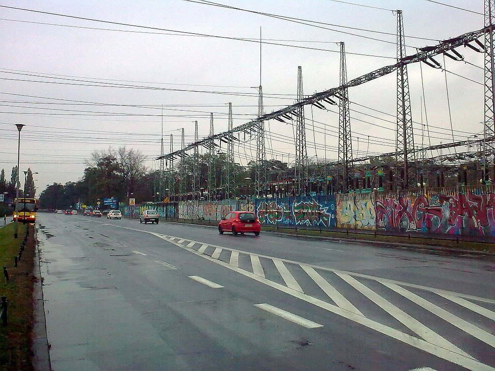
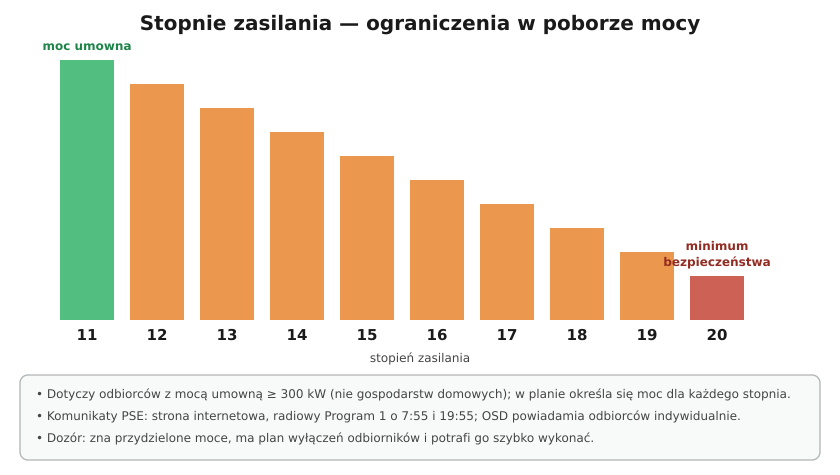

# 33.06 — Dysponowanie mocą i postępowanie przy zagrożeniu ruchu sieci

> **Moduł:** [33 — Dozór (D)](README.md) · **Oznaczenia:** 📋 · **Zakres SEP:** dozór (D), § 6 ust. 1 pkt 2 · **Status:** ✅ pełny
>
> **Czytaj:**
>
> - [Enerad — plan ograniczeń PSE i stopnie zasilania (2025)](https://enerad.pl/ure-zatwierdzil-plan-pse-nowe-zasady-ograniczen-pradu-dla-duzych-odbiorcow/)
> - Awaria i pożar: [30](../30-pozar-i-awaria/README.md)

[← poprzedni temat](33.05-racjonalne-uzytkowanie-energii.md) · [spis modułu](README.md) · (koniec modułu) →

## Po co to jest

Obszary (g) i (h) egzaminu D: postępowanie przy zagrożeniu bezpieczeństwa ruchu urządzeń przyłączonych do sieci i **dysponowanie mocą**. Dla zakładu z dużą mocą umowną to bardzo konkretne: co zrobić, gdy PSE ogłosi **20. stopień zasilania**, jak współpracować z dyspozytorem operatora, jak wyłączać i załączać zasilanie przy awarii.

## Po ludzku

**Kto dysponuje mocą w systemie:** **OSP** (PSE) — krajowa dyspozycja mocy, bilansuje wytwarzanie i pobór; **OSD** — dyspozycje ruchu sieci dystrybucyjnej; po stronie odbiorcy — **osoba dozoru** odpowiadająca za urządzenia przyłączone do sieci. Zasady współpracy (kto komu wydaje polecenia, jak zgłasza się zakłócenia) są w **IRiESD** i umowie.

**Ograniczenia w poborze — stopnie zasilania:**

- **stopień 11** — pobór do mocy umownej,
- **stopnie 12–19** — coraz niższa dopuszczalna moc,
- **stopień 20** — tylko **minimum** niezbędne dla bezpieczeństwa ludzi i urządzeń,
- dotyczą odbiorców o mocy umownej **≥ 300 kW** (nie gospodarstw domowych); moce dla każdego stopnia są w planie ograniczeń i w umowie,
- komunikaty: **strona PSE**, radiowy **Program 1 o 7:55 i 19:55**; OSD powiadamia odbiorców indywidualnie,
- w nagłym zagrożeniu OSP może wprowadzić ograniczenia na **do 72 h**; dłużej — rozporządzenie Rady Ministrów.

**Co robi dozór:** zna przydzielone moce, ma **plan wyłączeń** odbiorników (kolejność według ważności), potrafi go szybko wykonać i udokumentować, sprawdza pobór na liczniku.

**Zagrożenie bezpieczeństwa ruchu / awaria w sieci:**

1. bezpieczeństwo ludzi, ograniczenie skutków,
2. zgłoszenie do dyspozytora OSD (zakłócenia, wyłączenia, uszkodzenia),
3. wykonywanie **poleceń dyspozytorskich** (np. wyłącz, ogranicz, przełącz zasilanie),
4. przy zaniku napięcia — **wyłączenie** dużych odbiorników, żeby po powrocie napięcia nie wszystko ruszyło naraz,
5. przywracanie zasilania **stopniowo**, według uzgodnień,
6. zapis zdarzenia i analiza.

**Źródła rezerwowe** — agregaty i SZR muszą być tak połączone, by **nie zasilać sieci** operatora ([25.04](../25-transformatory-ups-agregaty/25.04-agregat-pradotworczy-i-przelacznik-zasilania.md)); OZE i magazyny — według wymagań operatora (anti-islanding, nastawy).

## Jak to wygląda

*Na co patrzeć: GPZ 110/SN — tu operator przełącza zasilanie całych dzielnic. Polecenia dyspozytora dotyczą takich stacji, ale też dużych odbiorców przyłączonych do SN.*

## Schemat

## Pojęcia

| Pojęcie | Po ludzku | Termin normowy / symbol |
|---------|-----------|-------------------------|
| OSP | Operator systemu przesyłowego | PSE |
| OSD | Operator systemu dystrybucyjnego | — |
| Stopień zasilania | Dopuszczalny poziom poboru mocy | 11–20 |
| Minimum bezpieczeństwa | Moc niezbędna dla ludzi i urządzeń | stopień 20 |
| Polecenie dyspozytorskie | Polecenie operatora dotyczące ruchu | IRiESD |
| Plan wyłączeń | Kolejność odłączania odbiorników | — |

## Liczby do zapamiętania

| Wielkość | Wartość | Kiedy obowiązuje | Źródło |
|----------|---------|------------------|--------|
| Stopnie zasilania | **11** (bez ograniczeń) … **20** (minimum) | ograniczenia w poborze | plan ograniczeń PSE |
| Kto podlega | moc umowna **≥ 300 kW** | odbiorcy | jw. |
| Komunikaty radiowe | **7:55 i 19:55**, Program 1 PR | ogłaszanie stopni | jw. |
| Ograniczenia w nagłym zagrożeniu | do **72 h** (OSP) | dłużej — Rada Ministrów | Prawo energetyczne |

## W praktyce

- **Plan wyłączeń** przygotuj zawczasu: lista odbiorników z mocą i priorytetem, kto i jak wyłącza, jak sprawdzić efekt.
- **Ćwiczenie** — raz na jakiś czas sprawdź, czy da się zejść do mocy z 20. stopnia.
- **Kontakt z dyspozytorem** — numery telefonów i osoby upoważnione w instrukcji eksploatacji.
- **Po powrocie napięcia** — załączaj stopniowo (prądy rozruchowe, ochrona sieci).

## Błędy i zagrożenia

- **Niedostosowanie się do stopni zasilania** — kary i odpowiedzialność; ryzyko dla systemu.
- **Odłączenie obwodów bezpieczeństwa** (oświetlenie awaryjne, ppoż.) w ramach ograniczeń — minimum bezpieczeństwa musi je obejmować.
- **Agregat zasilający sieć operatora** przy awarii — zagrożenie dla monterów.

## Przykład

**Zadanie.** Zakład ma moc umowną 900 kW, w planie ograniczeń: 20. stopień = 250 kW. PSE ogłasza 20. stopień w godzinach 17–20. Co robi dozór?

**Rozwiązanie.** Według **planu wyłączeń** ogranicza pobór do **≤ 250 kW** przed 17:00: zatrzymuje linie produkcyjne o niskim priorytecie, sprężarki i suszarnie, zostawia zasilanie bezpieczeństwa (oświetlenie awaryjne, ppoż., IT, procesy, których przerwanie grozi awarią). Kontroluje pobór na liczniku (moc 15-minutowa), **dokumentuje** działania; po 20:00 przywraca odbiory **stopniowo**.

## Pytania SEP

1. **Co oznaczają stopnie zasilania i jak postępuje odbiorca przy ich wprowadzeniu?**

Odpowiedź

Stopnie zasilania określają dopuszczalny pobór mocy przez odbiorców objętych planem ograniczeń (o mocy umownej co najmniej 300 kW): stopień 11 oznacza pobór do mocy umownej, kolejne stopnie stopniowo go ograniczają, a stopień 20 oznacza pobór tylko mocy minimalnej, niezbędnej do zapewnienia bezpieczeństwa ludzi i urządzeń. Stopnie ogłasza operator systemu przesyłowego w komunikatach (strona PSE, radio), a operator dystrybucyjny powiadamia odbiorców. Odbiorca musi ograniczyć pobór do mocy przypisanej danemu stopniowi według wcześniej przygotowanego planu wyłączeń odbiorników, kontrolować pobór i dokumentować działania, nie wyłączając obwodów bezpieczeństwa.

## Sprawdź się

1. Dlaczego po długim zaniku napięcia nie załącza się wszystkich odbiorników zakładu naraz?

Odpowiedź

Bo jednoczesny rozruch wielu silników i nagrzewnic daje bardzo duży prąd (prądy rozruchowe, „zimne” grzałki), który może zadziałać zabezpieczenia własne lub operatora i przeciążyć sieć tuż po jej przywróceniu. Stopniowe załączanie według planu chroni instalację i sieć.

## Źródła

- [Enerad — plan ograniczeń PSE, stopnie zasilania (30.05.2025)](https://enerad.pl/ure-zatwierdzil-plan-pse-nowe-zasady-ograniczen-pradu-dla-duzych-odbiorcow/).
- Ustawa Prawo energetyczne, art. 11 i nast. (ograniczenia w dostarczaniu i poborze energii).
- Instrukcja ruchu i eksploatacji sieci dystrybucyjnej (IRiESD) właściwego operatora.

---

[← poprzedni temat](33.05-racjonalne-uzytkowanie-energii.md) · [spis modułu](README.md) · (koniec modułu) →
