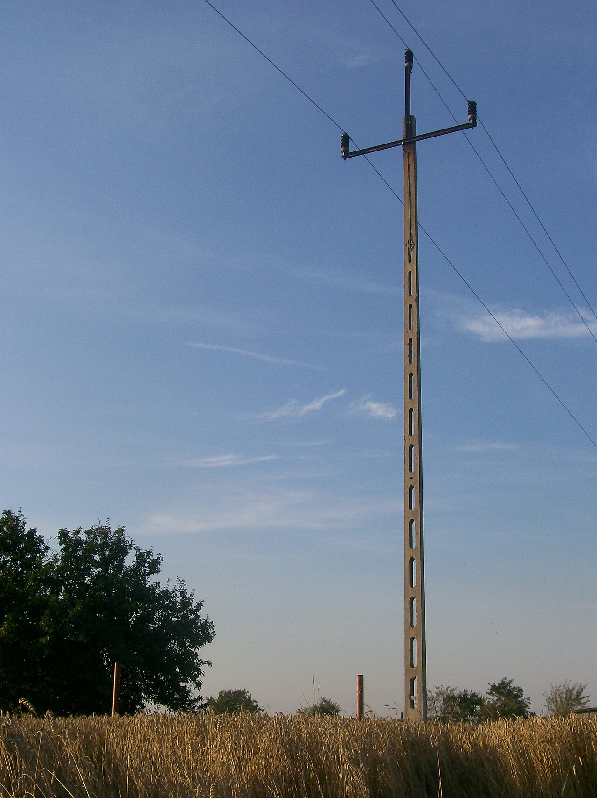
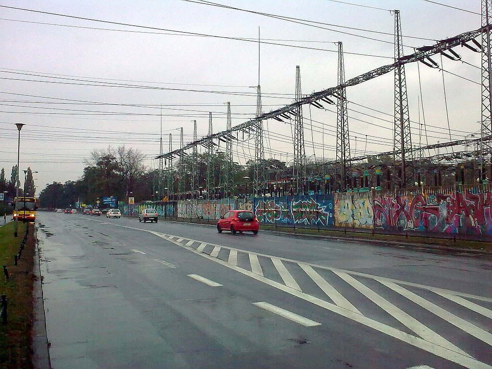
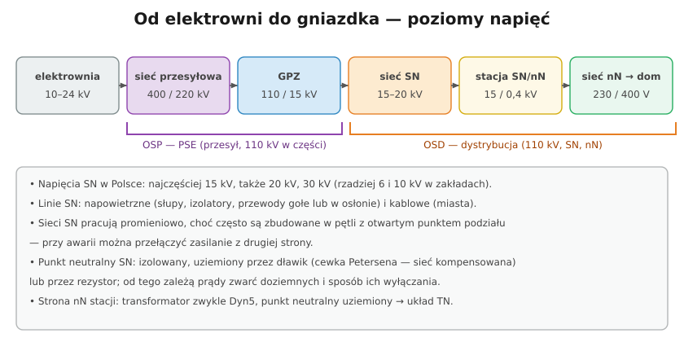

# 34.01 — Sieci średniego napięcia — budowa

> **Moduł:** [34 — Sieci SN i stacje transformatorowe](README.md) · **Oznaczenia:** 📋 · **Zakres SEP:** (a) (b) (d) · **Status:** ✅ pełny
>
> **Czytaj:**
>
> - Od słupa do gniazdka: [14](../14-od-slupa-do-gniazdka/README.md); układy sieci nN: [11](../11-uklady-sieci/README.md)

← (początek modułu) · [spis modułu](README.md) · [następny temat →](34.02-stacje-transformatorowe-sn-nn.md)

## Po co to jest

Sieć średniego napięcia (SN) to „krwiobieg” między dużymi stacjami 110 kV a stacjami transformatorowymi na osiedlach i wsiach. Dla elektryka z uprawnieniami do 1 kV to teren obcy — ale trzeba go rozumieć: skąd przychodzi zasilanie, dlaczego zerwany przewód SN jest śmiertelnie groźny, co znaczy „przełączenie na drugą stronę pętli”. Ten moduł jest poglądowy; do pracy przy SN potrzebne są uprawnienia (G1 pkt 3) i praktyka.

## Po ludzku

**Poziomy napięć:** elektrownia → **sieć przesyłowa 400/220 kV** (PSE) → **GPZ** (główny punkt zasilający) **110/15 kV** → **sieć SN** → **stacja SN/nN 15/0,4 kV** → **sieć nN 230/400 V** → odbiorca.

**Napięcia SN w Polsce:** najczęściej **15 kV**, także **20 kV** i **30 kV**; w zakładach przemysłowych spotyka się **6 i 10 kV**.

**Linie SN:**

- **napowietrzne** — słupy (żelbetowe, kratowe), izolatory, przewody gołe (AFL) lub w osłonie; tańsze, ale narażone na wiatr, oblodzenie, drzewa,
- **kablowe** — w miastach i na osiedlach; odporne na pogodę, droższe, awarie trudniej zlokalizować.

**Układ pracy:** sieć SN jest zwykle **zbudowana w pętli**, ale **pracuje promieniowo** — w jednym miejscu pętli jest **otwarty punkt podziału**. Przy awarii odcinka operator wyłącza uszkodzony fragment i zasila resztę **z drugiej strony** przez zamknięcie punktu podziału. Dlatego przy pracach przy SN zawsze zakłada się, że napięcie może przyjść **z obu stron**.

**Punkt neutralny sieci SN** (od niego zależą zwarcia doziemne):

- **izolowany** — małe prądy doziemne, sieć może chwilę pracować z doziemieniem, ale rosną przepięcia,
- **kompensowany** (dławik — **cewka Petersena**) — prąd doziemny kompensowany, łuk sam gaśnie,
- **uziemiony przez rezystor** — prąd doziemny ograniczony, ale wystarczający do szybkiego wyłączenia zabezpieczeniami.

**Po stronie nN** stacji punkt neutralny transformatora jest **uziemiony** — stąd układ **TN** w naszych domach ([11](../11-uklady-sieci/README.md)).

## Jak to wygląda

*Na co patrzeć: trzy przewody na izolatorach — linia SN 15 kV. Brak przewodu neutralnego: sieć SN jest trójprzewodowa, a „N” pojawia się dopiero po stronie nN transformatora.*

*Na co patrzeć: stacja 110 kV (GPZ) — tu napięcie 110 kV jest obniżane do 15 kV i rozdzielane na linie SN zasilające miasto.*

## Schemat

## Pojęcia

| Pojęcie | Po ludzku | Termin normowy / symbol |
|---------|-----------|-------------------------|
| SN | Średnie napięcie (1–110 kV) | sieć SN |
| GPZ | Stacja 110 kV/SN | główny punkt zasilający |
| Punkt podziału | Otwarty łącznik w pętli SN | — |
| Cewka Petersena | Dławik kompensujący prąd doziemny | sieć kompensowana |
| Zwarcie doziemne | Zetknięcie fazy z ziemią | — |
| Linia napowietrzna / kablowa | Przewody na słupach / kable w ziemi | — |

## Liczby do zapamiętania

| Wielkość | Wartość | Kiedy obowiązuje | Źródło |
|----------|---------|------------------|--------|
| Typowe napięcia SN | **15 kV**, **20 kV**, 30 kV (6, 10 kV — zakłady) | sieci dystrybucyjne w Polsce | OSD |
| Przekładnia stacji | **15 / 0,4 kV** (lub 20 / 0,4 kV) | stacje SN/nN | jw. |
| GPZ | **110 / 15 (20) kV** | jw. | jw. |
| Świadectwo | **G1 pkt 3**: > 1 kV do 30 kV | prace przy SN | rozp. z 2022 r. |

## W praktyce

- **Zerwany przewód SN** — nie podchodzić, napięcie krokowe, wezwać 991 i 112 ([04.03](../04-prad-a-czlowiek/04.03-napiecie-dotykowe-i-krokowe-napiecia.md)). Automatyka może próbować **ponownie załączyć** linię (SPZ).
- **Prace w pobliżu linii SN** (koparki, dźwigi, drzewa) — zachowanie odległości, uzgodnienie z operatorem.
- **Zakład z własną stacją** — rozdzielnia SN, transformator i rozdzielnia nN należą do odbiorcy: obsługa wymaga uprawnień SN i instrukcji eksploatacji.

## Błędy i zagrożenia

- ⚠️ **Zbliżanie się do przewodów SN** (drabina, maszt, wędka, dźwig) — przeskok łuku bez dotknięcia.
- ⚠️ **Założenie, że wyłączona linia jest bezpieczna** — zasilanie z drugiej strony pętli, SPZ, napięcia indukowane.
- **Traktowanie SN jak „wyższego nN”** — inne zjawiska (łuk, odstępy, zwarcia doziemne), inny sprzęt.

## Przykład

**Zadanie.** Po burzy w części miasta nie ma prądu. Po 20 minutach napięcie wraca, choć ekipa jeszcze nie dojechała do miejsca awarii. Jak to możliwe?

**Rozwiązanie.** Sieć SN była zasilana promieniowo z jednej strony pętli. Dyspozytor **zdalnie wyłączył** uszkodzony odcinek i **zamknął punkt podziału**, zasilając pozostałą część z drugiej strony. Odbiorcy mają prąd, a uszkodzony odcinek czeka na naprawę — i jest odłączony z obu stron.

## Pytania SEP

1. **Jak zbudowane są i jak pracują sieci średniego napięcia?**

Odpowiedź

Sieci SN (w Polsce najczęściej 15 kV, także 20 i 30 kV) zasilane są z głównych punktów zasilających 110/SN i doprowadzają energię do stacji transformatorowych SN/nN. Budowane są jako linie napowietrzne (słupy, izolatory, przewody gołe lub w osłonie) albo kablowe. Mają zwykle konfigurację pętlową lub wielostronnie zasilaną, ale pracują promieniowo — z otwartym punktem podziału, co pozwala przy awarii zasilić odbiorców z innej strony. Punkt neutralny sieci SN jest izolowany, uziemiony przez dławik (sieć kompensowana) lub przez rezystor, co decyduje o wartości prądów zwarć doziemnych i sposobie działania zabezpieczeń.

## Sprawdź się

1. Dlaczego w liniach SN nie ma przewodu neutralnego, a w sieci nN jest?

Odpowiedź

Bo sieć SN przesyła energię do stacji, gdzie odbiorniki są trójfazowe (transformatory) — nie potrzebuje przewodu N. Przewód neutralny tworzy się dopiero po stronie nN transformatora (punkt gwiazdy uzwojenia), żeby zasilać odbiorniki jednofazowe 230 V i realizować układ TN.

## Źródła

- PN-EN 50160 — Parametry napięcia zasilającego w publicznych sieciach (także SN).
- [33.03 — Przyłączanie i jakość energii](../33-dozor/33.03-przylaczanie-do-sieci-i-dostarczanie-energii.md).

---

← (początek modułu) · [spis modułu](README.md) · [następny temat →](34.02-stacje-transformatorowe-sn-nn.md)
