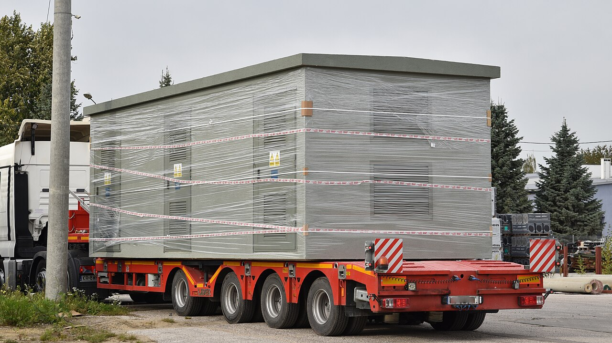
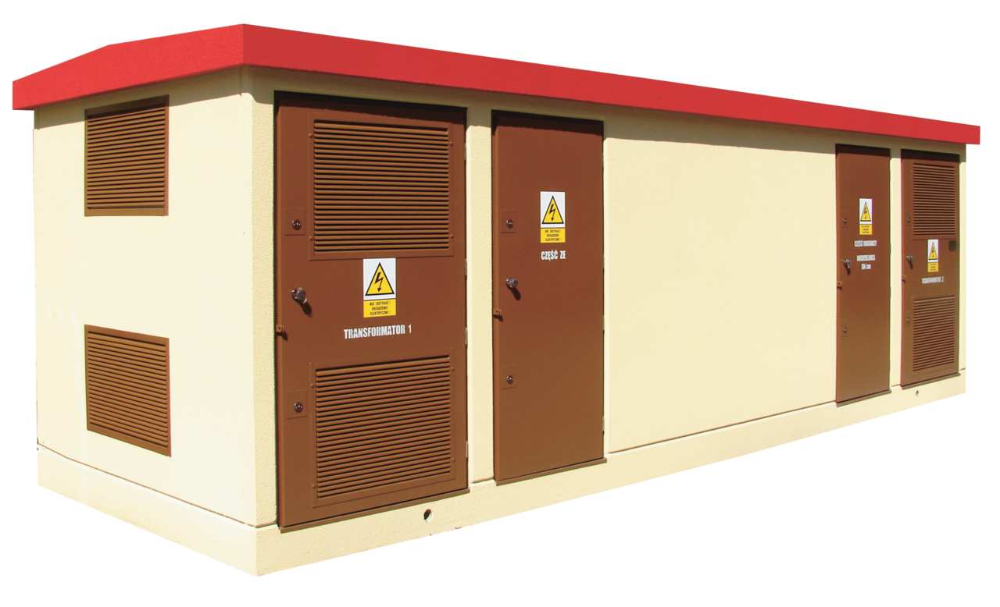
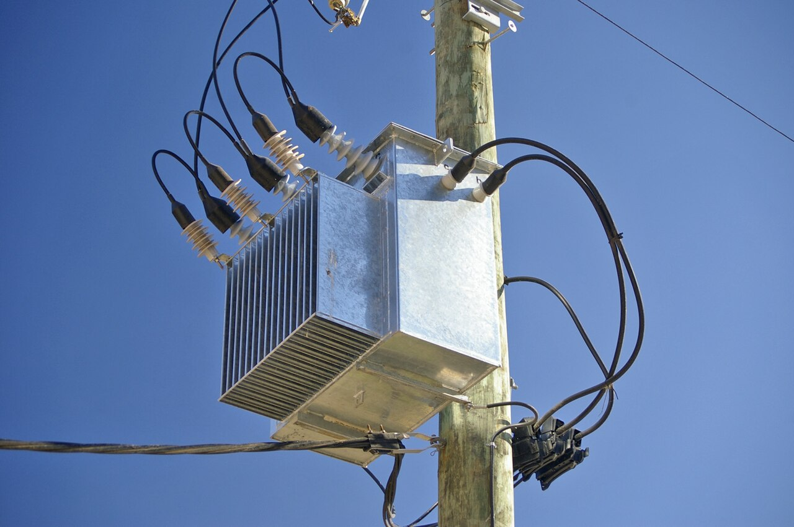
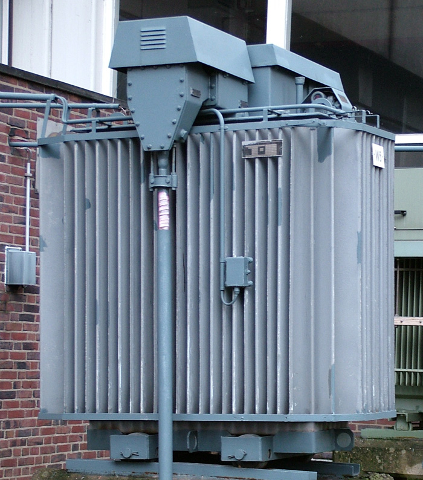
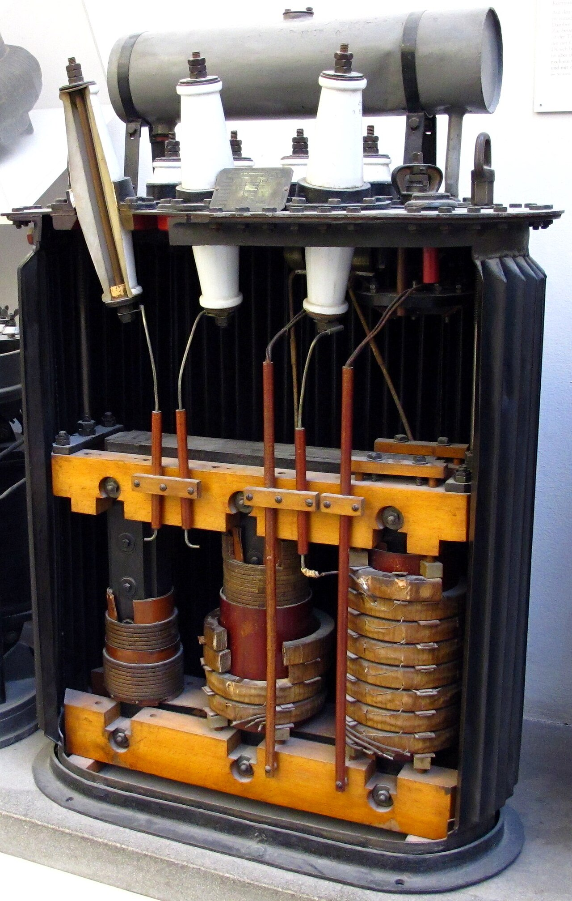
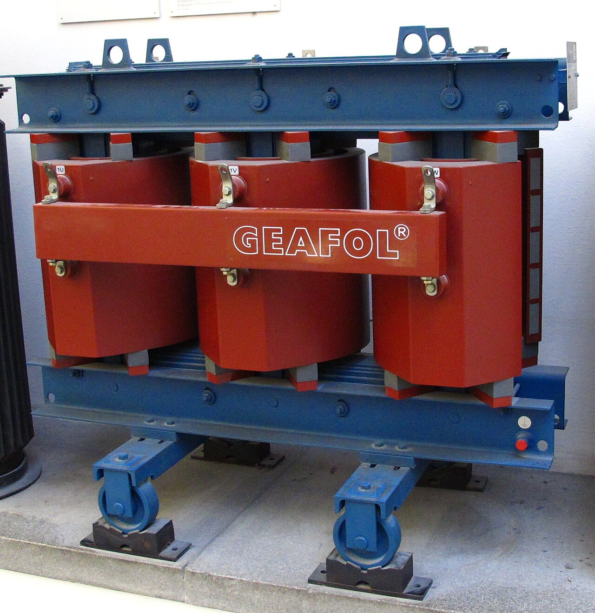
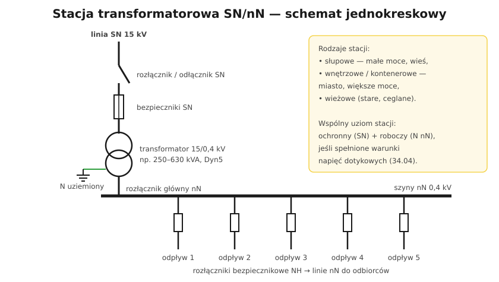

# 34.02 — Stacje transformatorowe SN/nN

> **Moduł:** [34 — Sieci SN i stacje transformatorowe](README.md) · **Oznaczenia:** 📋 · **Zakres SEP:** (a) (b) (d) · **Status:** ✅ pełny
>
> **Czytaj:**
>
> - Transformator — zasada: [03.02](../03-elektromagnetyzm-w-praktyce/03.02-indukcja-elektromagnetyczna-i-transformator.md)
> - Wkładki NH: [07.02](../07-zabezpieczenia-nadpradowe/07.02-bezpieczniki-topikowe-wkladki-gg-gwintowe-i.md)

[← poprzedni temat](34.01-sieci-sredniego-napiecia-budowa.md) · [spis modułu](README.md) · [następny temat →](34.03-laczniki-sn-odlacznik-rozlacznik-wylacznik.md)

## Po co to jest

Stacja transformatorowa SN/nN to ostatni krok przed siecią, która zasila nasze domy. Stoi na słupie przy drodze, w blaszanym kontenerze na osiedlu albo w starej ceglanej wieży. Wiedza o jej budowie wyjaśnia wiele zjawisk w instalacjach: skąd jest PEN, dlaczego napięcie na końcu linii nN spada, czemu dom „na końcu linii” ma problemy z PV.

## Po ludzku

**Rodzaje stacji:**

- **słupowe** — transformator na słupie (lub między słupami), małe moce (zwykle do ok. **250 kVA**), tereny wiejskie i podmiejskie,
- **wnętrzowe / kontenerowe** — budynek prefabrykowany z rozdzielnią SN, transformatorem i rozdzielnią nN; moce zwykle **250–630 kVA**, a nawet 1000 kVA i więcej; miasta, osiedla, zakłady,
- **wieżowe** — stare, ceglane, z liniami napowietrznymi wchodzącymi górą; coraz rzadsze.

**Elementy stacji (od strony SN):**

1. **rozdzielnia SN** — pola liniowe (wejście/wyjście pętli) z **rozłącznikami**, pole transformatorowe z rozłącznikiem i **bezpiecznikami SN** (albo wyłącznikiem),
2. **transformator** — olejowy lub suchy (żywiczny), np. **15/0,42 kV**, grupa połączeń zwykle **Dyn5**: uzwojenie SN w trójkąt, nN w gwiazdę z wyprowadzonym punktem neutralnym, który się **uziemia**,
3. **rozdzielnia nN** — rozłącznik główny, szyny, **odpływy** z rozłącznikami bezpiecznikowymi (**wkładki NH**) do linii nN, czasem licznik bilansujący,
4. **uziemienie stacji** — wspólne (ochronne SN + robocze nN) albo osobne, w zależności od warunków napięć dotykowych ([34.04](34.04-ochrona-przeciwporazeniowa-powyzej-1-kv.md)).

**Transformator olejowy:** rdzeń i uzwojenia zanurzone w oleju, który chłodzi i izoluje; radiatory (żeberka) oddają ciepło; konserwator lub szczelna kadź; przełącznik zaczepów (beznapięciowy) do korekty napięcia ±2×2,5 %. **Transformator suchy** — uzwojenia zalane żywicą; bez oleju, bezpieczniejszy pożarowo (wnętrza budynków).

## Jak to wygląda

*Na co patrzeć: kontenerowa stacja przyjeżdża w całości — z rozdzielnią SN, miejscem na transformator i rozdzielnią nN. Na miejscu stawia się ją na fundamencie i podłącza kable.*

*Na co patrzeć: osobne drzwi do rozdzielni SN, komory transformatora i rozdzielni nN, żaluzje wentylacyjne (transformator się grzeje) i tablice ostrzegawcze.*

*Na co patrzeć: transformator na słupie — u góry przepusty SN, z boku przepusty nN. Tak wyglądają małe stacje na wsiach (w Polsce zwykle trójfazowe, na słupach żelbetowych).*

*Na co patrzeć: radiatory (żeberka) chłodzące olej. Moc 630 kVA wystarcza dla kilkuset mieszkań lub średniego zakładu.*

*Na co patrzeć: rdzeń z blach i uzwojenia w kadzi — po napełnieniu olejem cała ta przestrzeń jest wypełniona; olej izoluje i chłodzi.*

*Na co patrzeć: uzwojenia zalane żywicą, bez oleju — stosowany w budynkach, gdzie olej byłby zagrożeniem pożarowym.*

## Schemat

## Pojęcia

| Pojęcie | Po ludzku | Termin normowy / symbol |
|---------|-----------|-------------------------|
| Stacja SN/nN | Obniża napięcie do 400 V | stacja transformatorowa |
| Dyn5 | Trójkąt SN, gwiazda nN z N, przesunięcie 150° | grupa połączeń |
| Rozdzielnia SN / nN | Część stacji z łącznikami SN / nN | — |
| Przełącznik zaczepów | Zmiana przekładni o kilka % | — |
| Transformator suchy | Bez oleju, uzwojenia w żywicy | — |
| Odpływ nN | Pole zasilające linię nN | — |

## Liczby do zapamiętania

| Wielkość | Wartość | Kiedy obowiązuje | Źródło |
|----------|---------|------------------|--------|
| Stacje słupowe | zwykle **do ok. 250 kVA** | sieci wiejskie | OSD |
| Stacje wnętrzowe / kontenerowe | zwykle **250–630 kVA** (i więcej) | miasta, zakłady | jw. |
| Napięcie po stronie nN | **0,42 / 0,4 kV** | transformatory 15 kV | jw. |
| Regulacja przełącznikiem zaczepów | typowo **± 2 × 2,5 %** | beznapięciowo | katalogi |
| Grupa połączeń | zwykle **Dyn5** | transformatory rozdzielcze | jw. |

## W praktyce

- **Napięcie za wysokie u wszystkich odbiorców stacji** (np. przy PV) — operator może zmienić zaczep transformatora; zgłoszenie do OSD ([26.03](../26-fotowoltaika-pompy-wallboxy/26.03-falownik-i-przylaczenie-mikroinstalacji.md)).
- **Wejście do stacji** — tylko osoby upoważnione; drzwi zamknięte, tablice ostrzegawcze.
- **Zakład z własną stacją** — przeglądy transformatora (olej, temperatura, szczelność), rozdzielni SN i nN według instrukcji eksploatacji.

## Błędy i zagrożenia

- ⚠️ **Wejście do komory transformatora** pod napięciem — przepusty SN na wyciągnięcie ręki.
- ⚠️ **Wymiana wkładek NH w stacji bez sprzętu i uprawnień.**
- **Wyciek oleju** — zagrożenie pożarowe i środowiskowe; misa olejowa pod transformatorem.

## Przykład

**Zadanie.** Stacja słupowa 160 kVA zasila wieś. W szczycie zimowym (cos φ ≈ 0,95) pobór wynosi 140 kW. Czy transformator jest przeciążony?

**Rozwiązanie.** Moc pozorna: $S = P / \cos\varphi = 140 / 0{,}95 \approx 147$ kVA — ok. **92 %** mocy znamionowej. Transformator nie jest przeciążony, ale pracuje blisko granicy; nowe pompy ciepła i wallboxy we wsi mogą wymagać jego wymiany na większy.

## Pytania SEP

1. **Z jakich elementów składa się stacja transformatorowa SN/nN?**

Odpowiedź

Z rozdzielni średniego napięcia (pola liniowe z rozłącznikami lub wyłącznikami, pole transformatorowe z rozłącznikiem i bezpiecznikami SN lub wyłącznikiem, uziemniki), transformatora SN/nN (olejowego lub suchego, zwykle w grupie połączeń Dyn5, z uziemionym punktem neutralnym po stronie nN), rozdzielni niskiego napięcia (rozłącznik główny, szyny zbiorcze, odpływy z rozłącznikami bezpiecznikowymi, często układ pomiarowy) oraz instalacji uziemiającej, a także obudowy (słup, budynek, kontener) z wentylacją, oznakowaniem i zabezpieczeniem przed dostępem osób postronnych.

## Sprawdź się

1. Dlaczego transformatory rozdzielcze mają zwykle uzwojenie SN w trójkąt, a nN w gwiazdę?

Odpowiedź

Gwiazda po stronie nN daje punkt neutralny — przewód N do odbiorników 230 V i punkt uziemienia układu TN. Trójkąt po stronie SN pozwala płynąć prądom trzeciej harmonicznej i wyrównuje skutki niesymetrycznego obciążenia faz po stronie nN, więc napięcia u odbiorców są bardziej stabilne.

## Źródła

- PN-EN 60076 — Transformatory energetyczne.
- PN-EN 61936-1 — Instalacje elektroenergetyczne prądu przemiennego o napięciu wyższym od 1 kV.
- [03.02 — Indukcja i transformator](../03-elektromagnetyzm-w-praktyce/03.02-indukcja-elektromagnetyczna-i-transformator.md).

---

[← poprzedni temat](34.01-sieci-sredniego-napiecia-budowa.md) · [spis modułu](README.md) · [następny temat →](34.03-laczniki-sn-odlacznik-rozlacznik-wylacznik.md)
