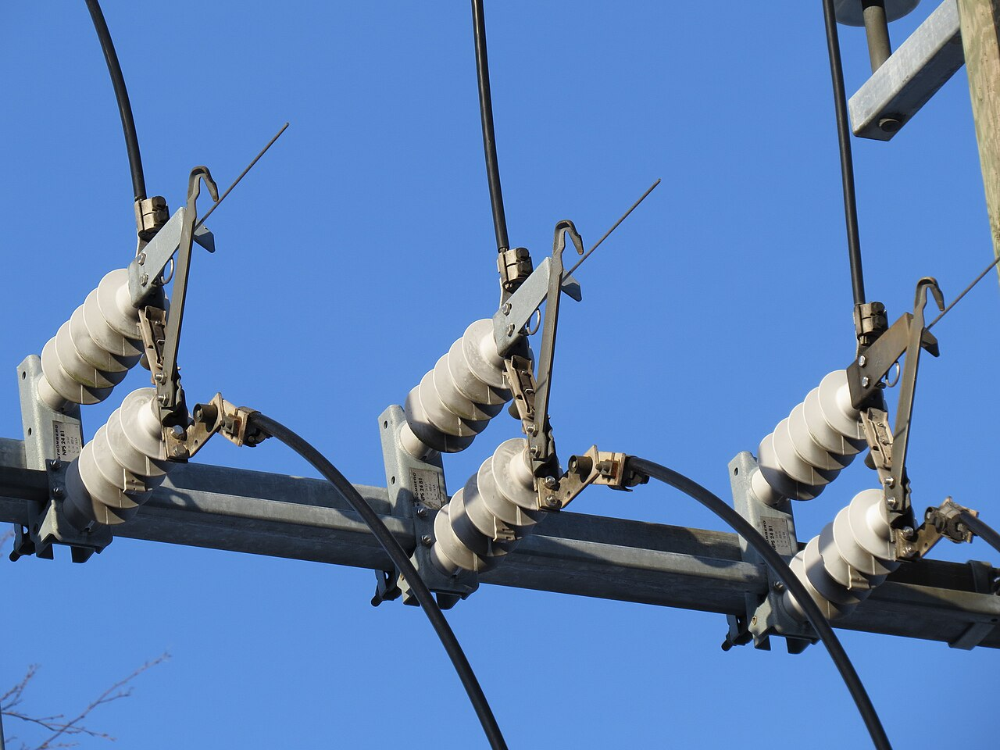
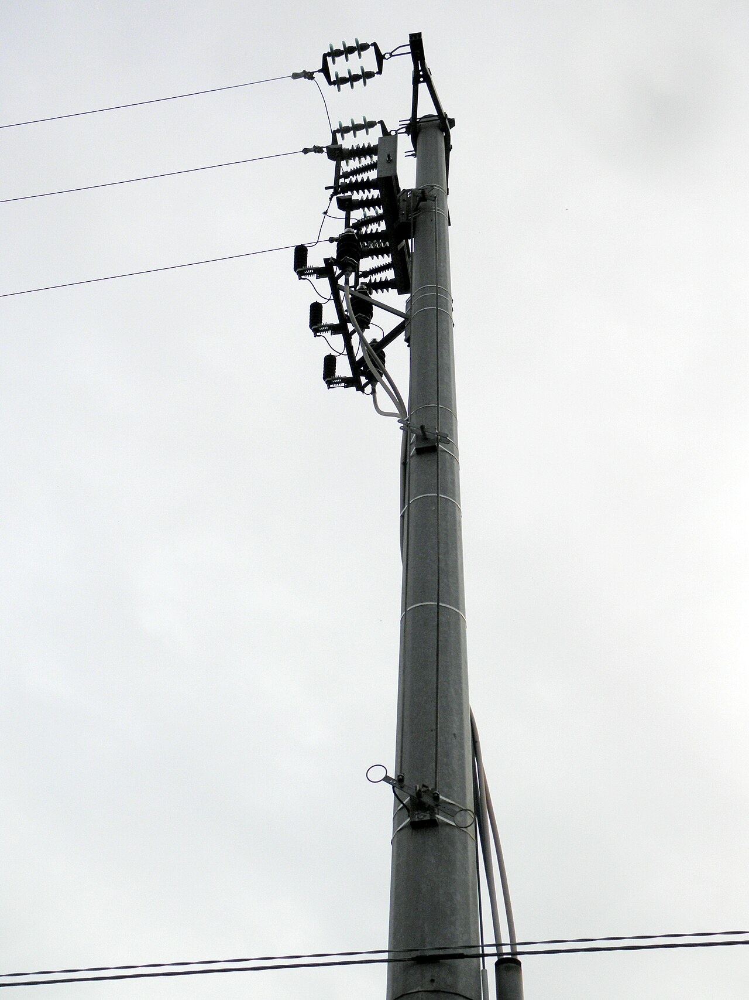
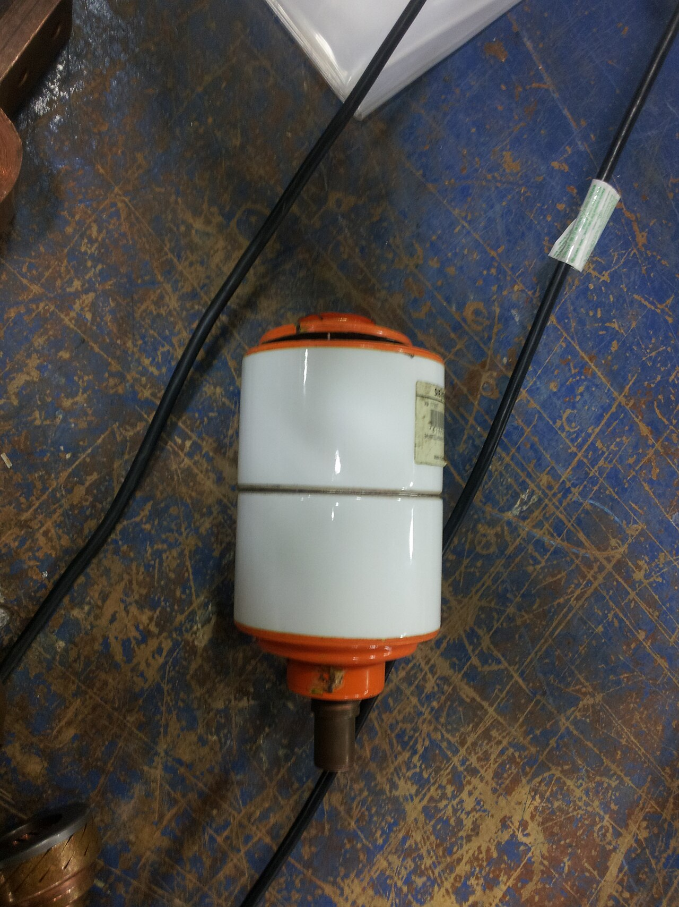
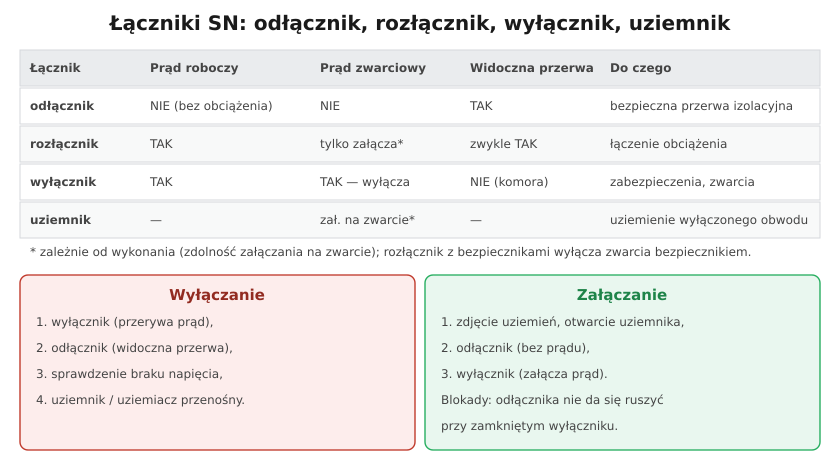

# 34.03 — Łączniki SN: odłącznik, rozłącznik, wyłącznik

> **Moduł:** [34 — Sieci SN i stacje transformatorowe](README.md) · **Oznaczenia:** 📋 · **Zakres SEP:** (a) (b) (d) · **Status:** ✅ pełny
>
> **Czytaj:**
>
> - PN-EN 62271 (seria) — Wysokonapięciowa aparatura rozdzielcza i sterownicza

[← poprzedni temat](34.02-stacje-transformatorowe-sn-nn.md) · [spis modułu](README.md) · [następny temat →](34.04-ochrona-przeciwporazeniowa-powyzej-1-kv.md)

## Po co to jest

Klasyczne pytanie egzaminacyjne dla każdego, kto ma styczność z SN: „czym różni się odłącznik od rozłącznika i wyłącznika?” i „w jakiej kolejności się je łączy?”. Pomyłka — otwarcie odłącznika pod obciążeniem — kończy się łukiem, który niszczy aparat i rani obsługę.

## Po ludzku

**Odłącznik** — łącznik **izolacyjny**: daje **widoczną przerwę** w obwodzie, ale **nie wolno** nim łączyć prądu obciążenia (nie ma komory gaszeniowej). Otwiera się go **po** wyłączeniu prądu innym łącznikiem.

**Rozłącznik** — łączy **prądy robocze** (obciążenia); ma komorę gaszeniową. Zwarcia **nie wyłącza** (co najwyżej może załączyć na zwarcie, jeśli ma taką zdolność). W połączeniu z **bezpiecznikami SN** (rozłącznik bezpiecznikowy) chroni transformator — zwarcie przerywa bezpiecznik. Często daje też widoczną przerwę (**rozłącznik izolacyjny**).

**Wyłącznik** — łączy prądy robocze i **wyłącza prądy zwarciowe**; współpracuje z **zabezpieczeniami** (przekaźniki, sterowniki pól), może być załączany samoczynnie (SPZ). Komora próżniowa lub SF₆. Nie daje widocznej przerwy — dlatego w polu z wyłącznikiem jest też odłącznik (lub wyłącznik wysuwny).

**Uziemnik** — zwiera i uziemia wyłączony obwód (np. linię, kabel) — po sprawdzeniu braku napięcia.

**Kolejność łączeń:**

- **wyłączanie:** najpierw **wyłącznik** (przerywa prąd) → potem **odłącznik** (widoczna przerwa) → sprawdzenie braku napięcia → **uziemnik** / uziemiacze przenośne,
- **załączanie:** zdjęcie uziemień → **odłącznik** (bez prądu) → **wyłącznik** (załącza prąd).

**Blokady** — mechaniczne i elektryczne — uniemożliwiają typowe błędy: otwarcie odłącznika przy zamkniętym wyłączniku, załączenie uziemnika przy zamkniętym odłączniku, otwarcie drzwi celki pod napięciem.

## Jak to wygląda

*Na co patrzeć: ruchome ramiona styków i izolatory porcelanowe — rozłącznik napowietrzny na słupie. Gdy jest otwarty, przerwę widać z ziemi.*

*Na co patrzeć: aparat na szczycie słupa i drążek napędu prowadzony w dół — obsługa z ziemi, w rękawicach i na pomoście izolacyjnym.*

*Na co patrzeć: komora próżniowa — wewnątrz rozchodzą się styki, a łuk gaśnie w próżni. To serce współczesnego wyłącznika SN.*

## Schemat

## Pojęcia

| Pojęcie | Po ludzku | Termin normowy / symbol |
|---------|-----------|-------------------------|
| Odłącznik | Daje widoczną przerwę, bez prądu | disconnector |
| Rozłącznik | Łączy prąd roboczy | switch-disconnector |
| Wyłącznik | Wyłącza zwarcia | circuit-breaker |
| Uziemnik | Uziemia wyłączony obwód | earthing switch |
| Komora gaszeniowa | Miejsce gaszenia łuku | próżnia, SF₆ |
| SPZ | Samoczynne ponowne załączenie | — |
| Blokada | Uniemożliwia błędne łączenie | mechaniczna, elektryczna |

## Liczby do zapamiętania

| Wielkość | Wartość | Kiedy obowiązuje | Źródło |
|----------|---------|------------------|--------|
| Kolejność wyłączania | **wyłącznik → odłącznik → sprawdzenie → uziemnik** | pola SN | zasady eksploatacji |
| Kolejność załączania | **uziemnik off → odłącznik → wyłącznik** | jw. | jw. |
| Odłącznik | **0 A** obciążenia przy łączeniu | — | PN-EN 62271-102 |

## W praktyce

- **Przed łączeniem** — sprawdź na schemacie i na obiekcie, które pole, w jakim stanie są łączniki i blokady.
- **Łączenia SN** wykonuje się według polecenia lub instrukcji, w sprzęcie ochronnym (rękawice, pomost izolacyjny, osłona twarzy), często w dwie osoby.
- **Wskaźniki położenia** łączników muszą być zgodne ze stanem faktycznym — przy wątpliwości sprawdź wzrokowo (widoczna przerwa).

## Błędy i zagrożenia

- ⚠️ **Otwarcie odłącznika pod obciążeniem** — łuk, zniszczenie aparatu, oparzenia.
- ⚠️ **Załączenie uziemnika na linię pod napięciem** — zwarcie (stąd sprawdzenie braku napięcia i blokady).
- **Obejście blokad** „bo się zacięło” — klasyczna przyczyna wypadków.

## Przykład

**Zadanie.** Trzeba wykonać przegląd pola liniowego SN z wyłącznikiem i odłącznikiem szynowym oraz liniowym. Podaj kolejność wyłączenia i przygotowania.

**Rozwiązanie.** **Wyłącznik** (otwarcie, sprawdzenie położenia) → **odłącznik liniowy** i **odłącznik szynowy** (widoczne przerwy) → zabezpieczenie napędów (blokady, tablice) → **sprawdzenie braku napięcia** wskaźnikiem SN po obu stronach → **uziemnik** / uziemiacze z obu stron (linia może być zasilona z drugiej strony pętli) → osłony i oznakowanie → dopuszczenie.

## Pytania SEP

1. **Czym różni się odłącznik, rozłącznik i wyłącznik?**

Odpowiedź

Odłącznik służy do tworzenia widocznej przerwy izolacyjnej w obwodzie; nie ma zdolności łączenia prądów obciążenia, więc otwiera się go i zamyka w stanie bezprądowym. Rozłącznik łączy prądy robocze (obciążenia), ma komorę gaszeniową, ale nie wyłącza prądów zwarciowych (w połączeniu z bezpiecznikami zwarcia przerywają bezpieczniki); często ma także cechy odłącznika (widoczna przerwa). Wyłącznik łączy prądy robocze i wyłącza prądy zwarciowe, współpracując z zabezpieczeniami; nie zapewnia widocznej przerwy, dlatego stosuje się go razem z odłącznikiem lub w wykonaniu wysuwnym.

2. **W jakiej kolejności wyłącza się i załącza pole z wyłącznikiem i odłącznikiem?**

Odpowiedź

Wyłączanie: najpierw wyłącznik przerywa prąd, potem otwiera się odłącznik (widoczna przerwa), następnie zabezpiecza się napędy przed załączeniem, sprawdza brak napięcia i zakłada uziemienie. Załączanie: zdejmuje się uziemienia, zamyka odłącznik (bez prądu), a na końcu załącza wyłącznik. Błędną kolejność uniemożliwiają blokady.

## Sprawdź się

1. Dlaczego odłącznik jest potrzebny, skoro wyłącznik i tak przerywa prąd?

Odpowiedź

Bo styki wyłącznika są zamknięte w komorze — nie widać, czy na pewno się rozeszły, a przy uszkodzeniu mogą być sklejone. Odłącznik daje widoczną, pewną przerwę izolacyjną, wymaganą przed przygotowaniem miejsca pracy.

## Źródła

- PN-EN 62271-100 (wyłączniki), PN-EN 62271-102 (odłączniki i uziemniki), PN-EN 62271-103 (rozłączniki).
- [Rozporządzenie BHP przy urządzeniach energetycznych — t.j. Dz.U. 2021 poz. 1210](https://api.sejm.gov.pl/eli/acts/DU/2021/1210/text.html) (§ 24–25, 30).

---

[← poprzedni temat](34.02-stacje-transformatorowe-sn-nn.md) · [spis modułu](README.md) · [następny temat →](34.04-ochrona-przeciwporazeniowa-powyzej-1-kv.md)
