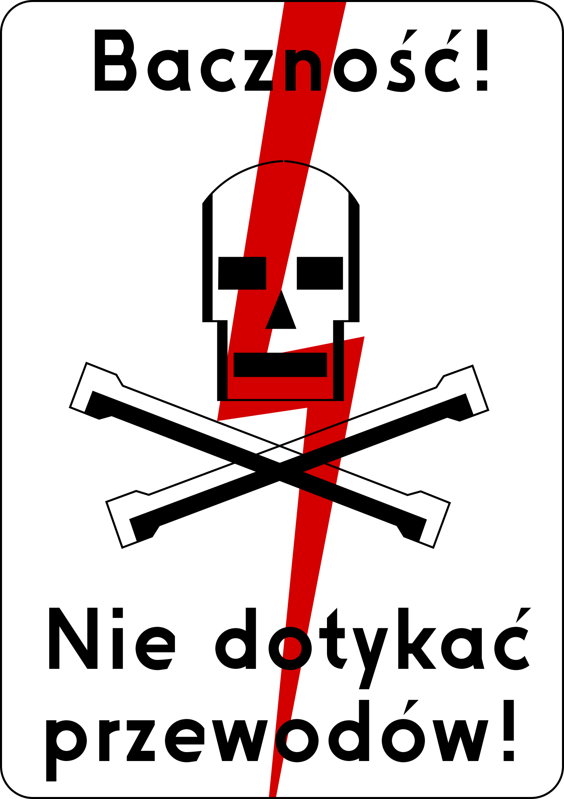
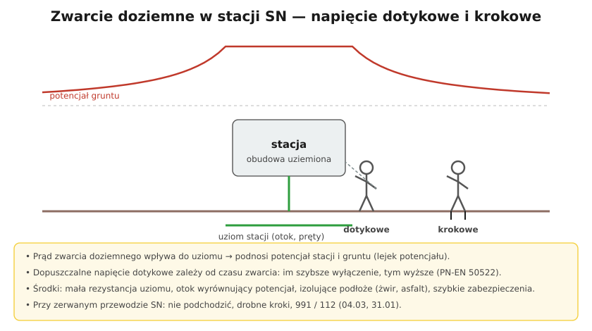

# 34.04 — Ochrona przeciwporażeniowa powyżej 1 kV

> **Moduł:** [34 — Sieci SN i stacje transformatorowe](README.md) · **Oznaczenia:** 📋 · **Zakres SEP:** (a) (b) (d) · **Status:** ✅ pełny
>
> **Czytaj:**
>
> - PN-EN 50522 — Uziemienia instalacji elektroenergetycznych prądu przemiennego o napięciu wyższym od 1 kV
> - Napięcie dotykowe i krokowe: [04.03](../04-prad-a-czlowiek/04.03-napiecie-dotykowe-i-krokowe-napiecia.md)

[← poprzedni temat](34.03-laczniki-sn-odlacznik-rozlacznik-wylacznik.md) · [spis modułu](README.md) · [następny temat →](34.05-zasady-pracy-przy-urzadzeniach-sn.md)

## Po co to jest

Powyżej 1 kV ochrona przeciwporażeniowa wygląda inaczej niż w domu: nie ma RCD 30 mA, a podstawowym środkiem jest **niedopuszczenie do dotyku** (odstępy, osłony, ogrodzenia) i **uziemienie**, które przy zwarciu doziemnym ogranicza napięcia dotykowe i krokowe. To zakres (a) i (d) egzaminu dla G1 pkt 3, a dla elektryka nN — wyjaśnienie, dlaczego stacja ma taki uziom i dlaczego od zerwanej linii trzeba trzymać się z daleka.

## Po ludzku

**Ochrona podstawowa (przed dotykiem bezpośrednim):**

- **izolacja** części czynnych (kable, przepusty),
- **osłony i obudowy** (celki rozdzielnic, obudowy stacji),
- **przegrody i ogrodzenia**, **odstępy** — części czynne poza zasięgiem ręki,
- **umieszczenie poza zasięgiem** (przewody linii na odpowiedniej wysokości).

**Ochrona przy uszkodzeniu** — przez **uziemienie** części przewodzących dostępnych (obudowy, konstrukcje) i **wyłączenie** zwarcia przez zabezpieczenia. Prąd zwarcia doziemnego wpływa do uziomu i **podnosi potencjał** stacji i gruntu wokół niej („lejek potencjału”). Człowiek dotykający obudowy ma **napięcie dotykowe**, idący obok — **krokowe**.

**Dopuszczalne napięcie dotykowe** (PN-EN 50522) zależy od **czasu trwania zwarcia**: im szybciej zabezpieczenie wyłączy zwarcie, tym wyższe napięcie jest dopuszczalne (prąd przez ciało działa krócej). Dla długich czasów dopuszczalne wartości są rzędu kilkudziesięciu woltów, dla bardzo krótkich — kilkuset.

**Środki ograniczające napięcia:**

- mała **rezystancja uziomu**, uziom **otokowy** wokół stacji (wyrównanie potencjału),
- **izolujące podłoże** (żwir, asfalt) zwiększające rezystancję przejścia stóp,
- **szybkie zabezpieczenia** (krótki czas zwarcia),
- **połączenia wyrównawcze** w obrębie stacji.

**Wspólny uziom stacji** (ochronny SN + roboczy nN) jest dopuszczalny, gdy napięcie, które przy zwarciu SN pojawi się na uziomie, nie przeniesie się w groźny sposób przez przewód PEN do instalacji odbiorców. W przeciwnym razie uziomy się rozdziela.

## Jak to wygląda

*Na co patrzeć: tablice ostrzegawcze na stacjach i słupach SN są częścią ochrony podstawowej — informują, że dalej są urządzenia, do których osoby postronne nie mają wstępu.*

## Schemat

## Pojęcia

| Pojęcie | Po ludzku | Termin normowy / symbol |
|---------|-----------|-------------------------|
| Napięcie dotykowe | Między ręką a stopami przy dotyku obudowy | $U_T$ |
| Napięcie krokowe | Między stopami | $U_S$ |
| Lejek potencjału | Rozkład napięcia wokół uziomu | — |
| Uziom otokowy | Pętla uziomu wokół obiektu | — |
| Wspólny uziom | Ochronny SN i roboczy nN razem | PN-EN 50522 |
| Ochrona podstawowa | Niedopuszczenie do dotyku części czynnych | — |

## Liczby do zapamiętania

| Wielkość | Wartość | Kiedy obowiązuje | Źródło |
|----------|---------|------------------|--------|
| Dopuszczalne napięcie dotykowe | zależne od **czasu zwarcia** (kilkadziesiąt V dla długich, kilkaset V dla krótkich) | instalacje > 1 kV | PN-EN 50522 |
| Granica stosowania norm | **> 1 kV AC** | instalacje i uziemienia | PN-EN 61936-1, PN-EN 50522 |
| Odstęp „w pobliżu” dla 15 kV | **1160 mm** | prace | rozp. BHP, § 23 |

## W praktyce

- **Pomiary uziemień stacji** — rezystancja uziomu, napięcia dotykowe i krokowe (metody z dużym prądem pomiarowym) — specjalistyczne pomiary.
- **Ogrodzenia i drzwi stacji** — zamknięte, oznakowane; uszkodzenia zgłaszać operatorowi.
- **Metalowe ogrodzenie przy stacji** — może przenosić potencjał; projektuje się je z uwzględnieniem uziemienia.

## Błędy i zagrożenia

- ⚠️ **Podchodzenie do stacji lub słupa z uszkodzeniem** (dym, iskrzenie, leżący przewód) — napięcie krokowe.
- **Połączenie uziomu stacji z instalacją budynku bez analizy** — przeniesienie potencjału.
- **Usunięcie warstwy żwiru / izolującego podłoża** w stacji — rosną napięcia dotykowe.

## Przykład

**Zadanie.** Dlaczego podczas zwarcia doziemnego w stacji SN człowiek stojący na żwirze tuż przy obudowie i dotykający jej może być bezpieczny, a stojący 10 m dalej na trawie, w szerokim rozkroku — narażony?

**Rozwiązanie.** Przy obudowie, dzięki otokowi, potencjał gruntu jest **wyrównany** z potencjałem obudowy — napięcie dotykowe jest małe, a żwir zwiększa rezystancję przejścia. 10 m dalej potencjał gruntu **szybko spada** z odległością (stromy lejek) — między stopami w rozkroku pojawia się znaczne **napięcie krokowe**.

## Pytania SEP

1. **Jakie środki ochrony przeciwporażeniowej stosuje się w urządzeniach o napięciu powyżej 1 kV?**

Odpowiedź

Ochronę podstawową zapewnia się przez izolowanie części czynnych, stosowanie osłon, obudów, przegród i ogrodzeń, zachowanie odstępów i umieszczanie części czynnych poza zasięgiem. Ochronę przy uszkodzeniu zapewnia się przez uziemienie części przewodzących dostępnych i wyłączenie zwarcia przez zabezpieczenia, tak aby napięcia dotykowe i krokowe nie przekroczyły wartości dopuszczalnych zależnych od czasu trwania zwarcia (PN-EN 50522). Służą temu: mała rezystancja uziomu, uziomy otokowe wyrównujące potencjał, izolujące podłoże, połączenia wyrównawcze i szybkie zabezpieczenia. Dodatkowo stosuje się środki organizacyjne: zamknięcie i oznakowanie stacji, dostęp tylko dla upoważnionych, sprzęt ochronny przy pracach.

## Sprawdź się

1. Dlaczego w instalacjach SN dopuszczalne napięcie dotykowe zależy od czasu zwarcia, a w nN mówimy po prostu o 50 V?

Odpowiedź

Bo skutki prądu zależą od jego wartości i czasu przepływu ([04](../04-prad-a-czlowiek/README.md)). W nN wymaga się krótkich czasów wyłączenia przy założonym 50 V długotrwałego napięcia dotykowego. W SN prądy doziemne i potencjały są duże i nie da się zawsze zejść do 50 V — więc norma pozwala na wyższe napięcia, ale tylko na krótki czas, wynikający z działania zabezpieczeń.

## Źródła

- PN-EN 50522 — Uziemienia instalacji elektroenergetycznych prądu przemiennego o napięciu wyższym od 1 kV.
- PN-EN 61936-1 — Instalacje elektroenergetyczne prądu przemiennego o napięciu wyższym od 1 kV.
- [04.03 — Napięcie dotykowe i krokowe](../04-prad-a-czlowiek/04.03-napiecie-dotykowe-i-krokowe-napiecia.md).

---

[← poprzedni temat](34.03-laczniki-sn-odlacznik-rozlacznik-wylacznik.md) · [spis modułu](README.md) · [następny temat →](34.05-zasady-pracy-przy-urzadzeniach-sn.md)
