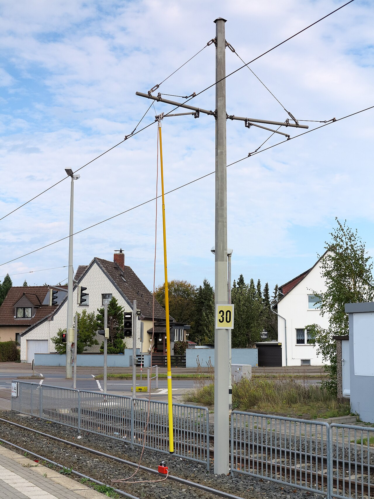
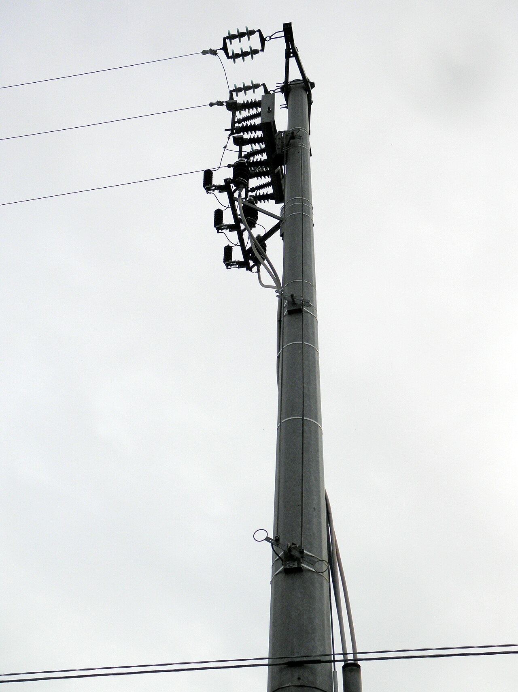
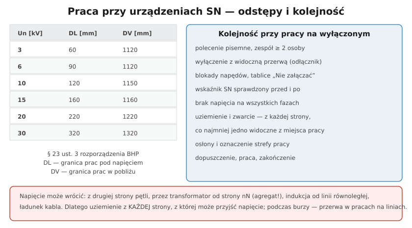

# 34.05 — Zasady pracy przy urządzeniach SN

> **Moduł:** [34 — Sieci SN i stacje transformatorowe](README.md) · **Oznaczenia:** 📋 · **Zakres SEP:** (a) (b) (d) · **Status:** ✅ pełny
>
> **Czytaj:**
>
> - [Rozporządzenie BHP przy urządzeniach energetycznych — t.j. Dz.U. 2021 poz. 1210](https://api.sejm.gov.pl/eli/acts/DU/2021/1210/text.html) (§ 23–27)
> - BHP przy urządzeniach: [28](../28-bhp-przy-urzadzeniach/README.md)

[← poprzedni temat](34.04-ochrona-przeciwporazeniowa-powyzej-1-kv.md) · [spis modułu](README.md) · (koniec modułu) →

## Po co to jest

Prace przy urządzeniach SN to klasyczne prace w warunkach **szczególnego zagrożenia**: polecenie pisemne, zespół, dopuszczenie, uziemienia. Ten temat zbiera zasady z modułu 28 w wersji „SN”: odstępy, wskaźniki napięcia SN, uziemiacze, źródła powrotu napięcia.

## Po ludzku

**Odstępy minimalne (§ 23 ust. 3 rozporządzenia BHP)** — granica strefy prac pod napięciem (DL) i w pobliżu napięcia (DV):

- 3 kV: 60 / 1120 mm,
- 6 kV: 90 / 1120 mm,
- 10 kV: 120 / 1150 mm,
- **15 kV: 160 / 1160 mm**,
- **20 kV: 220 / 1220 mm**,
- 30 kV: 320 / 1320 mm.

Żadna część ciała, narzędzia ani sprzętu (także **dźwigu, koparki**) nie może przekroczyć odstępu minimalnego.

**Kolejność przygotowania (rozporządzenie BHP, § 25, [28.03](../28-bhp-przy-urzadzeniach/28.03-przygotowanie-miejsca-pracy-i-dopuszczenie-do.md)):**

1. polecenie pisemne, zespół ≥ 2 osoby,
2. **wyłączenie** z widoczną przerwą — ze **wszystkich stron**, z których może przyjść napięcie (druga strona pętli, odgałęzienia, **strona nN** — agregaty i PV u odbiorców!),
3. **zabezpieczenie** przed załączeniem (blokady napędów, wyjęte bezpieczniki, tablice),
4. **sprawdzenie braku napięcia** wskaźnikiem **SN** (PN-EN 61243-1) — sprawdzonym przed i po, na **wszystkich fazach**,
5. **uziemienie i zwarcie** uziemnikami lub uziemiaczami przenośnymi **z każdej strony** miejsca pracy; co najmniej jedno uziemienie **widoczne z miejsca pracy**,
6. **osłony**, oznakowanie strefy, dopuszczenie.

**Skąd może wrócić napięcie:**

- **z drugiej strony pętli** (zamknięty punkt podziału, pomyłka przy łączeniach),
- **przez transformator od strony nN** — agregat lub PV u odbiorcy podłączone bez przełącznika ([25.05](../25-transformatory-ups-agregaty/25.05-dlaczego-nie-zasila-sie-domu-przez-gniazdo.md)),
- **indukcja** od linii równoległej lub drugiego toru (wyłączony tor linii wielotorowej to praca w warunkach szczególnego zagrożenia),
- **ładunek** pozostały w kablu (pojemność),
- **wyładowania atmosferyczne** — przy burzy prace przy liniach napowietrznych przerywa się (według instrukcji operatora).

**Sprzęt:** wskaźniki napięcia SN, drążki izolacyjne, uziemiacze przenośne (PN-EN 61230), rękawice klasy odpowiedniej do napięcia, pomosty i dywaniki izolacyjne, odzież łukoodporna i osłona twarzy.

## Jak to wygląda

*Na co patrzeć: uziemiacz założony drążkiem — dobrze widoczny z miejsca pracy. Przy liniach SN zakłada się je z obu stron miejsca pracy, na wszystkich fazach.*

*Na co patrzeć: otwarty odłącznik słupowy daje widoczną przerwę, a jego napęd na dole słupa zabezpiecza się kłódką i tablicą „Nie załączać”.*

## Schemat

## Pojęcia

| Pojęcie | Po ludzku | Termin normowy / symbol |
|---------|-----------|-------------------------|
| Wskaźnik napięcia SN | Sprawdza brak napięcia na SN | PN-EN 61243-1 |
| Uziemiacz przenośny | Zestaw do uziemienia i zwarcia faz | PN-EN 61230 |
| Drążek izolacyjny | Do łączeń i zakładania uziemiaczy | — |
| Napięcie indukowane | Napięcie od pola sąsiedniej linii | — |
| Praca na wyłączonym torze | Gdy drugi tor linii pracuje | § 27 rozp. BHP |

## Liczby do zapamiętania

| Wielkość | Wartość | Kiedy obowiązuje | Źródło |
|----------|---------|------------------|--------|
| 15 kV | DL **160 mm**, DV **1160 mm** | odstępy minimalne | rozp. BHP, § 23 ust. 3 |
| 20 kV | DL **220 mm**, DV **1220 mm** | jw. | jw. |
| 30 kV | DL **320 mm**, DV **1320 mm** | jw. | jw. |
| Zespół | **≥ 2 osoby** | prace w warunkach szczególnego zagrożenia | § 27 ust. 4 |
| Uziemienie | **z każdej strony**, min. **1** widoczne | prace przy wyłączonych | § 25 ust. 2 |

## W praktyce

- **Elektryk nN przy stacji SN** — może pracować w rozdzielni nN stacji (z uprawnieniami do 1 kV), ale w pobliżu części SN tylko po ich wyłączeniu lub osłonięciu i według polecenia operatora.
- **Prace ziemne przy kablach SN** — lokalizacja kabli, nadzór operatora, nie przecinać bez identyfikacji ([28.02](../28-bhp-przy-urzadzeniach/28.02-prace-w-warunkach-szczegolnego-zagrozenia.md)).
- **Dźwig przy linii SN** — ustalenie strefy niebezpiecznej, nadzór, ewentualnie wyłączenie linii na czas prac.

## Błędy i zagrożenia

- ⚠️ **Uziemienie tylko z jednej strony** — napięcie wraca z drugiej strony pętli lub przez transformator.
- ⚠️ **Wskaźnik niesprawdzony** przed użyciem — fałszywe „brak napięcia”.
- ⚠️ **Wysięgnik dźwigu w strefie DV** linii SN — przeskok łuku, porażenie operatora i ludzi przy maszynie.
- **Praca w czasie burzy** przy liniach napowietrznych.

## Przykład

**Zadanie.** Ekipa wymienia izolator na słupie linii 15 kV. Linia jest zasilana z GPZ, a na końcu odgałęzienia jest stacja SN/nN, w której jeden z odbiorców ma agregat 50 kW. Jakie miejsca trzeba wyłączyć i uziemić?

**Rozwiązanie.** Wyłączyć linię w GPZ (wyłącznik + odłącznik) **i** na końcu odgałęzienia (rozłącznik w stacji SN/nN lub odłącznik przed nią) — bo agregat u odbiorcy, podłączony nieprawidłowo, może zasilić linię przez transformator od strony nN. Sprawdzić brak napięcia wskaźnikiem 15 kV, założyć **uziemiacze z obu stron** miejsca pracy, widoczne ze słupa. Odstęp od części, które pozostają pod napięciem (np. inny tor), co najmniej **1160 mm**.

## Pytania SEP

1. **Jakie czynności wykonuje się przed rozpoczęciem pracy przy wyłączonej linii średniego napięcia?**

Odpowiedź

Na podstawie polecenia pisemnego i przez zespół: wyłącza się linię ze wszystkich stron, z których może pojawić się napięcie (także od strony transformatorów zasilających sieci nN, w których mogą pracować źródła), z widoczną przerwą; zabezpiecza się napędy łączników przed załączeniem i wywiesza tablice; sprawdza się brak napięcia wskaźnikiem przeznaczonym na dane napięcie, sprawdzonym przed i po użyciu, na wszystkich fazach; uziemia się i zwiera linię z każdej strony miejsca pracy tak, aby co najmniej jedno uziemienie było widoczne z miejsca pracy; wydziela się i oznakowuje strefę pracy, osłania części pozostające pod napięciem i zachowuje odstępy minimalne (np. 1160 mm dla 15 kV); następnie dokonuje się dopuszczenia. Podczas burzy prac przy liniach napowietrznych się nie wykonuje.

## Sprawdź się

1. Dlaczego agregat podłączony przez gniazdo w domu może zagrozić monterowi pracującemu przy linii SN?

Odpowiedź

Bo energia z agregatu płynie przez instalację domu do sieci nN, a transformator stacji podnosi napięcie 230/400 V do 15 kV po stronie SN. Jeśli linia SN nie jest uziemiona od strony tej stacji, monter pracuje przy przewodzie, na którym pojawiło się wysokie napięcie — mimo wyłączenia linii w GPZ.

## Źródła

- [Rozporządzenie BHP przy urządzeniach energetycznych — t.j. Dz.U. 2021 poz. 1210](https://api.sejm.gov.pl/eli/acts/DU/2021/1210/text.html) (§ 23, 25, 27).
- PN-EN 50110-1 — Eksploatacja urządzeń elektrycznych.
- PN-EN 61243-1 (wskaźniki napięcia > 1 kV), PN-EN 61230 (uziemiacze przenośne).

---

[← poprzedni temat](34.04-ochrona-przeciwporazeniowa-powyzej-1-kv.md) · [spis modułu](README.md) · (koniec modułu) →
